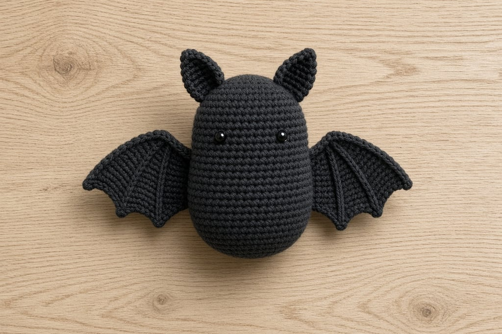
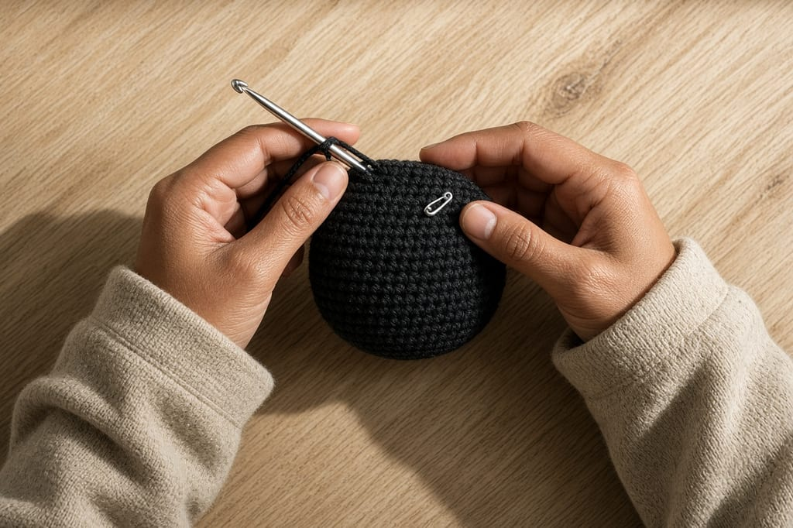
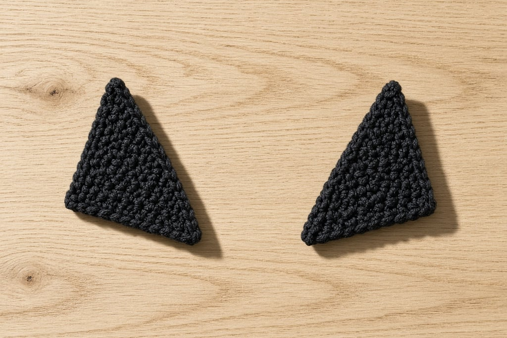
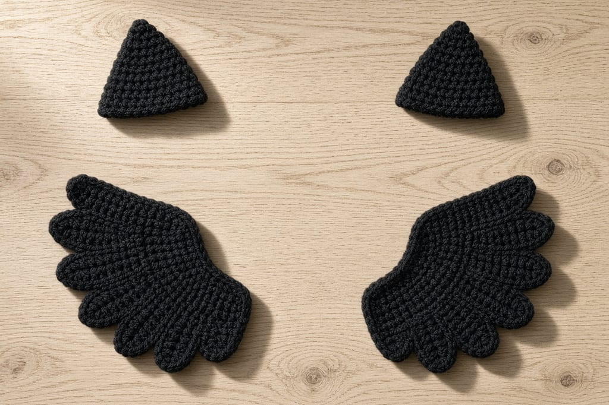
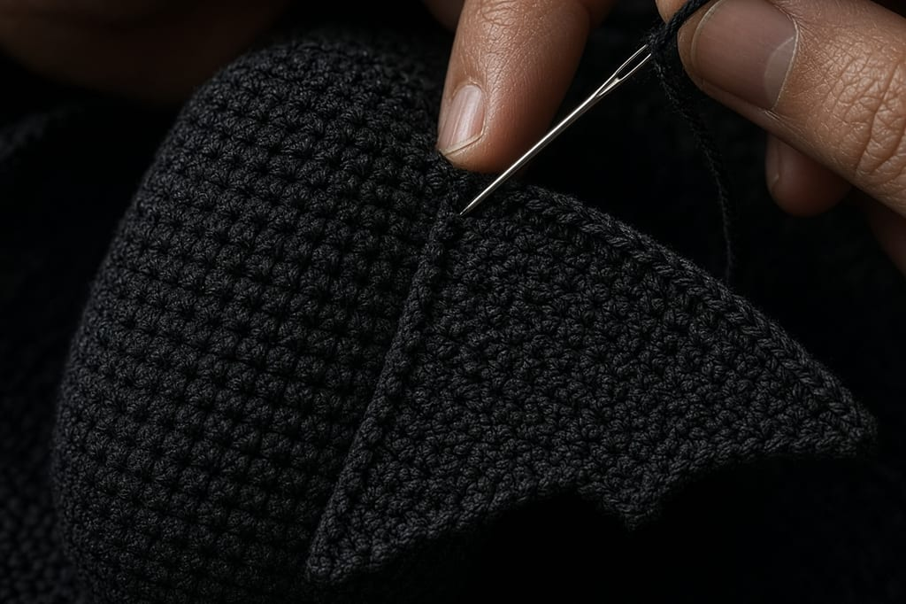
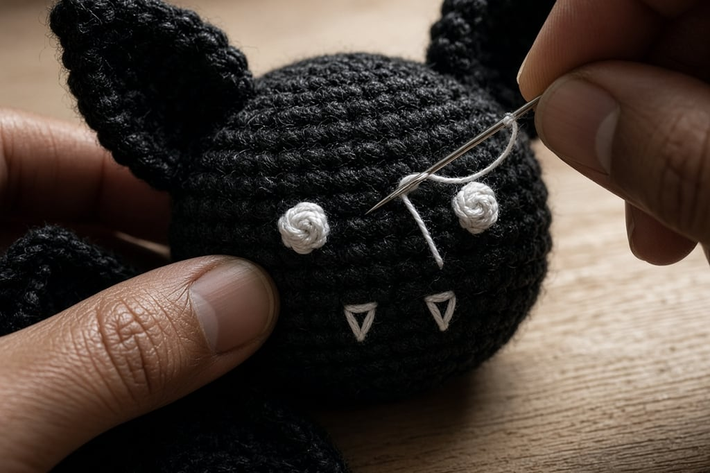

Bats look complicated because of the wings. The body is a small oval and the ears are tiny triangles. The hard part is making a left wing and a right wing that are mirror images of each other, and sewing them on level so the bat does not look like it is shrugging.

The mirror problem has a simple answer, and it is the lesson of this page. You do not write a separate pattern for the left wing. You make two identical wings and turn one over. Single crochet looks almost the same on both sides, so the flipped wing reads as the opposite hand. The same trick works for any lopsided flat piece: a leaf, a foot, a pair of ears.

You should be comfortable [working in the round](/crochet-in-the-round/) and sewing pieces with a yarn needle. US terms. [Abbreviations](/crochet-abbreviations-chart/). The pictures are illustrations of the finished bat, which has not been made up in yarn here, so its size depends on your yarn and hook.

## What you need

- **Dark worsted-weight yarn**: black, charcoal, or deep purple. A scrap of white for fangs if you want them. [Yarn weights](/yarn-weight-chart/).
- **A hook one or two sizes smaller than the label**, so stuffing does not show through. [Hook chart](/crochet-hook-size-conversion-chart/).
- Stuffing, a yarn needle, a stitch marker, pins.

Dark yarn makes stitches hard to see. Work in good light, and count every round and row out loud.

## Step 1: the body

A short oval: the same increase, even, decrease shape as the [pumpkin](/how-to-crochet-a-pumpkin-step-by-step/), with fewer increases and more even rounds, so it is taller than it is wide.

**Round 1:** 6 sc in a magic ring. (6)

<figure class="diagram">

<figcaption>Round 1 starts in a magic ring, pulled tight so the top has no hole.</figcaption>
</figure>

**Round 2:** 2 sc in each stitch. (12)

**Round 3:** (Sc, 2 sc in next) 6 times. (18)

**Rounds 4–8:** Sc in each stitch. (18)

**Round 9:** (Sc, sc2tog) 6 times. (12)

<figure class="diagram">

<figcaption>Through the front loops only, the decrease disappears into the fabric.</figcaption>
</figure>

Stuff firmly. A soft body lets the wings drag it out of shape.

**Round 10:** Sc2tog 6 times. (6) Fasten off and pull closed.

For a longer bat, add even rounds. For a stubbier one, remove them. The rest of the pattern does not change.

## Step 2: two ears

Worked flat. Make two.

**Row 1:** Ch 2. 2 sc in the 2nd chain from the hook. Turn. (2)

**Row 2:** Ch 1, sc, 2 sc in last stitch. Turn. (3)

**Row 3:** Ch 1, sc 2, 2 sc in last stitch. Turn. (4)

**Row 4:** Ch 1, sc 4. Fasten off with a long tail.

Because each row turns, the increase at the end of a row falls on alternate sides. The ear widens on both edges, so the two ears match without flipping.

## Step 3: two wings

Worked flat. Make two, exactly the same.

**Row 1:** Ch 5. Sc in the 2nd chain from the hook and each chain across. Turn. (4)

**Row 2:** Ch 1, sc 3, 2 sc in last stitch. Turn. (5)

**Row 3:** Ch 1, 2 sc in first stitch, sc 4. Turn. (6)

**Row 4:** Ch 1, sc 5, 2 sc in last stitch. Turn. (7)

**Row 5:** Ch 1, sc 7. Do not fasten off.

**Scallops:** Turn. Sl st in the first stitch. (Ch 3, skip 1, sl st in next) 3 times. Fasten off with a long tail.

The increases alternate between the end and the start of a row on purpose. Because the work turns, the end of row 2 and the start of row 3 sit on the same edge. All three increases land on one side, so that edge slants and the other stays straight. The scallops use all 7 stitches: 1 + 3 × 2 = 7.

<figure class="diagram">

<figcaption>Two identical wings. Turn one over, and the pair mirrors.</figcaption>
</figure>

## Step 4: make the pair mirror

<figure class="diagram">

<figcaption>Diagram. One wing is flipped.</figcaption>
</figure>

Lay both wings flat, scallops at the bottom. Their straight edges point the same way. Turn one wing over, front to back. Now one straight edge faces left and the other faces right. Those straight edges go against the body.

Before sewing, lay the two wings on top of each other with the straight edges together. If one is larger, a row or an increase is missing. Redo it. Stretching the smaller wing to match makes it pucker.

## Step 5: assemble

1. **Ears.** Pin both to the top of the body, slightly toward the front, a little apart. Pinch the base of each a little as you sew so it cups forward. Pin both before sewing either one, so you can check they are level.
2. **Wings.** Pin the straight edge of each wing to a side of the body, starting about two rounds below the top, scallops pointing down. Check from the front that they sit at the same height.
3. **Sew.** Whipstitch along the full straight edge through the wing and into the body. Add a second pass at the top of the edge, where the weight pulls.

## Step 6: the face

Two French knots for eyes, in a color that shows against dark yarn, and a small V of white for fangs. Less is better on a small face.

## Finish the body before attaching the wings

After round 10, cut a sewing tail, thread it through the six remaining front loops, pull closed, and secure it before hiding the tail. For the ears, the two-stitch end is the tip and the four-stitch last row is the base: sew row 4 to the body, leaving row 1 pointing upward. Mark the front center with a scrap strand. Pin one ear on each side of it and mirror the wing seams from the same body round. The straight five-row wing edge is the attachment edge; the seven-stitch scalloped edge points downward. Remove every pin before finishing.

## Troubleshooting

**Both wings slant the same way.** The second one was not turned over.

**One wing is bigger.** A missing increase or row. Count against the list.

**The wings droop.** Sewn only at one point. Sew the whole edge and reinforce the top.

**Ears sit on the sides.** They belong inside the width of the top, not around its widest part.

**The bat tips forward.** The stuffing is uneven. Stuff the lower half as firmly as the top.

## Frequently asked

### Can I crochet the wings in the round?

You can, but flat wings sew on more cleanly at this size.

### What if I only have chunky yarn?

The same counts make a larger bat with a larger hook. Keep the proportions by changing nothing else.

### How do I make a bat garland?

Make several, leave a long tail at the top of each body, and tie them along a cord.

### What should I make next?

A larger ghost with a skirt is the [ghost amigurumi](/crochet-ghost-amigurumi-for-beginners/). The [spider and web](/how-to-crochet-a-spider-and-web/) uses the same small stuffed body with legs.
