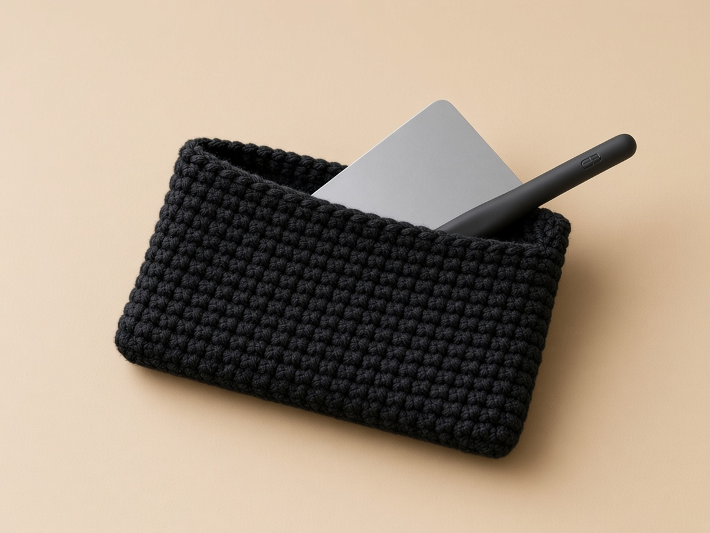
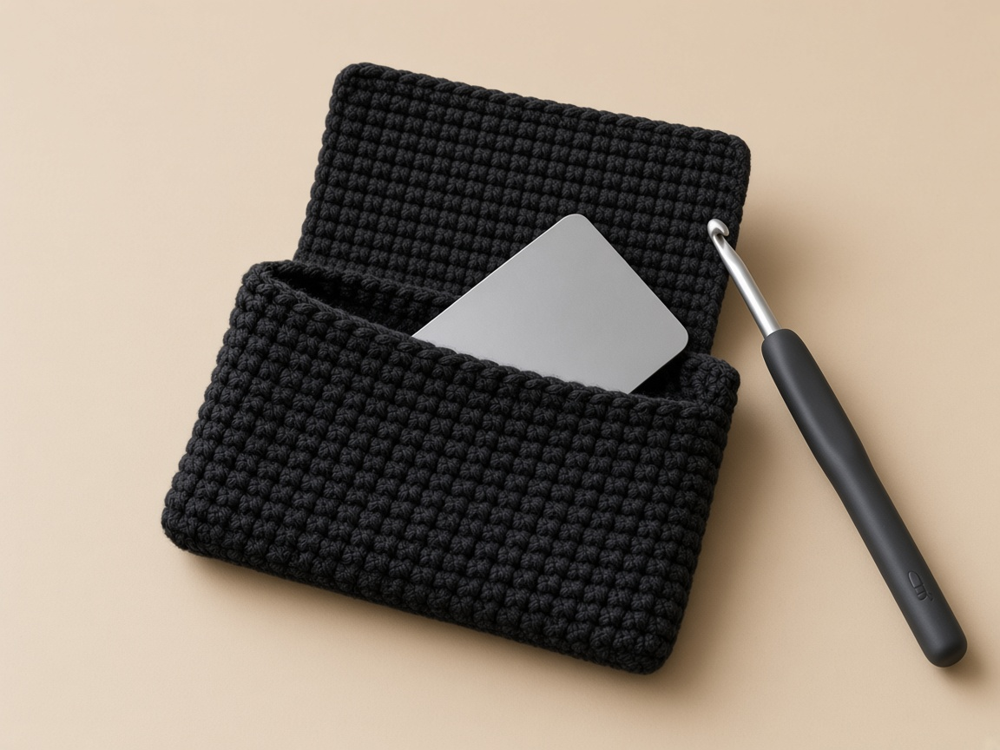
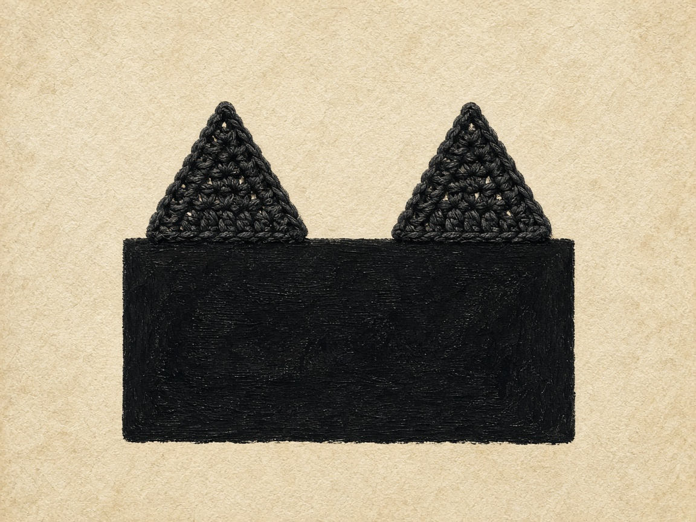
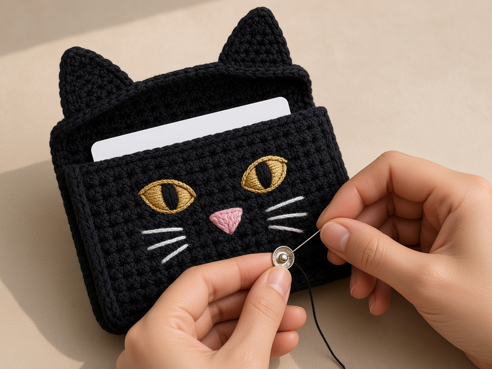
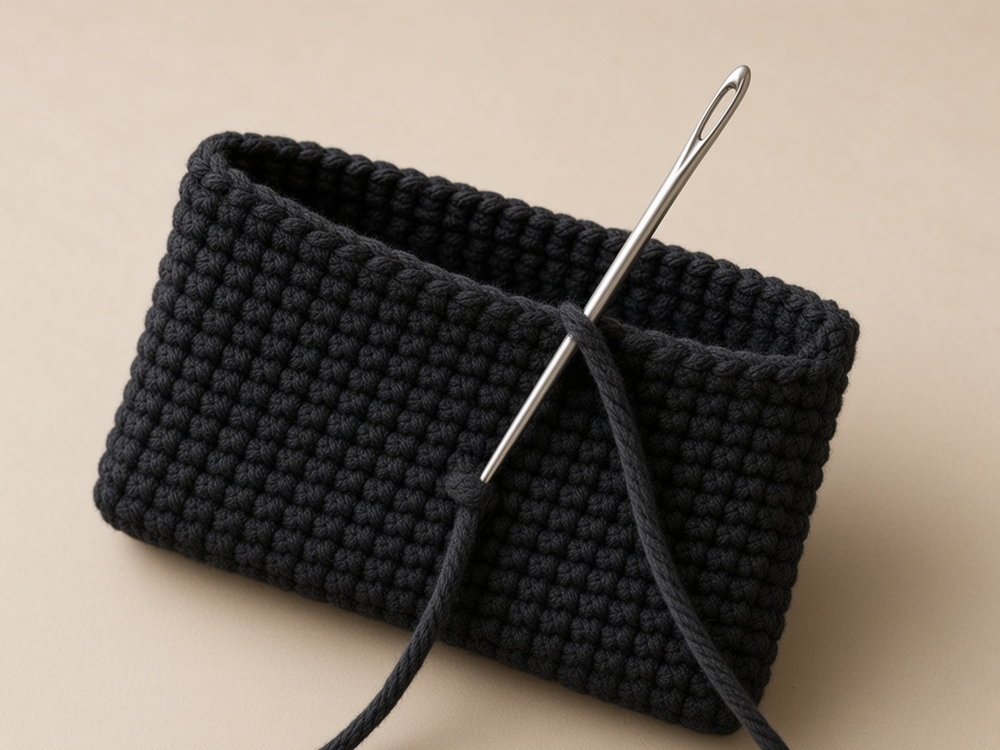

A black cat is the Halloween wallet people recognize from across the room, and this one is built so the pocket has no side seams at all. You work around both sides of a starting chain, which turns the chain into the bottom fold. Then a flap grows from the back half, two small triangles become ears on the fold, and a snap keeps it shut.

This page is one of five patterns in the [Halloween crochet wallet collection](/halloween-crochet-wallets/). The skill it teaches is working into both sides of a foundation chain, which is also how many pencil cases and amigurumi bodies start.

The finished size and card fit here are worked out from the example gauge rather than measured from a finished wallet, so make a quick gauge swatch and slip a real bank card in at round 10 to check the fit. A standard US bank card is 3.370 by 2.125 inches, the ISO/IEC 7810 ID-1 size.

## Materials

- **Worsted weight (CYC 4) yarn**, black. Cotton or a cotton blend holds a pocket's shape better than soft acrylic, but acrylic works. See the [yarn weight chart](/yarn-weight-chart/).
- **Scraps** of gold or yellow for the eyes, pink for the nose, and white or light gray for the whiskers. Worsted or a thinner yarn both work for embroidery.
- **US G/6 (4.0 mm) hook**, or whichever size gives the gauge below. That is smaller than most worsted ball bands suggest, on purpose. A wallet needs firm fabric. [Hook size chart](/crochet-hook-size-conversion-chart/).
- **One sew-on snap**, 3/8 in (10 mm), and black sewing thread.
- Tapestry needle, scissors, stitch marker, and one card to test the fit.

**How much yarn.** Not weighed from a made wallet. The wallet is about 27 square inches of fabric. Make your gauge swatch, measure it, and weigh it. A 4 by 4 inch swatch is 16 square inches, so the wallet uses about 1.7 times its weight. Add 20 percent for seams and tails. The scrap colors use a yard or two each.

## Abbreviations and stitches

US terms. US single crochet is UK double crochet. Full list in the [abbreviations chart](/crochet-abbreviations-chart/).

| Abbreviation | Meaning |
| --- | --- |
| ch | chain |
| sc | single crochet |
| sl st | slip stitch |
| sc2tog | single crochet two together: pull up a loop in each of 2 stitches, yarn over, pull through all 3 loops. One stitch fewer. |
| sc3tog | single crochet three together: the same with 3 stitches. Two stitches fewer. |
| rnd | round |
| st(s) | stitch(es) |

**Working the other side of a chain.** After the last stitch along the top of the chain, rotate the work so the chain's underside faces up. Each chain has a single free loop there. Insert the hook under that loop for each stitch. See [basic stitches](/basic-crochet-stitches/) if single crochet is new.

**Joined rounds.** At the end of each round, slip stitch into the first single crochet. Chain 1, which does not count as a stitch, and make the first single crochet of the next round in the same stitch as the join. Do not turn.

## Size and gauge

**Gauge:** 16 sc and 20 rows (or rounds) = 4 in in single crochet. Make a swatch about 5 inches square and measure the middle, as in the [gauge guide](/crochet-gauge/).

The pocket is a flat tube 16 stitches across each side. At 4 stitches to the inch, that is 4.0 inches wide outside. The two side folds take a little, so the inside is about 3.8 inches. An ID-1 card is 3.37 inches wide, which leaves about 0.4 inch of ease for a few cards. Twelve rounds at 5 to the inch make 2.4 inches outside, about 2.3 inside, so a 2.125 inch card sits just below the rim.

If 16 stitches measure less than 3.75 inches, the card will be tight. Go up a hook size, or chain 18 so each side has 17 stitches. All flap counts then go up by 1 (17, 15, 13), and the face and ear placements must be recentered on the new flap width. Do not copy the 16-stitch placement chart onto a wider flap.

## The pattern

### Step 1: stitches on both sides of one chain

<figure class="diagram">

<figcaption>Diagram. Both sides of the chain make round 1. The chain becomes the bottom fold.</figcaption>
</figure>

Use black.

1. Chain 17. Do not count the loop on the hook.
2. Skip the chain nearest the hook. Single crochet in the second chain, then in every chain across the top. Count 16. Stop. Do not fasten off.
3. Rotate the chain so the underside faces you. Each chain has one free loop on that underside.
4. The first underside stitch goes into the same chain as the last stitch on top. That shared chain is the one next to the slip knot, not the chain you skipped beside the hook.
5. Single crochet in the free loop of every chain back to the start. Count 16 on this side.
6. Slip stitch into the first single crochet of the round.
7. Count the whole round: 16 + 16 = 32. Thirty-one means the first underside stitch skipped a chain. Thirty-three means the skipped chain next to the hook was worked.

<figure class="diagram">

<figcaption>The turn at the end of the chain. The last sc on top and the first sc underneath share one chain.</figcaption>
</figure>

### Step 2: twelve rounds, counted every time

<figure class="diagram">

<figcaption>Diagram. Do not turn. Count 32, and test a card at round 10.</figcaption>
</figure>

Do this for round 2, then the same list for rounds 3 through 12. Do not turn.

1. Chain 1. It does not count as a stitch.
2. Single crochet in the same stitch as the slip stitch join.
3. Single crochet in every stitch around until you are back at the start.
4. Slip stitch into the first single crochet.
5. Count 32. Move a marker up into the first stitch so you can see where the round started.

At the end of round 10, stop and test. Flatten the tube with the join at one side fold. Slide a card in. It should lie flat with a little room at each side. Too tight: start over on a larger hook. Too loose: a smaller hook. Do not fasten off after round 12.

### Step 3: mark 16 stitches for the flap

<figure class="diagram">

<figcaption>Diagram. The flap is worked in rows over half of round 12. Decrease at both ends of rows 8 and 9.</figcaption>
</figure>

1. Flatten the pocket without pulling it. The two side folds should each have 16 rim stitches between them.
2. Put a marker in each side fold.
3. Choose one face as the back. The flap grows from those 16 stitches. The other face stays unworked.
4. If the round's join is not sitting on a side fold, fasten off and rejoin the yarn in the first marked back stitch. If the join is already on the fold, keep going.

**Row 1.** Chain 1. It does not count. Single crochet in the same stitch as the join, then in the next 15 stitches. Turn. Count 16.

**Rows 2 through 7.** Each row: chain 1, single crochet in every stitch, turn, count 16.

**Row 8.** Chain 1. Decrease over the first 2 stitches. Single crochet in the next 12. Decrease over the last 2. Turn. Count 14. The math is 2 + 12 + 2 = 16 stitches used from the row below.

**Row 9.** Chain 1. Decrease, single crochet in the next 10, decrease. Count 12. That uses 2 + 10 + 2 = 14.

Fasten off and leave a tail about 6 inches long. Fold the flap over the opening. At the example gauge it covers about 1.6 inches of the front and leaves the bottom third showing.

### Step 4: two ears, three rows each

<figure class="diagram">

<figcaption>Diagram. 1 + 5 + 4 + 5 + 1 = 16, so the ears sit symmetrically.</figcaption>
</figure>

Make 2 in black. Leave a tail about 10 inches long at the start of each, for sewing.

1. Chain 6. Single crochet in the second chain from the hook and in each chain across. Turn. Count 5.
2. Chain 1. Decrease, 1 single crochet in the middle stitch, decrease. Turn. Count 3.
3. Chain 1. Pull up a loop in each of the 3 stitches, yarn over, pull through all four loops. One stitch remains.
4. Fasten off.

At the example gauge each ear is about 1.25 inches across the base and 0.6 inch tall.

### Step 5: close the flap, then embroider

<figure class="diagram">

<figcaption>Diagram. Count stitches and rows on the flap before the first stitch of embroidery.</figcaption>
</figure>

1. Close the flap before the first embroidery stitch. Row 1 is now at the top fold. Rows 8 and 9, the narrower ones, are at the bottom of the flap. If you stitch with the flap standing up, the face comes out upside down.
2. Count across the closed flap from the same edge every time. Rows 1 through 7 have 16 stitches. Row 8 has 14, so its middle is not the same stitch number as row 1.

**Eyes.** With gold, on rows 3 and 4, over stitches 4 and 5, lay down 4 or 5 straight stitches side by side until they read as one oval. Repeat over stitches 12 and 13.

**Pupils.** With black, one vertical straight stitch down the middle of each gold oval, from the top of row 3 to the bottom of row 4.

**Nose.** With pink, on rows 5 and 6, between stitches 8 and 9, make 3 or 4 stitches that start at one bottom point and fan upward. The point faces down.

**Whiskers.** With white, three straight stitches on each side of the nose. Fan them across rows 5 to 7, out to about stitch 2 on one side and stitch 15 on the other. Keep each whisker shorter than half an inch so it does not snag. Tack each whisker at its middle with one tiny stitch laid across it.

Every stitch goes through the flap only. On the underside, keep the threads short and do not knot them. That underside rubs the front of the wallet every time it opens.

## Assembly and finishing

### Step 6: ears on the fold

<figure class="diagram">

<figcaption>Diagram. The two ears and the gap between them use all 16 fold stitches.</figcaption>
</figure>

1. Hold an ear upright. Its row-1 edge, the 5-stitch base, lies along the top fold where the flap meets the back.
2. Count the fold: skip 1 stitch, place an ear over the next 5, leave a gap of 4, place the second ear over the next 5, leave 1 stitch. That is 1 + 5 + 4 + 5 + 1 = 16.
3. Tack both ears with a scrap of thread and open the flap all the way. The bases must not bridge across the opening.
4. Whipstitch each base through both loops of the fold, then go back along the base a second time.

### Step 7: the snap

<figure class="diagram">

<figcaption>Diagram. Mark with a card in the pocket, then sew the front wall only.</figcaption>
</figure>

1. Put a card in. Close the flap and lay the wallet flat.
2. Mark the front with a clip or a loop of spare thread at the center of flap row 8. Do not push a pin toward your hand.
3. On the underside of the flap, row 8 has 14 stitches. The middle is local stitches 7 and 8. Sew the ball half of the snap there.
4. Sew the socket to the outside of the front at your mark. At the example gauge that is near round 5. Use your mark.
5. Doubled black thread, 4 or 5 passes through each hole. Do not sew through into the inside of the pocket.
6. Open and close the flap a few times before you bury the thread tails.

### Step 8: tails

<figure class="diagram">

<figcaption>Diagram. Weave inside the tube, then turn the tail once.</figcaption>
</figure>

Weave the tails inside the tube along a fold, then change direction once, as in [weaving in ends](/weaving-in-ends-and-blocking/).

<figure class="diagram">

<figcaption>Diagram. The card fits on paper with a little room. Your gauge decides whether it fits in yarn.</figcaption>
</figure>

## Make it yours

- **Wider or deeper.** One more chain adds one stitch to each side, about 0.25 inch of width. Each extra round adds about 0.2 inch of depth. Change the flap counts by the same number of stitches.
- **Eye color.** Green or amber eyes read as cat just as well. Avoid white eyes on black; they read as a ghost.
- **A gray or orange cat.** Black embroidery for pupils, a darker nose, and the same counts.
- **Lining.** A fabric lining takes up the ease the card needs. Chain 19 instead of 17, then hand-sew a fabric tube inside with the raw edge folded under at the rim.
- **Reinforcement.** Sew a small felt circle behind the socket half of the snap on the inside of the front, so the snap pulls on felt rather than on two stitches.

## Check the flap and closures before sewing

Number embroidery positions across the closed flap, from the same physical edge each time. Rows 1–7 are 16 stitches, row 8 is 14 and row 9 is 12: the narrowed rows have different local center numbers. Temporarily tack the ears to the back-fold edge, open the flap fully, and check that the ear bases do not bridge the opening. Place the loaded wallet on the table to mark the snap; use a clip or removable thread marker instead of pushing a pin toward your hand. Open and close it several times before securing sewing tails. Wider versions need recentered decoration and a new closure mark.

## Common mistakes and fixes

**Round 1 has 31 or 33 stitches.** The skipped chain was worked, or the first chain on the other side was skipped. The first single crochet on the underside goes into the same chain as the last one on top.

**The join leans.** A slight lean can occur even with correct joined-round counts. Count 32 stitches, exclude the joining slip stitch and ch 1, and work the first sc into the same stitch as the join. Set the flap position from the actual side folds, not from a seam that has drifted.

**The flap is off center.** Row 1 started in the wrong place. The flap should start right at the marked side fold. Rejoin there if the round join has drifted.

**The face is upside down.** It was embroidered with the flap standing up. Pick it out and work with the flap closed.

**The ears flop.** Loose fabric. Make the ears on a hook one size smaller, and sew the base twice. A drop of fabric stiffener inside the ear is an option, but test it on a swatch.

**The snap will not meet.** The flap was closed loosely when you marked it. Mark with a card inside the wallet.

## Care

Empty the wallet. Hand wash in cool water and dry flat. Gold and white yarn next to black can pick up dye in the first wash, so test a scrap of the black first if it is a new yarn: wet it, press it in a white paper towel, and look for color.

## Frequently asked

**Will a bank card fit?** On paper, yes: the inside is about 3.8 by 2.3 inches against a 3.37 by 2.125 inch card, so test with a real card at round 10 to be sure.

**How many cards?** It depends on your gauge and the cards. No card-stack capacity has been measured. Test your intended stack before placing the snap; a thicker stack needs additional width and flap reach.

**Can it carry coins?** It is not designed for loose coins. The flap covers the opening but the corners are open, and a snap pops under weight.

**Can I use safety eyes?** Their backs press into the pocket and catch cards. Embroidery lies flat.

**Is it left-handed friendly?** Yes. The rounds travel the other way, but the counts and placement do not change. See [left-handed crochet](/left-handed-crochet/).

**Can I sell what I make?** Yes, the finished wallets. Please link to this page rather than reposting the pattern.

## More Halloween wallets

Each wallet in the set teaches a different construction:

- [Ghost crochet wallet](/ghost-crochet-wallet/): two shaped panels and a scalloped hem
- [Pumpkin crochet wallet](/pumpkin-crochet-wallet/): sideways back-loop ribbing and a leaf tab
- [Witch hat crochet wallet](/witch-hat-crochet-wallet/): an inner divider and a worked buttonhole
- [Spiderweb crochet wallet](/spiderweb-crochet-wallet/): a pointed flap and an embroidered web

To size a flap wallet for any card stack, see the [Halloween card wallet](/halloween-crochet-card-wallet/). Decreases are explained in [increases and decreases](/crochet-increase-decrease/).

The cat wallet comes down to one round worked around both sides of a chain. Count 32 at the end of every round, test the card at round 10, and embroider with the flap closed.
