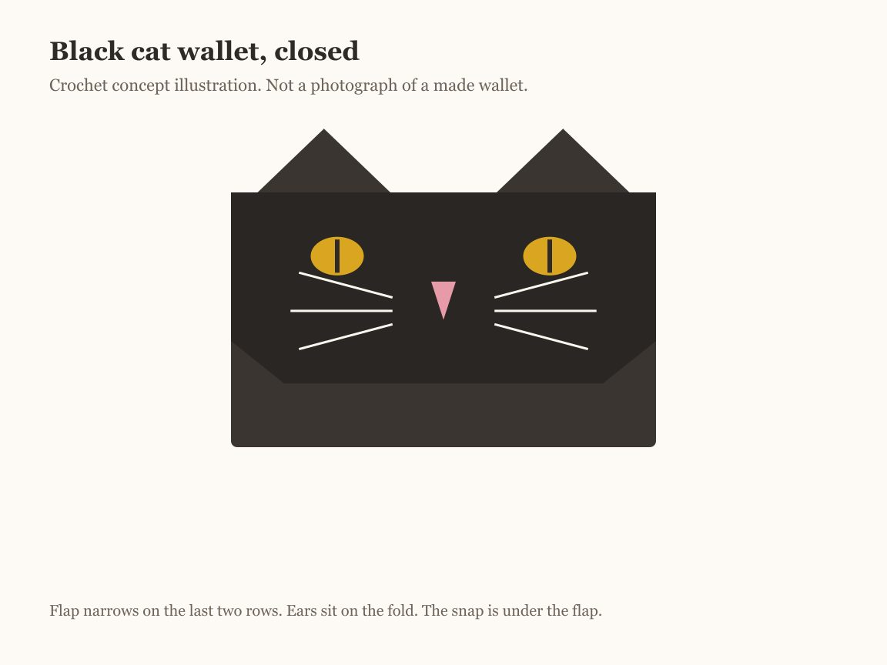
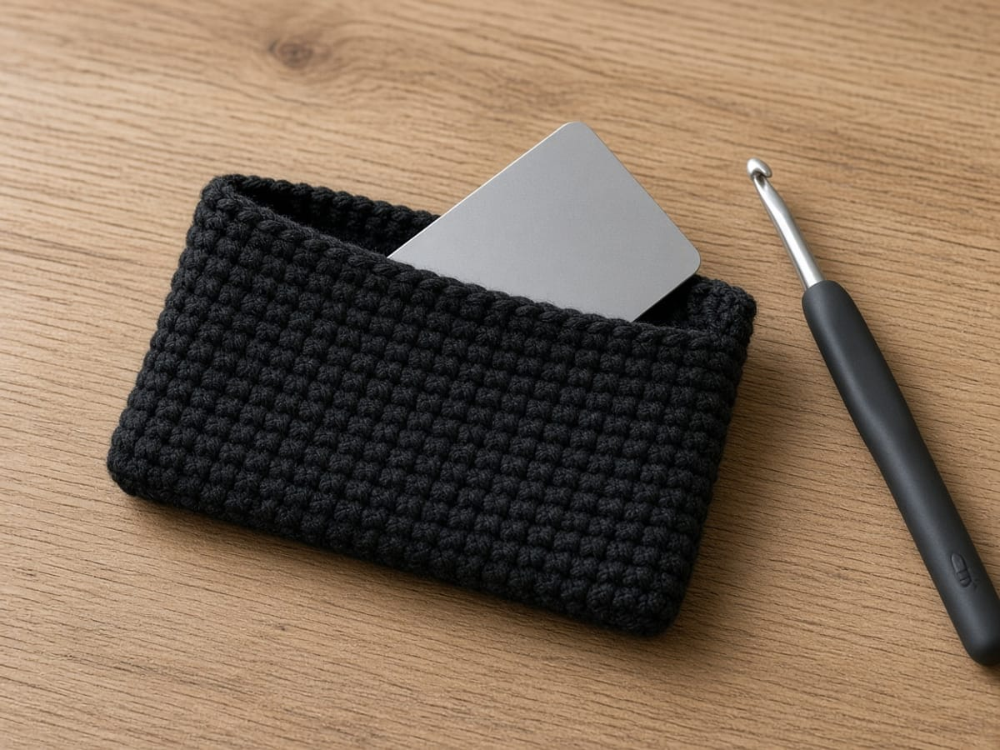
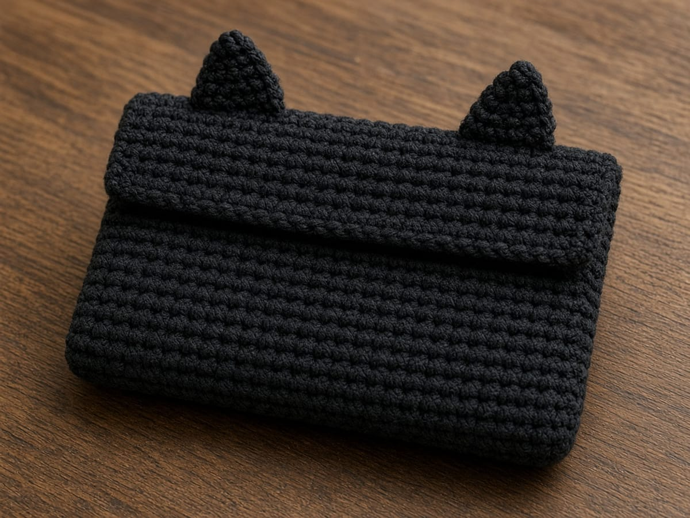
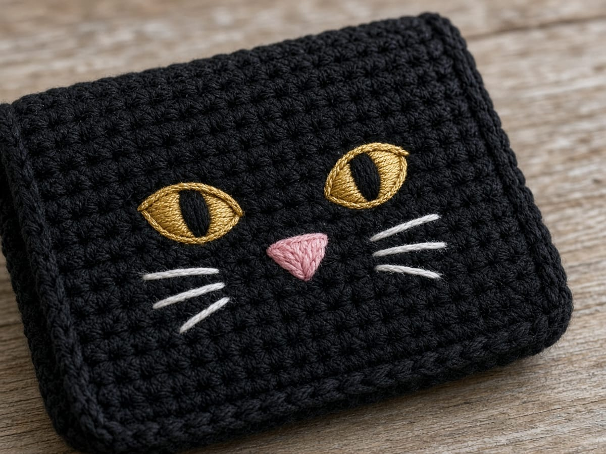

A black cat is the Halloween wallet people recognize from across the room, and this one is built so the pocket has no side seams at all. You work around both sides of a starting chain, which turns the chain into the bottom fold. Then a flap grows from the back half, two small triangles become ears on the fold, and a snap keeps it shut.

This page is one of five patterns in the [Halloween crochet wallet collection](/halloween-crochet-wallets/). The skill it teaches is working into both sides of a foundation chain, which is also how many pencil cases and amigurumi bodies start.

The finished size and card fit here are worked out from the example gauge rather than measured from a finished wallet, so make a quick gauge swatch and slip a real bank card in at round 10 to check the fit. A standard US bank card is 3.370 by 2.125 inches, the ISO/IEC 7810 ID-1 size. The picture is a concept illustration of the design.

## Materials

- **Worsted weight (CYC 4) yarn**, black. Cotton or a cotton blend holds a pocket's shape better than soft acrylic, but acrylic works. See the [yarn weight chart](/yarn-weight-chart/).
- **Scraps** of gold or yellow for the eyes, pink for the nose, and white or light gray for the whiskers. Worsted or a thinner yarn both work for embroidery.
- **US G/6 (4.0 mm) hook**, or whichever size gives the gauge below. That is smaller than most worsted ball bands suggest, on purpose. A wallet needs firm fabric. [Hook size chart](/crochet-hook-size-conversion-chart/).
- **One sew-on snap**, 3/8 in (10 mm), and black sewing thread.
- Tapestry needle, scissors, stitch marker, and one card to test the fit.

**How much yarn.** Not weighed from a made wallet. The wallet is about 27 square inches of fabric. Make your gauge swatch, measure it, and weigh it. A 4 by 4 inch swatch is 16 square inches, so the wallet uses about 1.7 times its weight. Add 20 percent for seams and tails. The scrap colors use a yard or two each.

## Abbreviations and stitches

US terms. US single crochet is UK double crochet. Full list in the [abbreviations chart](/crochet-abbreviations-chart/).

| Abbreviation | Meaning |
| --- | --- |
| ch | chain |
| sc | single crochet |
| sl st | slip stitch |
| sc2tog | single crochet two together: pull up a loop in each of 2 stitches, yarn over, pull through all 3 loops. One stitch fewer. |
| sc3tog | single crochet three together: the same with 3 stitches. Two stitches fewer. |
| rnd | round |
| st(s) | stitch(es) |

**Working the other side of a chain.** After the last stitch along the top of the chain, rotate the work so the chain's underside faces up. Each chain has a single free loop there. Insert the hook under that loop for each stitch. See [basic stitches](/basic-crochet-stitches/) if single crochet is new.

**Joined rounds.** At the end of each round, slip stitch into the first single crochet. Chain 1, which does not count as a stitch, and make the first single crochet of the next round in the same stitch as the join. Do not turn.

## Size and gauge

**Gauge:** 16 sc and 20 rows (or rounds) = 4 in in single crochet. Make a swatch about 5 inches square and measure the middle, as in the [gauge guide](/crochet-gauge/).

The pocket is a flat tube 16 stitches across each side. At 4 stitches to the inch, that is 4.0 inches wide outside. The two side folds take a little, so the inside is about 3.8 inches. An ID-1 card is 3.37 inches wide, which leaves about 0.4 inch of ease for a few cards. Twelve rounds at 5 to the inch make 2.4 inches outside, about 2.3 inside, so a 2.125 inch card sits just below the rim.

If 16 stitches measure less than 3.75 inches, the card will be tight. Go up a hook size, or chain 18 so each side has 17 stitches. All flap counts then go up by 1 (17, 15, 13), and the ears move out by half a stitch.

## The pattern

### Stage 1: the seamless pocket

<figure class="diagram">

<figcaption>Diagram. Both sides of the chain make round 1. The chain becomes the bottom fold.</figcaption>
</figure>

With black:

**Rnd 1:** Ch 17. Sc in the 2nd ch from the hook and in each ch across. (16 sc) Rotate the work. Sc in the free loop on the other side of each ch across, starting in the same ch as the last stitch. (16 sc) Join with a sl st to the first sc. (32)

<figure class="diagram">

<figcaption>The turn at the end of the chain. The last sc on top and the first sc underneath share one chain.</figcaption>
</figure>

**Rnds 2–12:** Ch 1 (does not count), sc in the same st as the join and in each st around. Join with a sl st to the first sc. (32)

Place a marker in the first stitch of round 2 and move it up each round. Count at the end of every round. If you have 31 or 33, the error is almost always at one of the two ends of the chain.

**Test the card at round 10.** Flatten the tube with the join at one side fold and slide a card in. It should go in flat with a little room at each side. Too tight: start again on a larger hook. Too loose: a smaller one.

Do not fasten off.

### Stage 2: the flap

<figure class="diagram">

<figcaption>Diagram. The flap is worked in rows over half of round 12. Decrease at both ends of rows 8 and 9.</figcaption>
</figure>

The join of round 12 sits at a side fold. The 16 stitches after it are the back. The other 16 are the front and stay unworked.

**Row 1:** Ch 1 (does not count), sc in the same st as the join and in the next 15 sts. Turn. (16)

**Rows 2–7:** Ch 1, sc in each st across. Turn. (16)

**Row 8:** Ch 1, sc2tog, sc in the next 12 sts, sc2tog. Turn. (14)

**Row 9:** Ch 1, sc2tog, sc in the next 10 sts, sc2tog. (12)

Fasten off and leave a 6 inch tail. Each decrease row uses the whole row below: 2 + 12 + 2 = 16, then 2 + 10 + 2 = 14.

Fold the flap over the opening. It should cover the front from the rim down about 1.6 inches, leaving roughly the bottom third of the front showing.

### Stage 3: the ears

<figure class="diagram">

<figcaption>Diagram. 1 + 5 + 4 + 5 + 1 = 16, so the ears sit symmetrically.</figcaption>
</figure>

Make 2, in black, leaving a 10 inch tail at the start of each.

**Row 1:** Ch 6. Sc in the 2nd ch from the hook and in each ch across. Turn. (5)

**Row 2:** Ch 1, sc2tog, sc in the next st, sc2tog. Turn. (3)

**Row 3:** Ch 1, sc3tog. (1)

Fasten off. Each ear is about 1.25 inches across the base and 0.6 inch tall.

### Stage 4: the face

<figure class="diagram">

<figcaption>Diagram. Count stitches and rows on the flap before the first stitch of embroidery.</figcaption>
</figure>

Close the flap first. Row 1 is now at the top fold. If you embroider with the flap standing up, the face ends up upside down.

1. **Eyes.** With gold, fill an oval over stitches 4 and 5 on rows 3 and 4 with four or five close straight stitches, side by side. Repeat over stitches 12 and 13.
2. **Pupils.** With black, one vertical straight stitch down the middle of each eye, from the top of row 3 to the bottom of row 4.
3. **Nose.** With pink, a small triangle pointing down, centered between stitches 8 and 9 on rows 5 and 6. Three or four stitches that fan from one bottom point.
4. **Whiskers.** With white, three straight stitches on each side of the nose, fanning outward across rows 5 to 7 to about stitch 2 and stitch 15. Whiskers longer than half an inch snag. Tack each one down at its middle with a tiny stitch over it.

Work through the flap only, and keep the stitches on the back short. The underside of the flap rubs against the front of the wallet every time it opens.

## Assembly and finishing

1. **Ears.** Hold each ear upright with its row 1 edge along the top fold, where the flap meets the back. Place them as the diagram shows: 1 stitch in from each side, 4 stitches apart. Whipstitch the base to the fold through both loops, then go back along the base a second time.
2. **Snap.** Close the flap and push a pin through to the front at the center of row 8. Sew the ball half of the snap to the underside of the flap at row 8, between stitches 8 and 9. Sew the socket half to the outside of the front at the pin, which is usually near round 5. Use black thread doubled, four or five passes through each hole, and do not go through to the inside of the pocket.
3. **Ends.** Weave the tails inside the tube along a fold, changing direction once, as in [weaving in ends](/weaving-in-ends-and-blocking/).

<figure class="diagram">

<figcaption>Diagram. The card fits on paper with a little room. Your gauge decides whether it fits in yarn.</figcaption>
</figure>

## Make it yours

- **Wider or deeper.** One more chain adds one stitch to each side, about 0.25 inch of width. Each extra round adds about 0.2 inch of depth. Change the flap counts by the same number of stitches.
- **Eye color.** Green or amber eyes read as cat just as well. Avoid white eyes on black; they read as a ghost.
- **A gray or orange cat.** Black embroidery for pupils, a darker nose, and the same counts.
- **Lining.** A fabric lining takes up the ease the card needs. Chain 19 instead of 17, then hand-sew a fabric tube inside with the raw edge folded under at the rim.
- **Reinforcement.** Sew a small felt circle behind the socket half of the snap on the inside of the front, so the snap pulls on felt rather than on two stitches.

## Common mistakes and fixes

**Round 1 has 31 or 33 stitches.** The skipped chain was worked, or the first chain on the other side was skipped. The first single crochet on the underside goes into the same chain as the last one on top.

**The tube spirals.** The first stitch of a round went into the stitch after the join instead of the same stitch. Work into the same stitch as the join.

**The flap is off center.** Row 1 started in the wrong place. The flap should start right at a side fold, at the join.

**The face is upside down.** It was embroidered with the flap standing up. Pick it out and work with the flap closed.

**The ears flop.** Loose fabric. Make the ears on a hook one size smaller, and sew the base twice. A drop of fabric stiffener inside the ear is an option, but test it on a swatch.

**The snap will not meet.** The flap was closed loosely when you marked it. Mark with a card inside the wallet.

## Care

Empty the wallet. Hand wash in cool water and dry flat. Gold and white yarn next to black can pick up dye in the first wash, so test a scrap of the black first if it is a new yarn: wet it, press it in a white paper towel, and look for color.

## Frequently asked

**Will a bank card fit?** On paper, yes: the inside is about 3.8 by 2.3 inches against a 3.37 by 2.125 inch card, so test with a real card at round 10 to be sure.

**How many cards?** It depends on your gauge and the cards. Three or four slim cards fit the calculated size with room to spare. A thick stack will hold the flap open.

**Can it carry coins?** It is not designed for loose coins. The flap covers the opening but the corners are open, and a snap pops under weight.

**Can I use safety eyes?** Their backs press into the pocket and catch cards. Embroidery lies flat.

**Is it left-handed friendly?** Yes. The rounds travel the other way, but the counts and placement do not change. See [left-handed crochet](/left-handed-crochet/).

**Can I sell what I make?** Yes, the finished wallets. Please link to this page rather than reposting the pattern.

## More Halloween wallets

Each wallet in the set teaches a different construction:

- [Ghost crochet wallet](/ghost-crochet-wallet/): two shaped panels and a scalloped hem
- [Pumpkin crochet wallet](/pumpkin-crochet-wallet/): sideways back-loop ribbing and a leaf tab
- [Witch hat crochet wallet](/witch-hat-crochet-wallet/): an inner divider and a worked buttonhole
- [Spiderweb crochet wallet](/spiderweb-crochet-wallet/): a pointed flap and an embroidered web

To size a flap wallet for any card stack, see the [Halloween card wallet](/halloween-crochet-card-wallet/). Decreases are explained in [increases and decreases](/crochet-increase-decrease/).

The cat wallet comes down to one round worked around both sides of a chain. Count 32 at the end of every round, test the card at round 10, and embroider with the flap closed.
