A bare phone picks up scratches in a bag, and a sleeve that was sized for a smaller phone will not take an iPhone 18 Pro Max. This page is a removable crochet sleeve in deep burgundy: one rectangle of [single crochet](/basic-crochet-stitches/), folded at the bottom, with the sides seamed. The camera stays outside the yarn. There is no hole cut for the lenses, and the sleeve is not a snap-on shell.

The picture at the top of this page is an illustration of that sleeve. It is not a photograph of a sample that was crocheted and fitted. The stitch counts later on are arithmetic from a stated example gauge. Your yarn will not match that gauge until you measure a swatch.

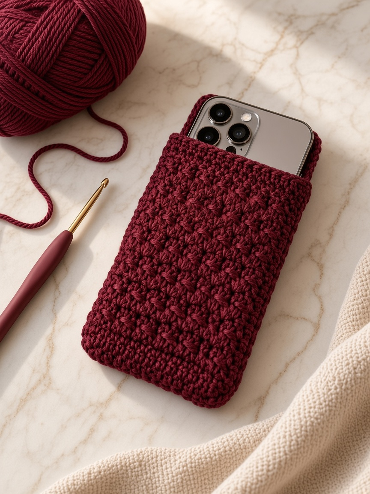

## What you are making

You are making a soft pouch. The phone slides in from the top and slides back out. The bottom is a fold, not a third seam. The two long edges are joined with a whipstitch through the outer loops, which is the same construction as the shorter [phone sleeve](/how-to-crochet-a-phone-case/) and the same idea as the [device sleeve](/how-to-crochet-a-device-case/).

A yarn sleeve can keep dust and light scratches off the back and the sides. It does not add certified impact protection, and it is not waterproof. Do not treat it as a substitute for a drop-tested case if that is what you need.

The color in the pictures is a deep wine red chosen for the yarn. Apple lists Burgundy as one of the iPhone 18 Pro Max finishes, along with Black, Silver, and Glacier, on the [iPhone 18 Pro Max tech specs](https://support.apple.com/en-us/148591). The yarn is not a color match to that finish. Any worsted yarn in a color you like will make the same sleeve.

## Skill level

You need a slip knot, a chain, and single crochet. You also need to count stitches and to sew a straight seam with a tapestry needle. If single crochet is new, read [the basic stitches](/basic-crochet-stitches/) first and make a small square before you start the sleeve.

This is a beginner project if you can keep a stitch count. The part that goes wrong is the size, not the stitch. A sleeve that is a quarter inch too narrow will not take the phone, no matter how even the fabric is.

## US terms

Every stitch name on this page is US. A US single crochet is the short stitch. In UK terms that same stitch is called a double crochet, and a UK treble is a different, taller stitch. If a pattern from another country says "dc," check which system it uses before you follow it. The abbreviations on this page match the [crochet abbreviations chart](/crochet-abbreviations-chart/).

## Materials

- Worsted-weight yarn (CYC 4) in a deep burgundy, or another color. A smooth acrylic, a wool blend, or a cotton of the same thickness all work. Cotton holds its shape a little more. Fuzzy yarn hides the stitches and makes the seam harder to see.
- A crochet hook that makes a firm fabric. Many people land near a 4.0 mm hook with worsted yarn. Use the hook that matches your swatch, not the number printed on the band, if the two disagree. Hook letters and millimeter sizes are on the [hook conversion chart](/crochet-hook-size-conversion-chart/).
- A blunt tapestry needle for the side seams and the ends.
- Two stitch markers, or two short pieces of contrasting yarn.
- A tape measure. A ruler works if it is long enough for 14 inches.
- Scissors.
- The phone you are covering, or the measurements below if you are making the sleeve as a gift and cannot hold that phone yet.
- Optional: one small button, only if you add the flap at the end.

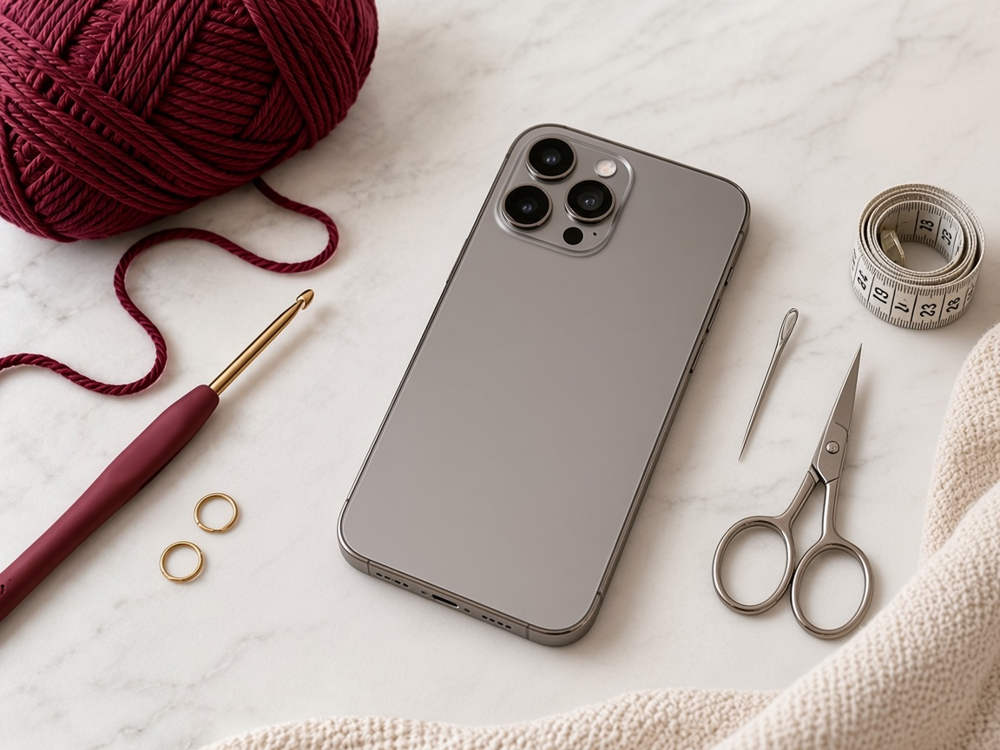

One standard ball of worsted yarn is more than the sleeve uses. There is no weighed yardage on this page, because no sample was made and weighed.

### Yarn and substitutions

The fabric should be dense enough that a key in the same pocket does not easily poke through. If you can see large holes, go down a hook size or choose a smoother, slightly firmer yarn. Very thin sock yarn makes a floppy sleeve unless you hold it double, and holding it double changes the gauge, so you would swatch again.

Super-bulky yarn makes a thick wall. The phone still has to fit inside, so a bulky yarn needs fewer stitches for the same width and a looser idea of "ease." Swatch it. Do not reuse the example stitch count from worsted yarn.

If you want a second color, change yarn at the end of a row and carry the method from [changing yarn color](/changing-yarn-color-crochet/). A stripe does not change the stitch count.

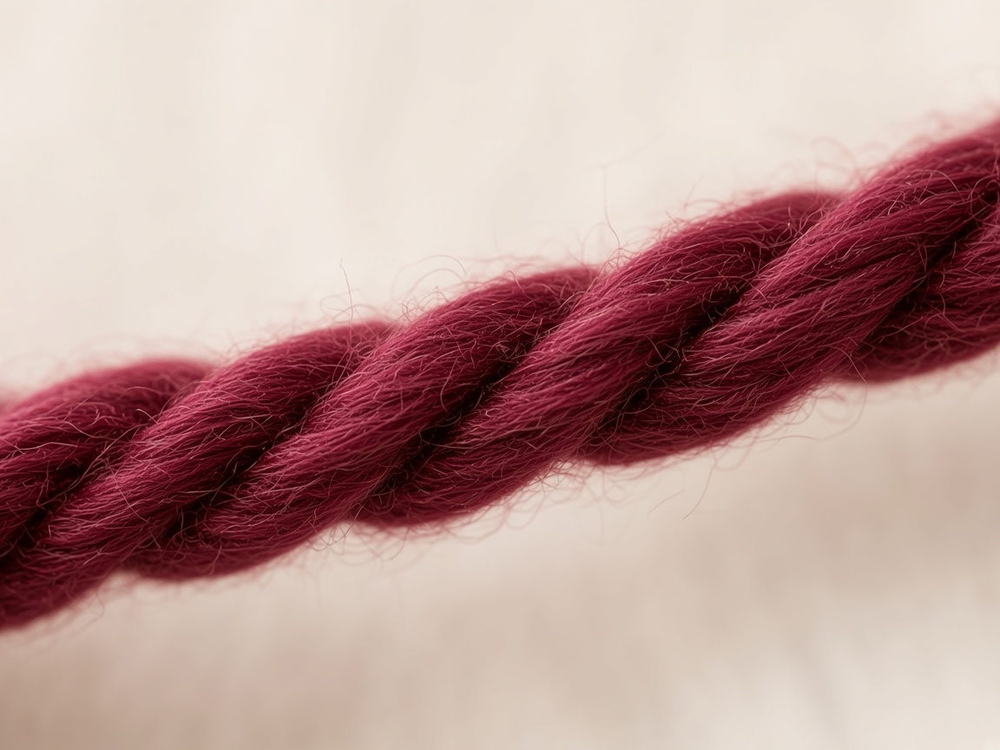

## Abbreviations

| Abbreviation | Meaning, US |
| --- | --- |
| ch | chain |
| sc | single crochet |
| sl st | slip stitch |
| st | stitch |
| sts | stitches |

The turning chain on every row of this sleeve is `ch 1`. That chain does not count as a stitch. Do not work into it on the next row.

## Phone measurements

These figures are the bare iPhone 18 Pro Max, from Apple's tech specs page linked above. They are the phone itself, not a phone already in a case.

| Measurement | Inches | Millimeters |
| --- | --- | --- |
| Width | 3.07 | 78.0 |
| Height | 6.43 | 163.4 |
| Depth | 0.34 | 8.75 |
| Weight | 8.78 oz | 249 g |

The display is a 6.9-inch diagonal. Do not size the sleeve from the diagonal. A sleeve needs width, height, and depth.

Measure the phone you actually own before you trust the table. A screen protector does not change the body. A thick case already on the phone does. If you are covering a different model, throw these numbers out and use a tape on that phone. Write down width, height, and depth in inches.

## Gauge

There is no tested gauge for this pattern. No swatch from this page was measured. The worked example later uses **4 single crochet and 5 rows per inch** only so the arithmetic has a number to start from. That is an example, not a promise about your yarn.

Make your own swatch:

1. Chain 18.
2. Single crochet in the second chain from the hook and in each chain across. You have 17 sc.
3. Chain 1, turn, and single crochet in each stitch across.
4. Repeat that row until the piece is at least 4 inches tall.
5. Fasten off, or leave the hook in, and lay the swatch flat. Do not stretch it.
6. Count the stitches in 2 inches of width, near the middle, not on the edge. Divide by 2. That is your stitches per inch.
7. Count the rows in 2 inches of height. Divide by 2. That is your rows per inch.

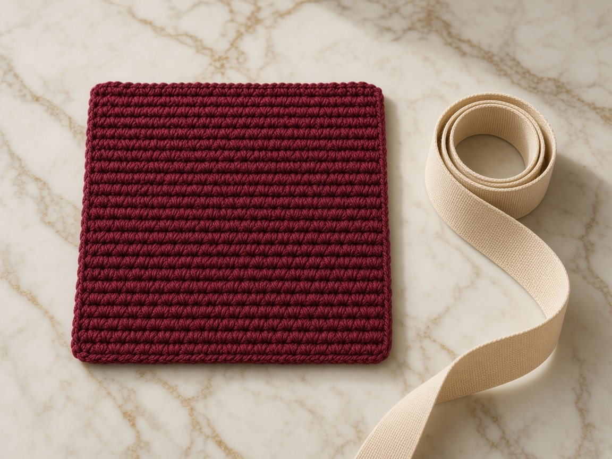

If the fabric feels loose and open, redo the swatch on a smaller hook. A sleeve that is soft and holey will stretch wider the first time the phone goes in, then it may also grow longer.

The [gauge guide](/crochet-gauge/) walks through the same count in more detail. For a dishcloth you can skip a swatch. For a sleeve that has to match a phone, do not skip it.

## Sizing formulas

Use inches. Measure the phone, then measure the swatch, then do the multiplication. The labels below keep three different kinds of number apart.

- **Phone size.** From Apple, or from your tape. For this model the bare body is 3.07 inches wide, 6.43 inches tall, and 0.34 inch thick.
- **Example gauge.** 4 sc per inch and 5 rows per inch. Used only in the worked example. Replace both numbers with your swatch.
- **Your fabric.** Whatever your swatch just measured. This is the number that goes into the formula.

**Width.** The yarn has to cover the face and also turn the edges. The inside width to aim for is phone width plus phone depth:

`3.07 + 0.34 = 3.41 inches`

The side seams take a little fabric, and the phone needs a little room to slide. This pattern allows about 1/4 inch for the two seams together and about 1/4 inch of ease:

`3.41 + 0.25 + 0.25 = 3.91 inches`

Round that to **3.9 inches** of flat fabric. Then:

`stitches = 3.9 × your stitches per inch`

Round up to a whole stitch. The foundation chain is that number plus 1, because the first single crochet goes into the second chain from the hook.

**Length.** Each side of the sleeve needs the phone's height, a little yarn for the fold at the bottom, and a short collar above the phone so the camera is not buried:

`6.43 + 0.17 + 0.40 = 7.00 inches` on each side

The rectangle is both sides, so the flat piece is twice that:

`2 × 7.00 = 14 inches`

`rows = 14 × your rows per inch`

Round to a whole row. If the number is odd, add one row so the fold can sit between two rows at the middle.

### Worked example at 4 stitches and 5 rows per inch

This block is arithmetic. It is not a count taken from a finished sleeve.

| Piece | Formula | Example result |
| --- | --- | --- |
| Flat width | 3.9 in × 4 sc | 15.6, rounded up to 16 sc |
| Foundation chain | 16 + 1 | 17 chains |
| Flat length | 14 in × 5 rows | 70 rows |
| Fold | Halfway | Between row 35 and row 36 |

At this example, row 1 is 16 sc and should lie at about 3.9 inches once it is flat. If your row 1 is much narrower, the phone will not fit even if you keep going to 70 rows.

### Second example, if your swatch is tighter

Still arithmetic, still not a measured sleeve. If your swatch is 5 sc and 6 rows per inch:

- Width: 3.9 × 5 = 19.5, so 20 sc, and a foundation chain of 21.
- Length: 14 × 6 = 84 rows.
- Fold between row 42 and row 43.

Use your numbers, not these, if your swatch said something else. A third gauge is the same two multiplications. Write the results on the page before you chain, so you are not recounting from memory at row 40.

The example of 16 sc and 70 rows is not a tested fit. Check row 1 against 3.9 inches, and check the folded length against your phone, before you sew.

## Step 1: Make a slip knot

Leave a tail about 8 inches long. You will use tails to sew, but a very short tail pulls out of the seam.

1. Lay the yarn over your fingers so you have a loop, with the tail in front.
2. Pull a second loop of working yarn through that loop.
3. Put the hook through the new loop and tug the tail until the loop sits on the shaft. It should slide. If it is a hard knot, undo it.

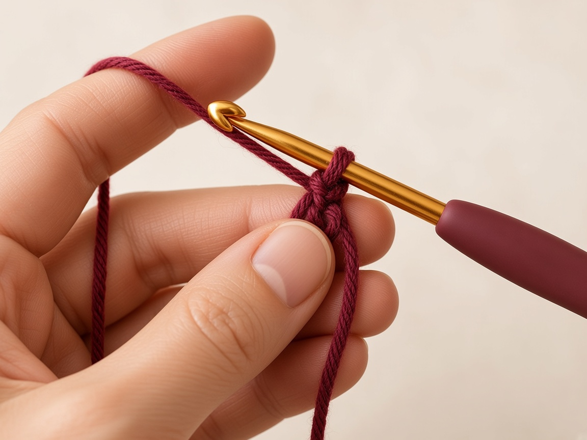

## Step 2: Chain the width

Chain the number you wrote down. In the worked example that is 17. Keep the chains loose enough to get the hook into them on the next row. A tight chain makes a tight bottom edge on one end of the rectangle, and that end may become the opening or the fold depending on how you fold.

Count the chains by the V on the front of each one. Do not count the slip knot as a chain, and do not count the loop on the hook.

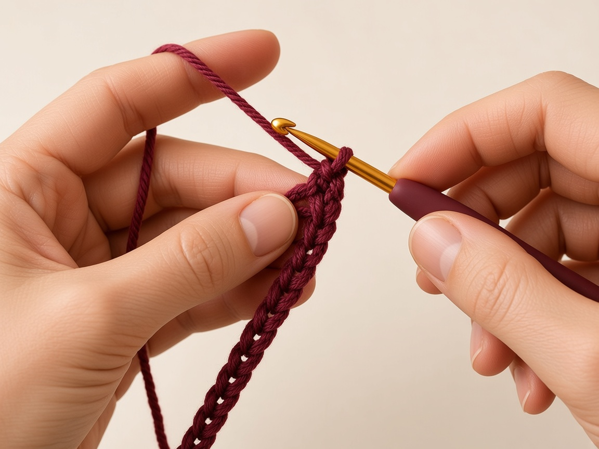

## Step 3: Work the first row

1. Skip the chain next to the hook.
2. Insert the hook under the top loop of the next chain, or under both loops of that chain if you can see them. Stay in the same loop for the whole row.
3. Yarn over and pull through. Two loops are on the hook.
4. Yarn over and pull through both loops. That is one single crochet.
5. Repeat in each chain across.

In the example you finish with 16 sc. Count them. Put a marker in the first stitch of the row if you lose the edge.

Lay the row flat. It should be close to 3.9 inches in the example, or close to the fabric width you calculated. If it is under 3.6 inches, rip it and try a larger hook, or add stitches using your real gauge. If it is over 4.3 inches and the fabric looks loose, try a smaller hook. Do not "fix" a narrow row by stretching it.

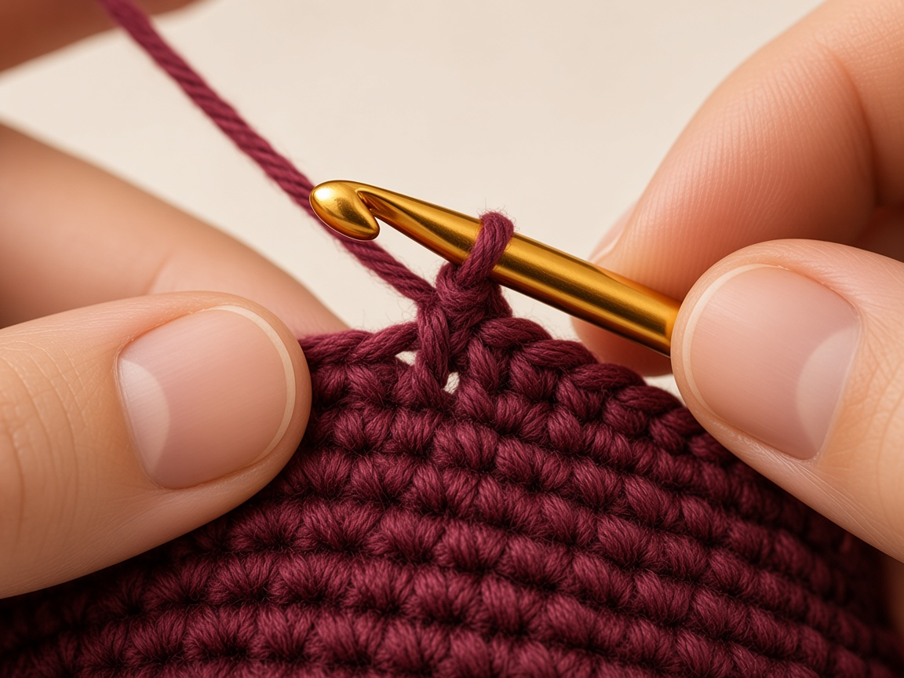

## Step 4: Repeat the same row

Every row after the first is the same.

1. Chain 1. This does not count as a stitch.
2. Turn the work.
3. Single crochet in the first stitch, the one you just made on the row below. Do not skip it, and do not work into the chain-1.
4. Single crochet in each stitch across, including the last one.
5. Count. You should have the same number as row 1.

Keep going until you have the row count you calculated. In the example that is 70 rows. The stitch count does not change. If a row comes out at 15 or 17, undo that row. A sleeve that grows wider on one side will not fold into an even pocket.

Mark every 10th row with a scrap of yarn so you do not have to recount from the chain.

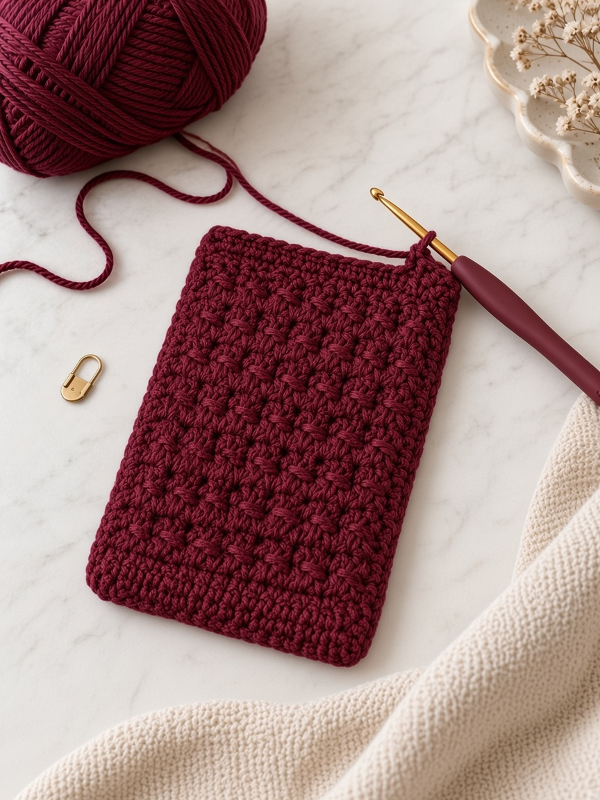

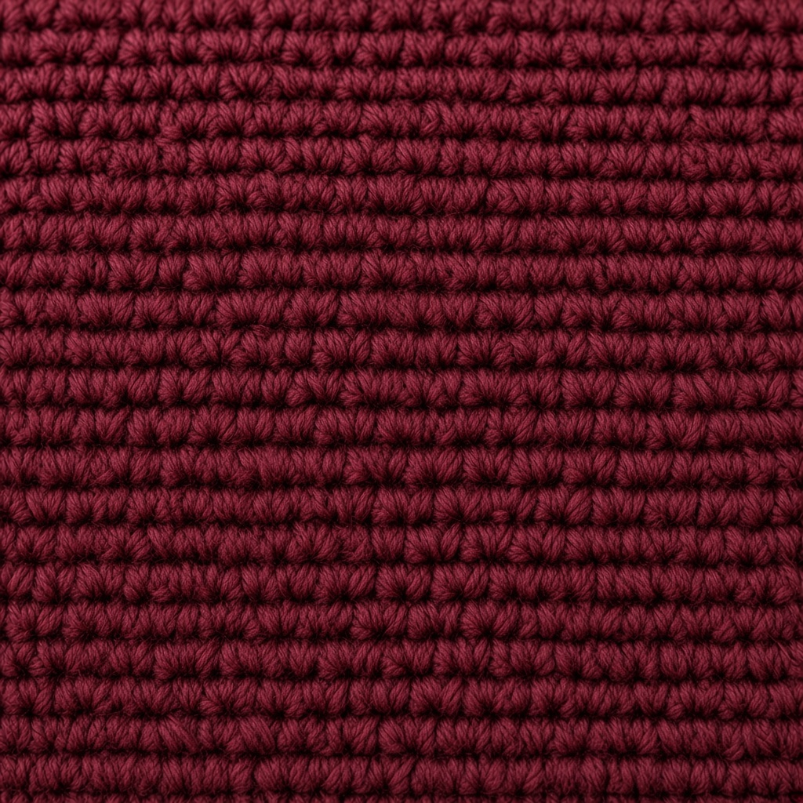

## Step 5: Check the length before you seam

Stop at the row count and measure the long side without stretching. In the example the flat piece is about 14 inches. Your target is twice the pocket depth you calculated.

Fold the rectangle in half, short ends together, with the chain edge meeting the last row. The fold is the bottom. Slip the phone inside the fold, still unseamed, and pinch the sides. The phone should sit on the fold with about a finger of fabric above the top of the phone. The camera should be able to sit at or above the opening.

If the folded piece is short, add rows in pairs so the fold stays at the middle. If it is long, rip back in pairs. A sleeve that is only a row or two long is fine. A sleeve that covers the camera is not, because this pattern has no lens opening.

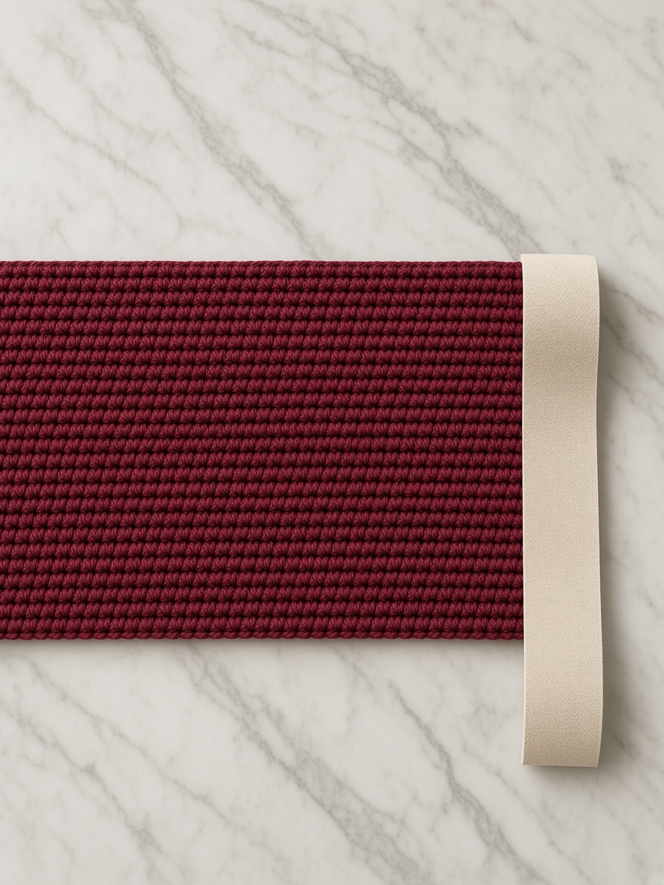

## Step 6: Fold and seam the sides

1. Cut the yarn, leave an 18-inch tail, and pull the tail through the last loop.
2. Fold the rectangle in half, right sides together, so the fold is the bottom. Match the chain edge to the last row. If one end is tighter, that tighter end is a better opening than a better fold, because a tight fold makes the phone hard to seat. Pin or marker the two top corners.
3. Thread the tail, or a new length of the same yarn, on the tapestry needle.
4. Whipstitch one side from the fold up to the opening. Pass the needle through the outer loop of each edge stitch only, one stitch on the front and the matching stitch on the back.
5. Repeat on the other side with a second length of yarn. Do not stitch across the bottom. The fold is already closed.
6. Turn the sleeve right side out.

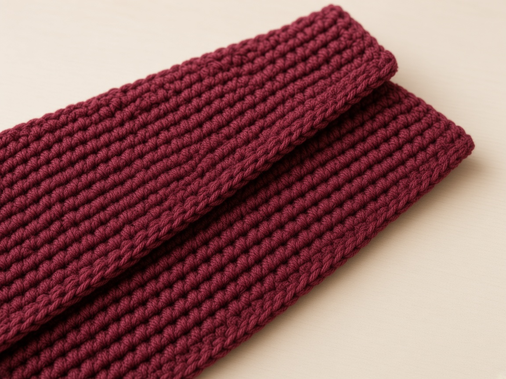

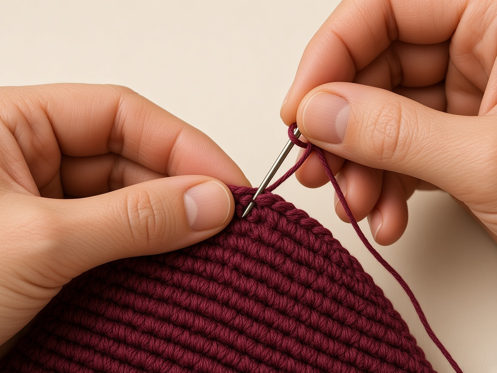

The seam allowance in the width formula was about 1/4 inch for both sides together. If you sew through the whole stitch, you take more than that and the phone may not go in. If the phone will not enter after a careful outer-loop seam, take the seams out and add a few stitches of width. Do not force the phone.

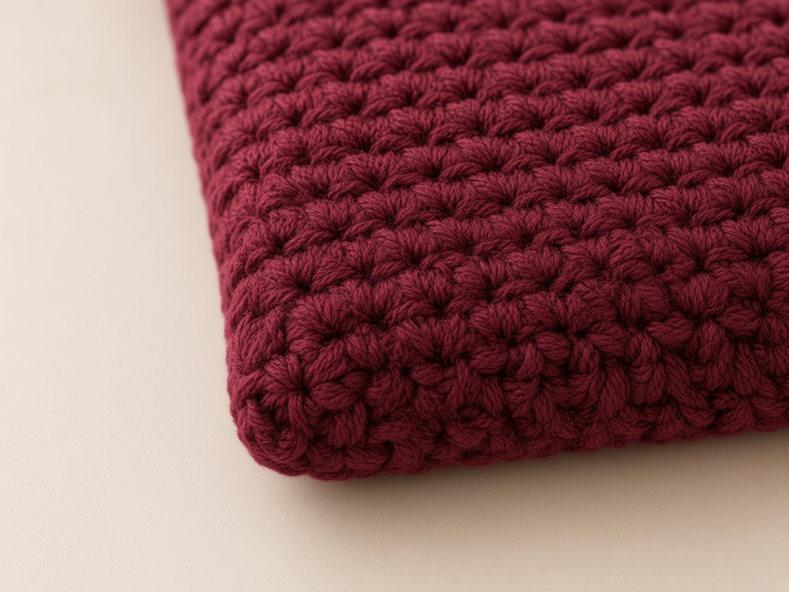

## Step 7: Finish the opening

The last row you crocheted is already a finished edge if the stitch count stayed even. Turn the sleeve right side out and look at the opening. If the edge curls or looks thin, join the yarn at a side seam and work one round of single crochet around the opening: one sc in each stitch, and one sc in the side seam to close the gap. Slip stitch to the first sc and fasten off.

Do not work that extra round tightly. A tight round shrinks the opening below the width you just checked.

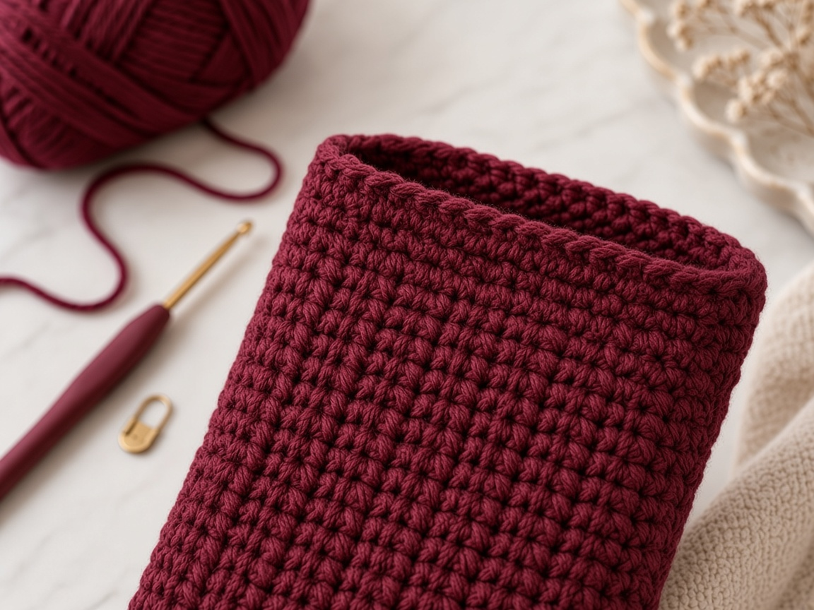

## Step 8: Add a flap only if you want one

The sleeve is finished without a flap. A flap is a short extra piece on the front of the opening, with a chain loop. It is optional. The counts below are a starting shape for the example width of 16 sc. They were not fitted to a button.

1. With the right side facing you, join the yarn at the top of one side seam, on the front only.
2. Single crochet across the front edge only. In the example that is 8 sc, half of 16. On your sleeve it is half your stitch count. If your count is odd, stop one stitch before the other seam.
3. Chain 1, turn, and single crochet across. Repeat until the flap is about 1 inch tall, often 4 to 6 rows at the example gauge.
4. On the last row, single crochet to the center, chain 6, then single crochet to the end. The chain-6 is the button loop. If your button is larger, chain more. If the loop stands up in a tall arch, use fewer chains.
5. Fasten off.
6. Put the phone in the sleeve. Fold the flap over. Mark where the loop lands, and sew a button there by hand. If the flap covers the camera, stop and shorten the flap. The camera needs to stay usable.

Skip this step if you are happy with an open top. An open top is easier to get the phone in and out of.

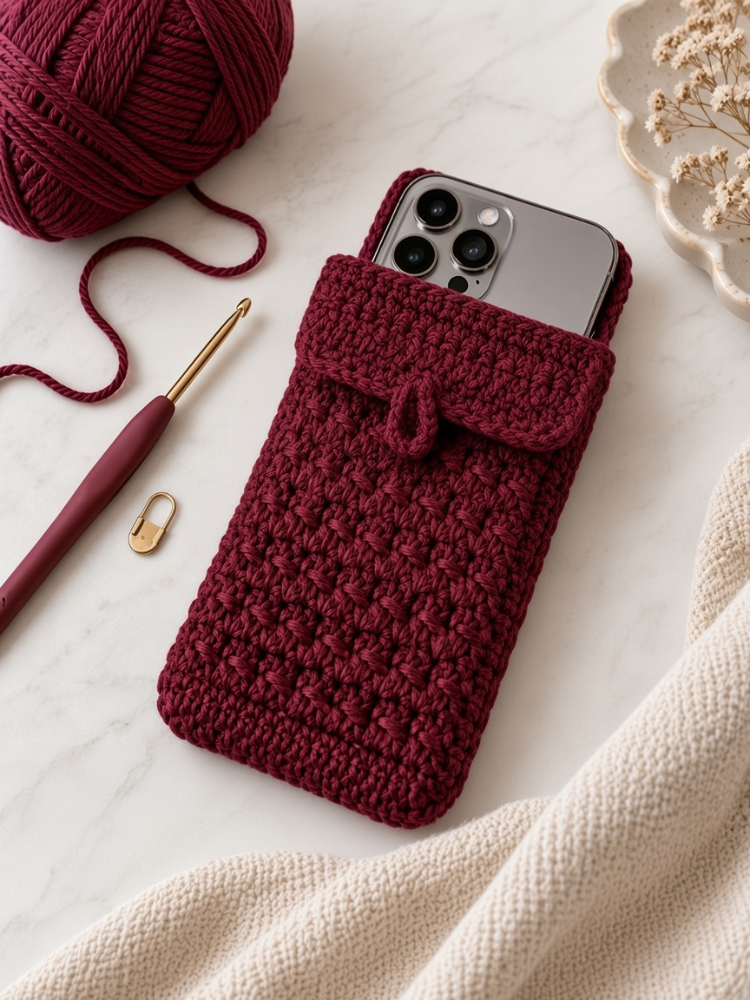

## Step 9: Weave in the ends

Thread each tail and run it along the inside of the seam for about an inch, then turn and run it back the other way for a short stretch. Trim close to the fabric. The full method is on [weaving in ends](/weaving-in-ends-and-blocking/). A phone sleeve does not need to be blocked. Blocking can stretch the width, which changes the fit you just checked.

## Adjust the fit

Try the phone before you weave the seam tails all the way in, so you can still undo a seam.

- The phone will not go in. The width is short, or the seam took too much fabric. Redo the sides through outer loops only. If it is still tight, add stitches and rework the rectangle.
- The phone swims, or the sleeve slides off. The width is long. A tighter hook, or fewer stitches, fixes the next one. On this one, a flap and a button will hold it better than a tight seam.
- The camera is covered. The piece is too long, or the flap is too deep. Remove rows, or shorten the flap.
- One side seam pulls. The edges were not matched. Take that seam out and start again from the fold, stitch for stitch.
- The bottom is pointed or bulky. You sewed across the fold. Take that stitching out. The fold should stay a fold.

## Mistakes that cost yarn

- Chaining to 3.07 inches, the phone's width, and forgetting the depth and the seams. The phone then stops halfway in.
- Counting the turning chain as a stitch, so every row gains one stitch and the piece becomes a trapezoid.
- Skipping the first stitch of the row, so every row loses a stitch.
- Sewing the top shut because both ends looked like edges.
- Cutting a hole for the camera. This sleeve is not built around a hole. A cut stitch unravels.
- Skipping the swatch and using 16 sc because it appeared in the example.

## Washing and care

Wash the sleeve only if the yarn label allows it, and take the phone out first. Cool water and a gentle dry keep a wool blend from felting. Acrylic can usually be washed cool and laid flat. Do not tumble-dry unless the label says you can. Heat can relax the stitches and make the sleeve wider and shorter.

The yarn will not stop a drop onto concrete, and it will not keep the phone dry in rain. If the sleeve gets soaked, remove the phone and let the yarn dry flat before you use it again.

## Frequently asked

### Is this a hard case with a camera hole?

No. It is a soft sleeve, open at the top. The phone slides in. The lenses stay above the yarn.

### Can I use the 16 sc and 70 row example without a swatch?

You can chain it, and you can crochet it, and it still may not fit. Those numbers only describe a fabric with 4 sc and 5 rows per inch. Measure your swatch and rerun the two formulas.

### Do I size it from the 6.9-inch screen?

No. That number is the diagonal of the display. The sleeve uses the body: 3.07 inches wide, 6.43 inches tall, and 0.34 inch thick, then your ease and your gauge.

### Will it protect the phone if I drop it?

No. The yarn can reduce light scratches and dust. It is not a certified impact case, and it is not water resistant.

### Which burgundy matches the phone?

Apple's finish list for this model includes a color named Burgundy. The yarn in the illustrations is a separate deep red. Pick a yarn you like. It does not have to match the phone.

### Can I make it for a different phone?

Yes. Replace the three body measurements with a tape on that phone, then use the same formulas. Keep the construction: one rectangle, a fold at the bottom, two side seams, an open top.

### Should the turning chain count as a stitch?

Not on this sleeve. The chain-1 is only there so the first single crochet has height. Working into it adds a stitch.

## Recap

Measure the phone, or start from Apple's 3.07 by 6.43 by 0.34 inch body and then check those numbers against the phone in your hand. Swatch, and replace the example gauge. Chain one more than your stitch count, single crochet every row to the same count, and stop when the flat piece is twice the pocket depth. Fold, whipstitch the sides through the outer loops, and leave the top open. Add a flap only if you still want a closure after the phone fits. Weave the ends in on the inside.

The sleeve in the pictures is an illustration of that shape and that color. Fit still depends on your gauge and on the phone you slide in.

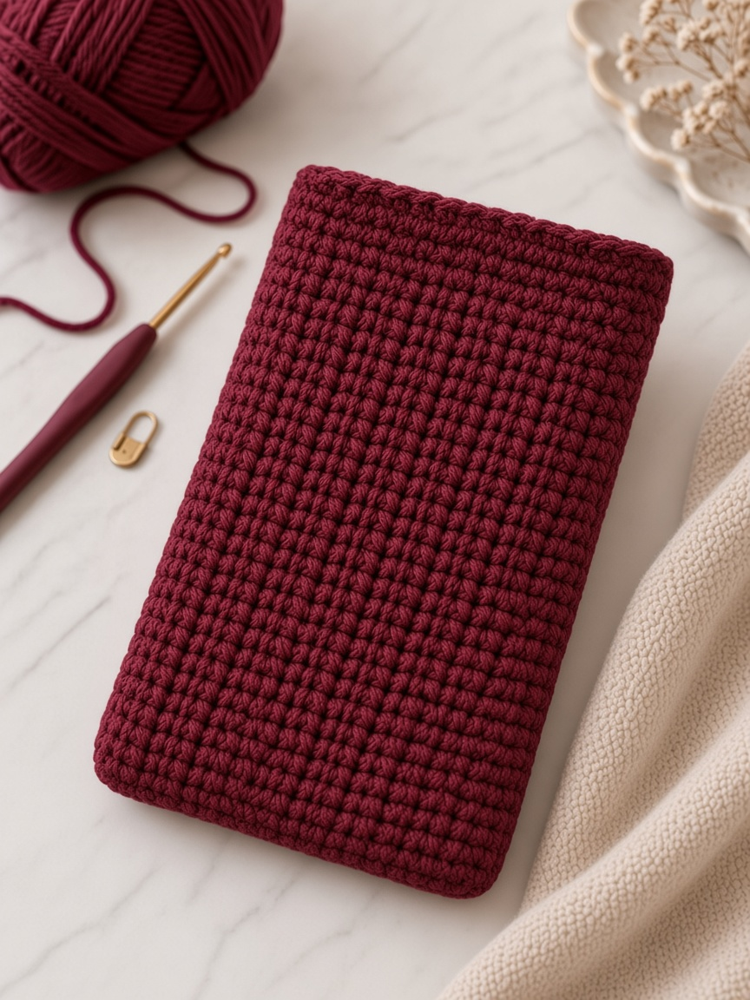

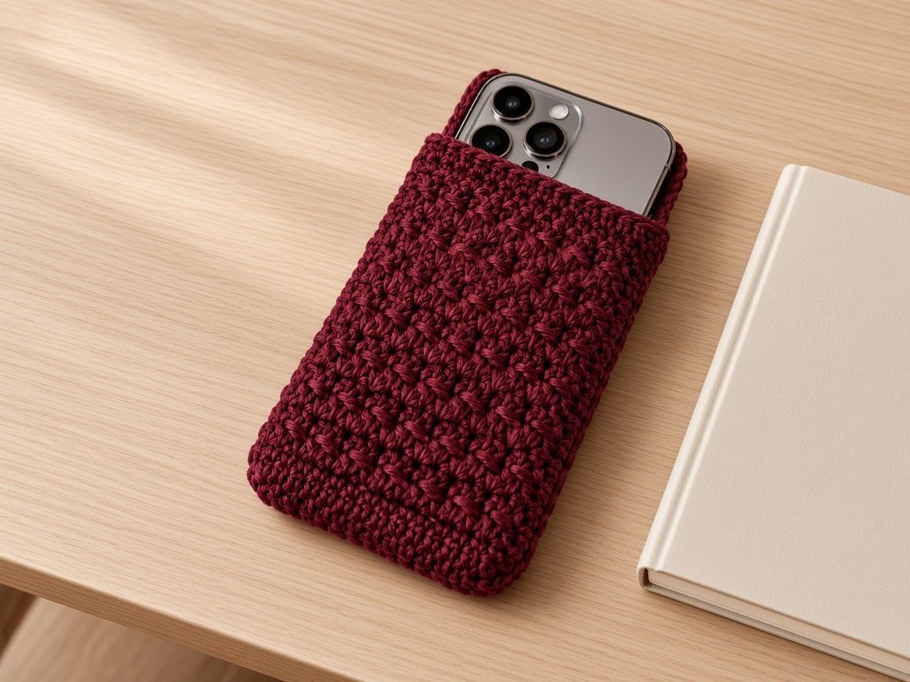
