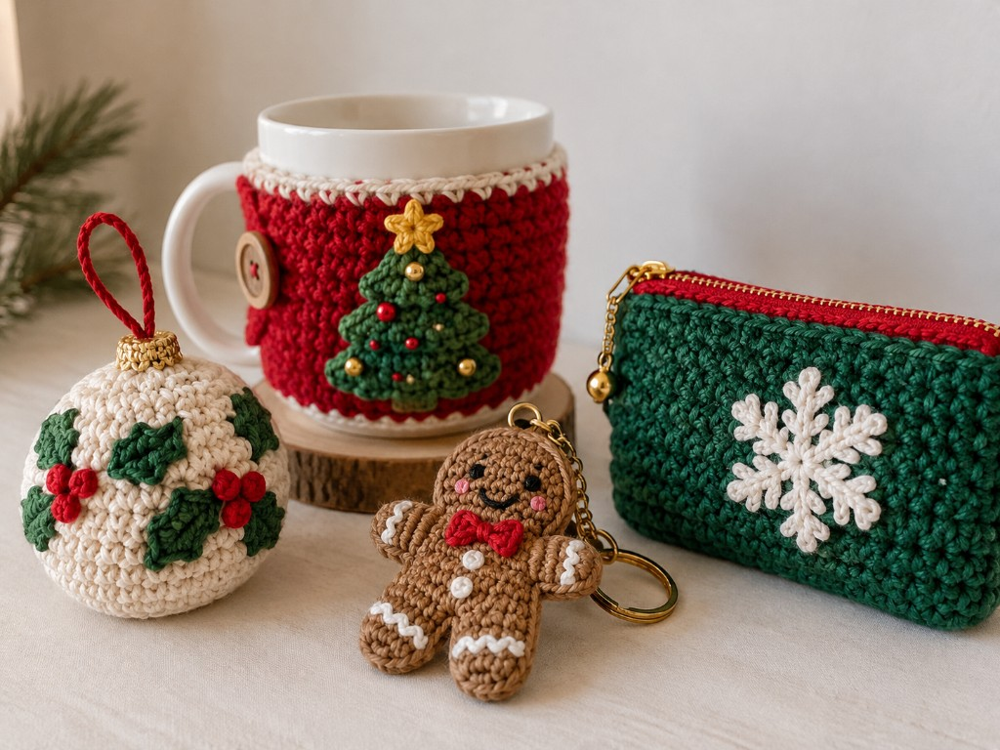

The useful Christmas question is not "what can I invent in December." It is which finished object you can actually complete before the date on the calendar. Every project below already has a tutorial on this site. Yarn that behaves in small holiday stitches is covered in [yarn for Christmas crochet](/yarn-for-christmas-crochet/).

This is a guide to existing tutorials rather than a new pattern, and the picture is an illustration of the kind of projects those pages describe. Pick the project you can finish, not the one with the newest date.

## If you have one evening

- [Christmas gift card holder](/how-to-crochet-a-christmas-gift-card-holder/). A flat pocket. One of the few gifts that is finished when the sewing is done.
- [Mug cozy](/crochet-mug-cozy-for-beginners/). Measure the mug first or it will not close.
- [Snowflake](/how-to-crochet-a-snowflake/). Three rounds, then stiffening. Allow a day for it to dry hard.
- [Scrunchie](/how-to-crochet-a-scrunchie/). Sized from a hair elastic, so you do not need the person's measurements.
- [Simple flower](/how-to-crochet-a-simple-flower/). Sew it to a plain gift or to the mug cozy.
- [Fall leaf](/how-to-crochet-a-fall-leaf/). A small appliqué. The stitch count is on paper, not from a finished leaf.
- [Halloween coasters](/free-pattern-halloween-coasters/). A flat pumpkin disc, plus a granny set. Not a hot pad.

The [ornament ideas](/easy-crochet-christmas-ornaments/) page lists fifteen shapes and writes one flat star in full. Use that star if you want a written pattern, and use the links on that page for the tree and the snowflake.

## If you have a weekend

- [Chunky beanie](/how-to-crochet-a-chunky-beanie/). Bulky yarn finishes faster than worsted. Measure the head.
- [Ear warmer](/how-to-crochet-an-ear-warmer/). A good gift when you do not know the hat size.
- [Fingerless gloves](/how-to-crochet-fingerless-gloves/). Measure the hand first. With the thumb gap opposite the round join, both gloves are worked the same.
- [Book or e-reader sleeve](/how-to-crochet-a-device-case/). Measure the device. The same folded shape fits many e-readers if you measure it instead of guessing a brand size.
- [Wine bottle bag](/how-to-crochet-a-wine-bottle-bag/). The bottle is the form. Crochet to that bottle.

## If you are starting in October

- [Gnome](/how-to-crochet-a-gnome/). Four small pieces. The hat length is what makes it read as a gnome.
- [Christmas tree](/how-to-crochet-a-christmas-tree/). A cone, not a blanket.
- [Beginner scarf](/how-to-crochet-a-beginner-scarf/). One stitch, repeated. Swatch before you trust the width.
- [Hooded scarf](/how-to-crochet-a-hooded-scarf/). Long. Start it before December.
- [Baby blanket](/how-to-crochet-a-baby-blanket/). A plain rectangle. Wash a swatch before you buy all the yarn. No buttons and no appliqués.
- [Slippers](/how-to-crochet-slippers/). A sole that is pure yarn is slippery on wood floors. Read the finishing notes before you gift them.

## People who do not want another hat

- [Drawstring bag](/how-to-crochet-a-drawstring-bag/) if Halloween yarn is still out, or the [makeup pouch](/how-to-crochet-a-makeup-pouch/) and [pumpkin zipper pouch](/how-to-crochet-a-pumpkin-zipper-pouch/).
- [Laptop sleeve](/how-to-crochet-a-device-case/) or [phone case](/how-to-crochet-a-phone-case/) only if you can measure the device. A guessed phone size is a gift that does not fit. A phone with a strap is the [phone crossbody](/how-to-crochet-a-strap-bag/).
- [Market bag](/how-to-crochet-a-market-bag/) for someone who actually carries one.
- [Bowl cozy](/how-to-crochet-a-bowl-cozy/) only if you read the heat section first. It is cotton, it is not a hot pad, and it does not claim to be microwave-safe.

## Sizing a gift without asking

Half the projects above need a measurement, and asking spoils the surprise. Measure something the person already owns instead.

- **A hat they wear.** Lay it flat, measure across the brim, and double it. That is the hat's relaxed size, which already includes the ease they like. Use it as the target in the [chunky beanie](/how-to-crochet-a-chunky-beanie/).
- **A phone or e-reader.** Measure the device in the case they use, because that is what has to fit. The [phone case](/how-to-crochet-a-phone-case/) explains why thickness matters as much as width.
- **Gloves.** Measure around the palm of a glove that fits them, lying flat, and double it.
- **Slippers or shoes.** Measure the inside length of a shoe they wear, heel to toe. That is close to the foot length, though a shoe usually has a little extra room. [Slippers](/how-to-crochet-slippers/) also need a measurement over the top of the foot, which only the foot can give, so they are hard to make as a surprise.

If you cannot measure anything, pick a project that does not need it: the scrunchie, an ornament, the gift card holder, or the ear warmer, which has some stretch.

## Put a care card in the box

A crochet gift is easy to ruin in its first wash. Write a small card with three facts and tuck it in:

- **The fiber**, copied from the yarn label: acrylic, cotton, wool, or a blend.
- **How to wash it.** Copy the label's symbols or write them out. Hand wash and dry flat is the safe default for anything with stuffing or stiffener.
- **What it is not.** A cotton cozy is not a hot pad. Slippers slide on hard floors. A stiffened ornament dissolves if it gets wet. Say so on the card, because the person opening it did not read the tutorial.

Keep the ball band yourself, pinned to a leftover length of yarn, so you can repair the gift later in the same yarn.

## What not to promise

Do not tell someone a project is done when the ends are still hanging out. [Weaving ends](/weaving-in-ends-and-blocking/) is part of the gift. Do not stuff a new amigurumi pattern into the same week as a blanket. The [Santa](/crochet-santa-amigurumi-for-beginners/) tutorial is a technique page for that shape, separate from the gnome.

## Frequently asked

### Which of these is the best first Christmas project?

The gift card holder or the flat star on the ornament page. Both are small, and both tell you quickly whether your tension will cooperate.

### Can I sell these?

The tutorials explain techniques and original project notes for this site. Selling a finished object you made is ordinary. Copying another designer's published pattern is not, and this page does not grant that.
