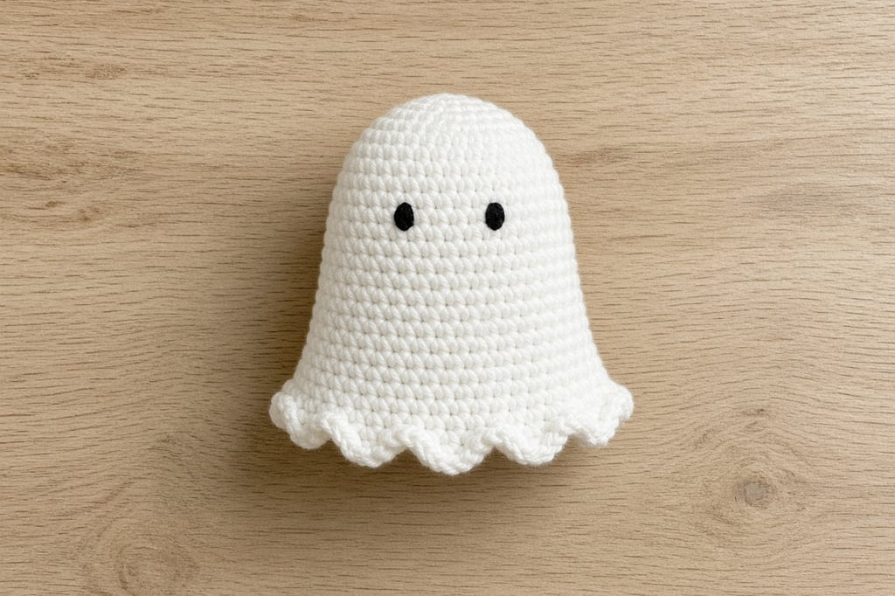
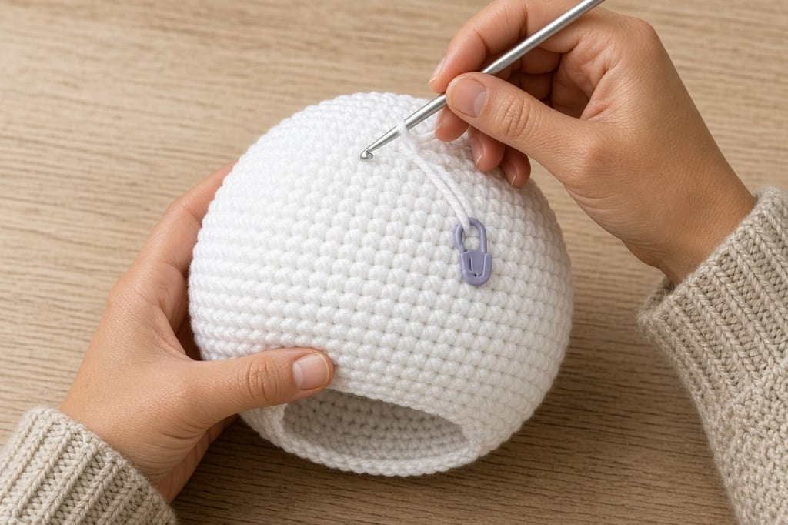
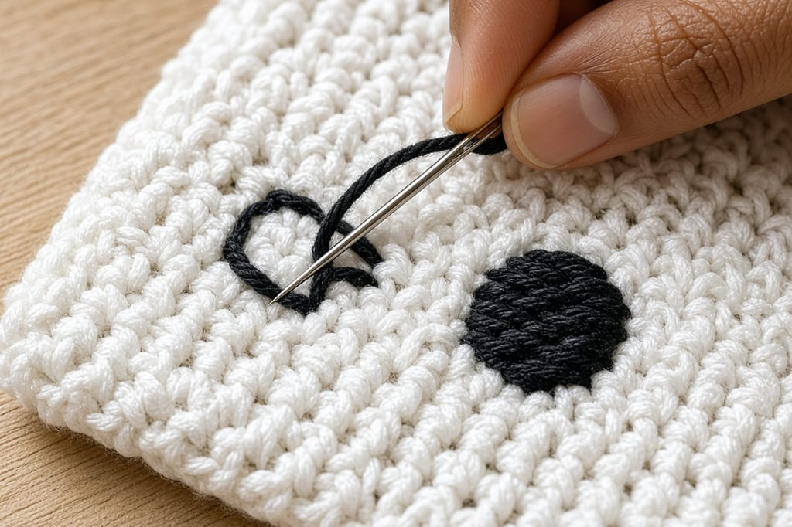

A crochet ghost is a forgiving first stuffed toy. You need a rounded head, a body that hangs or stands, a hem that looks a little ragged on purpose, and two eyes. There is one real problem to solve, and most simple ghost patterns skip it: an open-bottomed ghost has nowhere to keep its stuffing, and a soft single crochet hem cannot hold the ghost upright.

This page gives two answers. The **hanging ghost** stuffs only the head and cinches a round below it, which holds the stuffing and makes a neck at the same time. The **standing ghost** closes the bottom with a flat base and works the wavy skirt separately, into loops left free for that purpose. Both start the same way.

If magic rings still feel shaky, start with [crochet in the round](/crochet-in-the-round/). US terms. [Abbreviations](/crochet-abbreviations-chart/). The pictures are illustrations of the finished ghost, which has not been made up in yarn here, so its size depends on your yarn, hook, and stuffing.

## Two builds

<figure class="diagram">

<figcaption>The hanging ghost holds its stuffing with a cinch. The standing ghost holds it with a closed base, and its skirt is added afterward.</figcaption>
</figure>

## What you need

- **White or cream worsted-weight yarn**, plus black yarn or embroidery floss for the face. [Yarn weights](/yarn-weight-chart/).
- **A hook one or two sizes smaller than the label**, so the fabric is tight enough to hide the stuffing. [Hook chart](/crochet-hook-size-conversion-chart/).
- Polyester stuffing, a yarn needle, a stitch marker.

## Step 1: the head and body (both builds)

Start at the top of the head and work down in a spiral. Mark the first stitch of each round.

**Round 1:** 6 sc in a magic ring. (6)

<figure class="diagram">

<figcaption>Round 1 starts in a magic ring, pulled tight so the top has no hole.</figcaption>
</figure>

**Round 2:** 2 sc in each stitch. (12)

**Round 3:** (Sc, 2 sc in next) 6 times. (18)

**Round 4:** (Sc 2, 2 sc in next) 6 times. (24)

**Round 5:** (Sc 3, 2 sc in next) 6 times. (30)

**Rounds 6–16:** Sc in each stitch. (30)

On an even round, the count must stay at 30. If it grew, you probably worked two stitches into the last stitch of a round. The hem can look ragged. The count cannot.

**Mark the eyes now.** Put a scrap of contrasting yarn through a stitch on about round 8, the middle of the head. It is much easier to place them before stuffing.

## Step 2: the face

Embroider two small ovals in satin stitch, or two French knots, about 4 stitches apart at the marked round. Use floss or yarn thinner than the body yarn, or the eyes look heavy. A tiny mouth is optional. Weave the ends inside.

Embroidered eyes are safer than glued or plastic ones for anything a child might chew.

## Step 3A: the hanging ghost

**Stuff the head.** Fill rounds 1 to 9 firmly.

**Close the stuffing compartment.** Run white yarn through every stitch around round 10. Pull the circumference closed, not merely finger-wide, so no stuffing can migrate into the skirt. Secure it with a small knot tucked inward, then weave both tails through nearby stitches in different directions. Do not force a large amount of stuffing against the closure. This cinch changes the silhouette and must be checked on a sample. For a separate compartment, sew a small lining closed below the stuffed head instead.

**Round 17:** (Sc 4, 2 sc in next) 6 times. (36)

**Round 18, the wave:** (Sc, hdc, dc, dc, hdc, sc) 6 times. (36)

There are no increases in the wave. The different stitch heights make it ripple. Six repeats of 6 use all 36 stitches. Fasten off and weave the end in.

**Hanging loop:** Thread a doubled strand through the top of the head, near the magic ring, and knot it into a loop. Pass it through twice so it does not pull out.

## Step 3B: the standing ghost

**Round 17:** Sc in the back loop only of each stitch. (30)

This leaves the front loops of round 16 free for the skirt, and makes a fold line so the base turns under flat.

**Round 18:** (Sc 3, sc2tog) 6 times. (24)

<figure class="diagram">

<figcaption>Through the front loops only, the decrease disappears into the fabric.</figcaption>
</figure>

**Round 19:** (Sc 2, sc2tog) 6 times. (18)

Stuff the head and sides evenly, but keep the closing base from bulging. Overstuffing the base makes it dome; a BLO fold does not guarantee a flat bottom. Set it on the table during closing and redistribute stuffing if it rocks.

**Round 20:** (Sc, sc2tog) 6 times. (12)

**Round 21:** Sc2tog 6 times. (6) Fasten off and pull the hole closed.

<figure class="diagram">

<figcaption>The standing build by stitch count. The back-loop round 17 is the fold where the base turns in.</figcaption>
</figure>

**The skirt:** Turn the ghost upside down. Join white in any free front loop of round 16.

- **Skirt round 1:** Working into the front loops, (sc 4, 2 sc in next) 6 times. (36)
- **Skirt round 2:** (Sc, hdc, dc, dc, hdc, sc) 6 times. (36)

Fasten off. The skirt hangs over the base, so the ghost looks open but stands.

## Edge options

Both builds end with a 36-stitch round. Any edge whose repeat divides 36 will work.

- **Wave:** (sc, hdc, dc, dc, hdc, sc), 6 repeats.
- **Picots:** (sc 3, ch 2, sl st in the 2nd chain from the hook), 12 repeats.
- **Plain:** one round of sc. Quiet, and still clearly a ghost.

A five-stitch scallop will not fit: 36 is not a multiple of 5.

## Choose the bottom treatment before round 17

For the hanging build, the stuffing belongs above the closed cinch and the skirt remains hollow. For the standing build, round 17 goes into the back loops of round 16, leaving the front loops of that same round available for the skirt. Run a contrasting marker strand through those free loops before continuing, without catching it into the base. After closing the base, check it on a flat table before adding the skirt. To pull a six-stitch closing hole shut, run the tail through each remaining front loop in order, pull gently, secure, and bury it. Neither version is a tested child's toy.

## Troubleshooting

**Stuffing falls out of the hanging ghost.** The cinch is too loose. Pull it tighter, or tuck in a little more stuffing so it fills the space.

**The standing ghost tips over.** The base is under-stuffed or domed. Add stuffing at the bottom before round 21.

**The skirt flares like a tutu.** Too many increases. Skip skirt round 1 and work the wave straight into the 30 front loops: 30 is also a multiple of 6.

**Eyes too low.** Eyes belong on the head, above the neck.

**A diagonal wobble.** The marker was lost. Count back.

## Frequently asked

### Can I use joined rounds instead of a spiral?

Yes. Slip stitch to the first stitch and ch 1 at each round. The ch 1 does not count as a stitch.

### What colors besides white?

Gray, pale blue, or glow-in-the-dark acrylic. Keep strong contrast for the face.

### Can I add weight to the base?

Some makers put plastic pellets in a sealed fabric pouch inside the base. Loose pellets and small parts are a choking hazard, so do not do this for a toy that might reach a small child.

### What should I make next?

The same increase, even, decrease shape with grooves is the [pumpkin](/how-to-crochet-a-pumpkin-step-by-step/). Flat pieces sewn to a small body are the [bat](/bat-amigurumi-wings-body-and-ears/).
