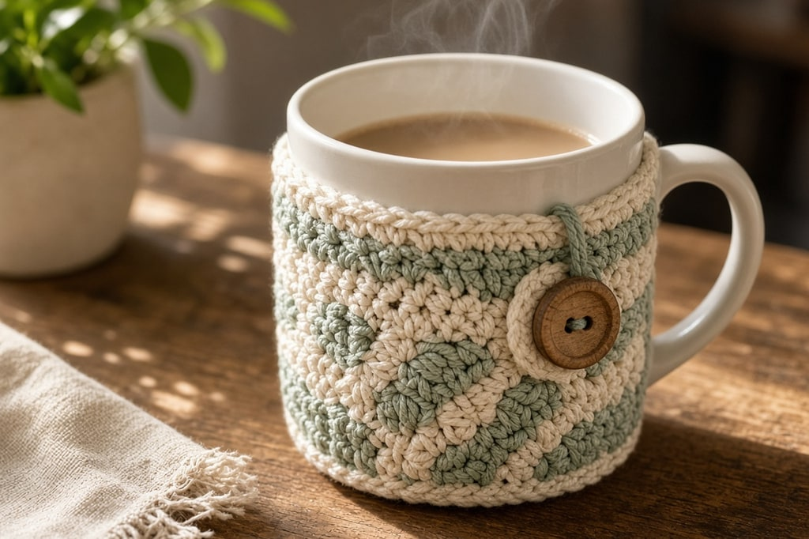
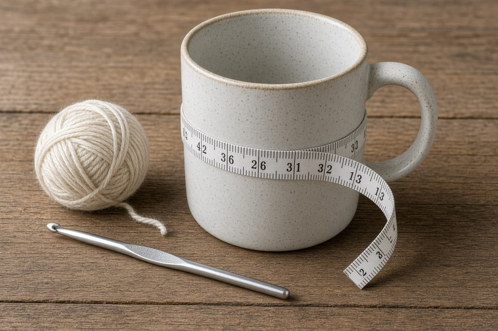
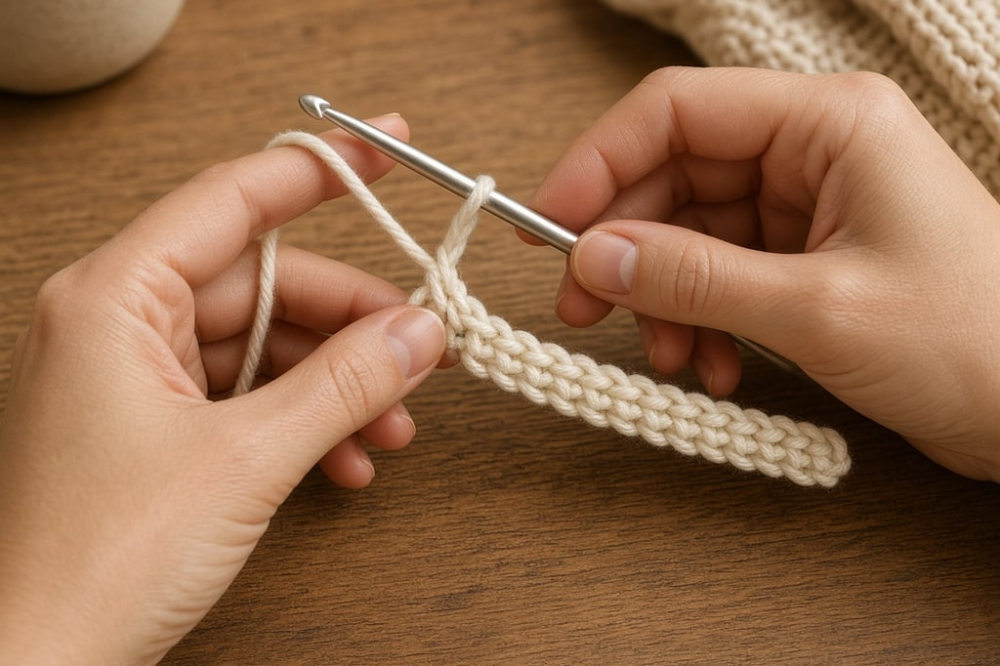
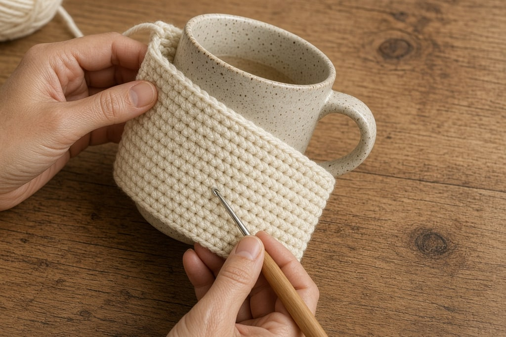
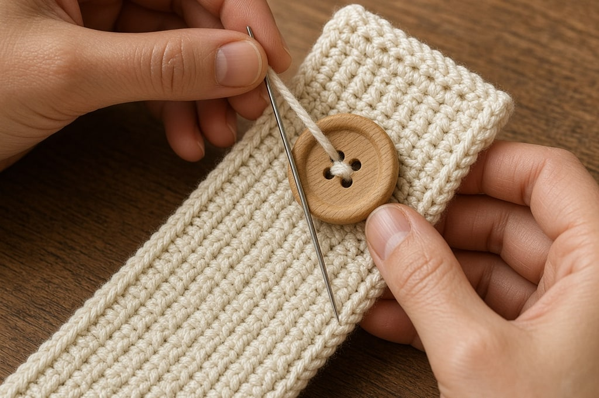

A mug cozy is a strip of single crochet that wraps the mug from one side of the handle to the other. A chain loop on one end passes inside the handle and closes over a button on the other end. The stitches are the easiest on the site. Three things trip beginners up: which gauge sets the length, what the handle does to the shape, and mugs that are not straight.

US terms. US single crochet is UK double crochet. [Abbreviations](/crochet-abbreviations-chart/). If your [single crochet](/basic-crochet-stitches/) is even, you are ready. The pictures are illustrations. No cozy for this page was crocheted or fitted on a mug. The 10 inch mug below is an example for the arithmetic.

## How the cozy is built

The foundation chain is the cozy's height. The rows travel around the mug. You wrap the strip as it grows and stop when the two short ends sit on either side of the handle. That is why it is worked sideways: the height is decided once, by the chain, and the length is decided at the mug, by adding rows.

<figure class="diagram">

<figcaption>Stitches set the height. Rows set the length around the mug. Each uses its own gauge.</figcaption>
</figure>

The direction has a consequence. Because rows go around the mug, the length comes from your **row** gauge, not your stitch gauge. Do not multiply 9 inches by 4 stitches per inch. That uses the stitch gauge for the row direction and calls it 36 rows. At 5 rows per inch, 9 inches is 45 rows.

It also changes stripes. A color change at the start of a row makes a stripe that runs up the mug, not around it.

## Measure the mug

Write down four things:

1. **Around the mug** at the height where the cozy will sit. If the mug flares, measure near the top and near the bottom of that band.
2. **Cozy height:** from just above where the base curves in, to about half an inch below the rim, so lips never touch yarn. The half inch is a choice.
3. **Handle base:** the width of the handle where it meets the wall, side to side.
4. **Handle gap:** the space between the handle and the wall at mid-height. The loop has to pass through it.

The example mug is **10 inches** around with a **1 inch** handle base, and the cozy is **3 inches** tall. The body is 10 − 1 = **9 inches**, because the cozy stops on either side of the handle instead of covering it.

If the top and bottom measurements differ, a straight strip can only match one of them. Sized to the top, it slides down. Sized to the bottom, it gaps at the top. Shaping the strip is a different construction, not covered here. For a tapered tumbler, see the [tumbler sleeve](/how-to-crochet-a-tumbler-sleeve/).

## Yarn and tools

- **Worsted cotton.** It is the usual choice next to hot drinks, it washes well, and it holds its shape on a mug. Acrylic can soften or melt with high heat. If you give an acrylic cozy, say so. [Yarn weight chart](/yarn-weight-chart/).
- **A hook matched to the yarn**, often US G/6 (4.0 mm) or H/8 (5.0 mm). [Hook size chart](/crochet-hook-size-conversion-chart/).
- **One button**, about 5/8 to 3/4 inch across. That size is a choice. The loop is made to fit whichever button you pick.
- Yarn needle, scissors, and the mug.

## Gauge and the worked example

Swatch in single crochet and measure both directions. [Gauge](/crochet-gauge/) shows how. The example uses 4 stitches and 5 rows per inch. Neither number came from a finished cozy.

| Part | Arithmetic | Result |
| --- | --- | --- |
| Height | 3 in × 4 sts per inch | 12 sts, chain 13 |
| Length | (10 − 1) in × 5 rows per inch | 45 rows |
| Same length at 4 rows per inch | 9 × 4 | 36 rows |

## Stage 1: chain the height

Chain 13.

**Row 1:** Sc in the second chain from the hook and in each chain across. Ch 1, turn. (12)

<figure class="diagram">

<figcaption>Step 1. The chain sets the cozy's height: chain 13 for 12 sc, 3 inches at 4 sc per inch.</figcaption>
</figure>

**Checkpoint:** hold the row upright against the mug. It should reach from just above the base curve to about half an inch below the rim. If it does not, change the chain now. This is the only point where the height is cheap to fix.

## Stage 2: rows around the mug

**Row 2 and on:** Sc in each stitch. Ch 1, turn. (12)

<figure class="diagram">

<figcaption>The usual way a 12-stitch cozy grows: a stitch worked into the ch 1.</figcaption>
</figure>

<figure class="diagram">

<figcaption>Step 2. Rows build the length around the mug. Each row is 12 sc, and the ch 1 is not a stitch.</figcaption>
</figure>

Count the stitches every 10 rows. A gained stitch makes one long edge longer than the other, and the ends will not line up beside the handle.

Wrap the strip around the mug every 10 rows. Stop when the two short ends sit against the two sides of the handle base. That is 45 rows in the example. Your row count is whatever reaches.

**Checkpoint:** both short ends sit beside the handle, not on top of it, and the strip lies flat against the wall all the way round.

## Stage 3: the loop and the button

<figure class="diagram">

<figcaption>The loop goes through the gap between the handle and the wall. That is the only way across.</figcaption>
</figure>

1. **Button.** On the foundation-chain end, sew the button at mid-height, about half an inch in from the edge. Go through several stitches of the cozy, not through a single strand.
2. **Loop.** Wrap the cozy on the mug. On the last-row end, join yarn at mid-height, between stitches 6 and 7 of the 12. Chain until the chain passes through the handle gap and reaches around the button. Slip stitch back into the same place to close the loop, and fasten off.
3. **Test it before you weave the ends.** Pass the loop through the handle and over the button. It should close with a slight stretch. A loop that slides off easily is too long. Pull it out and chain fewer.

Do not sew the ends into a tube on a mug with a handle. The handle is fixed to the wall at the top and at the bottom, so a closed tube cannot slide past it, and a seam at those attachments would have to be cut off to wash the cozy. For a cup with no handle and straight sides, a seamed tube works.

## Finish and fit check

Weave the ends in on the inside. If the long edges curl, steam cotton lightly. See [blocking](/weaving-in-ends-and-blocking/).

1. Slide the cozy on and close the loop over the button.
2. The ends sit beside the handle, and the rim is clear of yarn.
3. Hold a warm mug, not one straight off the boil. The cozy should stay put, not slide.

**Too loose:** take the loop off, pull out rows from the last-row end, and make the loop again. **Too tight:** take the loop off and add rows. That is why the loop goes on the last row. **Ends over the handle:** too many rows.

**Do not microwave a mug with the cozy on.** Take the cozy off first. Yarn and buttons do not belong in a microwave.

A button is a small part that can come loose. Check its thread before you give the cozy, and keep it away from small children.

## Check button placement with the mug empty

Mark the chosen button and loop positions with the strip wrapped around an empty, cool mug. The loop must travel through the handle opening and around the button without pulling either end over the handle attachment. Remove the strip before sewing. Use several passes through multiple crochet stitches and leave no loose thread that could catch a finger. If shortening the strip, undo the loop first and remove rows from the last-row end; then remake the loop. The foundation end holds the button and remains unchanged. Try it again before weaving the final tails.

## Troubleshooting

**The cozy is an inch short.** You worked the length from the stitch gauge. Count your rows per inch and add the difference.

**One long edge is longer than the other.** Gained or lost stitches. Count back to the row where you still had 12.

**There is a gap at the top or the bottom.** The mug tapers. A straight strip only fits one circumference.

**The cozy slides down.** It is loose, or the mug narrows toward the base.

**The loop slips off the button.** The loop is too long or the button too small. Chain fewer.

**The button pulls through.** It was sewn through one strand. Sew it through several stitches.

## Frequently asked

### How long does this take?

The example is 45 rows of 12, about 540 single crochet. Time your first 10 rows and multiply by 4.5.

### Can I make a set?

Yes, if the mugs are identical. For different mugs, measure each one. Mugs that look the same often are not.

### Does it work on tumblers?

On a straight-sided tumbler with no handle, yes, and you can seam it into a tube. On a tapered one, see the [tumbler sleeve](/how-to-crochet-a-tumbler-sleeve/).

### Can I add a pocket for a tea bag?

Yes. Crochet a second, smaller rectangle and sew three sides of it onto the outside before you add the button. Keep it flat so the mug still sits steady.

### What should I make next?

A [scrunchie](/how-to-crochet-a-scrunchie/) as a small gift, a [snowflake](/how-to-crochet-a-snowflake/) for the tree, or [coasters](/free-pattern-halloween-coasters/) for under the same mug.
