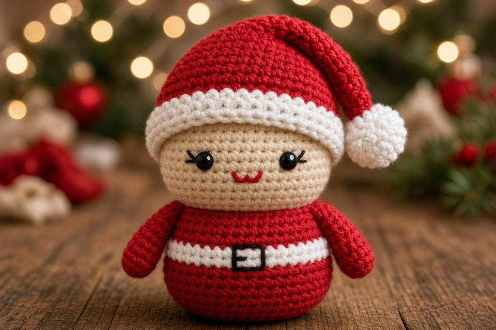
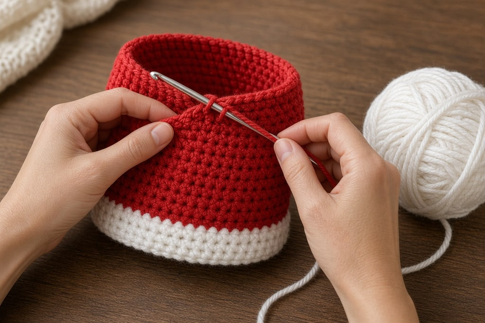
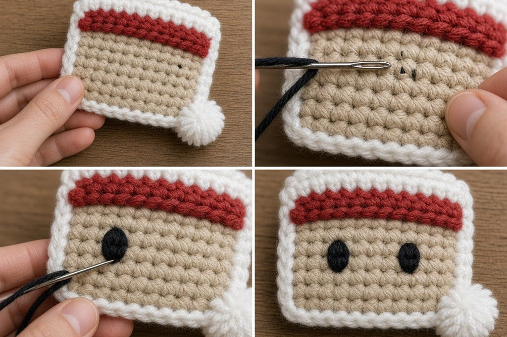

A Santa is the first amigurumi where the face shows. A [gnome](/how-to-crochet-a-gnome/) hides its eyes under a hat, and a [pumpkin](/how-to-crochet-a-pumpkin-step-by-step/) has no face, so both forgive a lot. On Santa, an eye one stitch off is the first thing anyone sees.

The body is easy: one piece, with no neck seam to sew. The skill is placement, and there is a reliable way to do it. Pick one stitch at the center front, mark it, and place every feature by counting stitches and rounds out from that marker, never by eye. A spiral leans slightly, so placing by eye is how faces end up crooked.

US terms. [Abbreviations](/crochet-abbreviations-chart/). The pictures are illustrations. No Santa for this page was made and measured, so no finished height is given.

## What you need

- **Worsted-weight yarn** in red, a skin tone, white, and a scrap of black. [Yarn weights](/yarn-weight-chart/).
- **A hook one or two sizes smaller than the label**, so stuffing does not show. [Hook chart](/crochet-hook-size-conversion-chart/).
- Stuffing, a yarn needle, stitch markers, pins.
- Black yarn for embroidered eyes, or 6 mm safety eyes if the Santa will not go to a small child.

Safety eyes are not safe for children under three. The name refers to the locking washer, not the age range. A plastic eye that works loose is a choking hazard. For a baby or toddler, embroider the eyes.

## Step 1: body and head in one piece

Red. Work in a spiral and mark the first stitch of each round.

**Round 1:** 6 sc in a magic ring. (6)

**Round 2:** 2 sc in each stitch. (12)

**Round 3:** (Sc, 2 sc in next) 6 times. (18)

**Round 4:** (Sc 2, 2 sc in next) 6 times. (24)

**Round 5:** (Sc 3, 2 sc in next) 6 times. (30)

That flat circle is the base. Press it on a table. It must sit flat, or Santa rocks.

**Rounds 6–13:** Sc in each stitch. (30)

**Round 14:** (Sc 3, sc2tog) 6 times. (24) The narrowing makes the shoulders.

Change to the skin tone at the end of round 14. [Changing yarn color](/changing-yarn-color-crochet/).

**Rounds 15–20:** Sc in each stitch. (24)

Stuff the body firmly now, firmer than the head will be. A soft base slumps under the head.

**If you are using safety eyes**, fit them now, before the head closes. See the placement in Step 2.

**Round 21:** (Sc 2, sc2tog) 6 times. (18)

**Round 22:** (Sc, sc2tog) 6 times. (12) Stuff the head.

**Round 23:** Sc2tog 6 times. (6) Fasten off. Thread the tail through the front loops of the last 6 stitches and pull closed.

## Step 2: place the face by counting

<figure class="diagram">

<figcaption>One marker, and every feature counted from it.</figcaption>
</figure>

1. **Pick the front.** The color-change jog is at the back, so choose the stitch opposite it. Thread a strand of contrasting yarn up that column of stitches.
2. **Pick the eye round.** The head is rounds 15 to 23. About two thirds of the way down from the top is round 18 or 17. Lower than instinct says looks friendlier.
3. **Count out.** Each eye sits 2 stitches out from the marker on the same round, so there are 4 stitches between the eyes with the marker in the middle. Pin them.
4. **Nose position.** On the marker, one round below the eyes.

Step back and look from a few feet away before you sew anything.

## Step 3: the eyes and nose

**Eyes.** Embroider each one over a single stitch with black, two or three wraps, or a French knot. Use the same number of wraps on both.

**Nose.** Skin tone:

- **Round 1:** 6 sc in a magic ring. (6)
- **Round 2:** (Sc, 2 sc in next) 3 times. (9)
- **Round 3:** Sc in each stitch. (9)
- **Round 4:** (Sc, sc2tog) 3 times. (6)

Stuff lightly with a pinch of stuffing, fasten off with a tail, and sew it on at the pinned spot.

## Step 4: the beard

Two options. **Fringe** is faster: cut white strands about twice the finished length, fold each in half, pull the fold through a stitch with the hook, then pull the ends through the fold. Work a curve from one side of the face, under the nose, to the other side, then trim. **A crocheted beard** is tidier up close: a half circle of white, worked in rows, sewn on under the nose.

Either way, the beard starts just under the nose and covers the bottom of the face.

## Step 5: the hat

Red. Worked from the tip down.

**Round 1:** 6 sc in a magic ring. (6)

**Rounds 2–3:** Sc in each stitch. (6)

**Round 4:** (Sc, 2 sc in next) 3 times. (9)

**Round 5:** Sc in each stitch. (9)

**Round 6:** (Sc 2, 2 sc in next) 3 times. (12)

**Round 7:** Sc in each stitch. (12)

Keep going the same way, adding 3 stitches every other round, until the hat has 27 stitches: (sc 3, 2 sc in next) for 15, (sc 4, 2 sc in next) for 18, and so on. The head is 24 around, so 27 slips over it.

**Brim:** Change to white. Two rounds of sc. (27) Fasten off with a tail.

**Pom-pom:** Make a second nose in white and sew it to the tip. Do not stuff the hat. Sew it on at a slight angle, all the way round the brim.

## Step 6: the belt

Black. Chain until the chain wraps the body at about round 9, then sc back along the chain. Sew it around the body. A small square of yellow, either a few stitches of embroidery or a tiny crocheted square, makes a buckle at the center front, on the marker line.

## Troubleshooting

**The eyes are uneven.** They were placed by eye. Count from the marker.

**Too high.** Eyes near the top look surprised. Move them down a round.

**He leans backward.** The base is domed or the body is softer than the head. Press the base flat and stuff the body harder.

**Stuffing shows through.** Hook too large. Go down a size.

**The hat perches on top.** Too few stitches. Add one more increase round.

## Frequently asked

### Can the head be a separate piece?

It can, but joining two stuffed balls so the head stays straight is a separate skill. One piece avoids it.

### How do I hide the color-change jog?

Put it at the back. The belt and the hat brim cover most of it.

### Is it safe for a toddler?

With embroidered eyes and firmly sewn parts it has no small parts, but it has not been safety tested. Treat it as decoration.

### What should I make next?

A cone with no face at all is the [gnome](/how-to-crochet-a-gnome/). A flat motif for the tree is the [snowflake](/how-to-crochet-a-snowflake/).
