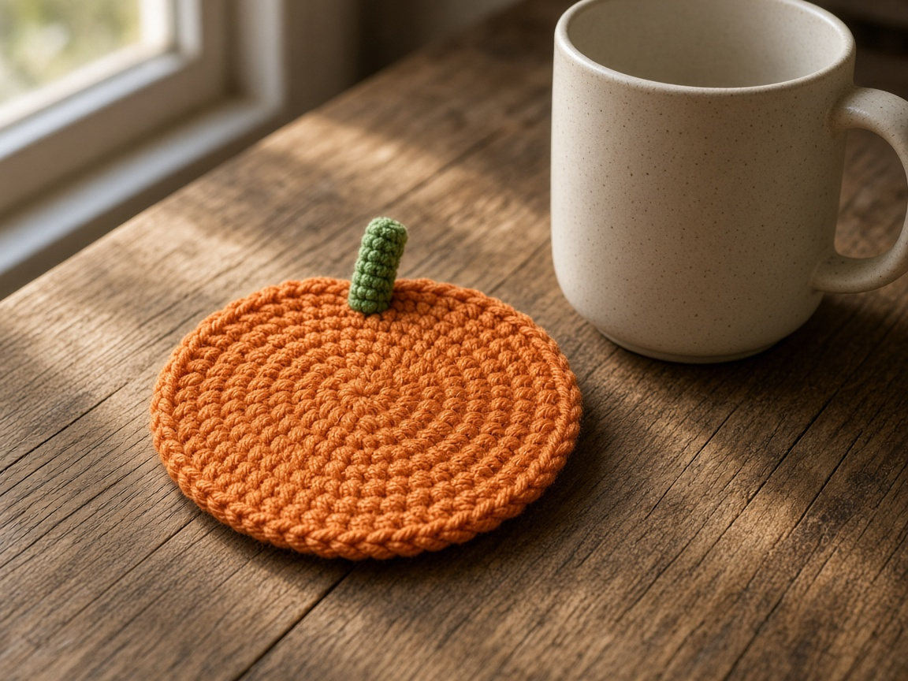

The sizes here come from gauge rather than a finished sample, so set your mug on the disc before you fasten off. The picture is an illustration.

A coaster has one job: lie flat under a mug. The pumpkin coaster on this page is a flat circle of single crochet, which is also the shape that starts most crochet worked in the round. Learning why it stays flat, and what to do when it does not, is most of the skill. The granny squares further down do the same job in a different shape, and the same square grows into a dishcloth. For color changes, see [Halloween Granny Square Variations](/halloween-granny-square-variations/) and [Changing Yarn Color](/changing-yarn-color-crochet/).

US terms. US single crochet is UK double crochet. US double crochet is UK treble. [Abbreviations](/crochet-abbreviations-chart/).

## What is a technique, and what is only a plan

| Piece of this page | What it is |
| --- | --- |
| Six increases per round in single crochet | The usual starting point for a flat single-crochet circle. Your stitch shape decides whether it stays flat. |
| Round n has 6n stitches | Arithmetic you can count. |
| 4 sc to the inch | An unverified planning gauge. |
| About 3.8 inches across | Arithmetic from that gauge. Not measured. |
| A granny round adds 12 double crochet | Arithmetic you can count. |
| Cotton under a warm mug | A fiber choice. Not a heat test. |
| Yardage | Not weighed. The earlier 30 and 60 yard lines are withdrawn. |

## Why a flat circle adds six stitches a round

Each round of single crochet moves the edge outward by about one stitch height. The distance around a circle is 2 × π × the radius, so every round has to be longer than the last by about 2 × π, or 6.28, stitch heights. If a single crochet is about as tall as it is wide, that is about six extra stitches per round. That is where "start with 6, add 6 each round" comes from.

It is a good rule, not a law. The DK *Crochet: The Complete Step-by-Step Guide* starts its practice circle with 8 single crochet and doubles to 16, and starts its circular pillow with 6. Both lie flat for some people. Double crochet circles commonly start with 12 for the same reason: a taller stitch moves the edge further each round, so the round needs more new stitches.

That is also why the same written circle cups for one person and ruffles for another. If your single crochet is taller than it is wide, six new stitches are too few and the edge pulls up into a bowl. If your stitches are short and wide, six are too many and the edge waves.

<figure class="diagram">

<figcaption>One increase in each of six wedges per round. The number in brackets is how many plain stitches sit between increases.</figcaption>
</figure>

## Materials

- **Worsted cotton:** orange for the disc and a short length of green for the stem. Cotton soaks up condensation from a cold glass. Next to a warm mug it is the safer fiber, because acrylic can melt near heat. That is a fiber choice, not a heat rating. [Yarn weights](/yarn-weight-chart/).
- **A US G/6 (4.0 mm) hook**, or the size that gives you a flat circle. A smaller hook than the label suggests makes a denser coaster that hides the table. [Hook chart](/crochet-hook-size-conversion-chart/).
- **A stitch marker.** In a spiral you cannot see where a round ends without one.
- Yarn needle, scissors.

To estimate yarn for a set, weigh your first finished coaster and multiply.

## Size: wider than the mug, not a fixed number

At the planning gauge of 4 single crochet to the inch, 48 stitches are 48 ÷ 4 = 12 inches around. Across is 12 ÷ 3.14 = about **3.8 inches**. That is arithmetic, not a measured disc.

Measure the base of the mug you will use. The coaster should be wider than that by whatever margin you like. Each extra round adds 6 stitches, which at 4 per inch is 1.5 inches of edge, or 1.5 ÷ 3.14 = about **half an inch** across. That makes adding a round an easy fix.

## The pumpkin disc, round by round

Work in a spiral: do not join rounds. Put the marker in the first stitch of each round and move it up as you go. [Working in the round](/crochet-in-the-round/) covers the spiral and the magic ring.

**Rnd 1.** Magic ring, 6 sc in the ring. Pull the tail until the hole closes. (6)

<figure class="diagram">

<figcaption>Pull the tail until the center closes. An open center is the first thing a mug finds.</figcaption>
</figure>

**Rnd 2.** 2 sc in each stitch. (12)

**Rnd 3.** (Sc in the next stitch, 2 sc in the next) 6 times. (18)

**Rnd 4.** (Sc in the next 2, 2 sc in the next) 6 times. (24)

**Checkpoint:** lay it flat. At 24 stitches a small disc should already lie flat or nearly so. A bowl shape here will only get worse.

**Rnd 5.** (Sc in the next 3, 2 sc in the next) 6 times. (30)

**Rnd 6.** (Sc in the next 4, 2 sc in the next) 6 times. (36)

**Rnd 7.** (Sc in the next 5, 2 sc in the next) 6 times. (42)

**Rnd 8.** (Sc in the next 6, 2 sc in the next) 6 times. (48)

**Rnd 9.** Sc in each stitch. (48)

**Checkpoint:** measure across and set your mug on it. Add a round of increases, (sc in the next 7, 2 sc in the next) 6 times for 54, if it is too small. Then work one plain round.

**Finish.** A spiral ends half a step higher than it started. Slip stitch into the next stitch, fasten off, and weave the tail along the edge for an inch to smooth the step.

### Keeping it round instead of six-sided

<figure class="diagram">

<figcaption>Move where the increases fall from round to round, and the six corners never form.</figcaption>
</figure>

Written as above, each round's increases sit just past the last round's, and they stack into six lines that can turn the circle into a soft hexagon. To break the lines, start alternate rounds partway through the repeat. Round 5, for example, becomes: sc in the next stitch, 2 sc in the next, (sc in the next 3, 2 sc in the next) 5 times, sc in the last 2. That is 1 + 2 + 25 + 2 = 30, the same count with the increases moved.

## Stem

With green, ch 7. Slip stitch in the second chain from the hook and in each chain back. (6 sl st) Fasten off, leaving a tail. Sew the tail end to the edge of the disc so the chain sticks out like a stem. Sew through the disc and back through the chain, then weave the tail. A knot on the back is not a finish.

## Reading a circle that is not flat

<figure class="diagram">

<figcaption>Hold the disc at eye level on the table. The edge tells you which way to adjust.</figcaption>
</figure>

**It cups.** Count first: a missed increase is the usual cause. If the count is right, go up a hook size. If it still cups, your single crochet is tall for six increases. Add a seventh increase on alternate rounds and count carefully.

**It ruffles.** Count first: an extra increase does this too. If the count is right, go down a hook size, or work one plain round and look again.

**It looks six-sided.** Stacked increases. Stagger them as shown above.

**There is a hole in the middle.** The magic ring was not pulled closed. Pull the tail again and weave it through the first round.

**It is smaller than the mug.** Add rounds. Each one adds about half an inch across at the example gauge.

## Granny square coaster (make 4)

The granny square is a second shape for the same job. It shows more of the table through its spaces, so it suits a mug more than a sweating glass.

**Color order suggestion.** Rnd 1 A (orange), Rnd 2 B (black), Rnd 3 C (purple), Rnd 4 B (black). Or follow Variation 1 on the granny tutorial. In this square the beginning ch-3 counts as a double crochet.

**Rnd 1.** With the first color, ch 4, join to form a ring. Ch 3, 2 dc in the ring, ch 2, (3 dc in the ring, ch 2) 3 times, join to the top of the ch-3. Fasten off if changing. (12 dc, 4 corners)

<figure class="diagram">

<figcaption>Round 1: four clusters in the ring, with a ch-2 corner between each pair.</figcaption>
</figure>

**Rnd 2.** Join the next color in any ch-2 corner. Ch 3, (2 dc, ch 2, 3 dc) in the same corner, ch 1, *(3 dc, ch 2, 3 dc) in the next corner, ch 1; rep from * twice more, join. Fasten off if changing. (24 dc, 4 ch-2 corners, 4 ch-1)

<figure class="diagram">

<figcaption>Round 2: every cluster goes into a corner, and the ch 1 between corners makes the first side spaces.</figcaption>
</figure>

**Rnd 3.** Join the next color in any corner. Ch 3, (2 dc, ch 2, 3 dc) in the corner, ch 1, 3 dc in the next ch-1 space, ch 1, *(3 dc, ch 2, 3 dc) in the corner, ch 1, 3 dc in the next ch-1 space, ch 1; rep from * around, join. (36 dc, 4 ch-2 corners, 4 side clusters)

<figure class="diagram">

<figcaption>From round 3 on, side clusters go into those ch-1 spaces, never into a stitch top.</figcaption>
</figure>

**Rnd 4.** Join in any corner. Ch 3, (2 dc, ch 2, 3 dc) in the corner, ch 1, 3 dc in the next space, ch 1, 3 dc in the next space, ch 1, *(3 dc, ch 2, 3 dc) in the next corner, ch 1, 3 dc in the next space, ch 1, 3 dc in the next space, ch 1; rep from * around, join. (48 dc, 4 corners, 2 side clusters on each side)

Each round adds 12 double crochet: 12, 24, 36, 48. The corners do the growing. Every round puts a new corner shell on each side of each corner and one more cluster along each side. If a round comes out at a number other than a multiple of 12, a cluster went into a stitch top instead of a space. No size is promised for this square. Measure yours after blocking.

## Dishcloth

Work as the coaster through Rnd 4, then keep going in the same pattern through **Rnd 7**, one more cluster per side each round. Round 7 has 7 × 12 = 84 dc. Stop earlier or later if the cloth is the size you want. Suggested colors: alternate B and A each round with a C round in the middle.

**Optional border.** One round of single crochet in B: 1 sc in each dc and each ch-1 space, and 3 sc in each corner space. On a 7-round square that is 27 along each side plus 3 at each corner, 120 in all. Count the first side before you go round.

## Finishing

Change color on the last yarn-over of the join. Weave the ends in as you go, because black ends show through orange if left loose. Block all pieces to the same measurement before calling the set done. Steam- or wet-block cotton as described in the [blocking notes](/weaving-in-ends-and-blocking/). Label the back of one coaster with the fiber content if you are giving the set away.

## Frequently asked

### Can this go in the microwave?

No. It is a coaster. Cotton is the safer fiber next to a warm mug, but a coaster is not a hot pad, and nothing on this page was heat-tested.

### Why does my circle look like a hexagon?

The increases are stacked in six lines. Stagger the start of each repeat on alternate rounds.

### Do I need the granny squares too?

No. The round pumpkin stands on its own. The squares are a second set if you want a matching cloth.

## What to make next

A stuffed [pumpkin](/how-to-crochet-a-pumpkin-step-by-step/), which starts with this same circle and then stops increasing so the sides rise. Or the [granny square tote](/how-to-crochet-a-granny-square-tote/), which joins eight of these squares, or the [mug cozy](/crochet-mug-cozy-for-beginners/) if you would rather wrap the cup than sit under it.
