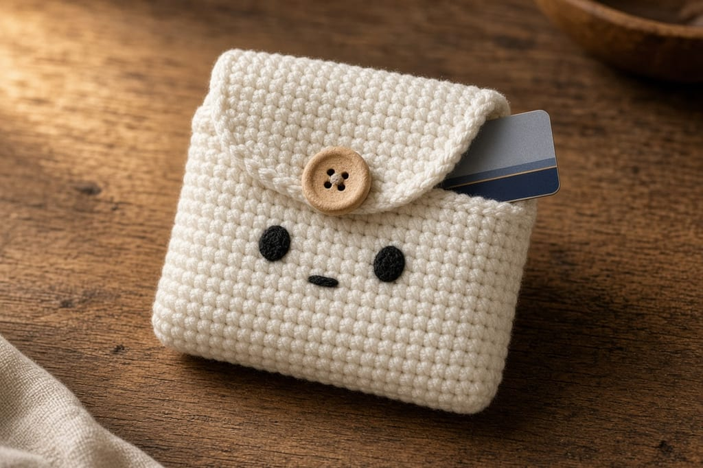
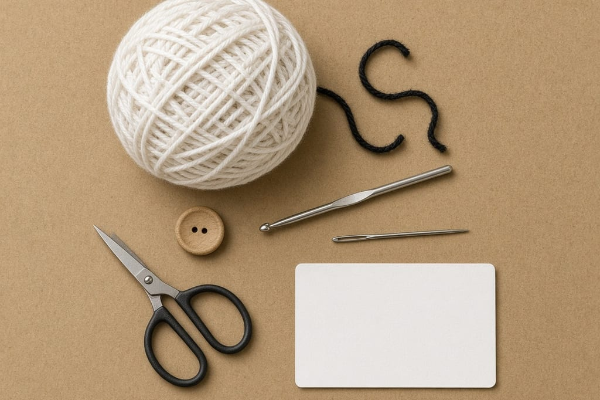

This is a fixed-count pattern for a small white wallet with a ghost face on its flap. It differs from the [Halloween card wallet](/halloween-crochet-card-wallet/), which teaches you to size a pocket from any cards, in two ways. The pocket here is deep enough for a dollar bill folded in half as well as a card. And the flap is shaped: three decrease rows narrow it from the full width to a rounded tab with a button loop. Shaping a flap with paired decreases is the skill this page teaches.

A standard ID-1 card, the size of most US bank cards and licenses, is **3.370 × 2.125 inches** (85.60 × 53.98 mm) under ISO/IEC 7810. US paper currency is **2.61 × 6.14 inches**, per the Bureau of Engraving and Printing. Folded in half, a bill is about 3.07 × 2.61 inches.

US terms. US single crochet is UK double crochet. [Abbreviations](/crochet-abbreviations-chart/). The pictures are illustrations. No wallet for this page was crocheted or measured. Lay a card on the fabric before you seam.

## How the wallet is built

One rectangle, 16 stitches wide. Rows 1 to 14 fold up to become the front of the pocket. Rows 15 to 28 are the back. Rows 29 to 34 are the flap: two straight rows, three decrease rows, and a row with a chain loop for the button. Seam the pocket sides, sew on a button, and embroider a face on the flap.

### Why the pocket is 14 rows

Fourteen rows at 5 per inch is 2.8 inches. That is deeper than a card needs, on purpose: a bill folded once is 2.61 inches tall, and it has to fit under the flap too. The cost is that a card alone sits about two-thirds of an inch below the opening. To take it out, press up on it from the bottom of the pocket, through the fabric.

If you will never carry cash, see the card-only variation below. Its pocket is 2.4 inches, so the card sits nearer the top.

### How the flap narrows

A single crochet decrease (sc2tog) turns two stitches into one. Work one at the start and one at the end of a row, and the row is two stitches shorter, one from each side. Both edges step inward by a stitch, a quarter inch at this gauge. Three such rows take the flap from 16 stitches to 10, from 4 inches to 2.5, and the corners slope evenly on both sides.

<figure class="diagram">

<figcaption>Decrease at both ends of the same row, or the flap leans to one side.</figcaption>
</figure>

## What you need

- **Worsted cotton**, white, and a scrap of black. Cotton holds a pocket's shape better than fuzzy acrylic. [Yarn weight chart](/yarn-weight-chart/).
- **US G/6 (4.0 mm) hook**, or whatever gives 4 stitches per inch. [Hook chart](/crochet-hook-size-conversion-chart/).
- **One button**, about 1/2 inch across.
- Yarn needle, scissors, one card to test the fit.

Abbreviations used: ch, sc, sc2tog (single crochet two together, written "dec" below).

## Gauge check

Work rows 1 to 4 and measure. Sixteen stitches should be close to 4 inches. Seamed, that leaves about 3.75 inches inside for a 3.37 inch card.

If 16 stitches measure under 3.6 inches, the card will jam after seaming. Go up a hook size, or work 18 stitches: chain 19, and every count below goes up by 2 (18, 16, 14, 12), with row 34 as sc 4, ch 5, skip 4, sc 4.

## Stage 1: the rectangle

**Row 1:** Ch 17. Sc in the second chain from the hook and in each chain across. Turn. (16)

<figure class="diagram">

<figcaption>Step 1. Chain 17 for 16 sc, about 4 inches at the example gauge.</figcaption>
</figure>

**Rows 2–30:** Ch 1, sc in each stitch across. Turn. (16)

The ch 1 does not count as a stitch. Count every five rows. Single crochet edges tend to gain a stitch at the turn.

<figure class="diagram">

<figcaption>The gained stitch this page warns about. The first sc of each row goes into the edge stitch, not the ch 1.</figcaption>
</figure>

## Stage 2: the flap

**Row 31:** Ch 1, dec, sc in the next 12 stitches, dec. Turn. (14)

**Row 32:** Ch 1, dec, sc in the next 10 stitches, dec. Turn. (12)

**Row 33:** Ch 1, dec, sc in the next 8 stitches, dec. Turn. (10)

**Row 34:** Ch 1, sc in the next 3 stitches, ch 5, skip 4, sc in the last 3. (6 sc and a ch-5 loop)

<figure class="diagram">

<figcaption>Step 2. The loop row works over the 10 stitches left after the three decrease rows.</figcaption>
</figure>

Fasten off.

Each decrease row uses every stitch of the row below: 2 + 12 + 2 = 16, then 2 + 10 + 2 = 14, then 2 + 8 + 2 = 12. Row 34 is 3 + 4 skipped + 3 = 10. If the loop misses your button, redo row 34 with ch 6 or ch 7 over the same four stitches.

## Stage 3: fold and seam

<figure class="diagram">

<figcaption>Diagram. Fold, then seam the sides.</figcaption>
</figure>

Lay the rectangle with the foundation chain at the bottom. Fold it up so the fold falls between rows 14 and 15. The chain edge now lies against row 28. Rows 29 to 34 stand above as the flap.

Slide the card in before you sew. It should go in flat and sit below the opening. Then try the folded bill behind it.

Whipstitch each side from the fold to the opening, through both layers, catching only the outer loop of each edge stitch. Going deeper takes width from the inside. Go back along each side a second time. A card corner works at a single seam line until it opens. Weave the tails inside the seam.

## Stage 4: button and face

<figure class="diagram">

<figcaption>Diagram. Button above the face.</figcaption>
</figure>

Close the flap with the card inside. Mark where the loop lands on the front. Sew the button there, through the front layer only.

With black, embroider the face on the outside of the flap, above the loop: two short stitches for eyes, about 4 stitches apart, and a small wide V or oval a row below them for the mouth. Shallow stitches. Deep ones leave a bump on the inside of the flap that catches the card.

## Mark the three zones before folding

On the original 34-row version, place removable markers at rows 14 and 28. Fold between 14 and 15; the foundation edge meets row 28, while rows 29–34 remain the free flap. Pair side row ends from the fold upward: front 14 with back 15, front 13 with back 16, continuing to front 1 with back 28. Sew each pair without catching the flap. The loop in row 34 replaces four base positions with five chains and is intentionally not a ten-sc straight row. Test the actual button before fastening off that row.

## Variations

**Card only.** Work row 1 and rows 2–26 at 16 stitches. Mark the fold between rows 12 and 13: front 1–12, back 13–24, straight flap 25–26. New rows 27, 28, and 29 use the original decrease instructions for rows 31, 32, and 33, finishing at 14, 12, and 10. New row 30 is sc 3, ch 5, skip 4, sc 3. The foundation edge meets row 24 when folded; diagrams numbered through row 34 show only the original cash-and-card version.

**A colored flap.** Work rows 31 to 34 in a second color, changing on the last yarn-over of row 30. See [changing yarn color](/changing-yarn-color-crochet/).

**No face.** A plain white wallet works the same.

## Troubleshooting

**The flap leans.** A decrease was missed at one end. Count the stitches on rows 31 to 33.

**The flap edges look stepped.** That is normal for single crochet decreases. A round of slip stitch around the flap smooths it.

**The card will not go in.** The seams went too deep, or the gauge is tight. Resew through the outer loops, or remake with a larger hook.

**The bill lifts the flap off the button.** Two bills, or a bill folded in quarters. One bill folded once.

**The pocket sags.** Loose gauge. Drop to an F/5 (3.75 mm) hook and redo it. Check the card again before seaming.

## Care

Empty it. Hand wash cool, dry flat, and do not iron the face. Cotton can shrink. If it does, the card will tell you, and the fix is the wider foundation, not stretching.

## Frequently asked

**Will a US driver's license fit?**

Most are ID-1 size, the same as a bank card. Test yours.

**Can I add a lining?**

Not at this width. A fabric lining takes up the ease the card needs.

**Can I sell finished wallets?**

Yes. Do not repost the pattern.

**Left-handed?**

Same rows. The fold and face do not change. See [left-handed crochet](/left-handed-crochet/).

## Next

The method for sizing a flap pocket to any cards is the [Halloween card wallet](/halloween-crochet-card-wallet/). A drawstring pouch for coins is a [drawstring bag](/how-to-crochet-a-drawstring-bag/). Decreases are explained in [increase and decrease](/crochet-increase-decrease/). A ghost-shaped wallet with a scalloped hem and no flap is the [ghost crochet wallet](/ghost-crochet-wallet/), part of the [Halloween crochet wallet collection](/halloween-crochet-wallets/).
