A ghost wallet only works if it still looks like a ghost with cards in it. This one keeps the face above the pocket, so the cards sit behind the ghost's middle and the face never stretches. Two flat panels, one edging round that joins them and scallops the hem, and a snap you cannot see from outside.

It is one of five patterns in the [Halloween crochet wallet collection](/halloween-crochet-wallets/). If you want a smaller, simpler ghost with a fold-over flap, the [ghost mini wallet](/ghost-crochet-mini-wallet/) is a different design worth a look. This one teaches shaping with decreases and joining two layers with an edging. The chain 1 that starts every row is the non-stitch described in [turning chains](/crochet-turning-chain/). Decreases are the same move as in [increases and decreases](/crochet-increase-decrease/), used here at both ends of four rows only.

The finished size and card fit here are worked out from the example gauge rather than measured from a finished wallet, so swatch first and lay a real bank card on the front panel before you join. A standard US bank card is 3.370 by 2.125 inches, the ISO/IEC 7810 ID-1 size.

## Where the two panels overlap

#### Name the back and the front

1. This ghost is not a tube and it is not a folded rectangle.
2. It is a tall back and a short front, joined later by one round.
3. The back is the outside. Its chain edge is the hem, the wide bottom.
4. Rows 1 through 18 stay 17 stitches wide.
5. Rows 19 through 22 step in at both ends and finish at 9 stitches. That stepped top is the head.
6. The front is the pocket wall. It is also 17 stitches wide, and it stops at row 14.
7. When the hems are matched, eight rows of the back show above the front: rows 15, 16, 17, and 18, still 17 stitches wide, and then the four narrowed rows.

<figure class="diagram">

<figcaption>Diagram. The front covers the lower back. The face and the head stay above row 14.</figcaption>
</figure>

#### Where the opening, the face, and the snap sit

1. The pocket opening is the top edge of the front, row 14.
2. Nothing in the joining round crosses that edge.
3. The round travels up the side through both layers for 14 row ends, then continues up the back alone.
4. Cards sit behind the ghost's middle, under the face.
5. The face is on rows 16 to 18 of the back, which is above the opening, so a full pocket does not stretch the eyes.
6. The snap is on row 13, stitch 9, one row below that opening.
7. Sew the snap while the panels are still separate so each half can catch one panel only.

A stitch that crosses the top of the front closes the pocket on that side. The face rows stay above row 14 so the eyes are not on the fabric the cards rub.

#### Read the gauge figures before you join

These inches are the gauge applied to the stitch counts. Lay the card on the front panel before you join. The card is 3.370 inches wide and 2.125 inches tall.

| What you are measuring | Count at the example gauge | Figured size |
| --- | --- | --- |
| One panel, outside width | 17 stitches | 4.25 in |
| Inside width, after the side edging takes a little | same 17 | about 3.9 in |
| Front height | 14 rows | 2.8 in |
| Pocket depth after the hem is joined | same 14 rows | about 2.7 in |
| Back height before the edging | 22 rows | 4.4 in |
| Overall, after the scallops and the round on top | back plus that edging | about 4.6 by 4.9 in |

On paper the card is narrower than 3.9 inches and shorter than 2.7 inches, with room above it for the snap at row 13.

## What you are looking at when you count

#### Chain 1, then the first real stitch

1. Every row on both panels starts with chain 1 and a turn.
2. The chain 1 is not a stitch.
3. The first single crochet goes into the first stitch of the row, the one that was the last stitch before you turned.
4. The last single crochet goes into the last stitch, even if that stitch is tilted on the edge.
5. Stop and pull a row that is not 17 on the straight section. The next row will not repair it, because this pattern has no increase row that puts a stitch back.

| Count across a straight row | What happened |
| --- | --- |
| 18 | The turning chain was worked. |
| 17 | The first and last stitches were both used, and the chain 1 was left out of the count. |
| 16 | The first or last stitch was skipped. |

A row of 16 or 18 on the rectangle becomes the width of every row above it. Pull that row before you turn.

#### Pick the right side only after row 22

1. The right side and the wrong side alternate, because you turn.
2. Pick the right side only after the back panel is finished, when you can see all 22 rows and choose the face you like.
3. Do not decide on row 2.
4. The embroidery and the socket go on the right side of the back.
5. The ball of the snap goes on the wrong side of the front, so that when the wrong side of the front lies against the face, the two snap halves face each other inside the pocket.

#### A decrease at the start, then one at the end

1. A decrease at the start of a row is two stitches becoming one, before any plain single crochet.
2. A decrease at the end is the last two stitches becoming one, after the plain stitches are done.
3. The plain-stitch counts are different on each shaped row because the row below is two stitches shorter each time.
4. Those plain numbers are the stitches between the decreases, not the finished count.

| Row | Plain stitches between the decreases | Finished count |
| --- | --- | --- |
| 19 | 13 | 15 |
| 20 | 11 | 13 |
| 21 | 9 | 11 |
| 22 | 7 | 9 |

The plain counts run 13, then 11, then 9, then 7. The finished counts run 15, then 13, then 11, then 9. Read the row you are on.

#### Half double crochet lives only in the scallops

1. Half double crochet appears only in the scallops.
2. US half double crochet yarns over, pulls up a loop, and pulls through all three loops on the hook.
3. It is taller than the single crochet of the panels.
4. Five of them in one hem stitch make the fan.
5. The rest of the wallet is single crochet.

UK terminology names that stitch differently. If you follow a UK half treble here you will get a taller fan than the pattern, and the hem will flute. Stay with US half double.

#### One stitch through both layers

1. Working through two layers means the hook enters a stitch or a row-end on the front and the matching stitch or row-end on the back before it pulls up a loop.
2. One stitch joins both.
3. Spread the layers on the table so both edges are visible.
4. The row-end is the small hole at the side of a finished row, not the V on top of the stitch, and not the turning-chain loop.

| What the hook entered | What the side count does |
| --- | --- |
| Front row-end and the matching back row-end | One stitch joins both layers. The first side can still be 14 + 4 + 5 = 23. |
| Two stitches on the same panel | That panel is seamed to itself. The other panel is left out. |
| The turning-chain loop as an extra hole | The side count does not include that loop. An extra one makes 24, and the return side will not match it. |

## Materials

- **Worsted weight (CYC 4) yarn** in cream, ivory, or white. Cream hides grime better than bright white. [Yarn weight chart](/yarn-weight-chart/).
- **Scraps** of black for the eyes and mouth and soft pink for the cheeks.
- **US G/6 (4.0 mm) hook**, or the size that gives the gauge. Firm fabric matters more than the number. [Hook size chart](/crochet-hook-size-conversion-chart/).
- **One sew-on snap**, 3/8 in (10 mm), with cream or white thread. A clear plastic snap disappears best.
- Tapestry needle, two stitch markers, scissors, one card.

#### How much yarn to weigh

1. The amount is not weighed from a made wallet.
2. The two panels and edging come to about 33 square inches, about 2 times a 4 inch swatch.
3. Weigh your swatch, double it, and add 20 percent.

## Abbreviations and stitches

US terms. US half double crochet is UK half treble. See the [abbreviations chart](/crochet-abbreviations-chart/).

| Abbreviation | Meaning |
| --- | --- |
| ch | chain |
| sc | single crochet |
| hdc | half double crochet |
| sl st | slip stitch |
| sk | skip |
| sc2tog | single crochet two together: pull up a loop in each of 2 stitches, yarn over, pull through all 3 loops. One stitch fewer. |
| st(s) | stitch(es) |
| RS / WS | right side / wrong side |

#### Turning chain rule

1. Every row begins: ch 1, turn.
2. The ch 1 does not count as a stitch.
3. Work the first single crochet into the first stitch.

#### Single crochet through two layers

1. Insert the hook through the front panel and then the back panel, matching the edges.
2. Work the stitch as normal.

## Size and gauge

**Gauge:** 16 sc and 20 rows = 4 in. Make and measure a swatch first, as in the [gauge guide](/crochet-gauge/).

#### Width, depth, and where the card sits

1. Each panel is 17 stitches, 4.25 inches wide.
2. The side edging takes a little from each side, which leaves the pocket about 3.9 inches wide inside, against a 3.37 inch card.
3. The front panel is 14 rows, 2.8 inches.
4. After the hem join, the pocket is about 2.7 inches deep.
5. A 2.125 inch card leaves room above it for the snap at row 13.
6. The back panel is 22 rows, 4.4 inches, and the edging adds the scallops below and a round on top: about 4.6 by 4.9 inches overall.

#### When the counts match and the ruler does not

1. Measure both panels against the same swatch.
2. A back that is 17 stitches and a front that is 17 stitches can still be different widths if you relaxed your tension halfway through.
3. The pattern's check is the ruler, not the count alone: if the numbers match and one panel is wider, remake the odd one.
4. Do not block one panel wider to match the other before joining. Blocking changes the row gauge too, and the eight rows that should show above the front will change height.
5. The card test on the front panel is a flat lay. The card should be narrower than the 17 stitches and shorter than the 14 rows, with a band of fabric above the card where row 13 sits.
6. If the card covers row 13, your rows are shorter than the example gauge and the snap will sit on the card.
7. Move both snap halves up by the same number of rows if that happens, and keep them on stitch 9.

Blocking one panel to stretch the width also changes how tall those eight rows look above the front. Remake the panel that does not match the swatch.

#### What 5 rows to the inch does to the head

1. Row height is 20 rows to 4 inches in the example, which is 5 rows to the inch.
2. Fourteen rows are the stated 2.8 inches.
3. Twenty-two rows are the stated 4.4 inches.
4. The difference, 8 rows, is 1.6 inches at that gauge.
5. That 1.6 inches is the head plus the four straight rows above the pocket, on paper. It is the gauge applied to those eight rows.
6. If your swatch is 18 rows to 4 inches, the head will be taller than the example and the scallops will still fit the hem, because the scallop repeat depends on the 17 stitches, not on the row gauge.
7. The side count of 14 plus 4 plus 5 assumes one single crochet in each listed row end, so a taller row gauge does not add side stitches. It only makes the ghost longer.

Scallops follow the 17 hem stitches. A taller row gauge changes the length of the ghost. It does not add a stitch to the side count of 23.

## The pattern

### Step 1: chain the back panel

<figure class="diagram">

<figcaption>Diagram. The hem is the wide bottom. Rows 19 to 22 narrow at the top.</figcaption>
</figure>

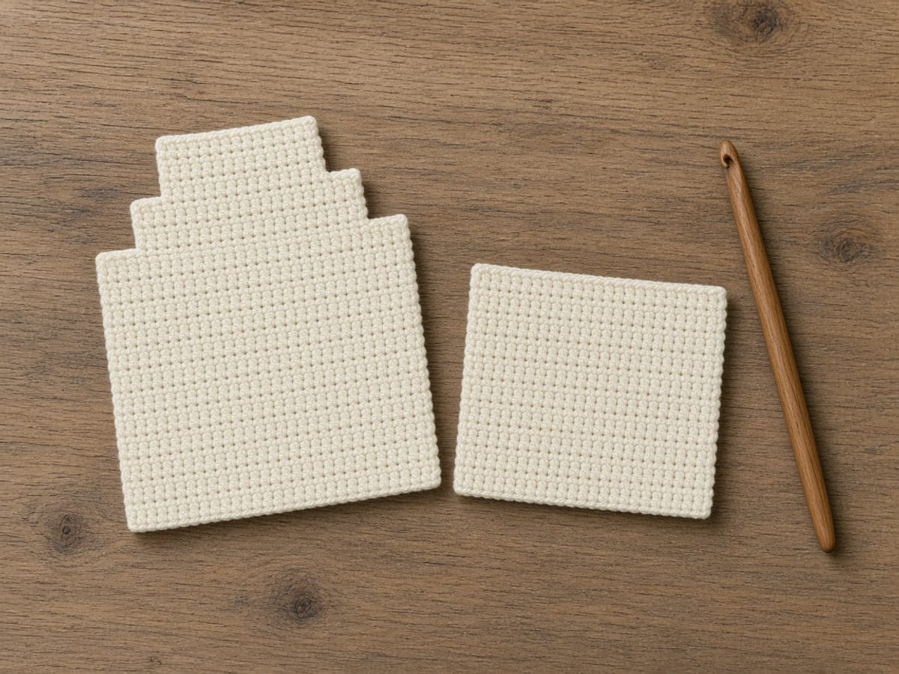

Use cream. The chain you make now is the hem, the wide bottom of the ghost.

1. Put a slip knot on the hook.
2. Chain 18. Count every chain. Do not count the loop sitting on the hook.
3. Skip the chain nearest the hook. Insert the hook into the second chain from the hook.
4. Yarn over, pull up a loop, yarn over, pull through both loops. That is 1 single crochet.
5. Move to the next chain and make 1 single crochet there. Keep going until the last chain has a stitch in it.
6. Count the single crochet. Stop only when you have 17. Sixteen means a chain was skipped. Eighteen means the chain next to the hook was used.

#### Keep the chain as the hem

1. The chain of 18 is the hem, and it stays the hem.
2. Do not start the panel with a row of foundation single crochet that replaces the chain.
3. The scallop round looks for 17 hem stitches with a chain edge it can enter through both layers.
4. A foundation row has a different bottom edge, and the skip, fan, skip, slip stitch repeat will not have the same loops to enter.

Foundation single crochet replaces the chain the scallops need. The hem of this pattern is the chain of 18, with 17 single crochet worked into it.

#### Look at row 1 before you turn

1. Count 17 V's, one in each chain except the one nearest the hook.
2. The skipped chain sits at the end where the hook started, a small knot of unused chain just before the first single crochet.
3. That unused chain is not a stitch you will scallop into.
4. The scallops use the 17 single crochet.
5. If you later count 18 loops along the hem, you are counting that skipped chain or the slip knot.
6. Do not put a scallop stitch in it.

| Loops you can see along the hem | What to do |
| --- | --- |
| 17 single crochet | Scallop these. This is the hem the repeat uses. |
| 18, counting the skipped chain or the slip knot | Leave that extra loop out. A scallop stitch in it shifts every fan. |

#### Leave both tails until the panel is done, then weave them

1. The slip knot's tail hangs at the first chain.
2. Weave it in when the panel is done, before the panels are joined, along the hem on the wrong side.
3. A tail left until after the scallops gets trapped under the fans, where you cannot reach it without pulling the edging out.
4. The same is true of the tail at row 22.
5. Weave that one as soon as you fasten off the back, because the joining round covers the edge it would have traveled.

#### A straight bottom, and nothing else yet

1. Row 1's right side is whichever face you prefer once the shaping is done.
2. For now, the only check is the count and a straight bottom.
3. The ends of the row should be the same height.
4. A sloped row 1 means the hook split some chains and entered under one loop only, so those stitches are shorter.
5. Pull back to the first short stitch and re-enter under the whole chain, the way you did on the stitches that look full.

### Step 2: straight rows 2 through 18

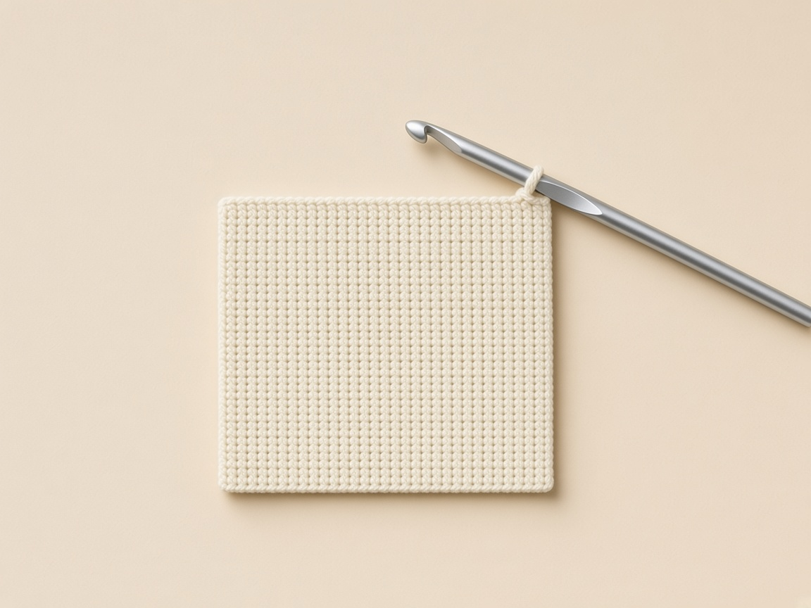

<figure class="diagram">

<figcaption>Diagram. Chain 1 does not count. Each of these rows is 17 single crochet.</figcaption>
</figure>

Do this same short list for row 2. Then do it again for row 3, row 4, and so on, until the side edge has 18 ridges counting up from the chain.

1. Chain 1. Leave it. It is not a stitch.
2. Turn the fabric so the row you just finished lies under the hook.
3. Find the first stitch, the one directly under that chain 1. Insert the hook under both loops of its V.
4. Single crochet in that stitch.
5. Single crochet in every stitch to the end, including the last one. Do not add a stitch into the turning chain.
6. Count across. You still need 17.
7. If the count is 16, the first or last stitch was skipped. Pull the row out and redo it before you start the next one.

After row 18 the panel is still a rectangle. Do not decrease yet.

#### Count the side edge, not only the top

1. From the chain up to the top of row 18 you want 18 ridges.
2. Each ridge is one row.
3. A ridge that splits into two near the edge is a row where the first stitch and the turning chain both got worked, and the top count may still have been forced back to 17 by skipping somewhere else.
4. That panel will be wider in the middle than at the ends.
5. Lay a ruler on the center and on the last row. They should match.
6. The pattern's width is 17 stitches all the way, which at the example gauge is 4.25 inches.

A top count of 17 can hide a row that used the turning chain and then skipped somewhere else. The ruler on the center and on the last row catches that.

#### Curl is not a reason to shape early

1. The rectangle can curl at the sides. That curl is normal for single crochet.
2. It is not a sign to decrease early.
3. Pin the corners if you need them flat to count.
4. Do not add a border yet.
5. The only edging this pattern has is the joining round, and it has to be worked through both panels at once along the hem and the lower sides.

#### Stop at row 18 even if the piece looks short

1. Stop even if the piece looks too short for a ghost.
2. Rows 19 to 22 add the head.
3. Stopping at row 18 and then adding a few more straight rows because it looks stubby pushes the face and the snap away from the row numbers in the chart.
4. The face is on rows 16 to 18.
5. Those rows exist only if row 18 is still the last full-width row.
6. An extra straight row renumbers everything above the hem.

An extra straight row after row 18 moves the face, the snap, and the opening off the row numbers in the chart. The head is rows 19 to 22, not more rectangle.

#### A missed stitch found at row 18

1. If you lost a stitch on row 10 and only noticed at row 18, pull back to row 10.
2. A panel that is 16 stitches wide cannot use the scallop repeat, and it cannot match a 17-stitch front.
3. A hem of 16 or 18 stitches cannot land the repeat. The same fact shows up again when you count the scallops.

| Hem stitches | What the scallop repeat can do |
| --- | --- |
| 16 | The repeat cannot land. Pull back to the row that dropped a stitch. |
| 17 | The repeat uses the hem exactly. |
| 18 | The repeat cannot land. A chain was added, or the turning chain was counted as a stitch. |

### Step 3: narrow the top, one row at a time

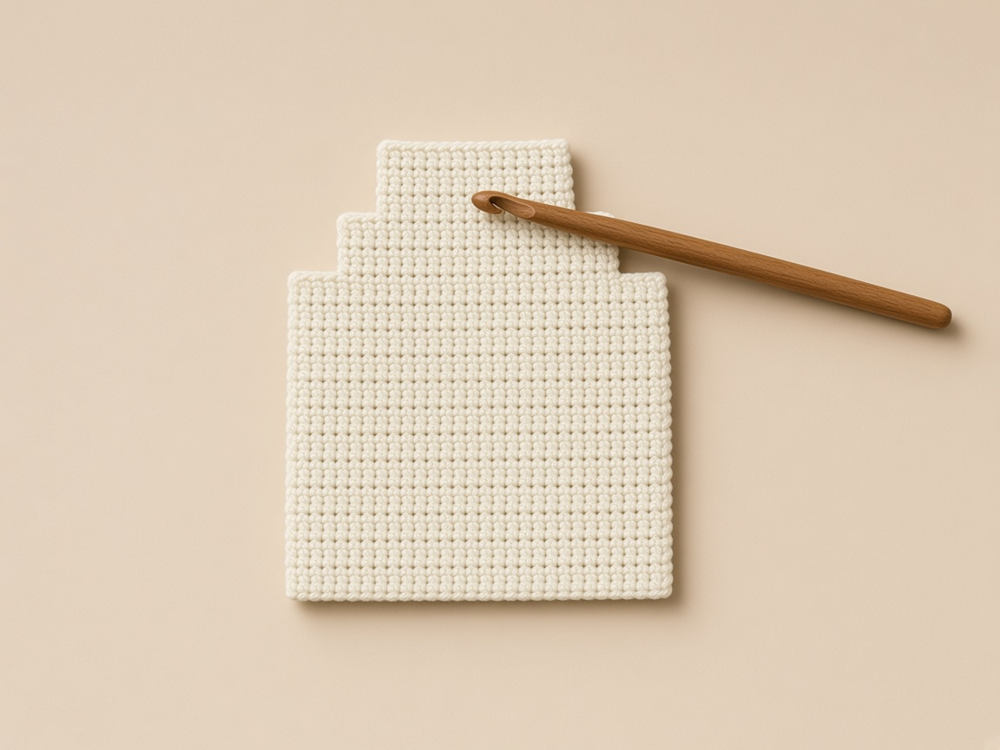

<figure class="diagram">

<figcaption>Diagram. The hem stays wide. Only rows 19 to 22 get smaller.</figcaption>
</figure>

Each of these rows starts and ends with a decrease. A decrease is two stitches becoming one: insert the hook in the first stitch and pull up a loop, insert it in the next stitch and pull up a loop, yarn over, pull through all three loops.

**Row 19.** Chain 1, turn. Decrease over stitches 1 and 2. Single crochet in the next 13 stitches, counting them as you go. Decrease over the last 2 stitches. Count the row: 15.

**Row 20.** Chain 1, turn. Decrease, single crochet in the next 11, decrease. Count: 13.

**Row 21.** Chain 1, turn. Decrease, single crochet in the next 9, decrease. Count: 11.

**Row 22.** Chain 1, turn. Decrease, single crochet in the next 7, decrease. Count: 9.

Cut the yarn, pull the tail through the loop on the hook, and weave that tail in now. After the panels are joined, this tail is trapped.

#### Check the step at both ends

1. Each shaped row should be one stitch shorter at each end than the row under it.
2. The hem should still be the widest edge.
3. After row 19 the top is 15, with a step you can see at both corners.
4. After row 20 it is 13. After row 21 it is 11. After row 22 it is 9.
5. The steps are the decreases.
6. If one side is still flush with the rectangle and the other side has stepped in twice as far, both decreases landed on the same end.
7. That happens when the first decrease is forgotten and two decreases are worked at the end to use up the stitches.
8. Pull the row. The first thing in the row is the decrease, then the plain stitches, then the decrease.

| What the two ends look like | What happened |
| --- | --- |
| A step at each end, top counts 15, then 13, then 11, then 9 | One decrease at the start and one at the end. |
| One end flush with the rectangle, the other stepped in twice as far | Both decreases landed on the same end. Pull the row. |

#### Do not swap the plain count with the finished count

1. The plain-stitch counts are easy to swap because they look like the finished counts from the previous row.
2. Row 19's plain stitches are 13, and 13 is also row 20's finished count.
3. Row 20's plain stitches are 11, and 11 is row 21's finished count.
4. Read the row you are on, not the row you just memorized.
5. Count the plain stitches between the decreases with a finger on the fabric, and then count the finished row as a separate act.
6. Finished means the loops sitting on the top of the row you just made: 15, then 13, then 11, then 9.

| Row you are making | Stitches you single crochet between the decreases | Loops on top when the row is done |
| --- | --- | --- |
| 19 | 13 | 15 |
| 20 | 11 | 13 |
| 21 | 9 | 11 |
| 22 | 7 | 9 |

Count the plain stitches with a finger while you work them. Then count the finished loops as a second pass. The two numbers are not the same.

#### The head is steps and a flat top of 9

1. The head should look like a shallow flight of steps, the same on the left and the right, with a flat top of 9 stitches.
2. A point, with no flat top, means the last row decreased in the middle as well, or the slope was later crocheted with too few stitches.
3. Five single crochet along the four decrease rows rounds the head, and three pulls it into a point.
4. That five is an edging count, worked later.
5. Do not try to round the head now by adding stitches to row 22.
6. Row 22 stays 9.

Three single crochet on the slope, worked later, pull the head to a point. Row 22 itself stays 9. Do not add stitches to it to round the head early.

#### Weave the row-22 tail along the steps

1. Weave the row-22 tail before you pick up the front.
2. Run it down the wrong side along the steps, not across the middle of rows 17 and 18, because those rows are the eyes.
3. A tail under the eyes shows through cream yarn as a shadow.
4. Cream and ivory are thin in single crochet.
5. Keep the woven tail at the edge.

### Step 4: the front panel

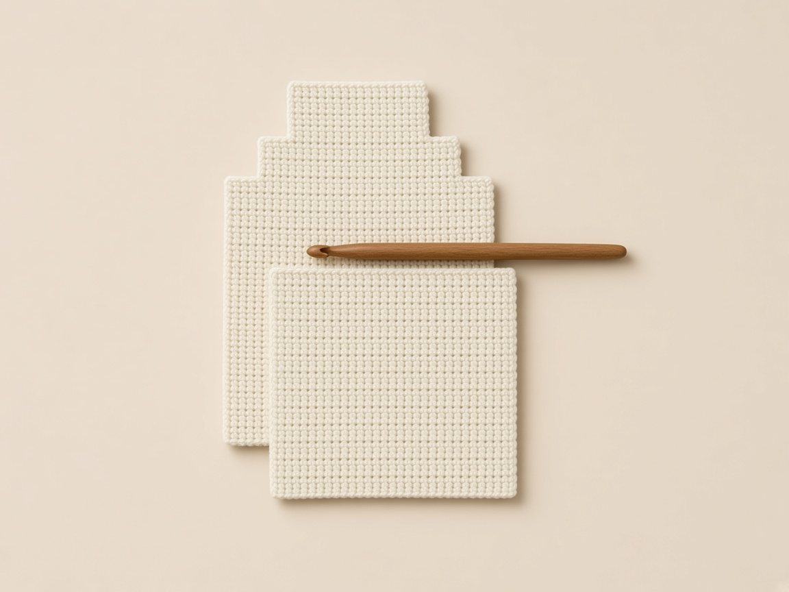

<figure class="diagram">

<figcaption>Diagram. Stop at row 14. That top edge is the opening.</figcaption>
</figure>

This panel is the pocket. It is the same width as the back and shorter.

1. Chain 18 with cream, the same way as the back.
2. Single crochet in the second chain from the hook and in each chain across. Count 17.
3. For each of rows 2 through 14: chain 1, turn, single crochet in every stitch, count 17.
4. Stop at row 14. Do not add rows. The top edge of this panel is the pocket opening, and it stays bare.
5. Fasten off and weave the tail in.

#### The front is the straight rows, cut off

1. The front is a copy of the back's straight rows, cut off at row 14.
2. It has no stepped top.
3. If you decrease the front to match the head, you will round the pocket opening and the card will not have a straight edge to pass.
4. Row 14 stays 17 stitches, the same as row 1.
5. The top edge is a raw row of single crochet on purpose.
6. The joining round does not finish it.
7. Cards slide against that edge, so weave the fastening-off tail along a side, not along row 14, where it would sit in the opening.

A decrease on the front rounds the opening. Row 14 stays 17, and the tail stays off that edge.

#### Count 14 ridges before you weave

1. Count 14 ridges up the side before you weave anything.
2. Thirteen ridges means the pocket is one row short and the snap at row 13 has less fabric above it than the pattern allows.
3. Fifteen means you will join one extra row through both layers and the opening will sit higher, covering part of the face rows if you still embroider on 16 to 18 of the back.
4. The back's row 14 is the last row that has a front panel beside it.
5. The front's row 14 has to be that same row.

| Ridges on the front | What the pocket does |
| --- | --- |
| 13 | One row short. The snap at row 13 has less fabric above it than the pattern allows. |
| 14 | The opening lines up with the back's row 14. |
| 15 | One extra row through both layers. The opening sits higher and can cover part of the face rows. |

#### The two hems have to be the same 17

1. The chain hem of the front is the hem that will lie on the back's hem, stitch for stitch.
2. Make sure you chained 18 and worked 17, the same check as the back.
3. A front of 16 stitches cannot be scalloped with a back of 17.
4. You would be skipping a different set of stitches on each layer, and the fans would pucker.

### Step 5: check the two panels before you decorate

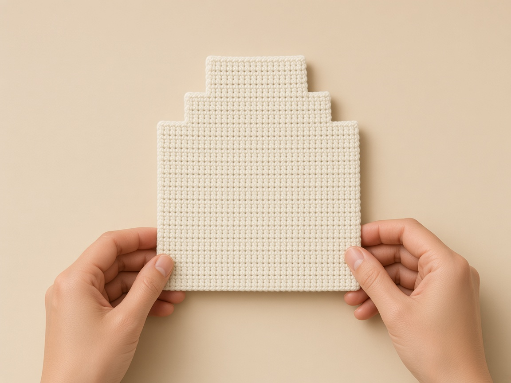

<figure class="diagram">

<figcaption>Diagram. Match the hems before any embroidery or snap.</figcaption>
</figure>

1. Lay both panels with the chain hems at the bottom.
2. Line up the two hems, stitch for stitch.
3. Count the back rows sticking out above the front. You need 8: rows 15, 16, 17, 18, then the four narrowed rows.
4. Count 17 stitches across both panels. If the numbers match but one panel is wider on a ruler, remake the odd one. Do not stretch it to fit.

#### Count the band, then the steps

1. Lay them with the hems together and the front on top of the back.
2. The back should stick out above the front in one even band, then the steps.
3. Count that band: four full-width rows, which are 15, 16, 17, and 18, and then four stepped rows.
4. Eight rows total.
5. If you count only the full-width rows and call it about right, you can miss a missing step and embroider the eyes on the pocket.
6. The eyes belong on the band, on rows 17 and 18, which are still full width, so stitch 6 and stitch 12 still exist.
7. On row 22 only nine stitches exist. There is no stitch 12 up there.

Eyes on the pocket mean the band above the front was short. Stitch 12 exists on rows 17 and 18. It does not exist on row 22.

#### Keep stitch 1 on the right-hand edge

1. Stitch 1 is the right-hand edge when the hem is at the bottom and the right side is toward you.
2. Keep that orientation for the rest of the decorating.
3. Turning the panel upside down to see the head better swaps stitch 1 with stitch 17, and the cheeks on stitches 5 and 13 trade places.
4. The face can survive that swap because 5 and 13 are mirrors, and 6 and 12 are mirrors.
5. The snap cannot. Stitch 9 is the center either way, but a cheek that you place after rotating, while still thinking stitch 1 is the old edge, lands on the wrong side of the mouth.

#### A width difference is not fixed by the joining round

1. If the hems match and the side edges do not, because one panel is a stitch wider, stop.
2. The joining round cannot fix a width difference.
3. It will either skip a stitch on the wider panel or stretch the narrower one.
4. Both show up as a scallop that will not lie flat, and as a side seam that pulls.
5. Remake the panel that does not match the 17-stitch count or the swatch width.

### Step 6: mark the face before any embroidery

<figure class="diagram">

<figcaption>Diagram. Stitch k mirrors stitch 18 minus k, so the face stays centered.</figcaption>
</figure>

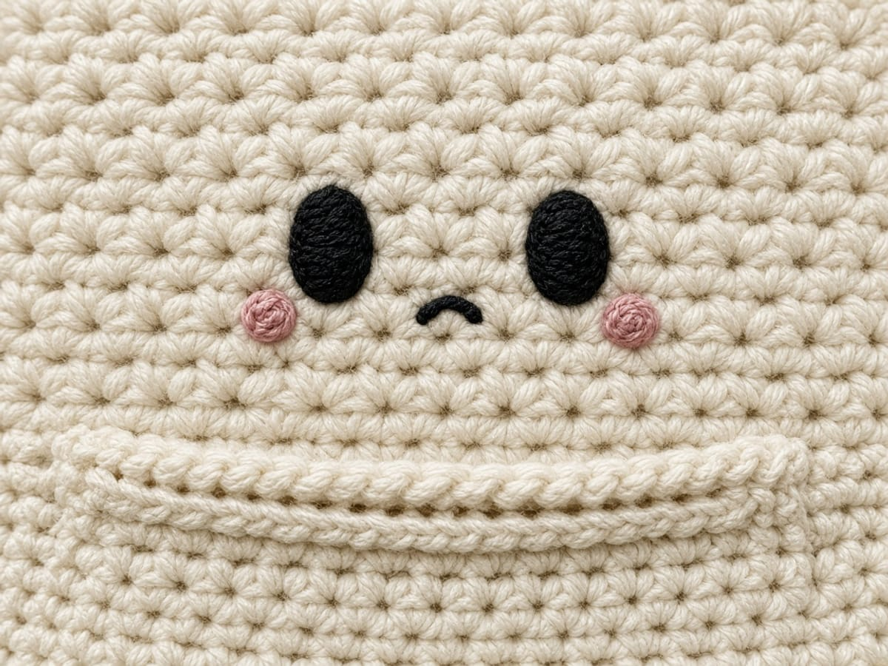

1. Look at both faces of the back panel. Pick the one you like. That side is the right side. The face goes on it.
2. Lay that side up, chain hem at the bottom, narrowed rows at the top.
3. Count stitches from the right-hand edge. Stitch 1 is the right edge. Stitch 9 is the center. Stitch 17 is the left edge. Put a pin in stitch 9 so you do not lose the center.
4. Count rows up from the hem. Row 16 is the mouth and cheeks. Rows 17 and 18 are the eyes. Row 14 is where the pocket opening will sit. Stay above row 14.

**Left eye.** Thread black on a tapestry needle. Come up in row 17 at stitch 6. Go down in row 18 at the same stitch. Come up beside that stitch and repeat until you have 3 or 4 short lines sitting next to each other. That stack is one oval eye.

**Right eye.** Do the same thing at stitch 12, still on rows 17 and 18.

**Mouth.** On row 16 at stitch 9, make one short horizontal stitch, or a tiny oval of 2 or 3 stitches. A line looks calm. A small oval looks more like a mouth.

**Cheeks.** Switch to pink. If the pink looks heavy, pull the yarn apart and use one ply. On row 16 at stitch 5, stack 2 or 3 short stitches into a dot. Repeat at stitch 13.

Every stitch goes through the back panel only. On the wrong side, do not tie a knot. Run the tail under the backs of the stitches you just made, then cut it short. That wrong side becomes the outside back of the wallet, so a knot would show.

<figure class="diagram">

<figcaption>Diagram. The face and both snap halves are finished before the joining round starts.</figcaption>
</figure>

#### Mark stitch 9 and leave the pin until the snap

1. Mark stitch 9 with a removable marker and leave it until the snap is sewn.
2. Stitch 9 is the center of 17: eight stitches on each side.
3. The mouth uses it. The snap uses it one row-group lower.
4. The eyes do not. They sit three stitches off center, on 6 and on 12.
5. Three stitches from 9 toward the right edge is stitch 6.
6. Three stitches from 9 toward the left edge is stitch 12.
7. If you place an eye on stitch 9 you have a cyclops, and the mouth has nowhere to sit that is not inside the eye.

| Feature | Row | Stitch, counted from the right |
| --- | --- | --- |
| Mouth | 16 | 9 |
| Cheeks | 16 | 5 and 13 |
| Eyes | 17 and 18 | 6 and 12 |
| Snap, later | 13 | 9 |

#### Count rows from the hem

1. Rows are counted from the hem, not from the head.
2. Row 1 is the chain row.
3. Row 16 is four rows above where the front will end.
4. Row 14 is the opening.
5. Stay above row 14 for every face stitch.
6. A cheek on row 14 sits on the opening and gets crushed by the card.
7. A cheek on row 15 is legal as fabric, but it is not the pattern: the pattern's cheeks are on row 16, level with the mouth, so the three features share a row and the eyes sit in the two rows above them.
8. Moving the cheeks up to the eyes crowds rows 17 and 18, which are only two stitches wide for each eye already.

A cheek on row 14 sits on the edge the card rubs. The chart puts cheeks and mouth on row 16, and the eyes on rows 17 and 18.

#### Build each eye as a stack, not a dash

1. Each eye is 3 or 4 short vertical stitches side by side, not one long stitch and not a knot.
2. They occupy one stitch-column, stitch 6 or stitch 12, and they span rows 17 and 18.
3. Come up in row 17 and go down in row 18, then come up beside that path and repeat.
4. The stack should read as one oval from arm's length.
5. A single line reads as a dash.
6. Keep the two ovals the same number of strands.
7. Four on one eye and two on the other is a wink you did not plan.

#### Keep the mouth inside stitch 9

1. The mouth is one short horizontal stitch, or a tiny oval of 2 or 3 stitches, on row 16 at stitch 9.
2. A long smile that reaches the cheeks will cross stitches 5 and 13 and pin the cheeks down.
3. Stop the mouth inside stitch 9.
4. The cheeks are dots, 2 or 3 short stitches stacked, at stitches 5 and 13 on that same row.
5. If the pink is heavy, split the yarn and use one ply.
6. A full strand of worsted pink on cream is a blot.
7. One ply is still visible, and it stays inside the stitch instead of covering the black mouth.

#### The embroidery back is the outside of the wallet

1. The wrong side of this embroidery is the outside back of the finished wallet.
2. That is the opposite of a lined bag, where the wrong side is hidden.
3. No knots. Slide the needle under the backs of the stitches you just worked, then cut.
4. Check the outside back in daylight before you join.
5. A shadow of black under cream means the strands are too long on the back. Shorten them.
6. You cannot reach that back once the front is sewn on, except by cutting the join.

Every face stitch goes through the back panel only. Knots and long black strands on the wrong side become the outside back of the wallet.

### Step 7: sew the snap while the panels are still flat

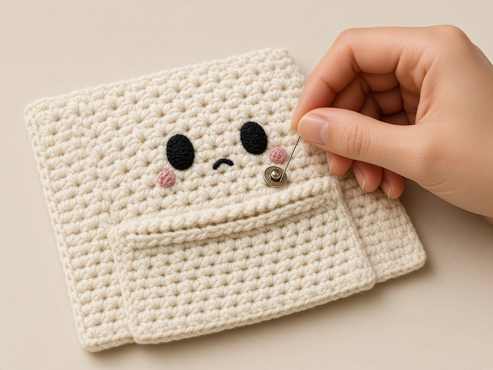

<figure class="diagram">

<figcaption>The two pocket-facing surfaces and the edge that must remain open.</figcaption>
</figure>

<figure class="diagram">

<figcaption>Diagram. The snap closes the top of the pocket from inside, so nothing shows on the ghost.</figcaption>
</figure>

The snap lives inside the pocket. Nothing should show on the ghost's face.

1. Find row 13, stitch 9 on the right side of the back. That is the side with the face.
2. Double the sewing thread. Sew the socket half there. Go through each hole 4 or 5 times.
3. Catch only the back bar of the crochet stitches. If the needle comes out on the wrong side of the back panel, the snap will show on the outside of the wallet.
4. Turn the front panel to its wrong side. Find row 13, stitch 9.
5. Sew the ball half there the same way, through that panel only.
6. Lay the front on the back, hems matched, wrong side of the front against the face. Press the snap shut with your fingers.
7. If the two halves miss by more than one stitch, unpick the one that is off and move it before you join.
8. Put your real cards on the front panel. If the snap sits on the cards, move both halves up by the same number of rows. Keep them on the same stitch number so they still meet.

#### Which face each half sits on

1. Row 13 is one row below the opening.
2. The socket is on the right side of the back, the face side, at stitch 9.
3. The ball is on the wrong side of the front, at the front's own row 13, stitch 9.
4. When the front is laid on the face, wrong side of the front against the embroidery, those two points touch.

| Where the halves went | Whether they meet |
| --- | --- |
| Socket on the right side of the back, ball on the wrong side of the front, both at row 13, stitch 9 | They face into the pocket and meet. |
| Ball on the right side of the front | The ball faces the world, the socket faces the embroidery, and they never meet. |
| Both halves on the back | The front has nothing to catch. |

#### Catch the back bar only

1. Catch the back bar of the stitch, the bar that faces the wrong side of that panel.
2. The needle should not come out on the public side.
3. On the back panel the public side is the outside of the wallet, the side without the face.
4. A stitch that pops through there is a speck of thread under the ghost's back.
5. On the front panel, read the placement again before you sew: the ball is on the front's wrong side, and the socket is on the back's right side.
6. Both face into the pocket.

#### Thread, passes, and a miss of one stitch

1. Four or five passes through each hole, with doubled thread, hold a 3/8 inch snap.
2. The thread color is cream, white, or clear.
3. Black thread, the color of the eyes, draws a ring on the cream.
4. Press the snap shut with the hems matched before you clip anything.
5. If the halves miss by more than one stitch, move the half that is off.
6. Moving both, in opposite directions, doubles the error.
7. Stitch 9 is the target on both panels.
8. A miss of one stitch can be left if the snap still closes flat.
9. A miss that twists the front panel sideways will make the side seams fight the scallops.

Black sewing thread draws a ring on the cream. Use cream, white, or clear thread, and move only the half that is off.

#### Cards are the last check before the round

1. Cards on the front panel are the last check before joining.
2. The snap should sit in the band of fabric above the card, not on the card.
3. If your row gauge put row 13 on the card, move both halves up the same number of rows and keep stitch 9.
4. Do not move one half up and leave the other.
5. They will miss by that many rows, and you will not see it until the panels are joined and the only fix is to cut the thread inside a pocket.

### Step 8: clip the panels and mark the opening

<figure class="diagram">

<figcaption>Diagram. One round joins the panels, scallops the hem, and leaves the front's top edge open.</figcaption>
</figure>

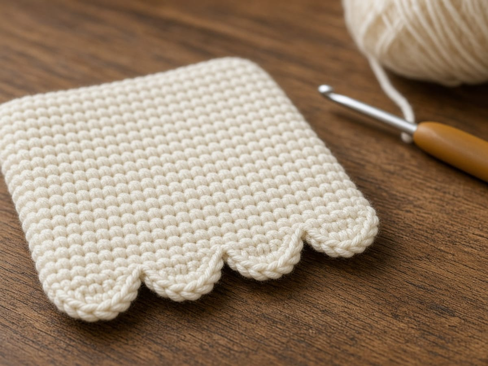

1. Put the front on the right side of the back. The face looks at the wrong side of the front. The two hems touch.
2. Clip both side edges.
3. On each side of the back, put a marker in the row-end of row 1, row 14, and row 18. Row 14 is the last row that has a front panel beside it.
4. Slide a card in. The top edge of the front must stay open. If the card will not go in, the clips are pinching that edge. Move them to the sides only.
5. A row-end is the little hole at the side of a finished row. It is not the V on top of a stitch, and it is not the turning-chain loop.

#### Put the three markers in the back

1. Markers go in the back's row ends, because the back is the piece that continues past the opening.
2. On each side, mark row 1, row 14, and row 18.
3. Row 1 is the hem end of the side, where the scallops will finish and the side stitches begin.
4. Row 14 is the last row that still has front fabric beside it.
5. Row 18 is the last full-width row, where the slope starts.
6. You can see row 18 as the row just before the first step.
7. If your marker for row 14 is in the front panel only, you will lose it when the hook is on the back.
8. Put it through the back's row end, next to the front.

| Marker | What it names |
| --- | --- |
| Row 1 | Hem end of the side. Scallops finish here and the side stitches begin. |
| Row 14 | Last row with front fabric beside it. The hook leaves the front after this row-end. |
| Row 18 | Last full-width row. The slope starts on the next row. |

#### Clips stay on the sides

1. Clips belong on the side edges, not on row 14's top.
2. A clip on the opening pinches it shut, and the card test then lies to you.
3. Slide a card in after the clips are on.
4. The card should pass the top of the front.
5. If it will not, the clips are on the opening. Move them.
6. This test is the same test you will repeat after each side of the joining round.
7. Check that the card still slides in after the first side and the hem, before you finish the second side.

The card test after the clips is the same test you repeat after the first side and the hem. A clip on row 14's top makes that test lie.

#### Match hem stitch 1 to hem stitch 1

1. The two hems touch, stitch for stitch.
2. Stitch 1 of the front hem lies on stitch 1 of the back hem.
3. If you offset them by one stitch to hide a decrease, the scallop fans will enter two different stitches and the hem will twist.
4. There is no decrease on the hem.
5. Both hems are 17.

### Step 9: four scallops across the hem

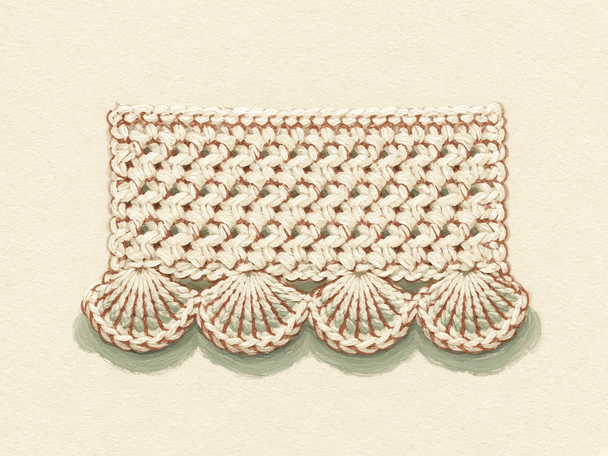

<figure class="diagram">

<figcaption>Diagram. Four scallops use the 17 hem stitches exactly.</figcaption>
</figure>

Join cream at a bottom corner, in hem stitch 1, with the hook going through both panels. The diagram starts at the lower left. If you are right-handed and the front is facing you, you will start at the lower right. The counts do not change.

1. Slip stitch in stitch 1, through both layers.
2. First scallop: skip 1 stitch, make 5 half double crochet in the next stitch, skip 1 stitch, slip stitch in the next stitch.
3. Second scallop: skip 1, 5 half double crochet in the next, skip 1, slip stitch in the next.
4. Third scallop: the same.
5. Fourth scallop: the same.
6. Stop and count the hem. The first slip stitch plus four scallops of 4 stitches each uses all 17 hem stitches. If you have stitches left, a skip was missed. If you ran out early, an extra stitch went into a scallop.

<figure class="diagram">

<figcaption>Diagram. Stitch 1, then four groups of four. The fans sit on stitches 3, 7, 11, and 15.</figcaption>
</figure>

#### Say the 17 stitches as you use them

1. Stitch 1 is the starting slip stitch, through both layers.
2. Stitches 2, 3, 4, and 5 are the first scallop: skip 2, five half double crochet in 3, skip 4, slip stitch in 5.
3. Stitches 6 through 9 are the second fan, on stitch 7.
4. Stitches 10 through 13 are the third fan, on stitch 11.
5. Stitches 14 through 17 are the fourth fan, on stitch 15, and the slip stitch that ends it is stitch 17.
6. After that slip stitch you are at the other bottom corner.
7. The next thing is a chain 1 and the side, not another fan.

| Hem stitches | What they are |
| --- | --- |
| 1 | Starting slip stitch, through both layers |
| 2, 3, 4, 5 | First scallop. Skip 2, five half double crochet in 3, skip 4, slip stitch in 5. |
| 6 through 9 | Second fan, on stitch 7 |
| 10 through 13 | Third fan, on stitch 11 |
| 14 through 17 | Fourth fan, on stitch 15. The ending slip stitch is stitch 17. |

#### Five half double crochet share one hole

1. Five half double crochet in one stitch means five posts in the same hole, not one half double in each of five stitches.
2. If you spread them, you consume the skip stitches and the slip-stitch stitch, and the repeat ends before stitch 17.
3. You will feel the fan as a shell that sticks out below the hem.
4. Four fans, evenly spaced, are the hem.
5. Three fans with stitches left over means a skip was missed and a later fan shifted.
6. Five fans means the starting slip stitch was counted as part of a fan and the groups got smaller.

| Fans you can count | What the repeat did |
| --- | --- |
| 3, with stitches left | A skip was missed and a later fan shifted. |
| 4, on stitches 3, 7, 11, and 15 | The repeat used all 17 hem stitches. |
| 5 | The starting slip stitch was counted as part of a fan and the groups got smaller. |

Spreading the five half double crochet across five stitches uses up the skips and the slip stitch. The repeat then ends before stitch 17.

#### Check the back of the hem after the second fan

1. The hook stays through both panels for every one of these hem stitches.
2. A fan that catches only the front will flap away from the back, and the pocket will have a slit at the bottom.
3. Check the back of the hem after the second fan.
4. You should see the posts coming through the back's stitches, not riding on top of the front only.

#### The start corner follows your handedness

1. Right-handed and left-handed starts sit at opposite corners.
2. The diagram starts at the lower left.
3. A right-handed worker with the front facing starts at the lower right.
4. Stitch 1 is whichever corner you join in.
5. The sequence does not flip. You still skip, fan, skip, slip stitch, four times.
6. Do not reverse the fans to match the diagram's left-to-right drawing.
7. [Left-handed crochet](/left-handed-crochet/) is the same idea: the counts stay, the direction of travel changes.

### Step 10: first side, then stop at the opening

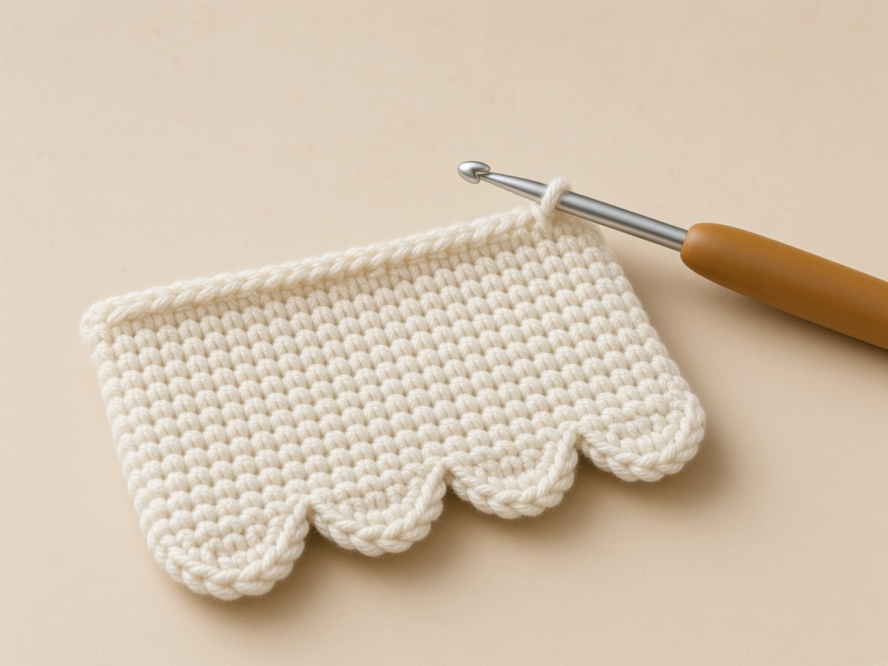

<figure class="diagram">

<figcaption>Diagram. Fourteen through both layers, then the back alone.</figcaption>
</figure>

1. Chain 1.
2. Working up the row ends, make 1 single crochet in each of rows 1 through 14. That is 14 stitches. The hook goes through a row-end on the front and a row-end on the back at the same time. Spread the two layers on the table so you can see both holes.
3. Stop at the row-14 marker. The top edge of the front is beside the hook. Do not put any stitch across that edge.
4. Make 1 single crochet in each of back rows 15, 16, 17, and 18. That is 4 stitches, through the back only.
5. Along the narrowed head, make 5 single crochet: 1 in the edge of row 19, 1 in row 20, 2 spread along the edge of row 21, and 1 in row 22.
6. Count this whole side: 14 + 4 + 5 = 23.

#### Stop while the front's top still looks unfinished

1. The 14 stitches through both layers end at the row-14 marker.
2. Stop there even if the front's top edge looks unfinished.
3. It is supposed to look unfinished. That bare edge is the opening.
4. One single crochet across it, just to tidy, sews the pocket shut on that side, and the card test will fail.
5. The next 4 stitches are back rows 15, 16, 17, and 18, and the hook is in the back only.
6. If you keep going through both layers, you will have to stab the hook through the opening edge of the front, which is the same mistake.

One stitch across the top of the front sews the pocket shut on that side. After the row-14 marker the hook is in the back only.

#### How the five slope stitches are split

1. The 5 slope stitches are not one per row in a neat list of five rows.
2. They are 1 in row 19, 1 in row 20, 2 spread along row 21, and 1 in row 22.
3. Row 21 gets two because the step there is long enough to gape if it only gets one.
4. Row 22's side stitch is the corner.
5. It is not one of the 9 top stitches.
6. Those 9 come next, across the top V's.
7. If you use the corner as the first of the 9, the top will be short and the other corner will have an empty loop.

| Place on the slope | Single crochet |
| --- | --- |
| Edge of row 19 | 1 |
| Edge of row 20 | 1 |
| Edge of row 21 | 2, spread along the step |
| Side of row 22 | 1, the corner, not one of the 9 top stitches |

#### Count 23 before you cross the top

1. Twenty-three is the whole side.
2. Count it before you cross the top.
3. If you have 22, one row end was skipped.
4. The usual skip is row 1, right after the hem, because the last slip stitch of the scallops feels like it already finished the corner.
5. Chain 1, then a single crochet in row 1's row-end.
6. The slip stitch does not replace it.
7. If you have 24, the turning chain of some row was used as an extra hole.
8. Pull back to the marker you trust, which is row 14, and count 14 below it and 4 plus 5 above it.

| Side count before the top | What to do |
| --- | --- |
| 22 | A row end was skipped, usually row 1. The hem slip stitch does not replace that single crochet. |
| 23 | 14 through both layers, 4 through the back, 5 on the slope. Cross the top. |
| 24 | A turning chain was used as an extra hole. Pull back to the row-14 marker and count 14 below it and 4 plus 5 above it. |

### Step 11: the top of the head

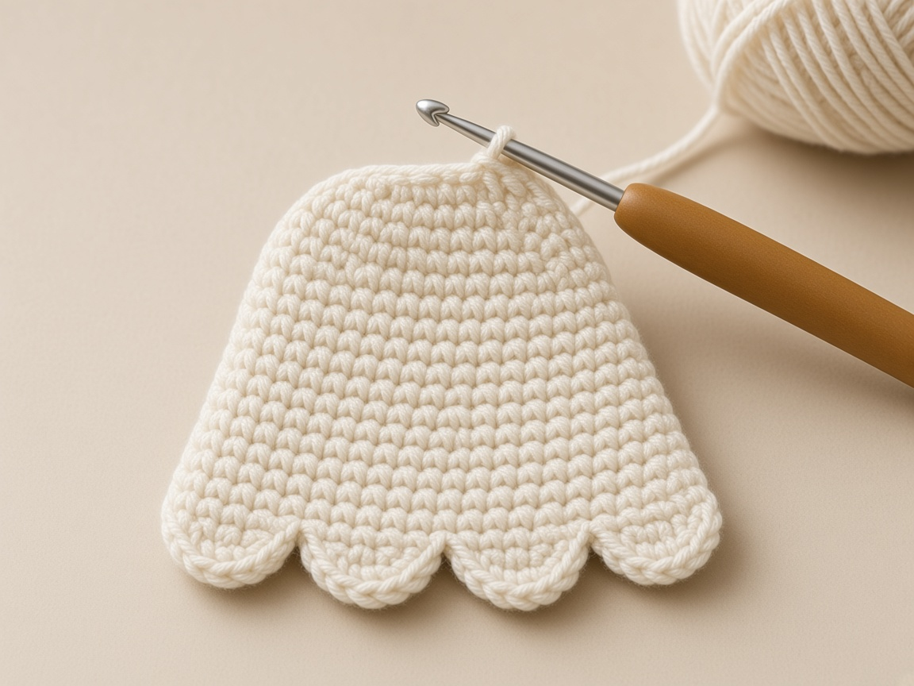

<figure class="diagram">

<figcaption>Diagram. Nine stitches across the top of row 22.</figcaption>
</figure>

#### Nine top V's, and not the corner

1. Single crochet in each of the 9 stitches of row 22.
2. Count them.
3. Do not use the corner stitch twice.
4. The last slope stitch already used the side of row 22.
5. These 9 are the top V's.

The corner of row 22 belongs to the slope. The nine across the top are a separate count. Using the corner as the first of the nine shortens the other side.

### Step 12: the way back down

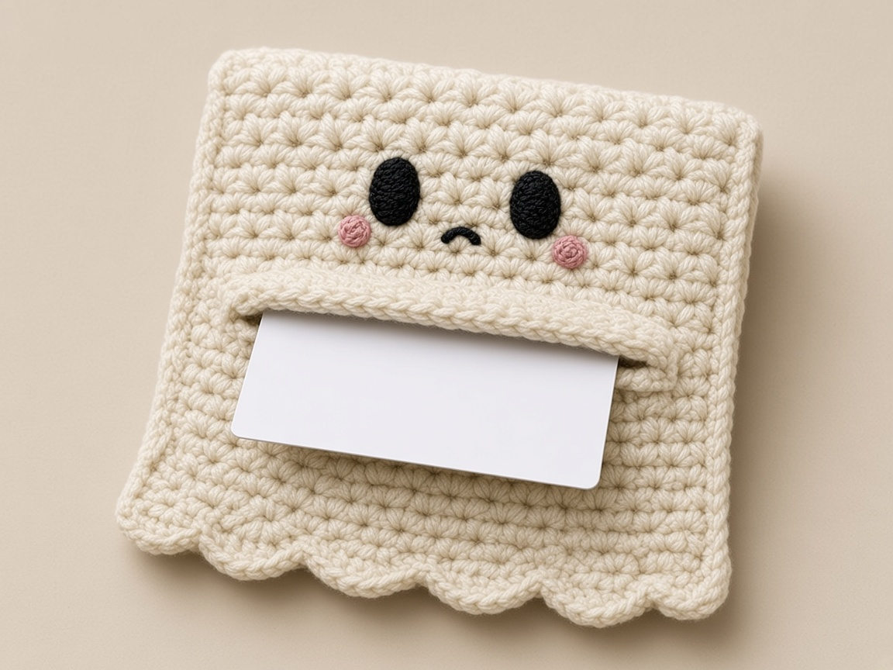

<figure class="diagram">

<figcaption>Diagram. Mirror the first side, then test the opening with a card.</figcaption>
</figure>

1. Make 5 single crochet down the other slope: 1 in row 22's side, 2 along row 21, 1 in row 20, 1 in row 19. If the head cups or waves, pull these 5 back and space them again. Flat fabric is the test.
2. Make 4 single crochet through the back only, in rows 18, 17, 16, and 15.
3. When you reach the other row-14 marker, switch back to both layers.
4. Make 14 single crochet through both layers, one in each of rows 14 down to 1.
5. Count this side: 23.
6. Slip stitch into the first slip stitch of the hem. Cut the yarn and weave the tail inside the edging, not across the pocket opening.
7. Slide the card in again. It should pass the opening. If the front's top edge is closed, you worked across it. Pull back to the row-14 marker and redo that side.

<figure class="diagram">

<figcaption>Diagram. Both sides are 23 stitches. The front's top edge is not on the path.</figcaption>
</figure>

#### Read the first side from the top down

1. The return side is the first side read from the top down.
2. Five slope stitches: the side of row 22, two along row 21, one in row 20, one in row 19.
3. Then four back-only stitches in rows 18, 17, 16, and 15.
4. Then, at the other row-14 marker, fourteen through both layers, rows 14 down to 1.
5. The count is 23 again.
6. The slip stitch into the first hem slip stitch closes the round.
7. It is not a twenty-fourth side stitch.

| Part of the return | Stitches | Where the hook is |
| --- | --- | --- |
| Slope | 5 | Side of row 22, two along row 21, one in row 20, one in row 19 |
| Back only | 4 | Rows 18, 17, 16, and 15 |
| Both layers | 14 | Rows 14 down to 1 |
| Close | slip stitch | Into the first hem slip stitch. Not a 24th side stitch. |

#### If the return cups or waves

1. If the head cups or waves on this return, the five slope stitches are spaced differently from the first side.
2. Pull those five and place them again.
3. The test is flat fabric: the steps should not flute, and they should not pull the top of row 22 into a cone.
4. Flat, here, means the panel lies as it did before the edging, with the same shallow steps.
5. The edging was not measured on a finished wallet. The sizes on this page are the gauge figures already given.

Match the return slope to the first side: one, two, one, one, from row 22 down to row 19. If the head waves, pull those five and space them again until the steps lie as they did before the edging.

#### Weave the ending tail inside the edging

1. Weave the ending tail inside the edging, along the hem or up a side inside the line of stitches.
2. Do not carry it across the opening and do not carry it across the face.
3. The opening has to stay a slot.
4. A tail across it is a snag for the card.
5. The face is cream, and a tail under the eyes shadows through.

The top edge of the front panel is the pocket opening. The edging passes it at the 14th row end on each side and keeps going up the back only. Do not work across it.

## Assembly order, at a glance

1. Back panel, then front panel. Weave in all tails.
2. Face on the back panel.
3. Snap halves on both panels. Test the meeting point.
4. One joining round.
5. Test a card and the snap.

## Make it yours

#### A wider pocket with a plain hem

1. Chain 20 for each panel (19 stitches).
2. Work the same straight-row totals.
3. Back rows 19–22 are: sc2tog, sc 15, sc2tog (17); sc2tog, sc 13, sc2tog (15); sc2tog, sc 11, sc2tog (13); sc2tog, sc 9, sc2tog (11).
4. Use 19 sc through both layers across the hem, not the 17-stitch scallop repeat.
5. Work 11 sc across row 22.
6. Center the snap at stitch 10 and shift every face position one stitch toward the higher number: eyes 7 and 13; mouth 10; cheeks 6 and 14.
7. Side-row counts stay unchanged.
8. This variation is not shown in the 17-stitch diagrams.

The 17-stitch diagrams do not show this wider pocket. The hem is 19 single crochet through both layers, and the face numbers move with stitch 10.

#### No scallops

1. Work 17 sc along the hem through both layers instead of the scallop repeat.

#### A glow-in-the-dark ghost

1. Glow yarns are often thicker or stiffer.
2. Swatch first. The stitch counts only work at the gauge.

#### Lining

1. Cut fabric to the front panel's size plus a 1/4 inch fold on every edge and hand-sew it inside the front before joining.
2. The pocket loses a little width, so check with a card first.

## Keep the pocket opening visible while joining

1. Clip the two panels together and slide a card in before stitching.
2. Mark both ends of the front's row 14 in a contrasting color.
3. During the joining round, count paired row ends 1–14 up the first side, then switch to the taller back alone.
4. On the other side, work the exposed back first and switch to both panels when you reach the other row-14 marker.
5. The horizontal top of the front remains completely unworked.
6. After the first side and hem are joined, check that the card still slides in before completing the second side.

The card check after the first side and the hem is the one that tells you the opening is still a slot, before the second side can close it.

## Common mistakes and fixes

#### The scallops end at the wrong place

1. The repeat uses exactly 16 stitches after the first slip stitch.
2. Count the hem stitches before starting.
3. If the hem has 16 or 18, the repeat cannot land.

| Hem count before you start | What happens to the four fans |
| --- | --- |
| 16 or 18 | The repeat cannot land. |
| 17 | The first slip stitch plus 16 more stitches is the whole hem. |

#### The front's top edge got crocheted shut

1. The 14th row end was missed.
2. Pull back to the side and restart counting at the hem.

#### The head looks pointed

1. The slope got too few stitches.
2. Five sc along four decrease rows rounds it.
3. Three pulls it into a point.

| Slope stitches along rows 19 to 22 | What the head does |
| --- | --- |
| 5 | Rounds the four decrease rows. |
| 3 | Pulls the head into a point. |

#### The face drifts toward a side

1. Stitches were counted from different edges.
2. Count from the right-hand edge every time, or mark stitch 9 first.

#### The snap is visible

1. It was sewn through both layers of a panel's stitches.
2. Catch only the back half of each stitch.

#### The pocket gapes above the snap

1. A gap above one snap is normal.
2. A second snap at row 13, stitches 4 and 14, can help, but it makes cards harder to reach.

One snap at row 13, stitch 9, leaves a little gap above it. A second snap at stitches 4 and 14 on that same row closes the gap and makes the cards harder to reach.

## Care

1. Hand wash in cool water.
2. Squeeze, do not wring, and dry flat with the hem scallops pinned.
3. Black embroidery on cream is the risk in the first wash: test a scrap of the black on a white paper towel first, or use a colorfast cotton.

## Frequently asked

### Will a card fit?

On paper, yes, with about 0.5 inch of width and room above the card. Test before joining by laying a card on the front panel; it should be narrower and shorter.

### Why is the snap inside instead of on a flap?

There is no flap. The face is the outside, so the closure stays hidden behind the front panel.

### Can a beginner make it?

If you can single crochet and decrease, yes. The joining round is the intermediate part, mostly because of the counting.

### How is it different from the ghost mini wallet?

That design is a folded rectangle with a tapered flap. This one is two shaped panels and no flap.

### Can I sell the finished wallets?

Yes. Please link here instead of reposting the pattern.

### Why does the back have 22 rows and the front only 14?

1. The front is the pocket.
2. Fourteen rows at the example gauge are the stated 2.8 inches, which becomes about 2.7 inches of pocket after the hem join, enough for a 2.125 inch card with room above it for the snap on row 13.
3. The back continues for eight more rows so the face on rows 16 to 18 and the stepped head on rows 19 to 22 sit above the opening.
4. Shortening the back to match the front removes the head and puts the eyes on the pocket.

### What does one scallop use?

1. Four hem stitches.
2. Skip one, work five half double crochet in the next, skip one, slip stitch in the next.
3. The five half double crochet share a single stitch. They do not use five stitches.
4. Four of those groups use 16 stitches.
5. The starting slip stitch is the 17th.
6. The fans land on stitches 3, 7, 11, and 15 if stitch 1 was the start.

### Why five single crochet on the slope, and nine across the top?

1. The slope covers four rows, 19 through 22, and row 21 takes two of the five stitches so that step does not gape.
2. Three stitches on that edge pull the head to a point.
3. The nine across the top are the nine stitches of row 22, the top V's.
4. The side stitch already used in the slope is the corner, not a tenth top stitch.
5. Using it twice shortens the other side.

### Which side of the front gets the ball of the snap?

1. The wrong side, at row 13, stitch 9.
2. The socket is on the right side of the back, the side with the face, at the back's row 13, stitch 9.
3. When the wrong side of the front is laid against the face, the halves meet inside the pocket.
4. Sewing the ball on the front's right side puts it on the outside of the pocket wall, facing away from the socket.

### Can I join the panels in a spiral instead of a slip-stitch round?

1. The pattern is one joined round: a start at the hem, a path around, and a slip stitch back into the first hem slip stitch.
2. A spiral has no join and no clean place to switch from both layers to the back alone at a marked row end.
3. The switch at row 14 is the whole point of the count.
4. Keep the slip stitch at the end.
5. It is not an extra side stitch.

### What if the panels match in stitch count but not on a ruler?

1. Remake the panel that does not match your swatch.
2. Do not stretch the narrow one.
3. A stretched edge relaxes after the join, and the scallops buckle.
4. The side stitches will also be tighter on the stretched panel, so the 14 paired row ends will not sit level with the other side.

### Why weave the back tail before joining?

1. Row 22's tail is at the top of the head.
2. The joining round covers the edges around it.
3. Once those stitches are in, the tail is trapped under the edging or has to travel across the face to reach an edge.
4. Weave it down the wrong side along the steps, away from rows 17 and 18, before you start the front.
5. The front's own tails get the same treatment, along a side rather than along the opening.

### What happens if I work across the front's top edge?

1. The pocket closes on that side.
2. A card will not pass.
3. Pull the yarn back to the row-14 marker on the side you just worked and redo from there, with the hook in the back only once the marker is reached.
4. Do not cut a slit afterward.
5. The opening is a row that was left unworked, not a seam you cut.

### Can the cheeks move to another row?

1. The pattern places them on row 16, stitches 5 and 13, level with the mouth at stitch 9.
2. Row 16 is above the opening.
3. A cheek on row 14 sits on the edge the card rubs.
4. A cheek on row 15 is still above the opening, but it leaves the mouth alone on row 16 and crowds neither the eyes nor the mouth in the way the chart does.
5. Keep the chart unless you are willing to re-count every feature from the hem before you join.
6. Stitch 6 still mirrors stitch 12, and stitch 5 still mirrors stitch 13, only while you count from the same edge.

## More Halloween wallets

- [Black cat crochet wallet](/black-cat-crochet-wallet/): a seamless tube with ears
- [Pumpkin crochet wallet](/pumpkin-crochet-wallet/): sideways back-loop ribs
- [Witch hat crochet wallet](/witch-hat-crochet-wallet/): two pockets and a buttonhole
- [Spiderweb crochet wallet](/spiderweb-crochet-wallet/): embroidery on a pointed flap

For decreases, see [increases and decreases](/crochet-increase-decrease/). For hiding tails in a cream fabric, see [weaving in ends](/weaving-in-ends-and-blocking/).

The ghost comes down to doing things in the right order: face and snap while the panels are flat, then one carefully counted round. Count the hem before you start it, and leave the front's top edge alone.
