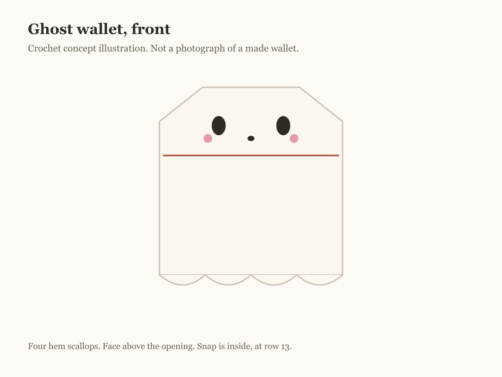

A ghost wallet only works if it still looks like a ghost with cards in it. This one keeps the face above the pocket, so the cards sit behind the ghost's middle and the face never stretches. Two flat panels, one edging round that joins them and scallops the hem, and a snap you cannot see from outside.

It is one of five patterns in the [Halloween crochet wallet collection](/halloween-crochet-wallets/). If you want a smaller, simpler ghost with a fold-over flap, the [ghost mini wallet](/ghost-crochet-mini-wallet/) is a different design worth a look. This one teaches shaping with decreases and joining two layers with an edging.

## What is checked, and what is not

| Part of this page | What it is |
| --- | --- |
| ID-1 card, 3.370 x 2.125 in | The ISO/IEC 7810 size of most US bank cards and licenses |
| Every stitch count and row count | Checked by hand on paper, including the edging round |
| 16 sc and 20 rows to 4 in | An example gauge, not measured from a finished wallet |
| Finished size and card fit | Geometry from that gauge. Not physically test-crocheted. |
| The picture above | A computer illustration, not a made sample |

## Materials

- **Worsted weight (CYC 4) yarn** in cream, ivory, or white. Cream hides grime better than bright white. [Yarn weight chart](/yarn-weight-chart/).
- **Scraps** of black for the eyes and mouth and soft pink for the cheeks.
- **US G/6 (4.0 mm) hook**, or the size that gives the gauge. Firm fabric matters more than the number. [Hook size chart](/crochet-hook-size-conversion-chart/).
- **One sew-on snap**, 3/8 in (10 mm), with cream or white thread. A clear plastic snap disappears best.
- Tapestry needle, two stitch markers, scissors, one card.

**How much yarn.** Not weighed from a made wallet. The two panels and edging come to about 33 square inches, about 2 times a 4 inch swatch. Weigh your swatch, double it, and add 20 percent.

## Abbreviations and stitches

US terms. US half double crochet is UK half treble. See the [abbreviations chart](/crochet-abbreviations-chart/).

| Abbreviation | Meaning |
| --- | --- |
| ch | chain |
| sc | single crochet |
| hdc | half double crochet |
| sl st | slip stitch |
| sk | skip |
| sc2tog | single crochet two together: pull up a loop in each of 2 stitches, yarn over, pull through all 3 loops. One stitch fewer. |
| st(s) | stitch(es) |
| RS / WS | right side / wrong side |

**Turning chain rule.** Every row begins: ch 1, turn. The ch 1 does not count as a stitch. Work the first single crochet into the first stitch.

**Single crochet through two layers.** Insert the hook through the front panel and then the back panel, matching the edges, and work the stitch as normal.

## Size and gauge

**Gauge:** 16 sc and 20 rows = 4 in. Make and measure a swatch first, as in the [gauge guide](/crochet-gauge/).

Each panel is 17 stitches, 4.25 inches wide. The side edging takes a little from each side, which leaves the pocket about 3.9 inches wide inside, against a 3.37 inch card. The front panel is 14 rows, 2.8 inches. After the hem join, the pocket is about 2.7 inches deep. A 2.125 inch card leaves room above it for the snap at row 13. The back panel is 22 rows, 4.4 inches, and the edging adds the scallops below and a round on top: about 4.6 by 4.9 inches overall.

## The pattern

### Stage 1: the two panels

<figure class="diagram">

<figcaption>Diagram. Both panels start the same way. The back keeps going and rounds off.</figcaption>
</figure>

**Back panel**, cream:

**Row 1:** Ch 18. Sc in the 2nd ch from the hook and in each ch across. (17)

**Rows 2–18:** Ch 1, turn. Sc in each st across. (17)

**Row 19:** Ch 1, turn. Sc2tog, sc in the next 13 sts, sc2tog. (15)

**Row 20:** Ch 1, turn. Sc2tog, sc in the next 11 sts, sc2tog. (13)

**Row 21:** Ch 1, turn. Sc2tog, sc in the next 9 sts, sc2tog. (11)

**Row 22:** Ch 1, turn. Sc2tog, sc in the next 7 sts, sc2tog. (9)

Fasten off. Weave the tails in now; they are hard to reach after joining.

**Front panel**, cream:

**Row 1:** Ch 18. Sc in the 2nd ch from the hook and in each ch across. (17)

**Rows 2–14:** Ch 1, turn. Sc in each st across. (17)

Fasten off and weave in.

Lay the front on the back with the hems matched. The front should end with 8 rows of the back showing above it. If it is wider than the back, one panel gained a stitch; count both.

### Stage 2: the face, while the back is flat

<figure class="diagram">

<figcaption>Diagram. Stitch k mirrors stitch 18 minus k, so the face stays centered.</figcaption>
</figure>

Pick the side of the back panel you like better. That is its right side, and it faces forward, above the front panel. Count stitches from the right-hand edge with row 1 at the bottom.

1. **Eyes.** With black, a vertical oval over rows 17 and 18 at stitch 6: three or four close straight stitches, side by side. Repeat at stitch 12.
2. **Mouth.** With black, a small oval or a short horizontal stitch on row 16 at stitch 9. An oval reads as "boo," a line as calm.
3. **Cheeks.** With pink, two or three short stitches stacked into a soft dot on row 16 at stitches 5 and 13. Use a single ply of the yarn if it looks heavy.

Work through the back panel only and keep the strands on the wrong side short. The wrong side becomes the outside back of the wallet, so finish each color with a few running stitches under the backs of the embroidery, not with a knot.

### Stage 3: the snap, before joining

<figure class="diagram">

<figcaption>Diagram. The snap closes the top of the pocket from inside, so nothing shows on the ghost.</figcaption>
</figure>

1. Sew the **socket** half to the right side of the back panel at row 13, stitch 9. This side faces into the pocket.
2. Sew the **ball** half to the wrong side of the front panel at row 13, stitch 9. This side also faces into the pocket.
3. Lay the panels together and press. The two halves should meet. If they miss by more than a stitch, move one now. After joining, there is no way to reach them.

Sew with doubled thread, four or five passes per hole, catching only the panel you are sewing on.

### Stage 4: the joining round

<figure class="diagram">

<figcaption>Diagram. One round joins the panels, scallops the hem, and leaves the front's top edge open.</figcaption>
</figure>

Place the front panel on the right side of the back panel, wrong side of the front against the face side of the back, hems and side edges matched. Clip the sides with markers. Join cream yarn at a bottom corner in stitch 1 of the hem, working through both layers.

**Hem:** Sl st in st 1. (Sk 1 st, 5 hdc in the next st, sk 1 st, sl st in the next st) 4 times. (17 hem sts used: 1 + 4 x 4)

**First side:** Ch 1. Working into the row ends, 14 sc through both layers, then 4 sc through the back only, then 5 sc evenly along the slope of the head. (23)

**Top:** Sc in each of the 9 sts of row 22. (9)

**Second side:** 5 sc along the slope, 4 sc through the back only, 14 sc through both layers. (23)

Sl st in the first sl st. Fasten off and weave the tail inside the edging.

The diagram starts at the lower left. Right-handed crocheters with the front facing them will start at the lower right instead. The counts are the same either way.

The top edge of the front panel is the pocket opening. The edging passes it at the 14th row end on each side and keeps going up the back only. Do not work across it.

## Assembly order, at a glance

1. Back panel, then front panel. Weave in all tails.
2. Face on the back panel.
3. Snap halves on both panels. Test the meeting point.
4. One joining round.
5. Test a card and the snap.

## Make it yours

- **A wider pocket.** Chain 20 for both panels (19 stitches). Each decrease row of the head then ends at 11 instead of 9, and the top of the edging gets 11 sc.
- **No scallops.** Work 17 sc along the hem through both layers instead of the scallop repeat.
- **A glow-in-the-dark ghost.** Glow yarns are often thicker or stiffer. Swatch first; the stitch counts only work at the gauge.
- **Lining.** Cut fabric to the front panel's size plus a 1/4 inch fold on every edge and hand-sew it inside the front before joining. The pocket loses a little width, so check with a card first.

## Common mistakes and fixes

**The scallops end at the wrong place.** The repeat uses exactly 16 stitches after the first slip stitch. Count the hem stitches before starting. If the hem has 16 or 18, the repeat cannot land.

**The front's top edge got crocheted shut.** The 14th row end was missed. Pull back to the side and restart counting at the hem.

**The head looks pointed.** The slope got too few stitches. Five sc along four decrease rows rounds it; three pulls it into a point.

**The face drifts toward a side.** Stitches were counted from different edges. Count from the right-hand edge every time, or mark stitch 9 first.

**The snap is visible.** It was sewn through both layers of a panel's stitches. Catch only the back half of each stitch.

**The pocket gapes above the snap.** Normal with one snap. A second snap at row 13, stitches 4 and 14, can help, but it makes cards harder to reach.

## Care

Hand wash in cool water. Squeeze, do not wring, and dry flat with the hem scallops pinned. Black embroidery on cream is the risk in the first wash: test a scrap of the black on a white paper towel first, or use a colorfast cotton.

## Frequently asked

**Will a card fit?** On paper, yes, with about 0.5 inch of width and room above the card. The pattern has not been made and measured. Test before joining by laying a card on the front panel; it should be narrower and shorter.

**Why is the snap inside instead of on a flap?** There is no flap. The face is the outside, so the closure stays hidden behind the front panel.

**Can a beginner make it?** If you can single crochet and decrease, yes. The joining round is the intermediate part, mostly because of the counting.

**How is it different from the ghost mini wallet?** That design is a folded rectangle with a tapered flap. This one is two shaped panels and no flap.

**Can I sell the finished wallets?** Yes. Please link here instead of reposting the pattern.

## More Halloween wallets

- [Black cat crochet wallet](/black-cat-crochet-wallet/): a seamless tube with ears
- [Pumpkin crochet wallet](/pumpkin-crochet-wallet/): sideways back-loop ribs
- [Witch hat crochet wallet](/witch-hat-crochet-wallet/): two pockets and a buttonhole
- [Spiderweb crochet wallet](/spiderweb-crochet-wallet/): embroidery on a pointed flap

For decreases, see [increases and decreases](/crochet-increase-decrease/). For hiding tails in a cream fabric, see [weaving in ends](/weaving-in-ends-and-blocking/).

The ghost comes down to doing things in the right order: face and snap while the panels are flat, then one carefully counted round. Count the hem before you start it, and leave the front's top edge alone.
