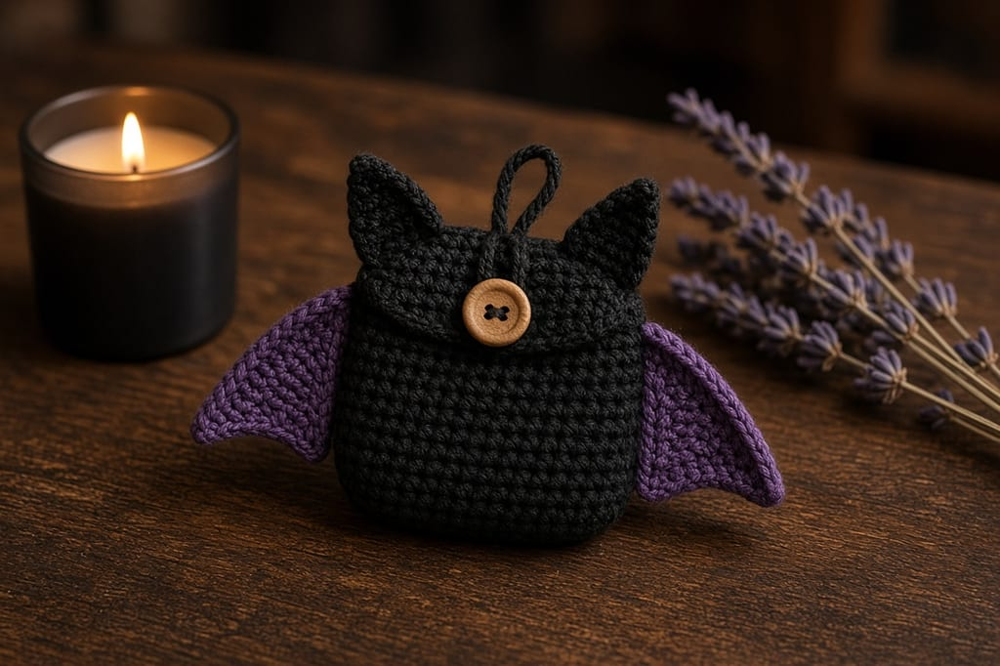
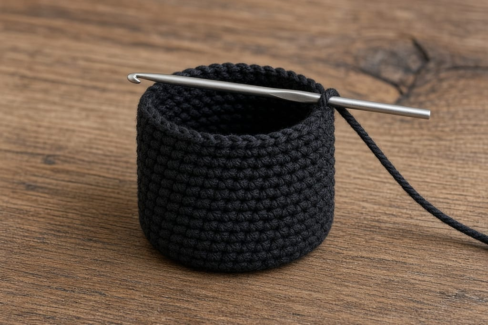
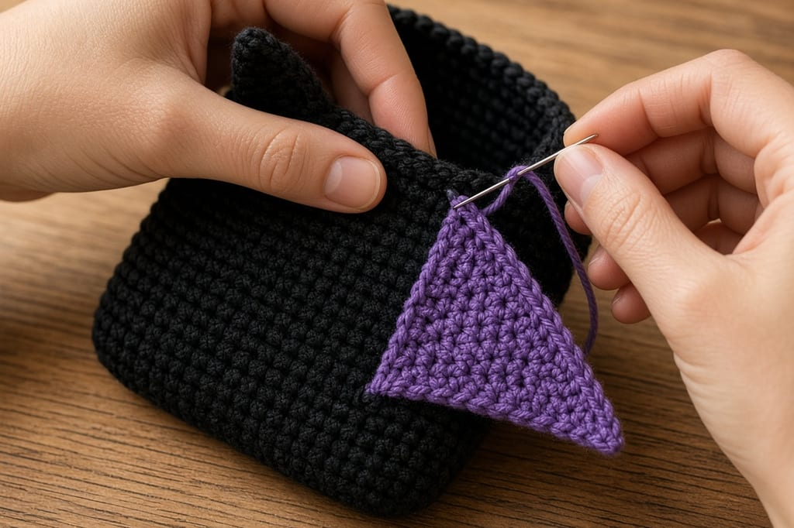
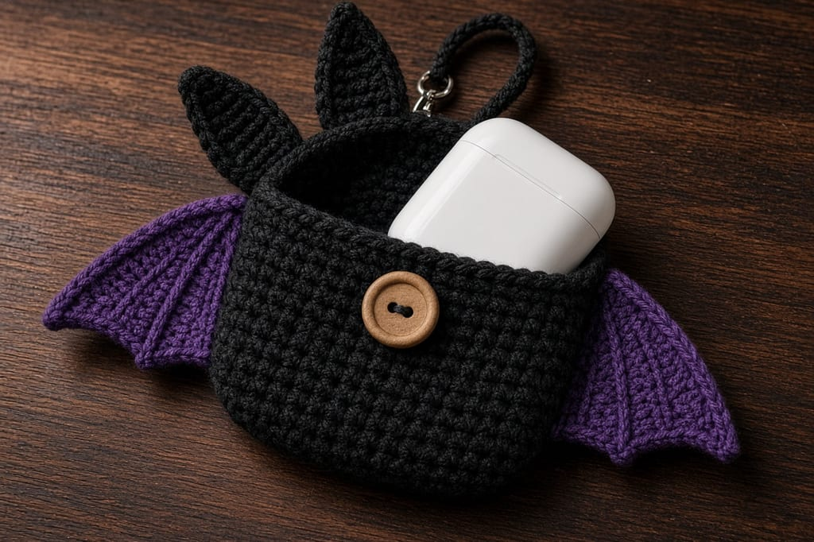

A bare earbud case disappears in a bag. A small black bat with purple wings is easy to spot, but only if the case still fits and the flap still closes once the wings are on. Decorations sewn on the outside take up room and shift the balance. Put them in the wrong place and the pouch either tips over or will not shut.

The pouch itself is a cup sized to the case. The [earbud pouch](/how-to-crochet-an-earbud-pouch/) explains in detail how to size one by measuring around the case, so this page keeps the sizing short. What this page adds is the appliqué: shaping a flat triangle with decreases, adding picots to an edge, and sewing parts on where they stay out of the way.

US terms. US single crochet is UK double crochet. [Abbreviations](/crochet-abbreviations-chart/). The pictures are illustrations. No pouch for this page was crocheted. Inches are estimates from the example gauge.

## What is a technique, and what is only a plan

| Piece of this page | What it is |
| --- | --- |
| A cup sized by the case's perimeter | Standard. Detailed on the earbud pouch page. |
| Triangles shaped with decreases at both edges | Standard. |
| Chain picots on an edge | Standard. |
| 30-stitch body for a small case | An example. Your case decides. |
| 40 yards black, 15 purple, 2 to 3 hours | Old lines. Not measured. Withdrawn. |

## How it is built

A flat circle, then straight rounds, makes a cup. A short flap is worked in rows over part of the rim and closes with a chain loop and a button. Two ear triangles sit on top. Two wing triangles with picot edges sit on the sides. A chain loop between the ears takes a split ring.

<figure class="diagram">

<figcaption>The wings go on the middle of the tube: above the base so the pouch stands, below the flap so it closes.</figcaption>
</figure>

## Yarn and hook

- **Worsted cotton**, black and purple. Cotton gives the wing points a crisp edge. Fuzzy yarn blurs the picots. [Yarn weights](/yarn-weight-chart/).
- **US G/6 (4.0 mm) hook**, or the size that gives firm fabric. [Hook chart](/crochet-hook-size-conversion-chart/).
- A button about 1/2 inch across, a yarn needle, a stitch marker, an optional split ring.

## Size the body to the case

Measure around the case at its widest point. At 4 single crochet per inch, multiply by 4, then round up to the nearest multiple of 6 for a flat circle. A small round case about 7 inches around needs 28, so 30. A larger case needs 36. Make a swatch first and use your own stitches per inch, not the example's.

The cup is deep enough when the top of the case sits just below the rim.

## Stage 1: the body

Black. Work in a spiral, without joining, and move a marker up each round. [Working in the round](/crochet-in-the-round/).

**Round 1:** 6 sc in a magic ring. (6)

<figure class="diagram">

<figcaption>Round 1 starts in a magic ring. The ch 1 that closes the first loop is not a stitch.</figcaption>
</figure>

**Round 2:** 2 sc in each stitch. (12)

**Round 3:** (Sc, 2 sc in next) 6 times. (18)

**Round 4:** (Sc 2, 2 sc in next) 6 times. (24)

**Round 5:** (Sc 3, 2 sc in next) 6 times. (30)

<figure class="diagram">

<figcaption>Step 1. Six increases a round to 30, the example body for a small case. Your case may need round 6.</figcaption>
</figure>

For a 36-stitch body: **Round 6:** (Sc 4, 2 sc in next) 6 times. (36)

**Even rounds:** Sc in each stitch until the case sits just inside the rim. At 5 rounds per inch, about 10 rounds for a 2 inch case.

## Stage 2: the flap

Worked in rows over one third of the rim.

**Row 1:** Sc in the next 10 stitches. Turn. (10) For 36 stitches, use 12.

**Rows 2–5:** Ch 1, sc in each stitch. Turn. (10)

**Row 6:** Ch 1, sc 4, ch 4, skip 2, sc 4. (8 sc and a 4-chain loop) For 12, sc 5, ch 4, skip 2, sc 5.

<figure class="diagram">

<figcaption>Step 2. The flap uses 10 of the 30 stitches. The other 20 stay open as the mouth of the cup.</figcaption>
</figure>

Fasten off. Close the flap over the case and mark where the loop lands. Sew the button there.

## Stage 3: the ears (make 2)

Black. A triangle loses one stitch at each edge every row.

**Row 1:** Ch 6. Sc in the 2nd chain from the hook and each chain across. Turn. (5)

**Row 2:** Ch 1, sc2tog, sc, sc2tog. Turn. (3)

**Row 3:** Ch 1, sc3tog. (1)

Fasten off with a sewing tail. The chain edge is the base.

## Stage 4: the wings (make 2)

Purple. The same shaping, made larger.

**Row 1:** Ch 10. Sc in the 2nd chain from the hook and each chain across. Turn. (9)

**Row 2:** Ch 1, sc2tog, sc 5, sc2tog. Turn. (7)

**Row 3:** Ch 1, sc2tog, sc 3, sc2tog. Turn. (5)

**Row 4:** Ch 1, sc2tog, sc, sc2tog. Turn. (3)

**Row 5:** Ch 1, sc3tog. (1) Do not fasten off.

Each row uses every stitch of the one below: 2 + 5 + 2 = 9, 2 + 3 + 2 = 7, 2 + 1 + 2 = 5, then all 3.

**Picot edge:** Slip stitch down one long side, working into the row ends. At three evenly spaced points, work (sl st, ch 3, sl st in the same place). Slip stitch along the chain edge without picots, because that edge gets sewn down. Work the second long side the same way. Fasten off with a sewing tail.

A picot is a small chain loop that stands off the edge. Three per side read as the scalloped edge of a bat wing.

## Stage 5: placing and sewing

1. **Case in first.** Put the case in the pouch and close the flap. Everything is placed with the pouch full, because an empty pouch is narrower.
2. **Ears.** Sew the chain edge of each ear to the rim just beside the flap, one on each side of where the flap starts. They must not sit on the flap, or they stop it folding.
3. **Wings.** Pin each wing's wide edge vertically along a side, centered on the middle of the wall. Too low and the wing touches the table and tips the pouch. Too high and it catches the flap.
4. **Sew loosely.** Whipstitch through both layers with easy tension. Pulled tight, the seam puckers the wall and makes the pouch smaller inside.
5. **Loop.** Join black on the back wall, one round below the middle of the flap's base. Ch 16, slip stitch into the same stitch. For a sturdier loop, slip stitch back along the chain.
6. Weave the ends in on the inside. [Weaving in ends](/weaving-in-ends-and-blocking/).

Check the case one last time. It should drop in and the flap should close without pulling.

## Variations

**All black.** The wing shape still reads as a bat.

**Eyes.** Embroider two small eyes rather than sewing on beads. Beads come off and are a choking risk for small children.

**Larger wings.** Start the wing with ch 12 (11 sc). Decrease the same way: 11, 9, 7, 5, 3, 1. Larger wings stick out further and catch on things in a bag.

## Troubleshooting

**The pouch tips over.** The wings were sewn too low. Move them up.

**The flap will not close.** The ears are on the flap, or the case is too tall. Move the ears, or add rounds.

**The side puckers.** Sewn too tight. Redo with easier tension.

**The wing has no point.** Row 5 was skipped, or a decrease was missed. Count each row.

**The picots disappear.** The yarn is too fuzzy, or the picot chain is too short. Use ch 4.

## Care

Hand wash cool. Press out in a towel. Dry flat. Machine drying can shrink cotton enough to trap the case.

## Frequently asked

**Will it fit every earbud case?**

Only if you size it to yours. Measure around the case and use the stitch count that covers it.

**Is the loop strong enough for keys?**

It has not been tested. A chain loop is weaker than a slip-stitch-reinforced one. For a heavy key ring, use a metal clip sewn on firmly, not a yarn loop.

**Can I sell finished pouches?**

Yes. Do not republish the pattern.

## Next

Sizing a case by its perimeter, in more detail, is the [earbud pouch](/how-to-crochet-an-earbud-pouch/). Another flat piece with a closure and a decoration is the [card wallet](/halloween-crochet-card-wallet/).
