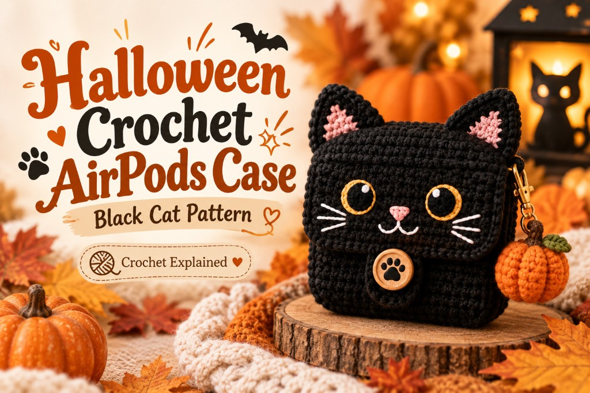
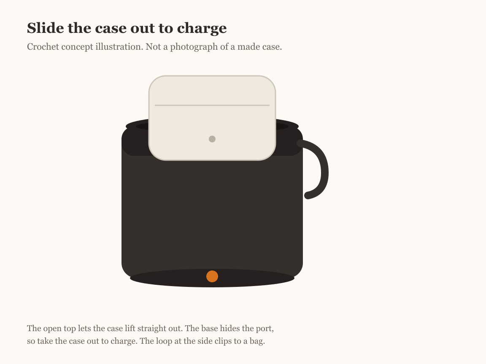

An AirPods case rides loose in a bag, picks up lint in the hinge, and then the lid stops seating cleanly. A snug cozy keeps the grit out and makes a small case easy to find by feel. This one is a black cat for Halloween: a deep black sleeve with two ears, an embroidered face, and a small pumpkin by the hem. It is a cover, not armor. It does not cushion a drop and it does not keep out a spill.

Most AirPods case patterns hand you one stitch count and hope your case fits it. This one is sized from the case. The number that matters is the distance around the case, its perimeter, not its width. The worked example is planned for the AirPods Pro 2 USB‑C charging case — the MagSafe Charging Case (USB‑C) that ships with the AirPods Pro 2 — and a short table below retargets it for the AirPods 4 and AirPods 3 cases.

US crochet terms throughout. US single crochet is UK double crochet; see the [abbreviations chart](/crochet-abbreviations-chart/). The case dimensions here are Apple's own published figures, linked below. This is an independent accessory. It is not made, sold, or endorsed by Apple, and "AirPods" is used only to say which case it fits.

## What you are making

An open-top black sleeve that slides over the charging case. The base is a small oval worked flat to match the case footprint, and the walls rise straight up to just below the lid seam. Two triangular ears sit on the top corners, and a flap rises from the back, folds over the top to hold the case in for carrying, and unbuttons so the lid can open. A short chain loop clips to a bag. The face is embroidered, so nothing can pull off and be swallowed. To charge, you slide the case out, which keeps the honest answer simple: there is no wireless charging through yarn.

## Which AirPods case this fits

Measure your own case with the lid closed, because that is the only reliable guide. If you want to check your figures against Apple's, here are the three cases this pattern targets, with the starting stitch count worked out from each footprint at the example gauge of 4 single crochet to the inch.

| Charging case | Height × Width × Depth (Apple) | Footprint perimeter | Start count |
| --- | --- | --- | --- |
| AirPods Pro 2 — MagSafe Charging Case (USB‑C) | 45.2 × 60.6 × 21.7 mm (1.78 × 2.39 × 0.85 in) | 6.48 in | 26 sts — the worked example |
| AirPods 4 | 46.2 × 50.1 × 21.2 mm (1.82 × 1.97 × 0.83 in) | 5.60 in | 22 sts |
| AirPods 3 | 46.40 × 54.40 × 21.38 mm (1.83 × 2.14 × 0.84 in) | 5.96 in | 24 sts |

Apple publishes these figures for the [AirPods Pro 2 USB‑C charging case](https://support.apple.com/en-us/111834), the [AirPods 4](https://support.apple.com/en-us/121203), and the [AirPods 3](https://support.apple.com/en-us/111863). The footprint perimeter is 2 × (width + depth): the case stands with the lid up, so its standing height becomes the wall and its width and depth become the loop the wall has to close around.

<figure class="diagram">

<figcaption>Measure width, depth, and height with the lid closed. The sleeve is built around the footprint, so the perimeter is the number that decides the stitch count.</figcaption>
</figure>

## What you need

- **Smooth worsted (medium / weight 4) cotton in black.** Cotton holds a crisp edge and does not shed into the speaker mesh or port the way a fuzzy acrylic can. [Yarn weights](/yarn-weight-chart/).
- **A scrap of orange** for the nose and pumpkin, and a short length of gold or white for the eyes and whiskers.
- **US G/6 (4.0 mm) hook**, or whatever size gives you a firm fabric that holds its shape. [Hook sizes](/crochet-hook-size-conversion-chart/).
- **One small button**, about 3/8 inch (10 mm) across.
- Stitch marker, yarn needle, scissors.

Worsted cotton on a G hook gives a close fabric a case will not poke through. If yours comes out loose and gappy, drop to a 3.75 mm or 3.5 mm hook rather than changing the counts.

## Before you start: gauge and fit

Two gauges matter here, and they do different jobs. **Stitch gauge** (single crochet per inch) sets how many stitches it takes to close around the case, so it controls the fit. **Row gauge** (rounds per inch) sets how fast the wall grows, so it controls the height. A pattern that only quotes one of them cannot tell you both, which is why a tube that fits around can still come out too short or too tall.

The worked example uses 4 sc to the inch and 5 rounds to the inch. From there the arithmetic is short:

| Part | Arithmetic | Result |
| --- | --- | --- |
| Footprint perimeter (Pro 2) | 2 × (2.39 + 0.85) | 6.48 in |
| Starting stitches | 6.48 × 4, rounded to even | 26 |
| Foundation chain | straight side = (26 − 12) ÷ 2 = 7, so ch 7 + 2 | ch 9 |
| Wall height to the lid seam | about 1.2 in on the example case | about 6 rounds |

Two things keep this honest. First, crochet stretches, so pick the count that lands **at or just under** the perimeter rather than over it; a cozy that measures a hair small grips, while one worked loose slides off. Second, the number of wall rounds is set by where your case's lid seam sits, which you find by fitting, not from a spec sheet, so treat "about 6 rounds" as the example and stop at your own seam.

The oval base uses more than the perimeter. Its stitch count comes from the perimeter and your stitch gauge, its two straight sides follow the case **width** and its rounded ends follow the case **thickness** (depth), and the wall stops below the lid seam for **lid clearance** set by your row gauge. So all four measurements shape the piece, not the perimeter alone.

These finished figures are a planning example, worked out on paper from Apple's published dimensions and the example gauge rather than measured from a crocheted sample. They are a starting point, not a promise of fit: measure against your own case at each checkpoint and change the stitch count or hook if the cozy runs large or small.

If your gauge is different, keep the method and change the numbers: count the single crochet across one inch of your own flat base, multiply the perimeter by that figure, round to the nearest even number, and use the base count formula below.

<figure class="diagram">

<figcaption>Pick the row whose measurement is closest to your case's perimeter, leaning snug. The fabric gives; an open count does not grip.</figcaption>
</figure>

## How the case is built

The sleeve is a flat-bottomed tube with trimmings. An oval base worked around a short foundation chain matches the oblong footprint better than a round circle would. Its two straight sides run along the case's width and the rounded ends curve around its thickness, so the base is shaped by both measurements while the perimeter sets how many stitches it takes to close around them. Once the base is the right size around, the increases stop and the walls go straight up — the same turn-up you see in [crochet in the round](/crochet-in-the-round/). The ears are small flat triangles, the flap is a few rows worked on the back stitches, and the face is embroidered on at the end. If you want the plain version without a Halloween face, the [earbud pouch](/how-to-crochet-an-earbud-pouch/) is the same construction with a round base, and the [ghost coin pouch](/how-to-crochet-a-ghost-coin-pouch/) closes the same tube with a drawstring.

## The full pattern

Work in a spiral without joining, and keep a marker in the first stitch of each round. The base count follows one rule: **round 2 total = 2 × (straight side) + 12.** For the Pro 2's 26 stitches the straight side is 7; for 24 use 6, and for 22 use 5, adjusting the foundation chain to match.

### Stage 1: the oval base

Work both long sides of the foundation chain and put three stitches in each end to turn the corner.

**Foundation:** ch 9.

**Round 1:** starting in the 2nd ch from the hook, sc 7 along the chain, 3 sc in the last ch (the end), then working back along the underside, sc 7, and 3 sc in the final ch (the other end). (20)

**Round 2:** work each 3‑stitch end as 2 sc in each stitch to make 6, and sc across each straight side of 7 unchanged: 6, sc 7, 6, sc 7. (26)

<figure class="diagram">

<figcaption>Stage 1. A flat oval grows at the ends only, not along the straight sides, so it stays the shape of the case footprint.</figcaption>
</figure>

**Checkpoint:** lay the base flat. A gentle cup is fine, since it becomes the wall. A ruffled, wavy edge means too many increases — the extra stitches belong only at the two ends. Then set it against the bottom of the case: the straight sides should run the length of the footprint (the case width) and the ends should sit around its thickness. If the oval is clearly longer or wider than the case bottom, change the straight-side count or drop a hook size before you build the wall.

### Stage 2: the body

**Rounds 3–8:** sc in each stitch around. (26 each round)

With no increases, the oval turns up and the walls climb straight. Stand the case in every couple of rounds and stop when the lid seam clears the rim, so the lid stays free to open. Six rounds reach it on the example case; your count is whatever covers your case to its seam.

<figure class="diagram">

<figcaption>Stage 2. Even rounds with no increases stand the tube up. Stop at the lid seam, not at a fixed round number.</figcaption>
</figure>

### Stage 3: the flap and buttonhole

The flap is worked back and forth on 7 stitches at the back of the rim — the stitches that will sit behind the hinge. The ch 1 at the end of each row does not count as a stitch.

**Row 1:** join yarn at the back, sc in the next 7 stitches. Ch 1, turn. (7)

**Rows 2–5:** sc in each stitch. Ch 1, turn. (7)

**Row 6 (buttonhole):** sc 2, ch 2, skip 2, sc 3. (5 sc worked over the 7‑stitch span, with a ch‑2 buttonhole)

Fasten off, leaving a tail. The flap folds over the top of the case; mark where the buttonhole lands on the front and sew the button there through several stitches. Buttoned, it holds the case in for carrying; unbuttoned and folded back, it leaves the lid free.

<figure class="diagram">

<figcaption>Stage 3. The rim stops below the lid seam so the lid clears it. The flap carries the case; it is not a charging door.</figcaption>
</figure>

### Stage 4: the ears

Make two. Each ear is a small triangle worked flat, losing a stitch at each edge until it points.

**Row 1:** ch 7, starting in the 2nd ch from the hook, sc 6. Ch 1, turn. (6)

**Row 2:** sc2tog, sc 2, sc2tog. Ch 1, turn. (4)

**Row 3:** sc2tog, sc2tog. Ch 1, turn. (2)

**Row 4:** sc2tog. (1)

Fasten off, leaving a long tail to sew with.

<figure class="diagram">

<figcaption>Stage 4. Each middle row loses one stitch at each edge, so the sides slope evenly to the point.</figcaption>
</figure>

### Stage 5: assembly and the cat face

Sew one ear near each end of the top front, angled slightly outward, using the long tails. With orange, embroider a small triangle nose near the center and a stitched mouth below it. With gold or white, work two eyes above the nose and a few straight whisker stitches to each side. Keep the face flat and sewn down; no plastic eyes, which can pull off and are a choking hazard around children and pets. For the carrying loop, ch 12, join into a ring with a slip stitch, and sew it to the back below the flap. Add a small pumpkin by the hem if you like: a few orange stitches gathered into a bump with a green top.

<figure class="diagram">

<figcaption>Stage 5. Ears on the corners, face embroidered, flap over the back, loop behind. The front stays clear for the cat.</figcaption>
</figure>

## Check the fit

Three checkpoints catch almost every problem. **The base** should lie flat with at most a gentle cup and sit close to the case bottom — straight sides along the width, ends around the thickness; a ruffle is too many increases. **The body** should hug the case with light tension; if the case drops in without touching the sides, go down two stitches (a shorter straight side) or a hook size. **The rim** should sit just below the lid seam so the lid opens without fighting the fabric. When all three are right, the buttoned flap holds the case for a bag and releases in a second to open.

## Make it your own

- **Other cases.** Use the table above: measure, find the perimeter, and set the base count with round 2 = 2 × straight + 12. The AirPods 4 case wants 22 stitches (ch 7), the AirPods 3 case 24 (ch 8).
- **Snug or roomy.** For a tighter grip, drop to the next even count down; for a looser slide, go one up. A half inch around is one stitch at this gauge.
- **Not a cat.** Skip the ears and face for a plain sleeve, or restyle the front as a pumpkin or ghost using the scraps. Color changes are worked the usual way; see [changing yarn color](/changing-yarn-color-crochet/).
- **A sturdier loop.** For a keychain clip, work the loop as a short chain of single crochet instead of a plain chain so it does not stretch out.

## When it goes wrong

<figure class="diagram">

<figcaption>The four problems that actually come up, and the fix for each.</figcaption>
</figure>

**The case will not go in.** The count is under the perimeter, or the fabric is too tight. Add two stitches to the base or go up a hook size.

**The case rattles and slips out.** Too much ease. Drop two stitches, or work the same count on a smaller hook.

**The base ruffles before the wall.** The increases are stacking up. They belong only at the two ends; the straight sides get one stitch each, no more.

**The first round twisted.** The oval closed with a half-turn in it. Keep all stitches facing the same way before you work round 2, and pull the tail to settle the ends.

**The lid will not open.** The rim is too tall, or the flap is buttoned. Unbutton and fold the flap back; if the rim still covers the seam, your wall is a round or two too high for this case.

## Finishing and care

Weave the tails in on the inside and give the sleeve a light steam or press so the base sits flat. Take the case out before washing; hand wash cool and dry flat, since cotton can shrink and turn a snug cozy too small. Leave charging to the bare case — the fabric does not pass power, so slide the case out to charge rather than sewing the flap shut over the port.

## Frequently asked

**Can it charge while it is in the cozy?**

No. There is no charging through the yarn. Slide the case out, charge it bare, and drop it back in.

**Will it fit AirPods Max or the older AirPods?**

No. This is sized for the small charging cases in the table. AirPods Max are over-ear headphones with a different case entirely, and very old cases have their own dimensions — measure and resize if yours is not listed.

**Is this an official Apple case?**

No. It is an independent handmade accessory. "AirPods" only describes which charging case it is cut to fit, and nothing here is made or endorsed by Apple.

**Do I need to swatch?**

Make the base and measure around its edge before you commit to the wall — that is your gauge check and it takes two rounds. If you want the longer explanation, see [crochet gauge](/crochet-gauge/).

## Related tutorials

For the plain version of this tube, see [how to crochet an earbud pouch](/how-to-crochet-an-earbud-pouch/). For a spookier earbud case with wings, try the [gothic bat earbuds pouch](/gothic-bat-earbuds-pouch/). And for a flat sleeve that follows the same around-not-across rule, there is [how to crochet a phone case](/how-to-crochet-a-phone-case/).
