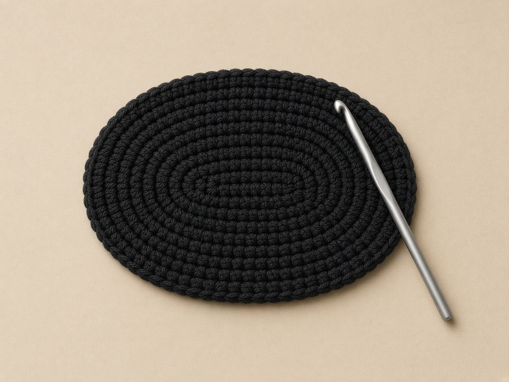
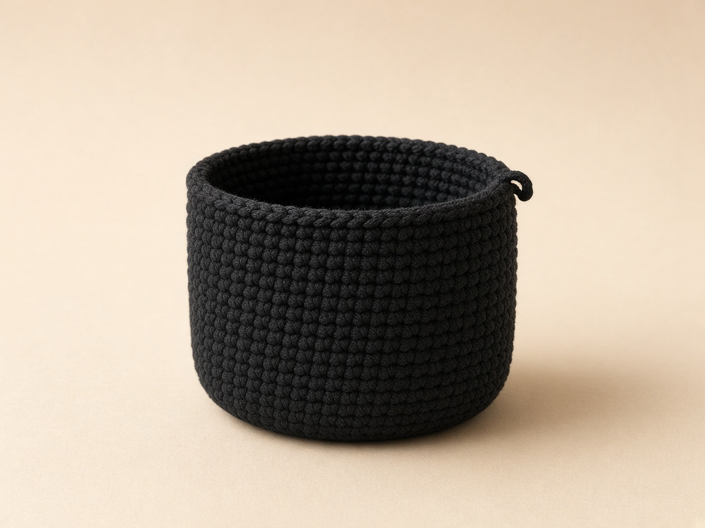
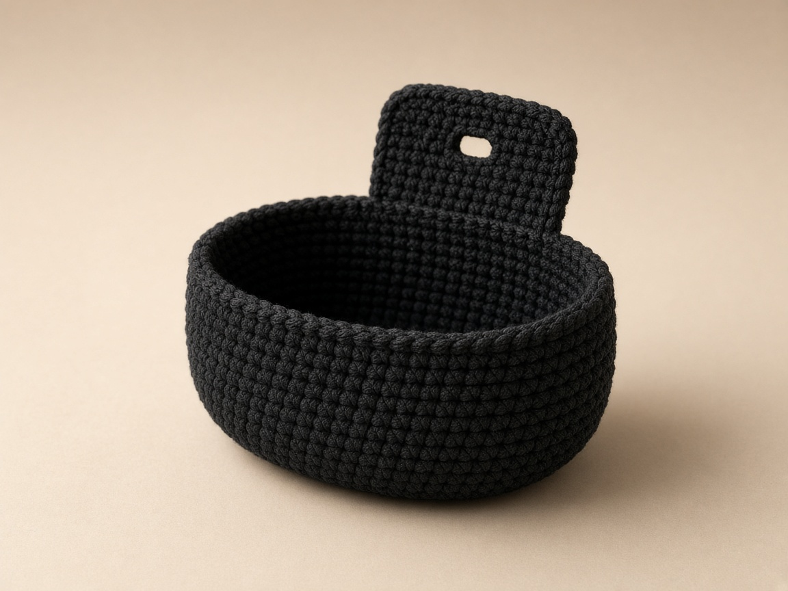
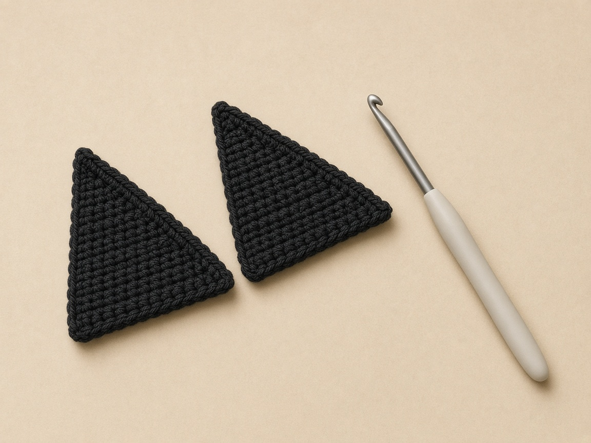

An AirPods case rides loose in a bag, picks up lint in the hinge, and then the lid stops seating cleanly. A snug cozy keeps the grit out and makes a small case easy to find by feel.

This one is a black cat for Halloween: a deep black sleeve with two ears, an embroidered face, and a small pumpkin by the hem. It is a cover. It does not cushion a drop and it does not keep out a spill.

US crochet terms throughout. US single crochet is UK double crochet; see the [abbreviations chart](/crochet-abbreviations-chart/). The case dimensions here are Apple's own published figures, linked below. This is an independent accessory. It is not made, sold, or endorsed by Apple, and "AirPods" is used only to say which case it fits.

## What you are making

#### The sleeve, from the bottom up

1. Work an open-top black sleeve that slides over the charging case.
2. Work the base as a small oval, flat, to match the case footprint.
3. Work the walls straight up and stop just below the lid seam.
4. Sew two triangular ears on the top corners.
5. Work a flap from the back. Fold it over the top to hold the case for carrying. Unbutton it so the lid can open.
6. Add a short chain loop that clips to a bag.
7. Embroider the face so nothing can pull off and be swallowed.

To charge, slide the case out. This tutorial requires removing the sleeve before charging. It does not claim wireless compatibility.

## Which AirPods case this fits

Measure your own case with the lid closed. That measurement is the only reliable guide. The table checks your figures against Apple's for the three cases this pattern targets. The start counts are worked from each footprint at the example gauge of 4 single crochet to the inch.

| Charging case | Height × Width × Depth (Apple) | Footprint perimeter | Start count |
| --- | --- | --- | --- |
| AirPods Pro 2 — MagSafe Charging Case (USB‑C) | 45.2 × 60.6 × 21.7 mm (1.78 × 2.39 × 0.85 in) | 6.48 in | 26 sts — the worked example |
| AirPods 4 | 46.2 × 50.1 × 21.2 mm (1.82 × 1.97 × 0.83 in) | 5.60 in | 22 sts |
| AirPods 3 | 46.40 × 54.40 × 21.38 mm (1.83 × 2.14 × 0.84 in) | 5.96 in | 24 sts |

Apple publishes these figures for the [AirPods Pro 2 USB‑C charging case](https://support.apple.com/en-us/111834), the [AirPods 4](https://support.apple.com/en-us/121203), and the [AirPods 3](https://support.apple.com/en-us/111863).

#### What the footprint perimeter is counting

1. Use 2 × (width + depth). The case stands with the lid up.
2. Treat the standing height as the wall.
3. Treat the width and the depth as the loop the wall has to close around.
4. For the Pro 2 example, width 2.39 in plus depth 0.85 in, doubled, is the 6.48 in in the table.

<figure class="diagram">

<figcaption>Diagram. Measure width, depth, and height with the lid closed. The sleeve is built around the footprint, so the perimeter is the number that decides the stitch count.</figcaption>
</figure>

#### Measure the actual perimeter

1. Treat the 2 × (width + depth) column as a rectangle. It overestimates a rounded case.
2. Wrap a narrow paper strip around the widest part.
3. Mark the overlap.
4. Use that measured length for the stitch calculation.
5. Keep the listed start counts as planning examples only.
6. At this coarse gauge, changing two stitches changes the circumference by 0.5 inch. A smaller yarn may give finer control.
7. Check the oval's length and depth before you build the wall. A correct perimeter does not by itself establish the footprint.

The number that matters is the distance around the case, its perimeter, not its width alone. The worked example is planned for the AirPods Pro 2 USB‑C charging case, the MagSafe Charging Case (USB‑C) that ships with the AirPods Pro 2. The table retargets the same method for the AirPods 4 and AirPods 3 cases.

## What you need

- **Smooth worsted (medium / weight 4) cotton in black.** Cotton holds a crisp edge and does not shed into the speaker mesh or port the way a fuzzy acrylic can. [Yarn weights](/yarn-weight-chart/).
- **A scrap of orange** for the nose and pumpkin, and a short length of gold or white for the eyes and whiskers.
- **US G/6 (4.0 mm) hook**, or whatever size gives you a firm fabric that holds its shape. [Hook sizes](/crochet-hook-size-conversion-chart/).
- **One small button**, about 3/8 inch (10 mm) across.
- Stitch marker, yarn needle, scissors.

#### If the fabric looks gappy

1. Look at the sleeve on the G/6 (4.0 mm) hook. Worsted cotton on that hook is meant to be a close fabric a case will not poke through.
2. If the stitches are loose and gappy, drop to a 3.75 mm or 3.5 mm hook.
3. Leave the written counts alone on that first change. The hook is the repair.

Yardage is not weighed. This is a scrap project, likely well under 30 yards. That figure is a planning estimate only.

## Before you start: gauge and fit

#### Two gauges, two jobs

1. Measure stitch gauge as single crochet per inch. It sets how many stitches close around the case, so it controls the fit.
2. Measure row gauge as rounds per inch. It sets how fast the wall grows, so it controls the height.
3. Quote both. A pattern that only quotes one of them cannot tell you both. A tube that fits around can still come out too short or too tall.

The worked example uses 4 sc to the inch and 5 rounds to the inch.

| Part | Arithmetic | Result |
| --- | --- | --- |
| Footprint perimeter (Pro 2) | 2 × (2.39 + 0.85) | 6.48 in |
| Starting stitches | 6.48 × 4, rounded to even | 26 |
| Foundation chain | straight side = (26 − 12) ÷ 2 = 7, so ch 7 + 3 | ch 10 |
| Wall height to the lid seam | about 1.2 in on the example case | about 6 rounds |

#### Pick the count that grips

1. Remember that crochet stretches.
2. Pick the count that lands at or just under the perimeter, rather than over it.
3. Let a cozy that measures a hair small grip.
4. Expect a cozy worked loose to slide off.
5. Set the wall rounds by where your case's lid seam sits. Find that by fitting, not from a spec sheet.
6. Treat "about 6 rounds" as the example. Stop at your own seam.

#### Four measurements shape the piece

1. Take the oval's stitch count from the perimeter and your stitch gauge.
2. Let the two straight sides follow the case width.
3. Let the rounded ends follow the case thickness (depth).
4. Stop the wall below the lid seam. Lid clearance is set by your row gauge.
5. Use all four measurements. The perimeter alone does not shape the piece.

These finished figures are a planning example, worked out on paper from Apple's published dimensions and the example gauge rather than measured from a crocheted sample. They are a starting point. Measure against your own case at each checkpoint and change the stitch count or hook if the cozy runs large or small.

#### If your gauge is different

1. Keep the method. Change the numbers.
2. Count the single crochet across one inch of your own flat base.
3. Multiply the perimeter by that figure.
4. Round to the nearest even number.
5. Use the base count formula below: round 2 total = 2 × (straight side) + 12.

<figure class="diagram">

<figcaption>Diagram. Pick the row whose measurement is closest to your case's perimeter, leaning snug. The fabric gives; an open count does not grip.</figcaption>
</figure>

## How the case is built

#### A flat-bottomed tube

1. Work an oval base around a short foundation chain. An oval matches the oblong footprint better than a round circle would.
2. Run the two straight sides along the case's width.
3. Curve the rounded ends around its thickness. The base is shaped by both measurements. The perimeter sets how many stitches it takes to close around them.
4. Stop the increases once the base is the right size around.
5. Let the walls go straight up. That is the same turn-up described in [crochet in the round](/crochet-in-the-round/).
6. Make the ears as small flat triangles.
7. Work the flap as a few rows on the back stitches.
8. Embroider the face at the end.

For a plain sleeve without a Halloween face, the round-pouch method in the [device case guide](/how-to-crochet-a-device-case/) is the same construction with a round base. A [drawstring bag](/how-to-crochet-a-drawstring-bag/) closes the same tube with a cord.

## The full pattern

Work in a spiral without joining, and keep a marker in the first stitch of each round.

#### The base-count rule

1. Set round 2 total = 2 × (straight side) + 12.
2. For the Pro 2's 26 stitches, use a straight side of 7.
3. For 24 stitches, use a straight side of 6.
4. For 22 stitches, use a straight side of 5.
5. Set the foundation chain to straight-side count + 3.

### Stage 1: the oval base

<figure class="diagram">

<figcaption>Diagram. The exact chain positions and stitch totals for the revised base.</figcaption>
</figure>

Work both long sides of the foundation chain and put three stitches in each end to turn the corner.

**Foundation:** ch 10. Label the chains 1–10 from the hook toward the slip knot; chain 1 is skipped.

**Round 1:** 3 sc in chain 2 (first rounded end; mark the first sc), sc in chains 3–9 (7 sc), 3 sc in chain 10 (second end). Rotate without turning the fabric over. Work one sc into each unused underside loop of chains 9–3 (7 sc). Stop before chain 2; it already contains its complete three-stitch end group. (20 = 3 + 7 + 3 + 7)

**Round 2:** From the marker, inc in each of the first 3 sc, sc in the next 7, inc in each of the next 3, sc in the last 7. Move the marker into the first new sc. (26 = 6 + 7 + 6 + 7)

#### Checkpoint before the wall

1. Lay the base flat.
2. Allow a gentle cup. It becomes the wall.
3. Treat a ruffled, wavy edge as too many increases or a gauge mismatch. The extra stitches belong only at the two ends.
4. Set the oval against the bottom of the case.
5. Run the straight sides the length of the footprint (the case width).
6. Sit the ends around its thickness.
7. If the oval is clearly longer or wider than the case bottom, change the straight-side count or drop a hook size before you build the wall.

| What you see | Count it should be | What went wrong |
| --- | --- | --- |
| Round 1 finished | 20 = 3 + 7 + 3 + 7 | 21 or 22 usually means a second stitch landed in chain 2 on the way back |
| Round 2 finished | 26 = 6 + 7 + 6 + 7 | An increase on a straight side, or a skipped increase at an end |
| Gentle cup | Still 26 | Allowed. The next rounds climb |
| Wavy rim | More than the end groups | Increases left the two ends |

### Stage 2: the body

**Rounds 3–8:** sc in each stitch around. (26 each round)

#### Stand the case in the tube

1. Stop increasing. The oval turns up and the walls climb straight.
2. Stand the case in every couple of rounds.
3. Stop when the lid seam clears the rim, so the lid stays free to open.
4. Expect six rounds to reach the seam on the example case.
5. Use whatever count covers your case to its seam.

<figure class="diagram">

<figcaption>Diagram. Stage 2. Even rounds with no increases stand the tube up. Stop at the lid seam, not at a fixed round number.</figcaption>
</figure>

### Stage 3: the flap and buttonhole

The flap is worked back and forth on 7 stitches at the back of the rim, the stitches that will sit behind the hinge. The ch 1 at the end of each row does not count as a stitch.

**Row 1:** join yarn at the back, sc in the next 7 stitches. Ch 1, turn. (7)

**Rows 2–5:** sc in each stitch. Ch 1, turn. (7)

**Row 6 (buttonhole):** sc 2, ch 2, skip 2, sc 3. (5 sc worked over the 7‑stitch span, with a ch‑2 buttonhole)

#### After the buttonhole row

1. Fasten off, leaving a tail.
2. Fold the flap over the top of the case.
3. Mark where the buttonhole lands on the front.
4. Sew the button there through several stitches.
5. Button it to hold the case in for carrying.
6. Unbutton it and fold it back to leave the lid free.

<figure class="diagram">

<figcaption>Diagram. Stage 3. The rim stops below the lid seam so the lid clears it. The flap carries the case; it is not a charging door.</figcaption>
</figure>

### Stage 4: the ears

Make two. Each ear is a small triangle worked flat, losing a stitch at each edge until it points.

**Row 1:** ch 7, starting in the 2nd ch from the hook, sc 6. Ch 1, turn. (6)

**Row 2:** sc2tog, sc 2, sc2tog. Ch 1, turn. (4)

**Row 3:** sc2tog, sc2tog. Ch 1, turn. (2)

**Row 4:** sc2tog. (1)

Fasten off, leaving a long tail to sew with.

<figure class="diagram">

<figcaption>Diagram. Stage 4. Each middle row loses one stitch at each edge, so the sides slope evenly to the point.</figcaption>
</figure>

### Stage 5: assembly and the cat face

#### Sew, embroider, then the loop

1. Sew one ear near each end of the top front, angled slightly outward, using the long tails.
2. With orange, embroider a small triangle nose near the center and a stitched mouth below it.
3. With gold or white, work two eyes above the nose and a few straight whisker stitches to each side.
4. Keep the face flat and sewn down. Use no plastic eyes. They can pull off and are a choking hazard around children and pets.
5. For the carrying loop, ch 12, join into a ring with a slip stitch, and sew it to the back below the flap.
6. Add a small pumpkin by the hem if you like: a few orange stitches gathered into a bump with a green top.

<figure class="diagram">

<figcaption>Diagram. Stage 5. Ears on the corners, face embroidered, flap over the back, loop behind. The front stays clear for the cat.</figcaption>
</figure>

## Check the fit

#### The base

1. Lay it flat with at most a gentle cup.
2. Sit it close to the case bottom.
3. Run the straight sides along the width.
4. Sit the ends around the thickness.
5. Read a ruffle as too many increases.

#### The body

1. Hug the case with light tension.
2. If the case drops in without touching the sides, go down two stitches (a shorter straight side) or a hook size.

#### The rim

1. Sit the rim just below the lid seam.
2. Open the lid without fighting the fabric.
3. When the base, the body, and the rim are right, the buttoned flap holds the case for a bag and releases in a second to open.

## Make it your own

#### Other cases

1. Use the table above.
2. Measure, find the perimeter, and set the base count with round 2 = 2 × straight + 12.
3. Start the AirPods 4 case at 22 stitches (ch 8).
4. Start the AirPods 3 case at 24 stitches (ch 9).

#### Snug or roomy

1. For a tighter grip, drop to the next even count down.
2. For a looser slide, go one even count up.
3. At four stitches per inch, two stitches change the perimeter estimate by half an inch.

#### Not a cat

1. Skip the ears and face for a plain sleeve.
2. Or restyle the front as a pumpkin or ghost using the scraps.
3. Work color changes the usual way. See [changing yarn color](/changing-yarn-color-crochet/).

#### A sturdier loop

1. For a keychain clip, work the loop as a short chain of single crochet instead of a plain chain.
2. A plain chain stretches. The single-crochet strip does not stretch as much.

## When it goes wrong

<figure class="diagram">

<figcaption>Diagram. The four problems that actually come up, and the fix for each.</figcaption>
</figure>

#### The case will not go in

1. Check whether the count is under the perimeter, or the fabric is too tight.
2. Add two stitches to the base, or go up a hook size.

#### The case rattles and slips out

1. Read that as too much ease.
2. Drop two stitches, or work the same count on a smaller hook.

#### The base ruffles before the wall

1. Look for increases stacking up.
2. Put them only at the two ends.
3. Give the straight sides one stitch each, no more.

#### The base twists

1. Remember this oval is worked around a chain. It is not formed by joining a foundation-chain ring.
2. Check that the return side uses the seven unused chain loops.
3. Leave the skipped chain alone.
4. Do not work any chain twice outside its end group.

#### The lid will not open

1. Check a rim that is too tall, or a flap that is buttoned.
2. Unbutton and fold the flap back.
3. If the rim still covers the seam, the wall is a round or two too high for this case.

| What you see | Wrong figure | Right figure |
| --- | --- | --- |
| Case will not enter a 20-stitch base | Round 1 left as the wall | Round 2 at 26 for the worked example |
| Case rattles | 28 stitches at the example gauge (7.0 in) when the strip is near 6.48 in | 26 stitches (6.5 in), or two stitches fewer |
| Wavy base | Increases on the straight sides | Increases only in the three-stitch ends |
| Lid jammed | Rim over the seam, or flap buttoned | Rim just below the seam, flap folded back |

## Finishing and care

1. Weave the tails in on the inside.
2. Give the sleeve a light steam or press so the base sits flat.
3. Take the case out before washing.
4. Hand wash cool and dry flat. Cotton can shrink and turn a snug cozy too small.

Leave charging to the bare case. The base covers the port, and wireless charging compatibility is unverified, so remove the case to charge.

## Fit the flap before making the buttonhole

#### Use the case as a form

1. Treat the seven-stitch flap as a starting width, not a fit measurement for every case.
2. Remove the case for sewing, but use it as a form while marking.
3. Center the flap behind the hinge.
4. Work plain rows until it crosses the lid and reaches the intended front button position without tension.
5. Work the buttonhole row only then.
6. Keep the ears out of that path.

#### The reinforced carrying loop

1. Make a separate strip: ch 13.
2. Single crochet in the second chain and across (12).
3. Fasten off with tails.
4. Sew both ends to several back-wall stitches.
5. No load rating is established.

## How to see the foundation before round 1

#### Label the ten chains

1. Chain 10 for the worked example. The pattern's chain is short, which is why a mistake in it is easy to miss and expensive to keep.
2. Hold the chain so the hook is on your right if you crochet right-handed.
3. Label the loops from the hook back toward the slip knot. Chain 1 is the one nearest the hook. Chain 10 is the one nearest the slip knot.
4. Skip chain 1. It is not a stitch.
5. If you work into chain 1, the first end gets four stitches instead of three and the oval leans toward the hook.

#### Which face of the chain you use

1. Look at one chain before you put the hook in chain 2.
2. Name the parts: a top bump, a back bump, and two side strands.
3. Use the top of chains 2 through 10 on the first pass.
4. Use the unused underside loops of chains 9 through 3 on the way back.
5. You should still see empty loops on the underside when the first pass is done.
6. If those loops are already filled, you worked around the chain instead of along one face, and the return pass has nothing honest to sit in.

#### Mark the first of the three

1. Count the first end out loud. Three single crochet in chain 2.
2. Put the marker in the first of those three.
3. If the marker sits in the second or third stitch of that group, every later count will look short by one or two.
4. You will then "fix" a round that was already right. Move the marker before you leave the end.

#### Touch the seven chains

1. Work the first straight side in chains 3 through 9. That is seven single crochet.
2. Touch each chain as you count.
3. Seven is not "across until it looks even."
4. Chains 3, 4, 5, 6, 7, 8, and 9 are the whole side.
5. Put the second group of three in chain 10.

#### Rotate without flipping

1. Rotate the chain without flipping the fabric over.
2. Flipping turns the underside into a new top and hides the loops you still need.
3. Rotation keeps the same face up and brings the unused loops to the hook.

#### Stop before chain 2 on the way back

1. Work one single crochet in each unused underside loop of chains 9, 8, 7, 6, 5, 4, and 3. That is another seven.
2. Stop before chain 2. Chain 2 already holds its three-stitch end.
3. A second stitch in chain 2 on the way back is the usual reason round 1 comes out at 21 or 22 instead of 20.
4. The written total is 3 + 7 + 3 + 7.

| Round 1 count | What it usually means |
| --- | --- |
| 20 | 3 + 7 + 3 + 7, the written round |
| 21 or 22 | An extra stitch in chain 2 on the return |
| 19 | A chain on the straight side was skipped |

#### Round 1 is not the wall yet

1. When round 1 is done, the piece is a narrow oval with two fat ends and two single-stitch sides.
2. It will not cover the case yet. That is expected.
3. Round 2 is the round that reaches the worked example of 26.
4. If you stop after round 1 and try to stand the wall, the sleeve is four stitches short of the example and the case will fight the opening.

A 20-stitch wall is four stitches short of the worked example of 26. Do not stand the sleeve on round 1.

#### The other two start counts use the same rule

1. Keep the same labeling. Change the chain length.
2. For the AirPods 4 example, use 22 stitches, straight side 5, foundation chain 8.
3. For the AirPods 3 example, use 24 stitches, straight side 6, foundation chain 9.
4. Keep the rule: round 2 total equals 2 times the straight side, plus 12, and the foundation chain is the straight side plus 3.
5. Do not mix a Pro 2 chain of 10 with a 22-stitch plan. The chain and the straight side are one pair.

| Case in the table | Round 2 | Straight side | Foundation |
| --- | --- | --- | --- |
| AirPods Pro 2 worked example | 26 | 7 | ch 10 |
| AirPods 3 | 24 | 6 | ch 9 |
| AirPods 4 | 22 | 5 | ch 8 |

<figure class="diagram">

<figcaption>Diagram. See a cup, a ruffle, or a twist before you build the wall. The worked example stays 6 plus 7 plus 6 plus 7.</figcaption>
</figure>

## How to see round 2

#### Increases only at the two ends

1. Start round 2 at the marker, in the first of the three stitches that share chain 2.
2. Increase in each of those three stitches. An increase here means two single crochet in one stitch, so three stitches become six.
3. That six is the first rounded end.
4. Single crochet in the next seven, one stitch each, with no increase.
5. Increase in each of the next three. That is the other end, another six.
6. Single crochet in the last seven.
7. Move the marker into the first new single crochet of the new round.
8. The count is 6 + 7 + 6 + 7.

#### See the structure without a calculator

1. Find the two ends. They are the only places where one stitch of round 1 holds two stitches of round 2.
2. On a straight side, each stitch of round 1 holds exactly one stitch of round 2.
3. If a straight side looks crowded, an increase landed there.
4. If an end looks thin, an increase was skipped and the extra stitch was probably worked into the side by habit.

#### Pinch both ends and both sides

1. Lay the oval flat.
2. Pinch one end between finger and thumb. You should feel a small fan of six stitches over three parents.
3. Pinch the middle of a long side. You should feel a single layer of seven, each sitting on its own parent.
4. Do this at both ends and both sides before you cut the yarn or start the wall.
5. The four pinches take less time than ripping six rounds.

| What you pinch | Right feel | Wrong feel |
| --- | --- | --- |
| One end | Six stitches over three parents | A thin end, an increase skipped |
| Middle of a long side | Seven, one each | Crowded, an increase on the side |
| Whole round | 6 + 7 + 6 + 7 = 26 | Waves along the side |

#### A cup can stay, a wave cannot

1. Allow a gentle cup. The middle may sit lower than the rim, because the next rounds will climb.
2. Do not call a wavy rim a cup.
3. A cup is one smooth dish.
4. A wave has hills along the side. Those hills are extra fabric that will not lie against the flat bottom of the case.
5. Put the increases back at the ends only.
6. Do not steam a ruffle flat and hope the case compresses it. The extra stitches are still in the circumference.

#### A twist means start the chain again

1. A twist looks like the oval crosses itself, or like the return side sits on top of the first side instead of opposite it.
2. That comes from working the return into loops that were not free, from turning the chain over, or from joining the foundation into a ring.
3. This oval is not a joined ring. The chain stays a chain.
4. The path goes out one face and back the other.
5. If you see a twist, pull back to the chain.
6. A twisted round 2 becomes a twisted tube, and the case will not sit square in it.

A twist cannot be blocked flat. Pull back to the chain.

#### Check the footprint before the wall

1. Run the straight sides along the case width.
2. Curve the rounded ends around the case thickness.
3. The published Pro 2 width is 2.39 inches and the depth is 0.85 inches. Those are Apple's figures for that charging case, not a measurement of yarn.
4. Keep your paper strip around the widest part as the number that decides whether 26 is the right count for your gauge.
5. The rectangle formula 2 times (2.39 + 0.85) is 6.48 inches, and it overestimates a rounded case.
6. If your strip is shorter than 6.48, do not keep 26 just because the table lists it.
7. Multiply your strip by your own single crochet per inch, round to an even number, and rebuild the straight side from the formula.
8. The table is the planning example at 4 single crochet to the inch.

#### Lean toward the count that grips

1. At the example gauge, 24 stitches are 6.0 inches, 26 stitches are 6.5 inches, and 28 stitches are 7.0 inches.
2. Two stitches are half an inch.
3. Lean toward the count that lands at or just under your measured perimeter.
4. A sleeve that is a hair small grips.
5. A sleeve that is a hair large slides off in a bag.
6. The [gauge guide](/crochet-gauge/) is the longer version of measuring a flat swatch if you want it before you start the oval.
7. The base itself is the swatch that matters, because it is the fabric you will actually use.

| Stitches around | Inches at 4 sc per inch | How it sits on a 6.48 in Pro 2 plan |
| --- | --- | --- |
| 24 | 6.0 | Snug |
| 26 | 6.5 | Worked example, closest |
| 28 | 7.0 | Roomy, more likely to slide |

## How to see the spiral while the wall climbs

#### The marker is the only seam

1. Work the wall as a spiral. Do not join with a slip stitch, and do not turn.
2. Let the marker tell you a round has ended.
3. If the marker falls out, stop. Do not guess.
4. Count back from the hook in groups of 26 until you reach a stitch that sits directly above the first stitch of the base end.
5. Put the marker there and write the round number on a scrap of paper.
6. A spiral hides its seam, which is useful on a small black sleeve and dangerous if you lose count.

#### Count 26 at every marker

1. Work each of rounds 3 through 8 as 26 single crochet, one in each stitch, with nothing added and nothing removed.
2. Read an accidental increase as a rim that flares.
3. Read an accidental decrease as a rim that pulls in. The case that fit at round 3 starts to bind.
4. Count 26 at the marker every round.
5. Black yarn hides stitches. Count with the tip of a needle or a spare hook, not with your eyes alone.

#### Stop at the seam you can see

1. Stand the closed case in the tube every second round.
2. Watch the lid seam, the line where the lid meets the body of the case. Do not watch the round number as the goal.
3. Stop the sleeve rim just below that line.
4. On the example, about six wall rounds, rounds 3 through 8, reach about 1.2 inches at 5 rounds to the inch.
5. Your case may need fewer or more rounds to clear its own seam.
6. Stop at the seam you see.
7. Do not add rounds to match the example if your seam is already clear.
8. Do not stop at round 8 if your seam is still buried.

<figure class="diagram">

<figcaption>Diagram. The rim stops under the lid seam. A covered seam means the wall is too tall for this case.</figcaption>
</figure>

#### Look from the side

1. Look at the case from the side, not only from above.
2. From above, a tall rim can look like a neat collar.
3. From the side, you can see whether the seam is free.
4. Open the lid with the case still in the sleeve. The lid should swing without scraping yarn.
5. If it scrapes, the rim is at the seam or above it.
6. Unravel one round and test again.
7. The stitch count of the round you remove is still 26. You are removing height, not changing the circumference.

#### Even rounds are what make the wall

1. Follow the same even-round rule, the turn-up described in [crochet in the round](/crochet-in-the-round/).
2. Let increases make a flat circle or oval grow.
3. Let even rounds make the edge climb.
4. If you keep increasing so the base stays flat, the base becomes a doily and never becomes a wall.
5. If you stop increasing one round early, the wall starts at 20 stitches instead of 26 and the case will not enter.
6. Round 2 is the last increase round in this pattern.
7. After the marker moves into round 3, every stitch is one single crochet.

Row gauge and stitch gauge do different jobs, and you can see both on this one piece. Stitch gauge is how many single crochet sit in one inch around the rim. That number sets the circumference. Row gauge is how many rounds sit in one inch of height. That number sets how fast you reach the seam.

#### Match the repair to the problem

1. If the rim fits around the case and still covers the lid, you have a row-gauge problem, not a stitch-count problem. Shorten the wall.
2. If the rim sits at the right height and still lets the case rattle, you have a stitch-gauge problem.
3. Change circumference with two stitches, or with a hook size.
4. Do not shorten the wall to fix a rattle. A shorter loose tube is still loose.

| What you see | Change this | Leave this |
| --- | --- | --- |
| Rim covers the lid seam | Height: remove a round of 26 | The 26-stitch circumference |
| Case rattles at the right height | Circumference: drop two stitches, or a smaller hook | The wall height |
| Wall started at 20 | Go back and work round 2 to 26 | Do not add increases up the wall to "catch up" |

## How to see the flap and the buttonhole

#### Find the seven stitches behind the hinge

1. Work the flap on seven stitches at the back of the rim, the stitches that will sit behind the hinge.
2. Seven is narrower than the oval on purpose. A flap as wide as the whole back would cover the ears' path and would be hard to fold inside a bag.
3. Find the back by putting the case in and looking at the hinge. The hinge is the back. The face will be the front.
4. Join the yarn at the back edge of that seven-stitch span, not at the marker, unless the marker happens to sit there.
5. The marker follows the spiral. The hinge follows the case. They are not the same landmark.

#### Plain rows stay at seven

1. Work row 1 as single crochet in the next seven stitches, chain 1, turn.
2. The chain 1 does not count as a stitch.
3. If you count it, the next row looks like eight and the flap grows a stair-step on one side.
4. Work rows 2 through 5 as single crochet in each of the seven, chain 1, turn.
5. The flap should be a rectangle.
6. If one edge loses a stitch, you skipped the first or last stitch after the turn, which is the usual single-crochet turn error.
7. Count seven at the end of every plain row.

| Plain-row count | Usual cause |
| --- | --- |
| 7 | The written row |
| 8 | The turning chain was counted, or an increase crept in |
| 6 | The first or last stitch after the turn was skipped |

#### Read the buttonhole as five single crochet and a chain-2 space

1. Work the written buttonhole as row 6: single crochet 2, chain 2, skip 2, single crochet 3.
2. See it as five single crochet worked over a seven-stitch span, with a chain-2 space where stitches 3 and 4 would have been.
3. Keep the hole in the middle, not at the edge.
4. An edge hole will not land on a button sewn at the center front.
5. Count two single crochet before the chain.
6. If you chained after one stitch, the hole sits left of center when the flap is closed.
7. If you skipped three, the span is no longer the same seven and the last side will not have three single crochet.

<figure class="diagram">

<figcaption>Diagram. The plain rows stay seven single crochet. The buttonhole row is two, a chain-2 space, then three.</figcaption>
</figure>

| Buttonhole row | What you worked | Where the hole sits |
| --- | --- | --- |
| sc 2, ch 2, skip 2, sc 3 | The written row, 5 sc over 7 | Middle |
| Chain after only 1 sc | Hole shifted | Left of center when the flap is closed |
| Skip 3 | Span no longer 7 | Last side cannot be 3 sc |

#### Fit the length before you make the hole

1. Fit the flap on the case before you work that buttonhole row.
2. Keep the seven-stitch width.
3. What can change is how many plain rows you work before the buttonhole row.
4. Center the flap behind the hinge.
5. Work plain rows of seven until the flap crosses the lid and reaches the front spot where the button should sit, without pulling the rim down.
6. Then work the buttonhole row as written.
7. If the example's five plain rows already reach that spot, row 6 is the buttonhole, as the pattern writes it.
8. If your row gauge is shorter, add plain rows of seven and keep the buttonhole row itself as single crochet 2, chain 2, skip 2, single crochet 3.
9. Do not widen the flap to make it reach. Width and length are different problems.

The button is about 3/8 inch across. Mark where the hole lands on the front with the case in the sleeve and the flap lying closed without stretch. Take the case out to sew. Sew the button through several stitches of the front wall only. If the needle catches the back wall, you have stitched the sleeve shut and the case cannot come out.

#### Check the sewing from the inside

1. Open the flap and look inside.
2. You should see the button's thread only on the front layer.
3. The back layer should be smooth.
4. Test the button with the flap folded back, then with it closed.
5. Folded back, the lid must still open.
6. Closed, the case should stay in when you turn the sleeve upside down over a soft surface.
7. If the hole is too tight for the 3/8 inch button, check that you skipped two stitches and chained two, not one.
8. The written hole stays chain 2, skip 2.
9. If that hole is correct and the button still will not pass, use a slightly smaller button that passes the written hole.
10. Do not rewrite the row into a different skip count on the first try.
11. A button that falls through without contact is too small for this hole, or the chain was looser than the rest of the fabric.
12. Work the buttonhole row again at the same count, a little firmer, before you change the button.

#### Keep the ears off the flap's path

1. If an ear sits where the flap must lie, the flap buckles and the button misses.
2. Put the ears on the top front, near the ends, angled slightly outward.
3. Put the flap on the back.
4. Those are opposite regions of the rim.

#### Two loops, neither rated for a bag

1. The simple carrying loop is chain 12, joined into a ring and sewn to the back below the flap.
2. The firmer loop, for a clip, is a separate strip: chain 13, single crochet in the second chain and across, which is 12 single crochet.
3. Sew both ends of that strip to several back-wall stitches.
4. The chain ring stretches more. The single-crochet strip stretches less.
5. Neither has a load rating.
6. Do not hang a bag from it.
7. It is a loop for a clip or a finger, sewn through the back wall only so it does not pin the flap down.

## How to see the ears

#### The four numbers of one ear

1. Make both ears before you sew either one.
2. Each ear is a flat triangle.
3. Row 1 is chain 7, then single crochet in the second chain from the hook and across, six single crochet.
4. Row 2 is a decrease, two single crochet, a decrease, which is four.
5. Row 3 is two decreases, which is two.
6. Row 4 is one decrease, which is the point.
7. The chain 1 at the end of the turning rows does not count.

| Row | Stitches | What you did |
| --- | --- | --- |
| 1 | 6 | sc across after ch 7, starting in the 2nd ch |
| 2 | 4 | sc2tog, sc 2, sc2tog |
| 3 | 2 | sc2tog, sc2tog |
| 4 | 1 | sc2tog, the point |

#### Compare the two edges

1. They should slope at the same rate.
2. If one edge is a steep cliff and the other is almost straight, one decrease ate an extra stitch or one side never decreased.
3. Count the row: 6, then 4, then 2, then 1.
4. Those four numbers are the whole ear.
5. A row that stays at 6 means the decreases were worked as ordinary single crochet.
6. A row that jumps from 6 to 2 means both decreases were stacked on one end.

The point should be one stitch, not a knot of yarn. If the last decrease was pulled tight enough to disappear, loosen it and leave the stitch visible so you have a real corner to sew from. Leave a long tail. The tail is the sewing thread. A short tail forces a new knot on the outside of a black ear, which shows.

#### Sew the six-stitch edge to the sleeve

1. Sew one ear near each end of the top front, angled slightly outward.
2. Use the tails.
3. The base of the ear, the six-stitch row, is the edge that touches the sleeve.
4. The point stands up.
5. Open the flap all the way after both ears are tacked.
6. The ear bases must not bridge into the flap's seven stitches.
7. If an ear is sewn across that boundary, the flap will not fold back and the lid will seem blocked even when the wall height is right.
8. Move the ear. Do not cut it.

#### Look at the pair from the front

1. The two points should lean away from each other, not toward the center.
2. Inward ears collide with the embroidered face and with the closed flap.
3. Outward ears read as a cat and leave the center clear.

## How to see the face and the small extras

#### Embroidery only, flat

1. Make the face embroidery, flat, with no plastic eyes.
2. Plastic eyes can pull off, and they are a choking hazard around children and pets.
3. Use orange for a small triangle nose and a stitched mouth.
4. Use gold or white for two eyes and a few straight whiskers on each side.
5. Every stitch should lie on the front wall.

#### Check the inside for floats

1. Turn the sleeve inside out, or push a finger behind the fabric, and look at the inside.
2. Long floats between the eyes will snag the case every time you slide it in.
3. Carry the thread along the inside only as far as the next stitch, and keep that carry short.
4. If a whisker pulls the fabric into a ridge, the stitch is too tight or it spans too many single crochet.
5. Shorten the whisker.
6. The face should not change the circumference you already fitted.

The nose is a small triangle near the center, not a stuffed bump. If the orange yarn builds up into a knob, you wrapped the same spot too many times. The case has to slide past that spot. A knob that catches the lid seam will feel like a tight sleeve even when the stitch count is right. Flatten the nose until it is thread, not a bead.

#### Place the face on the clear front

1. Place the face with the flap open and the ears already parked, so you can see the clear front panel.
2. The center is the middle of the front, between the ears, below the rim and above the hem.
3. Do not embroider across the rim. Stitches on the rim get chewed by the lid.
4. Do not embroider on the flap unless you decided the face belongs there.
5. This pattern puts the face on the sleeve front and leaves the flap plain, so the flap can fold back without dragging yarn across the lid.

#### The pumpkin stays at the hem

1. The pumpkin at the hem is optional: a few orange stitches gathered into a bump, with a green top.
2. Keep it at the hem, on the outside, small enough that it does not thicken the wall where the case is widest.
3. A heavy pumpkin on the side changes how the sleeve sits in a pocket.
4. If you change colors for the pumpkin or for a plain sleeve restyled as something else, [changing yarn color](/changing-yarn-color-crochet/) is the method.
5. The counts of the sleeve do not change when the color changes.

#### Other shapes, other pages

1. A plain sleeve, with no ears and no face, is the same tube.
2. The round-pouch method in the [device case guide](/how-to-crochet-a-device-case/) is the same idea on a round base.
3. A [drawstring bag](/how-to-crochet-a-drawstring-bag/) closes a tube with a cord instead of a flap.
4. A flat sleeve that follows the around-not-across rule is the [phone case](/how-to-crochet-a-phone-case/).
5. The gothic option with wings is the [gothic bat earbuds pouch](/gothic-bat-earbuds-pouch/).
6. None of those replaces the counts on this page. They are other shapes if you do not want a cat.

## How to fix what you see

1. Fix one problem at a time.
2. Fix the base before the wall, the wall before the flap, and the flap before the face.
3. Embroidery on a sleeve that does not fit is work you will pull out.

<figure class="diagram">

<figcaption>Diagram. Match the fix to the thing you can see. Circumference and height are different repairs.</figcaption>
</figure>

#### The case will not go in

1. Look first at whether the base is still round 1.
2. Twenty stitches will not take a case planned for 26.
3. If round 2 is truly 26 and the case still will not enter, the fabric is tighter than the example or your perimeter is larger than the count you chose.
4. Add two stitches to the base, which means a longer straight side under the same formula, or go up a hook size and remake the base.
5. Do not stretch 26 stitches around a case that needs more. Cotton may give a little and then shrink back.

#### The case rattles and slips out

1. There is too much ease.
2. Drop two stitches, or work the same count on a smaller hook.
3. At 4 single crochet to the inch, two stitches are half an inch around.
4. Check the paper strip again before you drop stitches, so you do not "fix" a correct count that only feels loose because the wall is still two rounds tall and has not gripped the sides yet.
5. Test the rattle when the rim is at the seam, not when the tube is a shallow dish.

#### The base ruffles

1. The increases are on the straight sides.
2. Rip to round 1 if round 2 is where the waves start.
3. Work increases only in the three-stitch ends.
4. The sides get one single crochet each.
5. A cup without waves can stay.

#### The base twists

1. This is a chain path, not a ring.
2. Check that chain 1 was skipped.
3. Check that chain 2 holds only its three stitches.
4. Check that the return side is the seven unused loops of chains 9 through 3.
5. Check that you did not turn the fabric over.
6. If any of those is wrong, start the chain again.
7. A twist cannot be blocked out.

#### The lid will not open

1. Unbutton the flap and fold it back.
2. If the lid then opens, the wall height is fine and the flap was the problem: it was buttoned, or it was sewn so it cannot fold behind the hinge.
3. If the lid still will not open with the flap out of the way, the rim covers the seam.
4. Remove one round, or two, until the seam is visible from the side and the lid clears.
5. Do not remove stitches from the circumference to fix a height problem.

#### The buttonhole misses the button

1. The flap was marked while it was stretched, or the hole is not in the middle of the seven.
2. Close the flap without pulling, mark again, and resew the button.
3. If the hole itself is off to one side, rip the buttonhole row and work single crochet 2, chain 2, skip 2, single crochet 3 again.

#### The ears block the flap

1. They are too close to the center or they are sewn into the back span.
2. Move them toward the ends of the top front.
3. The face stays between them.

#### The case snags on the inside

1. Look for floats.
2. Look for a button sewn through both walls.
3. Look for a pumpkin or nose that is thick enough to catch the seam.
4. The inside of a sleeve should feel like fabric, not like hardware.

#### The port is covered

1. That is the design.
2. The base covers the bottom of the case, where the wired port sits.
3. Take the case out to charge.
4. Opening the lid is not the same as reaching the port.
5. Wireless charging through this sleeve is not established.
6. Yarn between a case and a charger is not a feature you can promise.

Wash only after the fit is right. Take the case out, hand wash cool, and dry flat. Cotton can shrink, and a sleeve that was snug can become too small. If you must wash it, check the case again when the sleeve is dry before you give it away. Steam or a light press can settle the base. It will not add stitches, and it will not move a rim that covers the seam.

#### Terms, hook, and yarn while you repair

1. Stay in US terms. US single crochet is the short stitch.
2. If a UK pattern calls that stitch a double crochet, it is the same motion with a different name. The [abbreviations chart](/crochet-abbreviations-chart/) is the list.
3. The hook for the example is a US G/6 (4.0 mm), or the size that gives a firm fabric. The [hook size chart](/crochet-hook-size-conversion-chart/) converts that if your hook is marked in millimeters only.
4. The yarn is smooth worsted cotton, [weight 4](/yarn-weight-chart/).
5. A fuzzy yarn will shed into the hinge and the speaker mesh.
6. If the fabric looks gappy, drop to a 3.75 mm or 3.5 mm hook rather than changing the written counts on the first remake.

#### The three checkpoints again

1. These figures are a planning example from Apple's published case dimensions and the example gauge.
2. Measure your own case at each checkpoint.
3. The three checkpoints are still the base, the body, and the rim.
4. The base lies flat or in a gentle cup and matches the footprint.
5. The body hugs with light tension.
6. The rim sits just below the lid seam.
7. When those three are true, the buttoned flap is only a carrying latch.

## Frequently asked

**Can it charge while it is in the cozy?**

Remove it for charging. The base covers the wired port, and this sleeve has not been checked for wireless charging. Yarn alone does not establish whether wireless charging works.

**Will it fit AirPods Max or the older AirPods?**

1. No. This is sized for the small charging cases in the table.
2. AirPods Max are over-ear headphones with a different case entirely.
3. Very old cases have their own dimensions. Measure and resize if yours is not listed.

**Is this an official Apple case?**

No. It is an independent handmade accessory. "AirPods" only describes which charging case it is cut to fit, and nothing here is made or endorsed by Apple.

**Do I need to swatch?**

1. Make the base and measure around its edge before you commit to the wall.
2. That is your gauge check and it takes two rounds.
3. If you want the longer explanation, see [crochet gauge](/crochet-gauge/).

**How do I tell a cup from a ruffle?**

1. A cup is one smooth dish. The middle may sit lower than the edge, and that edge is a single oval.
2. A ruffle has extra hills, usually along the straight sides, because increases left the two ends.
3. Keep a cup. Rip a ruffle back to the end groups.

**I lost the marker in the spiral. Where is the round?**

1. Stop.
2. Count back from the hook in groups of 26 until you are above the first end stitch, and put the marker there.
3. Write the round number down.
4. Do not keep going on a guess, because an unmarked spiral will not show you where round 8 ended.

**My paper strip is not 6.48 inches. Which row of the table do I use?**

1. Use the strip.
2. Multiply that length by your single crochet per inch and round to an even number.
3. The 6.48 inch figure is 2 times (2.39 + 0.85) for the Pro 2 case treated as a rectangle, and it overestimates a rounded case.
4. The table's 26 stitches is the planning example at 4 single crochet to the inch, not a count you keep when your strip disagrees.

**The button will not go through the hole.**

1. Check the row: two single crochet, chain 2, skip 2, three single crochet.
2. If a stitch was skipped only once, the hole is smaller than the written one.
3. If the written hole is correct and a 3/8 inch button still will not pass, use a slightly smaller button that passes that hole.

**The lid opens, so can the case charge while it is still in the sleeve?**

1. Opening the lid is not access to the port.
2. The base covers the port.
3. Take the case out.
4. Wireless charging through the sleeve is not established.

**Can I put the AirPods 4 count on a Pro 2 case?**

1. No. At the example gauge the AirPods 4 case starts at 22 stitches and the Pro 2 example starts at 26.
2. The footprints are different.
3. Measure the case you have and use the row that matches it, or your own strip if the rectangle estimate does not match the yarn.

**The ears lean in and the flap will not lie flat.**

1. Put the ears near the ends of the top front, angled outward.
2. If a base is sewn into the back seven stitches, the flap buckles.
3. Move the ear.
4. Do not narrow the flap to dodge it.

**What should the inside feel like?**

Fabric. Long floats between embroidered eyes, a button sewn through both walls, and a thick nose will snag the case. The face stays on the front wall, and the button stays on the front wall only.

## Related tutorials

1. For the plain version of this tube, see the round-pouch method in [how to crochet a case for any device](/how-to-crochet-a-device-case/).
2. For a spookier earbud case with wings, try the [gothic bat earbuds pouch](/gothic-bat-earbuds-pouch/).
3. For a flat sleeve that follows the same around-not-across rule, there is [how to crochet a phone case](/how-to-crochet-a-phone-case/).
