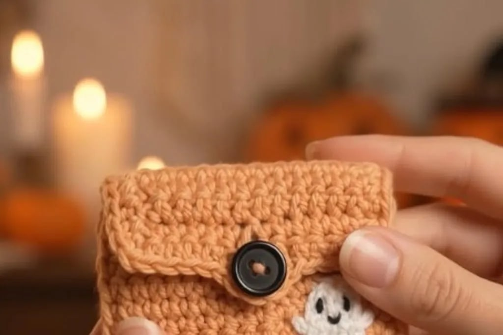
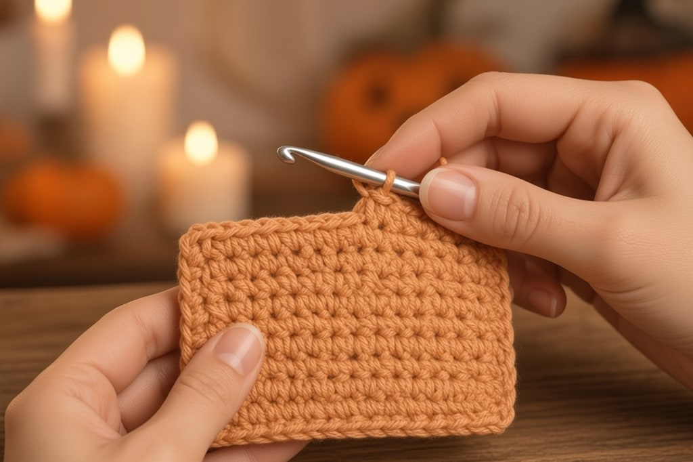
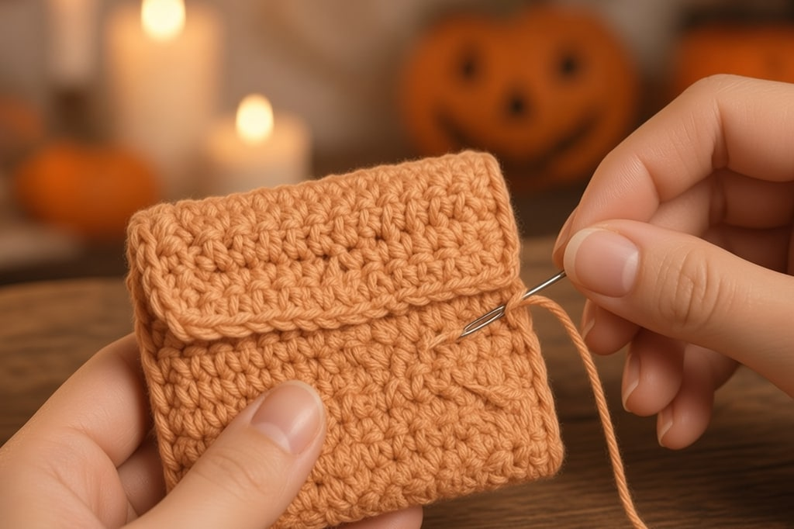
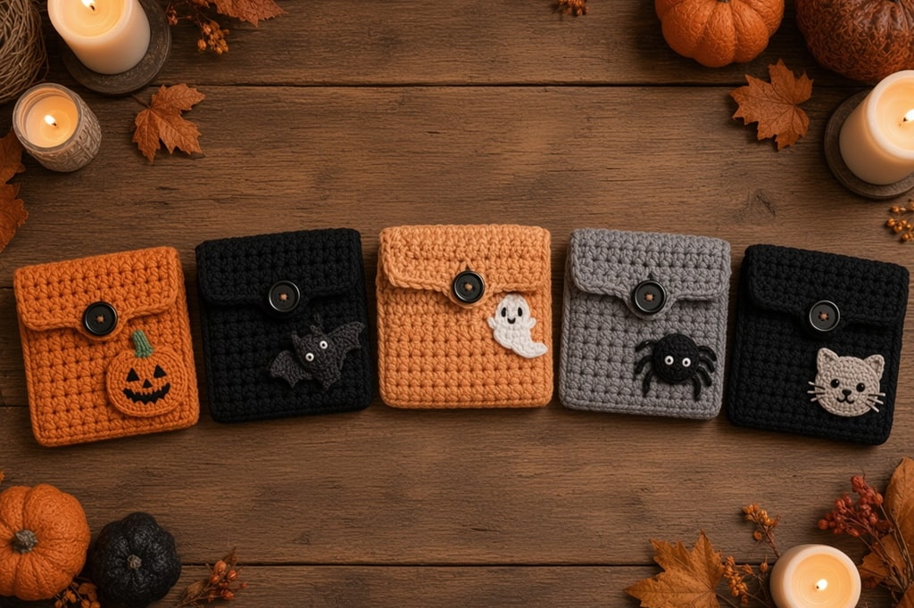

A card wallet is one rectangle with three jobs. The bottom part folds up to become the front of the pocket. The middle is the back. The top is a flap that folds over and buttons. Once you see the rectangle as those three zones, you can size it for any card, and the same method works for a gift-card pocket, a transit-card holder, or a slim wallet for two cards and a license.

This page works the method through one example in pumpkin orange, with a black button and a small flat ghost on the flap. The ghost is decoration. The pocket is the skill.

US terms. US single crochet is UK double crochet. [Abbreviations](/crochet-abbreviations-chart/), and [basic stitches](/basic-crochet-stitches/) if rows are new. The pictures are illustrations. No wallet for this page was crocheted or fitted to a card.

## How the rectangle becomes a wallet

<figure class="diagram">

<figcaption>Fold on the first dashed line to make the pocket. Fold on the second to close the flap.</figcaption>
</figure>

The foundation chain sets the width, and it does not change. The rows build the three zones one after another. After the last row, fold the front up against the back, seam the sides of the pocket only, and leave the flap free.

## Size it from your cards

Stack every card the wallet will hold and measure the stack. An ID-1 card is 0.030 inch thick, so two cards are about 0.06 inch and a license plus two cards about 0.09.

**Width.** The fabric has to cover the card's width and its stack thickness, plus some ease so the cards slide, plus the side seams, which take up about one stitch.

**Pocket depth.** The card's height plus a little ease. The flap covers the top, so the card can sit fully inside.

**Flap.** It has to fold over the top of the back, past the opening, and reach a button on the front. About 1.4 inches suits a 2.4 inch pocket.

## The worked example

Two ID-1 cards, at 4 stitches and 5 rows per inch.

| Part | Arithmetic | Result |
| --- | --- | --- |
| Width | 3.37 + 0.06 stack + 0.25 ease + 0.25 seams | 3.93 in, 16 sc, chain 17 |
| Pocket depth | 2.125 + 0.03 + about 0.25 ease | about 2.4 in, 12 rows |
| Front | same as the pocket | rows 1–12 |
| Back | same as the pocket | rows 13–24 |
| Flap | about 1.4 in | rows 25–31 |
| Loop row | 6 + 4 + 6 | sc 6, ch 4, skip 4, sc 6 |

## What you need

- Worsted yarn in **pumpkin orange**, plus scraps of **white** and **black**.
- A hook that gives firm fabric, often US G/6 (4.0 mm). A soft pocket lets cards slip.
- **One black button**, about 3/4 inch (20 mm) across.
- Yarn needle, clips or stitch markers.
- **The cards the wallet will hold.**

## Stage 1: chain and check

Chain 17. Sc in the second chain from the hook and in each chain across. Ch 1, turn. (16)

Lay a card on the first row. The fabric should be wider than the card by about the width of two stitches. If it is not, start again with more stitches or a larger hook. Measuring now saves seaming a pocket the card cannot enter.

**If the first row cups,** the chain was too tight. Redo it looser, or work the chain on a hook one size larger.

## Stage 2: the front and back

**Rows 2–24:** Sc in each stitch. Ch 1, turn. (16)

The ch 1 does not count as a stitch. Count every few rows.

**Checkpoint at row 24:** fold the first 12 rows up against the next 12. Slide the cards in. They should go in flat and sit just inside the opening. If the top of a card shows, both pocket zones need more rows. Undo to the planned fold, extend the front, then work an equally deep back before starting the flap. Adding rows only at the current end lengthens the back, not the front. Write down the new fold and flap-start row numbers.

## Stage 3: the flap

**Rows 25–30:** Sc in each stitch. Ch 1, turn. (16)

For a black stripe at the flap edge, [change color](/changing-yarn-color-crochet/) on the last yarn-over of row 29 and work rows 30 and 31 in black.

**Row 31:** Sc 6, ch 4, skip 4, sc 6. (12 sc and a ch-4 loop)

Fasten off. Six, four skipped, and six is sixteen, so the loop sits centered and the edge stays the same width. Four skipped stitches span about an inch, which suits a 3/4 inch button. For a 1/2 inch button, work sc 7, ch 3, skip 2, sc 7.

## Stage 4: fold and seam

<figure class="diagram">

<figcaption>Front and back row ends are paired outward from the bottom fold.</figcaption>
</figure>

Fold rows 1 to 12 up against rows 13 to 24. Clip the sides. Whipstitch both sides from the fold to the opening, through the outer loop of each edge stitch. **Stop at the opening.** Sewing into the flap makes a closed pouch. Add an extra stitch at the top of each seam, where cards pull. Weave the ends inside the seams, not loose in the pocket.

<figure class="diagram">

<figcaption>Measure the rectangle flat before seaming. It should be about 4 inches wide at the example gauge, or the card will not fit.</figcaption>
</figure>

## Stage 5: the button

Put the cards in. Fold the flap down and mark where the loop lands on the front. Sew the button there, **through the front wall only**. If the needle goes through both layers, the pocket is sewn shut at that point, and the cards hit the button's shank.

## Stage 6: a flat ghost

A ghost worked as a little tube flattens to about an inch and a half wide, which crowds a 4 inch flap. This one is flat and about an inch tall.

With white:

**Round 1:** 6 sc in a magic ring. Slip stitch to the first sc. (6) This is the head, about half an inch across.

**Row 1:** Ch 1, sc in the next 3 stitches. Turn. (3)

**Row 2:** Ch 1, sc in each stitch. Turn. (3)

**Row 3:** Sl st in the first stitch, 3 hdc in the next, sl st in the last. (A wavy hem)

Fasten off with a tail for sewing. Embroider two French-knot eyes in black. Sew the ghost to the flap, to one side of the loop, so it shows when the flap is closed. Sew through the flap only.

## Fit check

Slide the cards in, close the flap, and tip the wallet upside down.

**Too tight:** next time add a stitch or two of width. **Too loose:** a round of slip stitch around the opening firms it. **Flap will not reach:** add flap rows before row 31. **The loop fights the button:** rework row 31 with one chain more or less.

## Same pocket, different face

| Look | Base color | Appliqué idea |
| --- | --- | --- |
| Ghost (this page) | Orange or black | The small flat ghost above |
| Pumpkin | Orange or gray | A 6-stitch circle in orange, a few black face stitches, a green scrap stem |
| Bat | Gray or black | Two small black triangles in rows for wings, a 6-stitch head |
| Spider | Gray or cream | A 6-stitch black circle with eight embroidered legs |
| Cat | Black | Two ear triangles at the flap edge, embroidered whiskers |

## Match the folded rows before sewing

For the 31-row example, front rows 1–12 fold against back rows 13–24. From the fold upward, pair row 12 with 13, row 11 with 14, continuing to row 1 with 24. Rows 25–31 remain outside the side seams as the flap. Mark each pair with a clip if the edges are hard to read. Work the little ghost with ch 1 that does not count, and sew it through the flap alone while the pocket is open. Check the button through its loop before permanently sewing the button to the loaded wallet's marked position.

## Troubleshooting

**Cards go in but bow.** The width only covers the card, not the stack. Add a stitch.

**The flap pops open.** Too many cards for the flap length, or a loop that is too long. Fewer cards, or one more flap row.

**The pocket sags open at the top.** Loose gauge. Go down a hook size and redo it.

**The ghost wrinkles the flap.** It is sewn too tightly, or it is too big. Sew it loosely through the back of its stitches.

**The seams pull open at the top.** One stitch at the stress point. Add a second.

## Frequently asked

**Will a license and two cards fit?**

At this size, by the arithmetic, yes. Stack yours and check before you seam.

**Can I skip the ghost?**

Yes. Orange and a black button are enough.

**Do I need to know amigurumi?**

No. The body is flat rows. The ghost is one round and three rows.

## Next

A fixed-count version with a deeper pocket that also takes a folded bill is the [ghost mini wallet](/ghost-crochet-mini-wallet/). A pocket with no flap is the [Christmas gift card holder](/how-to-crochet-a-christmas-gift-card-holder/). Five fixed-count designs, a black cat, ghost, pumpkin, witch hat, and spiderweb, are in the [Halloween crochet wallet collection](/halloween-crochet-wallets/).
