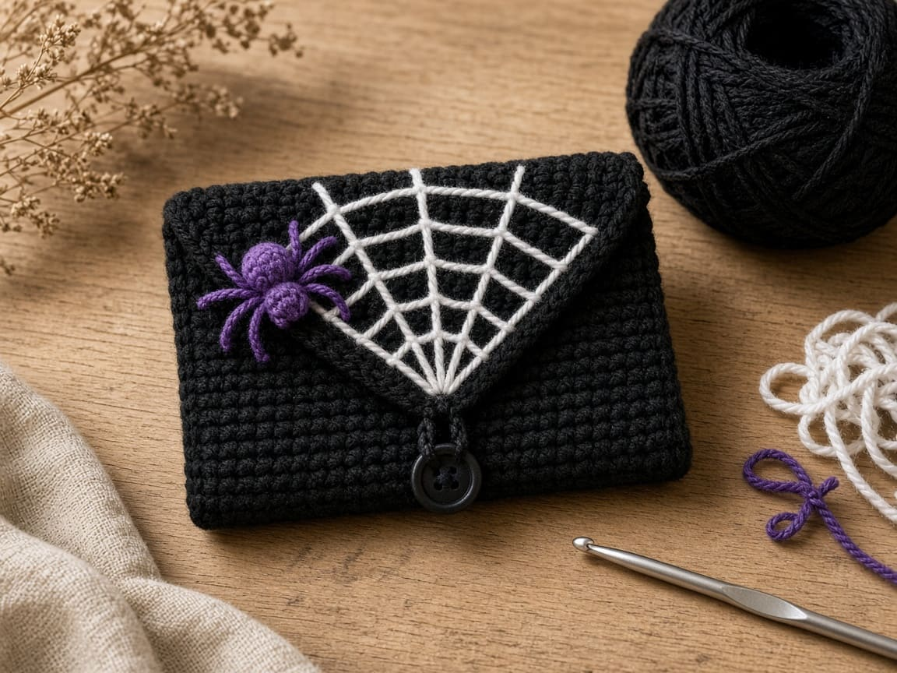

A Halloween wallet is a quick project, a good gift, and a reason to use up the scraps of black, orange, and purple you bought last October. The trouble with most "wallet" patterns is that nobody checked whether a card goes in. These five were sized on paper against a standard bank card, and each one uses a different construction, so making all five teaches you five techniques rather than one rectangle five times.

Every pattern uses the same yarn weight, hook, and example gauge, so one swatch tells you whether all five will fit.

<figure class="diagram">

<figcaption>Diagram. Five constructions, one gauge.</figcaption>
</figure>

## Pick a pattern

**[Black cat crochet wallet](/black-cat-crochet-wallet/).** Beginner. A seamless pocket worked in rounds around both sides of a chain, a 9-row flap with gold eyes, two triangle ears, and a snap.

**[Ghost crochet wallet](/ghost-crochet-wallet/).** Intermediate. Two shaped panels, a soft embroidered face with pink cheeks, and one edging round that joins the layers and scallops the hem. The snap hides inside.

**[Pumpkin crochet wallet](/pumpkin-crochet-wallet/).** Beginner. One sideways piece in back-loop ribs, folded and seamed, with a jack-o'-lantern face, a rolled stem, and a green leaf tab that snaps shut.

**[Witch hat crochet wallet](/witch-hat-crochet-wallet/).** Intermediate. One purple rectangle with a worked buttonhole, an inner divider for two pockets, and a black and orange hat appliqué.

**[Spiderweb crochet wallet](/spiderweb-crochet-wallet/).** Intermediate. A black wallet with a pointed flap, a backstitched white web, a tiny purple spider, and a button loop.

All five pictures are computer illustrations of the intended look. None is a photograph of a wallet made from these patterns.

## How they compare

| Wallet | Level | Outside size, about | Closure | New technique |
| --- | --- | --- | --- | --- |
| Black cat | Beginner | 4.0 x 2.4 in, plus ears | Snap | Working both sides of a chain |
| Ghost | Intermediate | 4.6 x 4.9 in | Hidden snap | Shaping and joining two layers with an edging |
| Pumpkin | Beginner | 4.25 x 2.5 in | Leaf tab and snap | Back-loop ribbing worked sideways |
| Witch hat | Intermediate | 4.25 x 2.4 in | Button | Buttonhole and a three-layer seam |
| Spiderweb | Intermediate | 4.25 x 2.6 in | Button loop | Backstitch embroidery |

Sizes are paper geometry at the example gauge of 16 sc and 20 rows to 4 inches.

**What you need for all five.** Worsted weight (CYC 4) yarn in black, cream, orange, and purple, scraps of gold, pink, green, and white, a US G/6 (4.0 mm) hook, two 3/8 inch sew-on snaps, two 5/8 inch flat buttons, and a tapestry needle.

## Which one to make first

- **Never made anything but a swatch:** the pumpkin. Straight rows, one fold, two seams.
- **Comfortable with rounds:** the black cat. It has no seams on the pocket at all.
- **Want two pockets:** the witch hat. Cards on one side, cash on the other.
- **Like embroidery more than crochet:** the spiderweb. The crochet is plain; the web is drawn on.
- **Want the most character:** the ghost. It takes longest because of the joining round.

If you need a wallet for a specific number of cards, or want to work out your own size, start with the sizing method in the [Halloween card wallet](/halloween-crochet-card-wallet/) instead. For a smaller, flap-style ghost, see the [ghost mini wallet](/ghost-crochet-mini-wallet/).

## What is checked, and what is not

| Part of every pattern | What it is |
| --- | --- |
| ID-1 card, 3.370 x 2.125 in | The ISO/IEC 7810 size of most US bank cards and licenses |
| Stitch and row counts | Checked by hand on paper |
| 16 sc and 20 rows to 4 in | An example gauge, not measured from finished wallets |
| Sizes and card fit | Geometry from that gauge. Not physically test-crocheted. |

Each pattern tells you where to test the fit with a real card before you commit to the finishing. That test is the one step not to skip.

## The swatch that decides all five

Make a single crochet swatch about 5 inches square on the G/6 hook and measure the middle 4 inches, as in the [gauge guide](/crochet-gauge/). If you get 16 stitches, all five patterns work as written. If you get 17 or 18, go up a hook size. If you get 14 or 15, go down one. For the pumpkin, make a second small swatch in back loops only, because that fabric is shorter per row.

Weigh the swatch, too. Each pattern gives its fabric area as a multiple of a 4 inch square, which is how you estimate yarn without guessing.

## Mistakes these patterns share

**Skipping the card test.** Every pattern names a point to test. A pocket that is 0.2 inch too narrow will not stretch enough.

**Embroidering in the wrong orientation.** The cat and witch hat flaps are decorated with the flap closed. The ghost face goes on before the panels are joined.

**Sewing closures through both layers.** A snap or button sewn through the whole wallet stitches the pocket shut. Sew through one layer.

**Loose fabric.** Wallets need firmer fabric than a hat or blanket, which is why the hook is smaller than most worsted labels suggest.

## Frequently asked

**Are these patterns tested?** They are checked on paper: every count, every size, and the card fit at the example gauge. They have not been physically crocheted and measured yet. Each pattern says so and gives a fit test.

**Do they hold coins?** None of them is designed for loose coins. They are card sleeves with closures.

**Can I use acrylic yarn?** Yes. Cotton holds the shape better and shows stitch detail, but any worsted yarn that gets the gauge works.

**Can I sell what I make?** Yes, the finished wallets. Please link to the pattern rather than reposting it.

**Where do I learn the basics first?** Start with [basic crochet stitches](/basic-crochet-stitches/) and the [abbreviations chart](/crochet-abbreviations-chart/). Every pattern here uses US terms.

Pick the pattern that matches your skills, make one swatch, and test the card where the pattern tells you to. The rest is single crochet.
