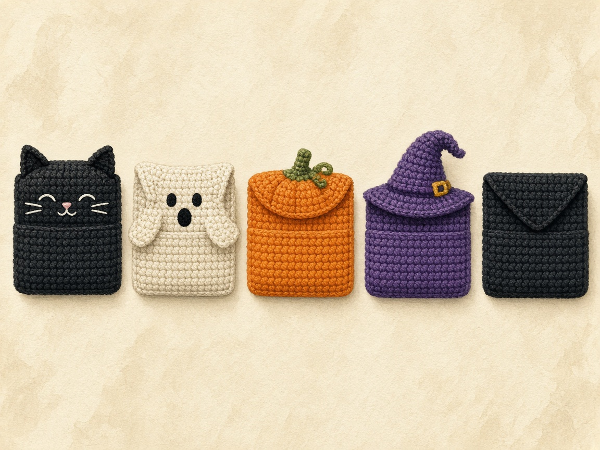

A Halloween wallet is a quick project, a good gift, and a reason to use up the scraps of black, orange, and purple you bought last October. The trouble with most wallet patterns is that nobody checked whether a card goes in.

These five were sized on paper against a standard bank card, and each one uses a different construction, so making all five teaches you five techniques rather than one rectangle five times.

#### What all five share before you pick one

1. Write all five for worsted yarn and a US G/6 (4.0 mm) hook.
2. Make a plain single-crochet swatch. It checks the gauge the cat, ghost, witch hat, and spiderweb assume.
3. Do not treat that swatch as proof a card will fit.
4. Do not use that swatch to measure the pumpkin. The pumpkin is worked in the back loop only.
5. Each pattern names the row where you slide a real card in.

<figure class="diagram">

<figcaption>Diagram. Five constructions. The pumpkin's ribs are back loop only, so its row gauge differs.</figcaption>
</figure>

## Pick a pattern

#### Black cat

1. Open [black cat crochet wallet](/black-cat-crochet-wallet/).
2. Level: beginner.
3. Work a seamless pocket in rounds around both sides of a chain.
4. Add a 9-row flap with gold eyes, two triangle ears, and a snap.

#### Ghost

1. Open [ghost crochet wallet](/ghost-crochet-wallet/).
2. Level: intermediate.
3. Make two shaped panels and a soft embroidered face with pink cheeks.
4. Join the layers with one edging round that also scallops the hem.
5. Hide the snap inside.

#### Pumpkin

1. Open [pumpkin crochet wallet](/pumpkin-crochet-wallet/).
2. Level: beginner.
3. Work one sideways piece in back-loop ribs, then fold and seam it.
4. Add a jack-o'-lantern face, a rolled stem, and a green leaf tab that snaps shut.

#### Witch hat

1. Open [witch hat crochet wallet](/witch-hat-crochet-wallet/).
2. Level: intermediate.
3. Work one purple rectangle with a worked buttonhole.
4. Add an inner divider for two pockets, and a black and orange hat appliqué.

#### Spiderweb

1. Open [spiderweb crochet wallet](/spiderweb-crochet-wallet/).
2. Level: intermediate.
3. Work a black wallet with a pointed flap.
4. Backstitch a white web, add a tiny purple spider, and close with a button loop.

Each link above is a complete pattern. The diagram is the counted construction for all five. This page does not restate those counts as a second pattern.

## How they compare

| Wallet | Level | Outside size, about | Closure | New technique |
| --- | --- | --- | --- | --- |
| Black cat | Beginner | 4.0 x 2.4 in, plus ears | Snap | Working both sides of a chain |
| Ghost | Intermediate | 4.6 x 4.9 in | Hidden snap | Shaping and joining two layers with an edging |
| Pumpkin | Beginner | 4.25 x 2.5 in | Leaf tab and snap | Back-loop ribbing worked sideways |
| Witch hat | Intermediate | 4.25 x 2.4 in | Button | Buttonhole and a three-layer seam |
| Spiderweb | Intermediate | 4.25 x 2.6 in | Button loop | Backstitch embroidery |

#### Read the inches as a gauge plan

1. The sizes are worked out from a gauge of 16 sc and 20 rows to 4 inches.
2. The pumpkin's back-loop row gauge may differ.
3. That is why the pumpkin pattern works to a length instead of a fixed row count.

#### What you need for all five

1. Worsted weight (CYC 4) yarn in black, cream, orange, and purple.
2. Scraps of gold, pink, green, and white.
3. A US G/6 (4.0 mm) hook.
4. Three 3/8 inch sew-on snaps.
5. Two 5/8 inch flat buttons.
6. A tapestry needle.

## Which one to make first

#### Match the first wallet to the skill you already have

1. Never made anything but a swatch: the pumpkin. Straight rows, one fold, two seams.
2. Comfortable with rounds: the black cat. It has no seams on the pocket at all.
3. Want two pockets: the witch hat. Cards on one side, cash on the other.
4. Like embroidery more than crochet: the spiderweb. The crochet is plain; the web is drawn on.
5. Want the most character: the ghost. It takes longest because of the joining round.

If you need a wallet for a specific number of cards, or want to work out your own size, start with the sizing method in the [Halloween card wallet](/halloween-crochet-card-wallet/) instead. For a smaller, flap-style ghost, see the [ghost mini wallet](/ghost-crochet-mini-wallet/).

#### Swatch, then a real card

1. Every pattern gives sizes worked out from the example gauge of 16 sc and 20 rows to 4 inches rather than from a finished wallet, so swatch first.
2. A standard US bank card is 3.370 by 2.125 inches, the ISO/IEC 7810 ID-1 size.
3. Each pattern tells you where to test the fit with a real card before you commit to the finishing.
4. That test is the one step not to skip.

## Gauge, then a real card

#### The plain swatch

1. Make a single crochet swatch about 5 inches square on the G/6 hook.
2. Measure the middle 4 inches, as in the [gauge guide](/crochet-gauge/).
3. If you get 16 stitches and 20 rows, the cat, ghost, witch hat, and spiderweb are at the gauge those patterns assume.
4. If you get 17 or 18 stitches, go up a hook size.
5. If you get 14 or 15, go down one.

| Stitches in 4 inches | What the fabric is doing | Hook change |
| --- | --- | --- |
| 16, and 20 rows | The plan for cat, ghost, witch hat, and spiderweb | Stay |
| 17 or 18 | Each stitch is smaller. The same counts make a narrower wallet | Go up a hook size |
| 14 or 15 | Each stitch is larger. The wallet comes out wide and soft | Go down a hook size |

#### The pumpkin swatch is a second fabric

1. The pumpkin is worked in the back loop only.
2. Its row gauge must be measured separately from plain single crochet.
3. Make a second small swatch in back loops.
4. Follow that pattern's instruction to work until the piece measures 4.25 inches.

A matching swatch only means the stitch size is in range. Seams, joins, and the flap still change the opening. Slide a real card in at the step each pattern names before you sew the closure.

#### Weigh the swatch if you want yarn

1. Weigh the plain swatch.
2. Each pattern gives its fabric area as a multiple of a 4 inch square.
3. That multiple is how you estimate yarn without guessing.
4. Use the multiple printed on the pattern you chose. This page does not add a second set.

## Choose the closure as well as the shape

#### Notions for the set, one wallet at a time

1. The collection contains five featured designs, with two additional flap-wallet tutorials linked separately.
2. None of the five is a sealed coin purse.
3. For each project, check its own fabric: the pumpkin uses BLO rows, the cat uses rounds, and the other three use flat rows.
4. All five together require three snaps and two buttons, plus appropriate sewing thread.
5. Make one complete wallet before preparing a batch.
6. Record the hook, measured gauge, actual pocket size, closure position, and card-stack fit.
7. Reproduce your own result. Do not assume the illustration establishes those measurements.

## Mistakes these patterns share

#### Skipping the card test

1. Every pattern names a point to test.
2. A pocket that is 0.2 inch too narrow will not stretch enough.
3. Test before the closure is sewn.

#### Embroidering in the wrong orientation

1. Decorate the cat and witch hat flaps with the flap closed.
2. Put the ghost face on before the panels are joined.
3. Stitching while the flap stands up puts the face upside down when it closes.

#### Sewing closures through both layers

1. A snap or button sewn through the whole wallet stitches the pocket shut.
2. Sew through one layer.
3. Look inside. If you can see the thread through the back wall, you caught both layers.

#### Loose fabric

1. Wallets need firmer fabric than a hat or blanket.
2. That is why the hook is smaller than most worsted labels suggest.
3. If the swatch is soft and you can see large holes, go down a hook even when the stitch count is close.

## What is actually different about the five builds

#### Do not copy a count from one page onto another

1. The five wallets share a holiday and a card size. They do not share a construction.
2. If you copy the cat's round count onto the witch hat rectangle, you will not get a wider cat.
3. You will get a rectangle with the wrong number of rows and no divider.
4. Each linked page owns its counts.
5. This page is the comparison. Choose one build, then follow that page without mixing it with the others.

<figure class="diagram">

<figcaption>Diagram. Five builds. The stitch counts stay on each pattern page and do not travel with you.</figcaption>
</figure>

#### The black cat is a tube

1. Chain and work along both sides of that chain, so the chain becomes the bottom fold and the pocket has no side seams to sew.
2. Grow the flap from the back half of the last round.
3. Sew the ears as separate triangles on the fold.
4. Close with a snap.
5. The new skill is working both sides of a chain and then stopping the tube so a flap can start.
6. Round joins can drift. The cat pattern tells you to set the flap from the side folds you can see, not from a seam that has leaned.
7. Read [black cat crochet wallet](/black-cat-crochet-wallet/) for the round-by-round counts.
8. Do not invent a new round count on this page to make it deeper.
9. If the card test at the round that pattern names is too shallow, that page is where an extra round is explained.

#### What the cat tube should look like before any ear

1. See a flat tube.
2. See the same number of stitches on the front face and the back face.
3. See the starting chain acting as the bottom, and an open top.
4. If you see two seams already, you folded a rectangle and sewed it. That is a different wallet.
5. If the tube twists, the return side of the chain was worked with the fabric flipped.
6. Lay it flat with the join at one side fold before you pick the 16 stitches the flap will grow from.
7. A flap that starts in the middle of a face will close crooked even if every later row is counted correctly.

The face is embroidered with the flap closed, so row 1 of the flap is at the top fold and the shorter rows are at the bottom edge. Stitching the face while the flap stands up puts the eyes near the snap. Gold eyes, a small nose, and whiskers stay on the flap only. Thread on the underside of the flap rubs the front of the wallet every time it opens, so the cat pattern keeps those carries short and unknotted.

#### The ghost is two panels and one joining round

1. There is no flap.
2. The face is the outside of the taller back panel, above the pocket, so cards sit behind the ghost's middle and do not stretch the embroidery.
3. The front panel is shorter. Its top edge is the pocket opening and stays unworked.
4. One edging round joins the layers, scallops the hem, and climbs the head.
5. The snap is hidden inside, sewn while both panels are still flat.
6. That order is the whole difficulty.
7. If you join first and embroider second, the face yarn is trapped between layers or the opening gets sewn shut while you are trying to reach the inside.

#### Match the ghost panels before the round

1. Read [ghost crochet wallet](/ghost-crochet-wallet/) before you chain either panel.
2. Match the hems and the stitch counts while both pieces are separate.
3. If the numbers match and one panel is still wider on a ruler, remake the odd panel.
4. Do not stretch it to fit. A stretched panel springs back and the scallops pucker.
5. The joining round has a place where you must switch from working through both layers to working through the back panel alone.
6. That place is the top of the front panel. Mark it before you start the round.
7. Slide a card in before the round, too.
8. If the card will not pass, the clips are pinching the opening. Move them to the sides.

#### Why the ghost takes the longest

1. The ghost takes longest of the five because of that round, not because the panels are hard.
2. Straight rows are straight rows.
3. The round is where a missed skip ruins the four scallops, and where one careless stitch across the front's top edge deletes the pocket.
4. The [ghost mini wallet](/ghost-crochet-mini-wallet/) is the other ghost on this site: a smaller flap-style piece, a folded rectangle, not these two panels.
5. Do not mix their counts.
6. If you want the most character and you can follow a counted round, make this one.
7. If you want a flap, you are looking at the mini, or at the cat, the witch hat, or the spiderweb.

One stitch across the front panel's top edge deletes the pocket. Mark that edge before the joining round.

#### The pumpkin is sideways ribbing, folded once

1. The rows run across the width you will fold in half.
2. Back-loop stitches leave a raised rib on the surface.
3. Those ribs run up and down after you turn the piece the right way, which is why it reads as a pumpkin instead of as a striped rectangle.
4. There is no flap rectangle.
5. A green leaf tab comes over the opening, a rolled stem anchors that tab, and a snap closes it.
6. Embroider the face before the fold, on the half that will be the front.
7. Leave the tab's landing rectangle empty so you do not stitch the fold shut.

#### Stop the pumpkin on a measurement

1. Read [pumpkin crochet wallet](/pumpkin-crochet-wallet/) for the row instructions.
2. This hub will not restate them as a second pattern.
3. What matters for the choice is the fabric. Back-loop rows are a different gauge from plain single crochet.
4. The four other wallets can share one plain swatch. The pumpkin cannot.
5. Work until the piece measures 4.25 inches, and stop on an even row, instead of trusting a row count copied from a plain-single-crochet swatch.
6. If you stop at a number you remember from the witch hat, the pumpkin will be the wrong width and the ribs will not match the face chart on that page.

| Pumpkin check | Right | Wrong |
| --- | --- | --- |
| Width | Work to 4.25 inches, stop on an even row | A row count borrowed from the witch hat or the plain swatch |
| Fold | Right side out, ribs and face outside, two rims open at the top | A second fold, or the face on the inside |
| Seams | Side seams only, loose enough that a card still slides | A tight whipstitch that binds the card at the edge |

1. Fold right side out so the ribs and the face stay outside.
2. The two rims meet at the top and stay open.
3. The side seams are the only seams.
4. A tight whipstitch makes a card bind at the edge even when the width on paper looked fine.
5. After the seams, slide a card in again.
6. If it sticks, loosen those stitches.
7. Do not add a second fold.

#### The witch hat is one rectangle in three zones, plus a divider

1. Front, back, and flap are rows of the same piece, not three fabrics sewn end to end.
2. A buttonhole is worked into a flap row.
3. An inner divider, a row shorter than the front so it hides under the rim, makes two pockets of the same plan size: cards on one side, folded cash or a pass on the other.
4. The side seams go through three layers where the divider is present and through two layers past it.
5. The hat is an appliqué sewn to the flap, and it has to stay clear of the buttonhole.

#### The skill you are choosing on the witch hat

1. Read [witch hat crochet wallet](/witch-hat-crochet-wallet/) for the zone row numbers and the buttonhole row.
2. The skill is a hole made of chains and skipped stitches, then a return row that puts the stitch count back, then a seam that does not leave a gap under the divider.
3. A gap at the bottom of the divider lets a card slip from one pocket into the other.
4. The pattern tells you to test one card in each pocket before you trust the seam.
5. The hat is decoration with a placement rule: if the brim covers the hole, the button cannot pass.
6. Pin the hat with the flap closed, the way it will be worn, and look at the hole before you sew the brim down.

#### The spiderweb is one rectangle, a pointed flap, and surface embroidery

1. The crochet is plain single crochet until the flap.
2. On the flap, both ends decrease on every row until you have a point.
3. A chain loop at that point is the closure, because a buttonhole cannot sit in the last few stitches of a point.
4. The web is backstitch on the closed flap: spokes and rings in white, then a small purple spider.
5. Sew the button where the loop actually lands, with cards inside, through the front wall only.

#### Choose the spiderweb when you would rather draw

1. Read [spiderweb crochet wallet](/spiderweb-crochet-wallet/) for the decrease rows and the loop.
2. Choose this one when you would rather draw with a needle than shape a tube or join two panels.
3. The crochet has to be even enough that the spokes do not wobble, and firm enough that a button does not tear out.
4. It does not have to teach you rounds, ribbing, or a three-layer seam.
5. If you embroider before the flap's closed direction is fixed, the web will be upside down when the wallet shuts.
6. Close the flap, see which face is outside, and then stitch.

| Build | Fabric path | Closure | When the face goes on |
| --- | --- | --- | --- |
| Cat | Tube, both sides of a chain | Snap | Flap closed |
| Ghost | Two panels, one edging round | Hidden snap | Back panel, before the join |
| Pumpkin | Sideways back-loop ribs, one fold | Leaf tab and snap | Before the fold, off the tab's rectangle |
| Witch hat | One rectangle, three zones, divider | Worked buttonhole | Flap closed, hat clear of the hole |
| Spiderweb | Rectangle, then decreases to a point | Chain loop | After you know which way the point hangs |

## How to see the gauge, including the pumpkin's

<figure class="diagram">

<figcaption>Diagram. Four wallets share the plain swatch. The pumpkin needs its own back-loop swatch.</figcaption>
</figure>

#### Measure the middle, not the edge

1. Make a single crochet swatch about 5 inches square on the US G/6 (4.0 mm) hook.
2. Measure the middle 4 inches, not the edge, the way the [gauge guide](/crochet-gauge/) describes.
3. The edge lies. The middle is the fabric.
4. If that middle is 16 stitches and 20 rows, the cat, ghost, witch hat, and spiderweb are at the gauge those patterns assume.
5. If you count 17 or 18 stitches in that 4 inches, each stitch is smaller than the plan and the same counts will make a narrower wallet. Go up a hook size and swatch again.
6. If you count 14 or 15, each stitch is larger and the wallet will come out wide and soft. Go down a hook size.
7. Do not fix a 14-stitch gauge by crocheting tighter on the next row. Tension you force for one row will not hold for a whole wallet.

#### Stitch gauge and row gauge can fail separately

1. You can have 16 stitches and 18 rows, or 16 stitches and 22 rows.
2. The width plan can be right while the depth plan moves.
3. On the cat, depth is rounds.
4. On the ghost, depth is the front panel's rows plus what the hem join takes.
5. On the witch hat and the spiderweb, depth is the front and back row blocks.
6. If your row gauge is off, do not rewrite those blocks on this page.
7. Make the wallet at the pattern's row counts, run the card test that pattern names, and use that pattern's own note if the card sticks out the top.
8. A hub chart of new row counts would disagree with the pages you are about to follow.

#### Swatch the pumpkin a second time

1. The pumpkin is the exception you swatch twice.
2. Back-loop single crochet often has a different row gauge from plain single crochet, because the hook is under one loop and the fabric packs differently.
3. Make a second small swatch in the back loop only.
4. Use it to see how many rows you need to reach a measured 4.25 inches.
5. The pumpkin pattern works to that length and asks for an even row at the end.
6. If your back-loop swatch says 4.25 inches arrives at a different even number than the example, follow the tape.
7. The example is an illustration of the gauge, not a number that overrides the ruler.

Follow the tape to 4.25 inches and stop on an even row. A row count copied from the plain swatch will make the pumpkin the wrong width.

#### Yarn estimate from the pattern's own multiple

1. Weigh the plain swatch if you want a yarn estimate.
2. Each pattern gives its fabric area as a multiple of a 4 inch square.
3. Weigh a known square, multiply by that pattern's multiple, and add a little for sewing yarn and scraps.
4. This page does not add a second set of multiples.
5. Use the multiple printed on the pattern you chose.
6. A guess in grams, copied from a different wallet, is how you run out of black on the last row of the flap.

#### Blot a scrap before you trust the dye

1. Wash a scrap if the colors might bleed.
2. Black on cream is the ghost's risk.
3. Orange and black on purple is the witch hat's risk.
4. Green on orange is the pumpkin's risk.
5. Blot a wet scrap on a white paper towel before you wash a finished wallet.
6. The hub cannot tell you whether your brand of yarn is colorfast. The towel can.

#### Firm fabric, smaller hook

1. Firm fabric matters more here than it does in a hat or a blanket.
2. The hook is smaller than most worsted labels suggest because a card wallet should not sag open.
3. If the swatch is soft and you can see large holes between stitches, go down a hook even if the stitch count is close.
4. Holes are where a card corner catches.
5. Cotton shows stitch detail and holds a buttonhole better than a fluffy acrylic.
6. Acrylic can still be used if it hits the gauge and the fabric feels firm. The pattern pages say that directly.
7. Fuzzy yarn hides the ribs, the web, and the decreases, and it sheds into the pocket.

## Where the card goes in, wallet by wallet

#### The card and the paper plan

1. A standard US bank card is 3.370 by 2.125 inches, the ISO/IEC 7810 ID-1 size.
2. The outside sizes in the table above are worked from 16 single crochet and 20 rows to 4 inches.
3. The insides are smaller than the outsides because folds, seams, and edging take some of the width.
4. The glance size on this page, pockets about 3.8 to 3.9 inches inside, is that paper plan across the set.
5. It is not a measurement from a finished stack of wallets.
6. A plan that looks 0.2 inch too narrow will not stretch enough to become honest.
7. If your card binds, fix the gauge or the seam.
8. Do not pull the card through and call it a fit.

<figure class="diagram">

<figcaption>Diagram. Each pattern names its own moment for a real card. These insides are plans from the example gauge.</figcaption>
</figure>

#### Cat

1. The pattern's test is at round 10, with the tube flattened and the join at one side fold, before you finish the remaining rounds and start the flap.
2. On that page's plan the outside is about 4.0 by 2.4 inches and the inside is about 3.8 by 2.3 inches.
3. Slide one card in. It should lie flat with a little room at each side.
4. Too tight means a larger hook, or the wider chain that page describes, not a tug of war.
5. Too loose means a smaller hook.
6. Test again with the number of cards you mean to carry before you place the snap.
7. No card-stack capacity has been measured for these patterns.
8. A thick stack changes the flap's reach, and the snap mark has to be made with that stack inside.

#### Ghost

1. Lay the card on the front panel before any joining stitch.
2. On that page's plan the pocket is about 3.9 by 2.7 inches inside, and the outside with edging is about 4.6 by 4.9 inches.
3. The card should be narrower and shorter than the front panel, with room above it for the hidden snap.
4. Put the card in again while the panels are clipped.
5. The top edge of the front must stay open.
6. If you only test after the edging round, a closed opening is already sewn and the card test is a diagnosis instead of a prevention.
7. The face sits above that opening.
8. If the card reaches the eyes, the front panel is too short for your row gauge or the card is above the snap line.
9. Move both snap halves by the same number of rows if the pattern's note says the snap sits on the cards.
10. Keep them on the same stitch so they still meet.

#### Pumpkin

1. Slip the card onto the flat ribbed piece before you fold.
2. On that page's plan the outside is about 4.25 by 2.5 inches and the inside is about 3.9 by 2.4 inches.
3. The 20-stitch height is what folds to the 2.5 inch outside.
4. The width is whatever row count reached 4.25 inches in back loop.
5. If the card is wider than the flat piece, you are not at 4.25 inches, or your stitch gauge is off.
6. Folding will not add width.
7. After the side seams, slide the card in again.
8. A card that stuck only after seaming is a tight whipstitch, not a gauge problem.
9. Loosen the seam. Do not rip the ribs.

#### Witch hat

1. The rectangle's plan is about 4.25 by 2.4 inches outside, with two pockets about 3.9 by 2.3 inches inside.
2. Test the button through the hole after the buttonhole's return row, before you seam anything.
3. The hole should pass a 5/8 inch flat button with a small push.
4. A shank button pushes into the cards.
5. Then, after the divider is sewn along its whole lower edge and the sides are seamed, put one card in each pocket.
6. Neither card should pass under the divider.
7. If one does, the bottom seam has a gap. Open that side and close the gap before you mark the button.
8. Mark the button with the cards in, through the hole, and sew through the front wall only.

#### Spiderweb

1. The plan is about 4.25 by 2.6 inches closed, pocket about 3.9 by 2.5 inches inside.
2. Slip a card in before you join the sides.
3. Then seam, put in the cards you mean to carry, and lower the pointed flap without stretching it.
4. Mark where the loop lands.
5. Take the cards out.
6. Sew the button at that mark through the front wall only.
7. If you mark on an empty pocket, the flap reaches farther than it will with cards inside, and the loop will strain or miss.
8. The web is embroidered after you know the closed orientation, and the needle stays out of the pocket.

| Wallet | When the card goes in | Outside plan | Inside plan |
| --- | --- | --- | --- |
| Cat | Round 10, before the flap | about 4.0 by 2.4 in | about 3.8 by 2.3 in |
| Ghost | On the front panel, before the join | about 4.6 by 4.9 in | about 3.9 by 2.7 in |
| Pumpkin | On the flat piece, before the fold, and again after the seams | about 4.25 by 2.5 in | about 3.9 by 2.4 in |
| Witch hat | Button through the hole first, then one card in each pocket | about 4.25 by 2.4 in | about 3.9 by 2.3 in each pocket |
| Spiderweb | Before the side seams, then again when the loop is marked | about 4.25 by 2.6 in closed | about 3.9 by 2.5 in |

The [Halloween card wallet](/halloween-crochet-card-wallet/) is the page to open when you need a pocket for a specific stack and you are willing to size it yourself. These five are fixed plans with a test, not a sizing lesson. Use that other page for a custom stack. Use this page to pick a Halloween build.

## Choose the closure before you sew it

#### Buy notions for one wallet first

1. The set uses three 3/8 inch sew-on snaps and two 5/8 inch flat buttons if you make all five.
2. The cat, the ghost, and the pumpkin take the snaps.
3. The witch hat and the spiderweb take the buttons.
4. Make one wallet before you cut all the notions for a batch.
5. A snap sewn in the wrong layer is harder to undo than a button, and a batch of five wrong closures is an evening you will not enjoy.

<figure class="diagram">

<figcaption>Diagram. The closure shapes differ. The sewing rule does not: one layer, or the pocket is stitched shut.</figcaption>
</figure>

#### A snap on a flap

1. This is the cat and, in a different shape, the pumpkin's leaf tab.
2. Mark with a card or a stack inside, flap or tab lying closed without stretch.
3. The ball half goes on the underside of the flap or tab.
4. The socket goes on the front.
5. Sew the socket through the front wall only.
6. Look inside the pocket. If you can see the thread through the back wall, you caught both layers. Take it out.
7. A small felt circle behind a socket is described on the cat page as reinforcement when the fabric is soft.
8. It still sits on the front wall's inside, not through to the back.

#### A hidden snap

1. This is the ghost. There is no flap, so nothing on the outside should show a closure.
2. Sew both halves while the panels are separate, catching the back of the stitches so the thread does not print on the ghost's face or on the outside back.
3. Press the snap shut with your fingers before you join, and put your real cards on the front panel.
4. If the snap lands on the cards, move both halves.
5. Joining first and then trying to sew a hidden snap means sewing blind between two layers, which is how the opening gets caught.

#### A worked buttonhole

1. This is the witch hat.
2. The hole is stitches and chains in a row, not a slit cut with scissors.
3. Test the button before the later rows lock the hole in place, at the moment that pattern names.
4. If the button falls through, that page gives a smaller hole to redo.
5. If the button will not pass, it gives a larger hole.
6. Follow those rewrites there.
7. Do not copy them onto the spiderweb, which has no buttonhole, or onto the cat, which has a snap.
8. When you sew the button, mark through the hole with cards in the pockets.
9. A button sewn on an empty wallet sits high, and the hole has to stretch down onto it.

#### A chain loop at a point

1. This is the spiderweb.
2. The loop returns to the point stitch.
3. Hold your button against the loop before you sew anything. It should pass with a little push, not fall through.
4. Then mark the landing place on the closed, loaded wallet.
5. A loop marked on an empty wallet, or marked while you pull the point down to a spot you like, will gap or strain.
6. The point is narrow. Sew the button through several stitches of the front, not through one thread.

None of the five is a coin purse. The corners are not a sealed box, and a snap pops under the weight of coins. If you need coins, this set is the wrong project. The closures keep cards from sliding out of a sleeve. They do not make a pouch.

#### Thread, then a record

1. Sewing thread should match the notion, not fight it.
2. Black thread on the cat.
3. Cream or a clear snap on the ghost.
4. Thread that matches the tab on the pumpkin.
5. Thread that can hold a 5/8 inch button on the witch hat and the spiderweb.
6. Yarn can sew a button if it fits the holes. It makes a bulky knot on a 3/8 inch snap. Use sewing thread for the snaps.
7. Record what you did if you might make a second one.
8. Write the hook, the measured gauge, the actual pocket size you got with a card, where the closure landed, and how many cards sat flat.
9. The illustration on this page does not establish those measurements. Your card test does.
10. A later wallet made from memory of the picture will not match the one in your hand.

| Closure | Wallets | Hardware | Layer |
| --- | --- | --- | --- |
| Snap on a flap or tab | Cat, pumpkin | 3/8 inch sew-on snap | Front wall only |
| Hidden snap | Ghost | 3/8 inch sew-on snap | Back of the stitches, panels still separate |
| Worked buttonhole | Witch hat | 5/8 inch flat button | Front wall, marked through the hole with cards in |
| Chain loop at the point | Spiderweb | 5/8 inch flat button | Front wall, marked on a loaded wallet |

## How to choose one, then stop

#### Pick from the constraint you actually have

1. Pick from the constraint you actually have, not from the picture you like most.
2. If you have never done more than a swatch, the pumpkin is straight rows, one fold, and two seams.
3. The new habit is the back loop, which you can see: the loop nearer you stays on the surface and becomes the rib.
4. If you are comfortable working in rounds and you hate sewing sides, the cat has no side seams on the pocket.
5. If you need two compartments, the witch hat is the only one of the five with a divider.
6. If you like a needle more than a hook, the spiderweb's crochet is the plain part.
7. If you want the piece that takes the most care and looks the least like a rectangle, the ghost is the joining round and the hidden snap.

#### One finished wallet before a batch

1. Make one complete wallet before you wind yarn for all five.
2. The notions list for the whole set is real, and it is also a trap.
3. Three snaps and two buttons are enough for five wallets and too many for a first evening.
4. One finished cat, or one finished pumpkin, teaches the card test in your own hands.
5. The second wallet can use a different build.
6. The counts still come from that second page, not from the wallet you just finished.

#### Color does not decide the build

1. Black, cream, orange, and purple are the set's palette, with scraps of gold, pink, green, and white.
2. You can swap colors and keep the build.
3. A cream cat is still a tube.
4. An orange ghost is still two panels.
5. Do not swap builds and keep the counts.
6. A purple tube is the cat pattern in purple. It is not the witch hat.

#### Decoration time is part of the choice

1. Embroidery orientation decides when you may decorate.
2. Cat and witch hat flaps are decorated closed.
3. The ghost face goes on the back panel before the panels are joined.
4. The pumpkin face goes on before the fold, avoiding the tab's rectangle and avoiding the fold line.
5. The spiderweb is embroidered after you know which way the point hangs when the flap is shut.
6. If you only have time to decorate and not to redo, choose the wallet whose decoration happens while the fabric is still flat and separate.
7. That is the ghost's face, or the pumpkin's face, not the joining round and not the three-layer seam.

#### If the shape you want is not one of the five

1. Stop and open the [Halloween card wallet](/halloween-crochet-card-wallet/) for a sized pocket, or the [ghost mini wallet](/ghost-crochet-mini-wallet/) for the small flap ghost.
2. Coming back to this page after those will still make sense: the five builds remain the five builds.
3. Basics, if you need them before any of this, are [basic crochet stitches](/basic-crochet-stitches/) and the [abbreviations chart](/crochet-abbreviations-chart/).
4. Every pattern here uses US terms. US single crochet is the short stitch.
5. A UK pattern's double crochet is that same stitch.
6. Do not follow a UK decrease in the middle of a US row count.

US single crochet is the short stitch. A UK pattern's double crochet is that same motion with a different name.

## Mistakes, seen on the right wallet

#### The card test was skipped

1. Each pattern names a point.
2. A pocket that is 0.2 inch too narrow on the plan will not stretch into a fit.
3. Test at that point, with a real card, before the closure is sewn.
4. Testing after the snap is sewn tells you the wallet is wrong when the repair now includes ripping a snap.

#### The face was embroidered in the working direction

1. Cat and witch hat flaps were still standing up, so the face is upside down when they close.
2. The ghost face was put on the front panel instead of the back, so it stretches over the cards.
3. Pick it out.
4. Re-stitch in the orientation that wallet uses.

#### The closure went through both layers

1. The pocket is sewn shut.
2. You can tell because a card will not enter, or because it enters and will not come out.
3. Open the stitches that catch the back wall.
4. Sew again through one layer.
5. This mistake looks the same on all five and the repair is the same: one layer.

#### The fabric is soft

1. The hook was the one on the yarn label, which is often larger than a G/6 for worsted.
2. The wallet gapes, the button pulls, the ribs look like loose stripes.
3. Swatch again on a smaller hook.
4. Firm single crochet is the point of the hook size on this page.

#### Counts were copied across wallets

1. The cat's 16-stitch face and the witch hat's 17-stitch rectangle are not interchangeable.
2. The ghost's scallop repeat uses its hem stitch count exactly.
3. The spiderweb's loop belongs at a point, not in a straight flap.
4. The pumpkin's length is a measurement.
5. If you are holding two patterns open, close one.

| Mistake | Which wallet | Repair |
| --- | --- | --- |
| 16-stitch cat face copied onto the witch hat | Witch hat | The witch hat rectangle is 17 stitches on its page. Close the cat page |
| Scallops finishing in the wrong place | Ghost only | Count the hem before the repeat. Do not skip stitches to force the picture |
| Ribs that appear, then disappear | Pumpkin only | A later row went under both loops. Rip back to back loop only |
| A buttonhole cut into the point | Spiderweb | The closure is a loop. A buttonhole belongs on the witch hat's straight flap |
| Divider gapes at the bottom | Witch hat only | The lower edge has to be continuous. A few tacks are not a seam |

#### The divider gapes at the bottom

1. That is the witch hat only.
2. A few tacks are not a seam.
3. The divider's lower edge has to be continuous or a card changes pockets.
4. Cards do not settle. They follow a gap.

#### The scallops do not land

1. That is the ghost only.
2. Count the hem before the repeat.
3. If the hem does not have the stitch count that repeat needs, the fans will finish in the wrong place.
4. Do not skip extra stitches to force the picture.
5. Remake the hem path the pattern wrote, or use that page's plain-hem option if you chose it on purpose.

#### The ribs appear, then disappear

1. That is the pumpkin only.
2. Some later row was worked under both loops.
3. The front loop was supposed to stay free.
4. From the row where the texture changes, rip back and keep the back loop only.

#### The point has a buttonhole cut into it

1. That is a spiderweb misunderstanding.
2. The closure is a loop.
3. Cutting the point removes the stitch the loop needs.
4. If you want a buttonhole, you want the witch hat's straight flap, not this point.

## What to write down before you start the pattern you picked

Write five lines on a card and keep it with the yarn.

#### Line 1: the build

1. Write the build in one word: tube, panels, ribs, divider, or point.
2. If you cannot say which of those you are making, you are about to mix pages.

#### Line 2: the hook and the swatch

1. Write the hook that hit the swatch.
2. Write the count you measured in the middle 4 inches.
3. For the pumpkin, add the back-loop row gauge and the even row where 4.25 inches landed.

#### Line 3: the card stop

1. Copy the moment you will stop for a card from the pattern.
2. Round 10, before the join, before the fold, both pockets, or before the side seams.
3. A moment you mean to remember is a moment you will pass.

#### Line 4: the closure and the layer

1. Snap on flap and front.
2. Hidden snap on separate panels.
3. Leaf tab.
4. Button through the front after a worked hole.
5. Loop marked on a loaded wallet, button on the front.

#### Line 5: the decoration

1. Flap closed.
2. Panels still separate.
3. Before the fold.
4. After the point hangs the right way.

Those five lines are the difference between this hub and a pile of Halloween pictures. The pictures are illustrations. The lines are the work.

## Read the size table as a plan, not as a promise

#### Scale before you fall in love with a picture

1. The comparison table is there so you can see scale before you fall in love with a picture.
2. The cat's outside plan is about 4.0 by 2.4 inches, plus ears.
3. The ghost's outside plan is about 4.6 by 4.9 inches because the head and the scalloped hem are part of the object, not extra pockets.
4. The pumpkin is about 4.25 by 2.5 inches.
5. The witch hat is about 4.25 by 2.4 inches.
6. The spiderweb is about 4.25 by 2.6 inches closed.
7. Those numbers come from 16 single crochet and 20 rows to 4 inches, except the pumpkin's row gauge, which may differ because it is back loop only.
8. If your swatch is not that gauge, the table's inches will not be your inches.
9. The card test is the correction. The table is the map.

#### Look at height, not only width

1. Four of the wallets are a bit over 2 inches tall outside, which is a card sleeve.
2. The ghost is nearly 5 inches tall because it is a character with a pocket in the lower half.
3. If you need something that disappears in a small bag, the ghost is the bulky one of the set even though its pocket is still a card pocket.
4. If you need the pocket to be the whole object, choose among the cat, the pumpkin, the witch hat, and the spiderweb, and then choose by seams and closure.

#### Ears and stems change the packed size

1. Ears, a stem, a hat appliqué, and a pointed flap change the packed size without changing the pocket.
2. The cat's ears stick up past the 2.4 inch body.
3. The pumpkin's stem sits on the tab.
4. The witch hat's appliqué sits on the flap and must leave the buttonhole clear.
5. The spiderweb's point hangs on the front when it is closed.
6. Put the finished piece in the bag you mean to carry before you decide the pocket is small.
7. The pocket plan can be 3.8 inches inside while the ears make the object taller than a card.

#### Inside plans from the pattern pages

1. Cat about 3.8 by 2.3 inches.
2. Ghost about 3.9 by 2.7.
3. Pumpkin about 3.9 by 2.4.
4. Witch hat about 3.9 by 2.3 in each pocket.
5. Spiderweb about 3.9 by 2.5.
6. An ID-1 card is 3.370 by 2.125 inches.
7. The leftover is ease for the card to enter and for a finger to pull it out.
8. It is not a promise that six cards will fit.
9. No stack has been measured.
10. Test the stack you carry, at the moment that pattern names, before the closure is sewn.

## A first hour that matches the build

Spend the first hour on the swatch and the card, not on the face.

#### If you chose the cat

1. Swatch plain single crochet.
2. Start the tube and stop at the round the pattern names for the card.
3. Do not chain the ears yet.
4. Ears on a tube that is too narrow are ears you will rip off.

#### If you chose the ghost

1. Swatch, then make both panels and stop while they are separate.
2. Lay the card on the front.
3. Embroider only after the panels match.
4. Do not start the edging round in the same hour unless the card already lies inside the front's outline with room for the snap.

#### If you chose the pumpkin

1. Swatch in the back loop.
2. Work to 4.25 inches and stop.
3. Lay the card on the flat piece.
4. Embroider the face only when the card fits on that flat piece.
5. Keep the needle out of the fold and out of the tab's rectangle.

#### If you chose the witch hat

1. Swatch.
2. Work through the buttonhole's return row.
3. Push the button through the hole before you make the divider.
4. A hole that fails is a small rip now and a large rip after the hat is sewn on.

#### If you chose the spiderweb

1. Swatch, work the rectangle, and stop before the decreases if you are unsure of the width.
2. Slide a card against the fabric.
3. Then decrease toward the point and make the loop.
4. Do not embroider until the flap has been closed on the cards and you know which face is out.

End the hour by writing the five lines from the section above. The second session can be seams, the snap or button, and the decoration. A wallet is finished when the card goes in and out, the closure holds with that card inside, the decoration is in the worn orientation, and the ends are woven. A wallet with a face and no card test is a picture.

## The second session, after the card already fits

#### Order, with the ghost as the exception

1. The first hour proved the fabric and the card.
2. The second session is seams, the closure, and the face, in that order only when the pattern's order agrees.
3. The ghost is the exception you already planned for: face and snap while the panels are separate, then the joining round.
4. Do not save the snap for last on the ghost. Last is too late.
5. The other four can take the closure after the pocket exists, and the decoration in the worn orientation.

#### Put the card in again

1. Start the second session by putting the card in again.
2. Yarn can relax overnight.
3. A pocket that fit at midnight can be a tighter pocket in the morning if you pinned it under something heavy, or a looser one if the stitches relaxed.
4. If the card now binds, stop and fix the gauge or the seam before you embroider.
5. Gold eyes on a cat flap will not widen a tube.

#### Three tests, then weave

1. Sew the closure with the loaded pocket as the form, then remove the cards to needle the front wall only.
2. Test three times: empty, one card, and the stack you wrote down.
3. The empty test shows whether the flap or tab reaches at all.
4. The one-card test is the plan.
5. The stack test is the life the wallet will have.
6. If the stack test fails, the closure mark was made on an empty pocket. Mark it again.
7. Do not add a second snap to help unless that pattern's own page describes a second snap.
8. The ghost page mentions a second snap as a possible help for a gaping top, and it also says cards get harder to reach.
9. That is a choice on the ghost page, not a default for the cat.

Weave ends before you call the second session done. An end left under a snap will work out through the snap holes. An end left in the ghost's joining round will show at a scallop. Trim only after the tail has been woven back on itself. A knot on the inside of a card pocket wears a white line into the card.

#### A second gift is a second first hour

1. If you are making more than one wallet as gifts, repeat the whole first hour for the second build.
2. Notes from the cat do not set the witch hat's hook, even if both used the same black yarn.
3. The yarn can match and the fabric path still differ.
4. One finished wallet is a gift.
5. Five unfinished faces are not a set.

## Frequently asked

**Are these patterns tested?**

The counts and sizes are worked out from the example gauge rather than from a finished wallet, so each pattern gives you a point to test the fit with a real card as you work.

**Do they hold coins?**

None of them is designed for loose coins. They are card sleeves with closures.

**Can I use acrylic yarn?**

Yes. Cotton holds the shape better and shows stitch detail, but any worsted yarn that gets the gauge works.

**Can I sell what I make?**

Yes, the finished wallets. Please link to the pattern rather than reposting it.

**Where do I learn the basics first?**

Start with [basic crochet stitches](/basic-crochet-stitches/) and the [abbreviations chart](/crochet-abbreviations-chart/). Every pattern here uses US terms.

**Which wallet if I have only made a swatch?**

The pumpkin. Straight rows, one fold, two seams. Swatch it in the back loop, and work to 4.25 inches rather than to a row count borrowed from the plain swatch.

**Why does the pumpkin need a second swatch?**

Back-loop rows can pack differently from plain single crochet. The cat, ghost, witch hat, and spiderweb share the plain gauge of 16 stitches and 20 rows to 4 inches. The pumpkin does not.

**When do I put the card in?**

1. Cat: at the round that pattern names, before the flap.
2. Ghost: on the front panel before the joining round.
3. Pumpkin: on the flat piece before the fold, and again after the seams.
4. Witch hat: one card in each pocket before the button is sewn, and the button through the hole before the hat goes on.
5. Spiderweb: before the side seams, then again when you mark the loop.

**Can I use the cat's stitch count on the witch hat?**

No. One is a tube worked on both sides of a chain. The other is a rectangle with a divider and a buttonhole. The counts do not transfer.

**How do I choose between a snap and a button?**

The build already chose. Cat, ghost, and pumpkin use 3/8 inch snaps. Witch hat and spiderweb use 5/8 inch buttons, one in a worked hole and one on a loop. Do not put the spiderweb's loop on the ghost, which has no point to hang it from.

**Will a pocket that is a little narrow stretch?**

A plan that is about 0.2 inch too narrow will not stretch into a fit. Change the hook or follow that pattern's wider option. Do not tug the card through and call it done.

**How many cards will it hold?**

No stack has been measured. Test the cards you mean to carry before you sew the closure. A thicker stack needs the flap or tab to reach, and it needs the mark made with those cards inside.

**How is this ghost different from the mini wallet?**

This ghost is two shaped panels, a hidden snap, and a scalloped hem. The [ghost mini wallet](/ghost-crochet-mini-wallet/) is a smaller flap-style piece. Their counts are not the same pattern.

**Can one plain swatch cover all five?**

It can cover the cat, the ghost, the witch hat, and the spiderweb if it measures 16 single crochet and 20 rows to 4 inches. The pumpkin still needs a back-loop swatch.

**What if I sew the snap and the card will not come out?**

The needle caught the back wall. Take those stitches out and sew through one layer only.

Pick the pattern that matches your skills, swatch the fabric that pattern actually uses, and test a real card where it tells you to. The rest is single crochet.
