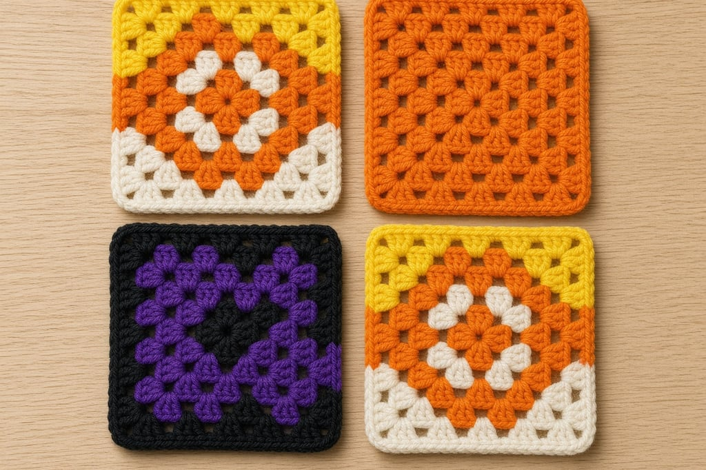
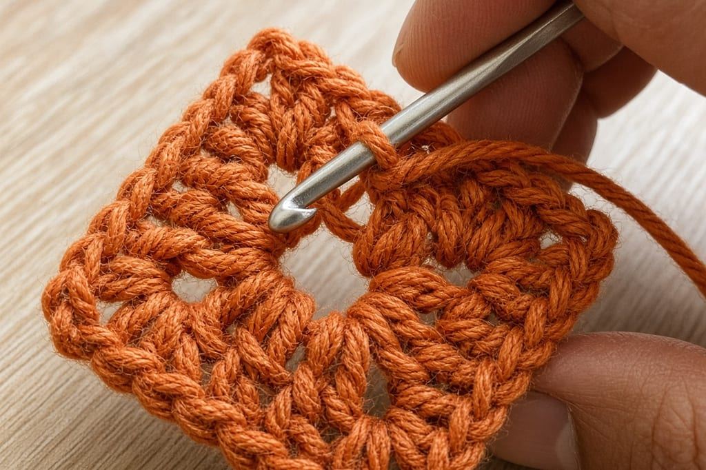
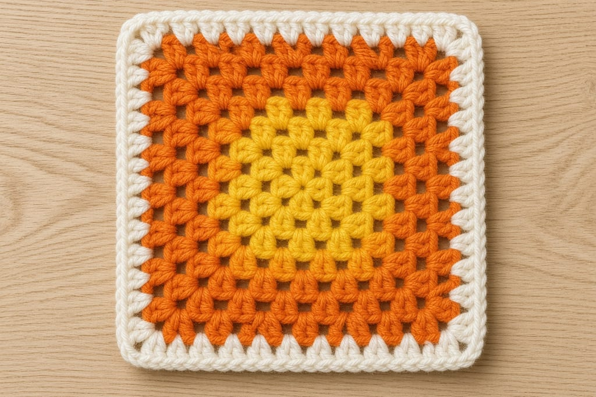
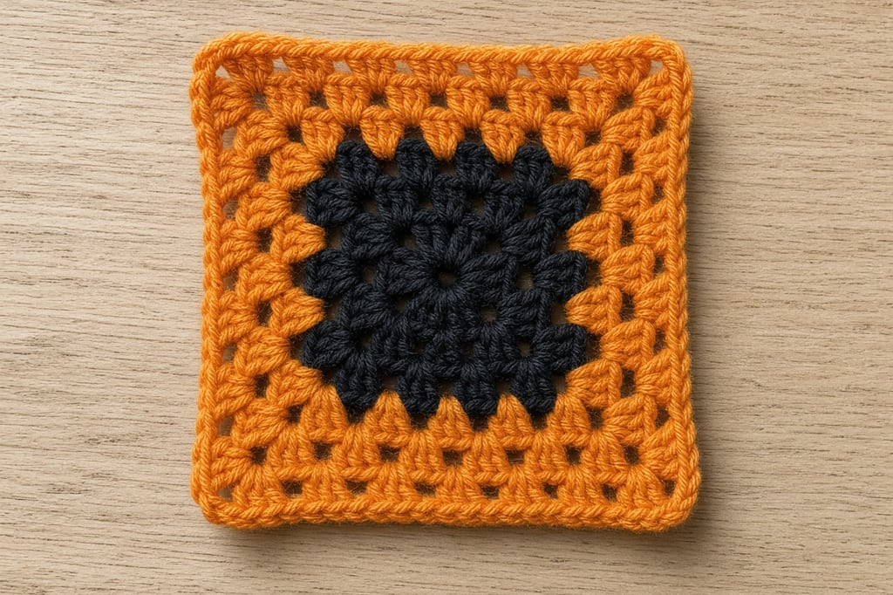
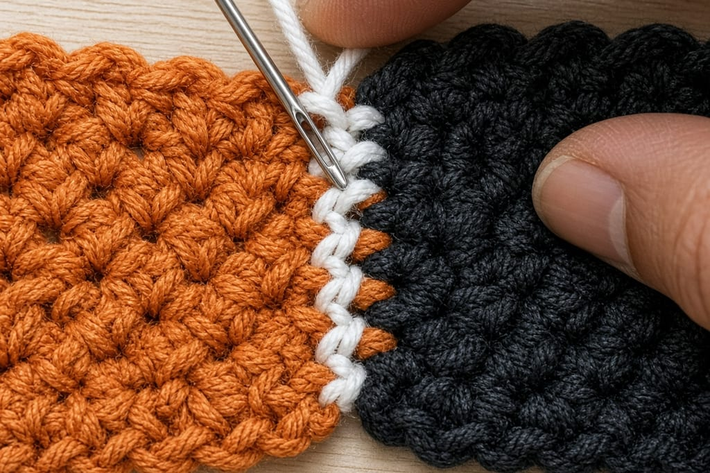

Halloween granny squares are ordinary granny squares with a deliberate palette: pumpkin orange, black, purple, yellow, and white. The stitch is the same cluster-of-double-crochet motif as the [Christmas granny squares](/christmas-granny-square-variations/). That page solves a different color problem: red and green need a light round between them or the boundary goes muddy. This page is high-contrast rings, including a yellow-orange-white candy-corn order. The stitch does not change. What changes is **when** you switch colors and **how** you keep the joins from looking muddy.

If you have not changed colors cleanly before, read [How to Change Yarn Color in Crochet](/changing-yarn-color-crochet/) first.

US terms throughout. The rounds are the standard granny square. The pictures are illustrations of the finished look, so treat the color layouts as a plan you can change to suit your yarn.

## Starting every granny round consistently

After round 1, travel with slip stitches across the next two dc and into the next corner space. In that corner, ch 3 (counts as the first dc), then work 2 dc, ch 2, and 3 dc. This is the first complete corner. Work the other corners and side clusters as described, separating adjacent groups with ch 1, and join to the top of the beginning ch 3. When changing colors, fastening off and rejoining the new color in a corner is an alternative to traveling. Never make ch 3 plus three dc for the first half-corner: that would be four dc instead of three.

## What you need

- Worsted yarn in orange, black, purple, plus yellow and white for candy corn (scraps are fine)
- Hook matched to the yarn ([hook size chart](/crochet-hook-size-conversion-chart/), [yarn weights](/yarn-weight-chart/))
- Yarn needle

Abbreviations: [chart](/crochet-abbreviations-chart/). Classic granny uses dc clusters and ch spaces.

## Step 1: classic granny move (one color)

**Rnd 1.** Ch 4, join to form a ring (or magic ring). Ch 3 (counts as dc), 2 dc in ring, ch 2, *3 dc in ring, ch 2; repeat from * twice more, join to top of beginning ch-3. (4 clusters, 4 corner spaces)

**Rnd 2.** Slip to next corner space (or start with a standing dc). *(3 dc, ch 2, 3 dc) in corner, ch 1; repeat from * around, join. (24 dc, 4 ch-2 corners, 4 ch-1)

**Later rounds.** Corners always get (3 dc, ch 2, 3 dc). Each ch-1 space along the sides gets 3 dc, with ch 1 between groups. Some patterns leave out the ch 1. Either works, but use the same style on every square, or they will not match when you join them.

<figure class="diagram">

<figcaption>The one rule every variation on this page keeps: clusters go into spaces, never into stitch tops.</figcaption>
</figure>

<figure class="diagram">

<figcaption>Round N has N clusters along each side, counting the corner halves. Check it before each color change.</figcaption>
</figure>

Count before you change colors. A side with too few clusters is much easier to fix before the next color covers it.

## Step 2: candy-corn rings

Work each round in a different color: golden yellow in the center, then pumpkin orange, then soft white (or cream) on the outer rounds.

Change color on the join: finish the last yarn-over of the joining slip stitch (or the last dc) with the new color. Cut the old color if you will not need it soon; carry only when the next round needs it immediately and the carry can hide along a seam edge.

**Plan the stack before you hook.** Sticky note: R1 yellow, R2–3 orange, R4–5 white. Guessing mid-square is how you reverse the candy-corn order.

## Changing color at the join, step by step

Every variation on this page changes color between rounds, and the join is where a square either looks clean or shows a lump of the wrong color.

1. Work the round to the end in the old color, finishing with the last cluster.
2. Insert the hook into the top of the beginning ch 3 to join. Drop the old color to the back.
3. Pick up the new color and pull it through both loops on the hook. That slip stitch is now in the new color, so no old color shows above the join.
4. Slip stitch across to the next corner space in the new color, or cut the yarn and start with a standing double crochet in a corner. A standing start leaves no slip stitches across the top of the cluster, so the join is almost invisible.
5. Leave tails of about 6 inches on both colors. Weave each one into the round of its own color, so a black tail never crosses orange.

If the joins form a diagonal line up the square, start each new color in a different corner. That spreads them out.

## Step 3: spooky center, quiet border

Keep rounds 1–2 in black, then switch to orange or purple for outer rounds. The dark center reads as a void; the bright outer rounds keep a blanket from looking like a hole punched in fabric.

This variation is forgiving with scrap yarn because the outer rounds use the most yardage.

**Optional harder variation:** split each round on the diagonal, two sides orange and two black. The color changes happen halfway through two opposite corners. The step-by-step version is the half-and-half square in [Christmas granny square variations](/christmas-granny-square-variations/). Swap the colors and it works the same way.

**Optional denser coaster:** work dc in every stitch and chain-space around, still placing `(2 dc, ch 2, 2 dc)` or `(3 dc, ch 2, 3 dc)` in corners.

## Step 4: join squares into a set

Block each square to the same measurement before joining — see [weaving in ends and blocking](/weaving-in-ends-and-blocking/). Join with slip stitch or whip stitch in black so the seams disappear into the darkest color.

For a small wall hanging, join three squares in a column with purple joins and add a black border round around the whole piece.

**How many squares.** Finish and block one square, measure it, and divide the size you want by that measurement. Four squares across and four down make a 16-square cushion front. A blanket is the same arithmetic with bigger numbers. Decide the count after the first square, not before, or the finished piece comes out an awkward rectangle.

**Mixing the variations.** Candy-corn, dark-center, and plain orange squares sit together as one set if they all finish on the same outer color. Edge them all in black, and the different centers read as a pattern rather than leftovers.

## Make one counted square before colorwork

Use the complete four-round square in the [granny-square tote tutorial](/how-to-crochet-a-granny-square-tote/) as your first swatch. Counts are 12, 24, 36, and 48 dc, including each round's beginning ch 3 as one dc. Each round has four ch-2 corners; the side ch-1 spaces total 0, 4, 8, and 12. Fasten off one color and rejoin the next in a corner if traveling slip stitches confuse you. Keep all four corners and all side spaces visible while counting. Apply the candy-corn sequence to those rounds; changing colors does not change the counts.

## Mistakes that muddy Halloween colorwork

**Changing color at the start of a round after the chain-up.** Change on the last yarn-over of the previous stitch or join.

**Too many colors in one small square.** Three is plenty.

**Tight chain spaces in black yarn.** Check drape in daylight.

**Skipping end-weaving.** Black ends that poke through orange show forever.

## Frequently asked

### Do I need glow-in-the-dark yarn?

No. Fun as a one-round accent; scratchy as the main fabric.

### Can I mix acrylic and cotton in one square?

For practice, yes. For a set you care about, keep fiber content consistent.

### What size should a coaster be?

Large enough for the mug base plus a little margin. Make one square, set the mug on it, then decide.

### What to make next

A [pumpkin](/how-to-crochet-a-pumpkin-step-by-step/), a [ghost](/crochet-ghost-amigurumi-for-beginners/), or the [Halloween card wallet](/halloween-crochet-card-wallet/).
