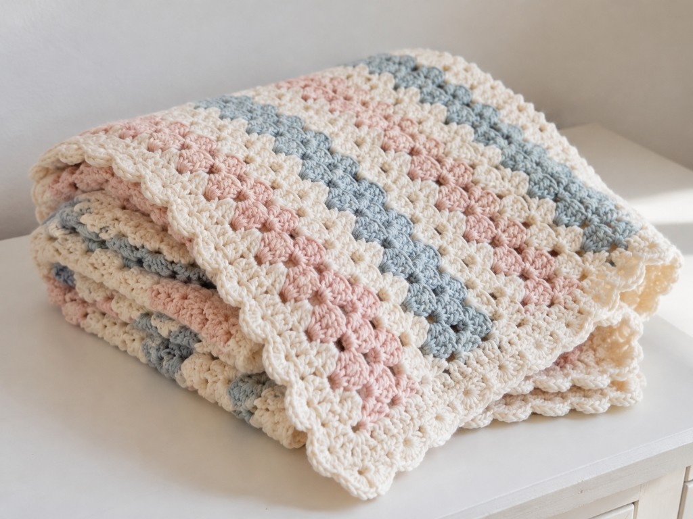
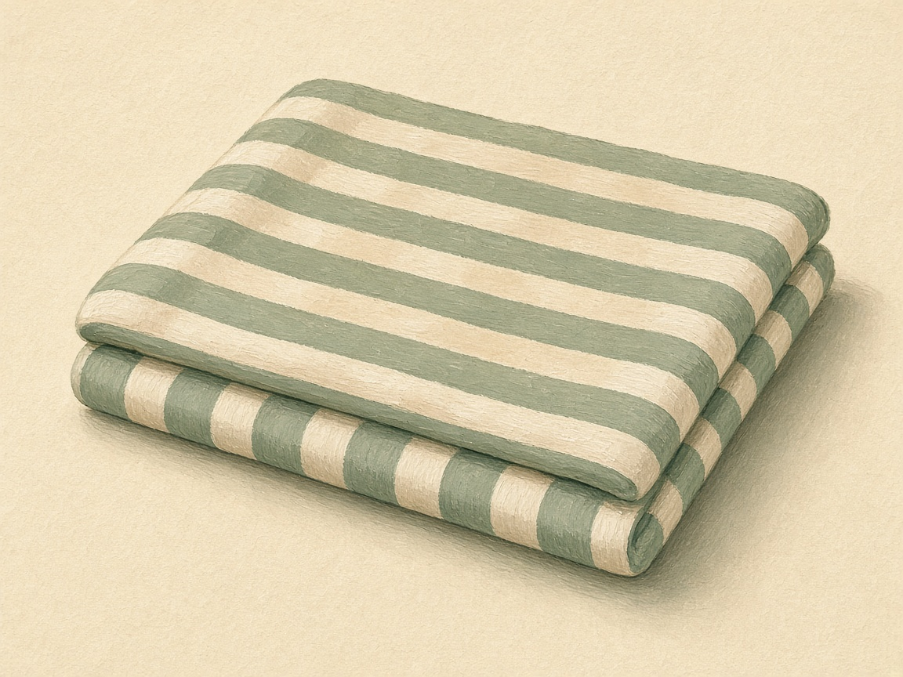

A baby blanket on this page is a rectangle of [half double crochet](/basic-crochet-stitches/), the same stitch as the [beginner scarf](/how-to-crochet-a-beginner-scarf/). The scarf can be an inch off and still be a scarf. A blanket planned at 30 inches can come out a different size after it is washed. The other rule is what you leave off the surface.

US terms. The chain-2 does not count. [Abbreviations](/crochet-abbreviations-chart/). No blanket for this page was crocheted, washed, or measured.

Nothing on this page was safety-tested with a baby. Do not sew on buttons, beads, flowers, or ties. A piece that can come off does not belong on a blanket a child can mouth. Follow the yarn band for washing. The stitch counts below are planning arithmetic.

## Step 1: Write the size, then wash a swatch

Write the width and the length you want before you chain. Thirty inches wide and 36 inches long is the example. A toddler lap blanket is a different pair of numbers.

Use washable worsted in a light solid color so a dropped stitch shows. [Yarn weights](/yarn-weight-chart/). Read the band. Work a swatch in half double, then wash and dry it the way the blanket will be washed. Cotton often grows. Some acrylic relaxes. Measure after it is dry.

You need two numbers from that dry swatch: stitches per inch, and rows per inch. They are not interchangeable.

## Step 2: Two widths for the same 30 inches

Planning gauge, unverified: **3 hdc = 1 inch** and **2.5 rows = 1 inch**, with a US H/8 (5.0 mm) or whatever hook matches the swatch. [Hook chart](/crochet-hook-size-conversion-chart/). [Gauge](/crochet-gauge/).

At 3 stitches per inch, 30 × 3 = **90 stitches**. The chain is 92, because you start in the third chain.

A second swatch, so the multiply is visible: 14 half doubles in 4 inches is 14 ÷ 4 = **3.5 stitches per inch**. Then 30 × 3.5 = **105 stitches**, and the chain is 107.

<figure class="diagram">

<figcaption>Ninety stitches is only the first case. Use the washed swatch.</figcaption>
</figure>

Length uses rows per inch. At 2.5 rows per inch, 36 × 2.5 = **90 rows**. If the dry swatch is 3 rows per inch, 36 inches is 108 rows. The 90-row figure is not a partner to the 105-stitch figure. Each direction has its own multiply.

Yardage is the swatch scaled up. Weigh a known number of stitches, then scale to stitches times rows. Buy an extra skein of the same dye lot before you are close to the end. A new lot in the middle of a solid blanket shows as a stripe. This page does not name a yardage.

## Step 3: One stitch, the same count, a loose chain

The foundation chain on a blanket is long, and a tight chain makes the first edge shorter than the rows above it. Chain loosely, or use one hook size larger for the chain only, then return to the swatch hook for row 1.

These rows are the **90-stitch example**. Substitute your count.

**Row 1.** Chain 92. Half double in the third chain from the hook and in each chain across. (90)

<figure class="diagram">

<figcaption>Chain 92 for 90 hdc at the example washed gauge. The 2 skipped chains do not count.</figcaption>
</figure>

**Row 2.** Chain 2, turn. Half double in the first real stitch and in each stitch across. (90)

<figure class="diagram">

<figcaption>On 90 stitches a single gained stitch per row is easy to miss. The first hdc goes into the first real stitch.</figcaption>
</figure>

The chain-2 is not a stitch. [Turning chain](/crochet-turning-chain/). Repeat row 2 until the blanket matches the length you wrote down, measured flat, not stretched.

Checkpoint every 10 rows: the count is still 90, or your number, and the side is not walking. A blanket that gains a stitch on one edge becomes a trapezoid. It will not lie flat on a mattress. On a piece this wide you will not see the gain in the first foot. Count anyway.

Fasten off. Weave ends for several inches inside the fabric. A knot on the corner is a hard lump. [Weaving ends](/weaving-in-ends-and-blocking/).

## What stays off the blanket

No buttons, beads, sewn flowers, or long ties. Open mesh looks light and catches fingers. If you want a softer fabric, go up one hook size, wash a new swatch, and recount. Do not switch to a hole stitch to get drape.

## Finish and measure the washed rectangle

After reaching the planned length, fasten off with enough tail to weave through several stitch posts and reverse direction. Wash and dry according to the yarn label, then measure width and length again. Check each edge for protruding tails and loose stitches; no sewn decoration is added. This is a crochet blanket tutorial, not approval for infant sleep. Keep loose blankets out of an infant's crib or bassinet; use it only in an appropriate supervised setting. The [American Academy of Pediatrics safe-sleep guidance](https://www.healthychildren.org/English/ages-stages/baby/sleep/Pages/A-Parents-Guide-to-Safe-Sleep.aspx) explains a clear sleep space.

## Mistakes

**The first edge is tighter than the rest.** The chain was tight. The next blanket gets a looser chain or a larger hook for that chain only. Pulling the finished edge will not add the missing length.

**The sides bow outward.** The count crept up. Rip back to the last correct row.

**One skein looked like enough.** The band's yards were never multiplied by the stitch count. A second dye lot is now a stripe.

## Frequently asked

### Is the plain stitch enough for a newborn?

It is a solid fabric without holes and without sewn-on parts. That is the construction this page can stand behind. It is not a safety test. Use the yarn the band says you can wash, and skip anything that can come loose.

### Can I use single crochet?

Yes. It is denser, slower, and it uses a different gauge. Swatch single crochet, wash it, and recount. Do not reuse 90.

## Next

The small version of this rectangle, where an inch of error matters less, is the [beginner scarf](/how-to-crochet-a-beginner-scarf/). If the chain edge keeps losing the first stitch, the repair is the [turning chain](/crochet-turning-chain/) page, worked on a swatch before you chain 92.
