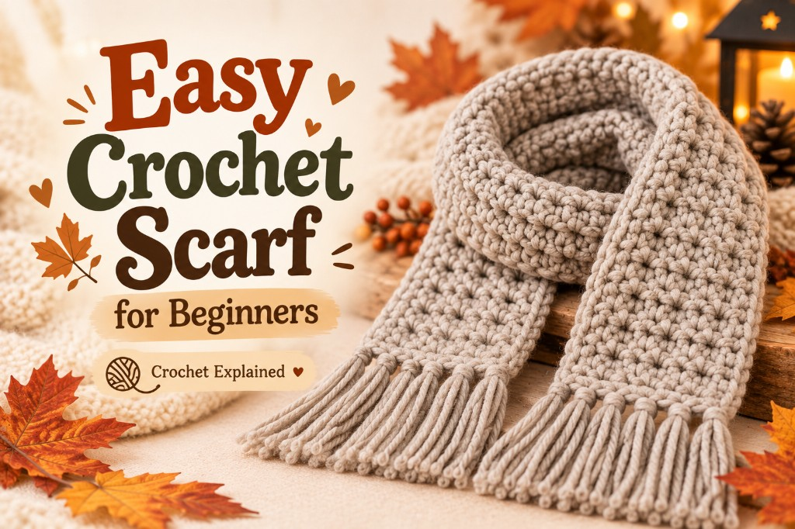
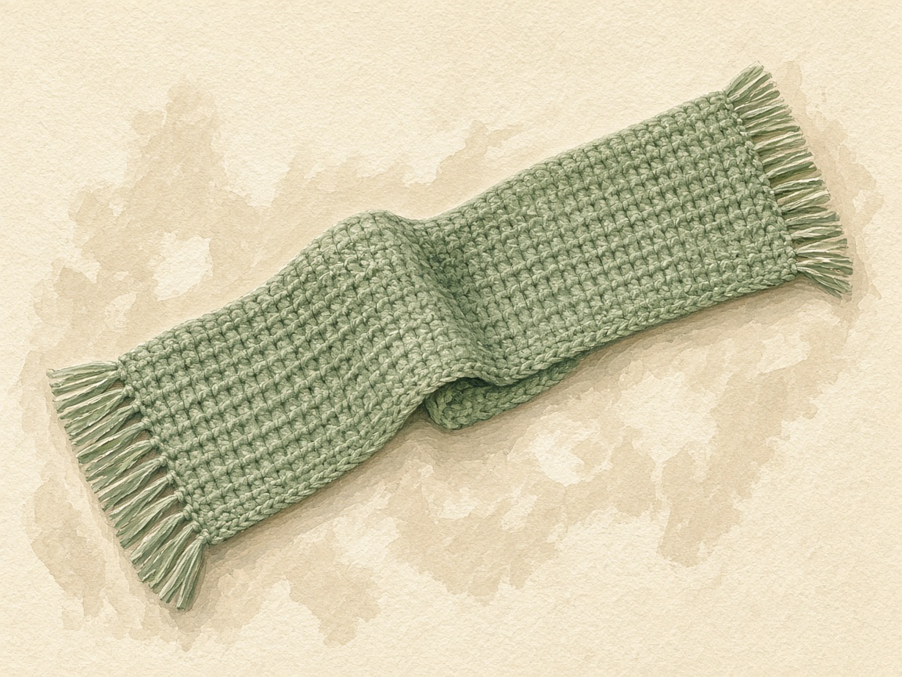

A first scarf is a rectangle of [half double crochet](/basic-crochet-stitches/). The chain decides the width. The rows decide the length. Nothing is shaped, seamed, or fitted. If the edges slant, the stitch count changed.

US terms. US half double crochet is UK half treble. [Abbreviations](/crochet-abbreviations-chart/). No scarf for this page was crocheted and measured.

## Step 1: Pick a width and a length with a tape

Decide the width you want against your coat, and the length from one end to the other the way you will wear it. Eight inches wide and 60 inches long is the example. A taller person, or someone who tucks the ends into a coat, needs a longer tape, not a longer guess.

<figure class="diagram">

<figcaption>Yarn over once before the hook goes in. Three loops, then one pull through all three.</figcaption>
</figure>

## Step 2: Turn a swatch into a stitch count

The planning gauge is **3 hdc = 1 inch** and **2.5 rows = 1 inch** in worsted with a US H/8 (5.0 mm) hook. It was not measured on a finished scarf. [Gauge](/crochet-gauge/). [Hook chart](/crochet-hook-size-conversion-chart/).

Work about 15 half doubles for several rows. Measure 10 stitches in the middle. Two cases:

- Those 10 stitches are 4 inches. Each stitch is 4 ÷ 10 = **0.4 inch**. An 8 inch width needs 8 ÷ 0.4 = **20 stitches**.
- The planning gauge holds: 8 × 3 = **24 stitches**.

Half double on this page starts in the third chain, so the chain is the stitch count plus 2. Twenty stitches start with chain 22. Twenty-four stitches start with chain 26.

The same 24 stitches are not 8 inches if your stitch is 0.4 inch wide. 24 × 0.4 = **9.6 inches**. That is the usual surprise: the pattern count was copied, and the scarf came out wide.

<figure class="diagram">

<figcaption>Use the count from the swatch. Twenty-four is only the 3-per-inch case.</figcaption>
</figure>

Measure rows in that same swatch, separately. Stitches per inch and rows per inch are not the same number. A 60 inch scarf at 2.5 rows per inch is 60 × 2.5 = **150 rows**. If you get 3 rows per inch, 60 inches is 180 rows. Do not treat 150 as required.

## Materials

Worsted yarn with some drape. Acrylic and a washable wool blend both work if the swatch feels like a scarf and not a mat. Cotton is usually stiffer. [Yarn weights](/yarn-weight-chart/).

The hook is the one that made the swatch, not automatically an H. Yarn needle and a tape. Weigh the skein before you start and again when you stop. This page has no weighed yardage.

## Step 3: Keep the same count every row

Chain-2 does not count as a stitch. [Turning chain](/crochet-turning-chain/).

These rows are the **24-stitch example**. If step 2 gave you another number, use that number. The shape of the row does not change.

**Row 1.** Chain 26. Half double in the third chain from the hook and in each chain across. (24)

<figure class="diagram">

<figcaption>Chain 26 for 24 hdc. The 2 skipped chains next to the hook are the turning chain, not a stitch.</figcaption>
</figure>

**Row 2.** Chain 2, turn. Half double in the first stitch, the one at the base of the chain, and in each stitch across. (24)

<figure class="diagram">

<figcaption>The chain is turned out of the way. The first half double uses the first stitch of the row you just finished.</figcaption>
</figure>

Repeat row 2 until the scarf matches the tape. Count the stitches every 10 rows. You want 24, or your own number.

Checkpoint after row 2: if you have 25, the hook went into the turning chain. If you have 23, the first stitch was skipped. Fix it before the scarf is a wedge. One extra stitch every row, over 150 rows, is 149 extra stitches at the far end.

Fasten off. Weave the ends along the side for an inch or more, not straight out the short end. [Weaving ends](/weaving-in-ends-and-blocking/).

## A wider scarf, or stripes

Add stitches before you chain, using your own stitch width. At the planning gauge only, 30 stitches are 10 inches and the chain is 32. That is a preference, not a tested drape.

Change color on the last yarn-over of the last half double of a row, so the new color starts cleanly on the next row. [Changing color](/changing-yarn-color-crochet/).

## Make a short sample with finished edges

Before the full scarf, work four rows at your chosen width and count every row. The 24-stitch example starts with ch 26; row 1 begins in the third chain. Every subsequent row starts with ch 2 that does not count and hdc into the first real stitch. Mark both end stitches so the final hdc does not go into the turning chain. Measure width once this sample lies flat. For yarn planning, weigh a washed sample of known area and scale to the chosen scarf area, leaving extra for swatching and tails. Do not wait until the last skein to check supply.

## Mistakes

**The long edges slant.** The count is changing at the turn. Pick up the rule in the diagram and count.

**The scarf is stiff.** The hook is small for the yarn, or the fiber has no give. Go up a hook and remeasure. Do not steam acrylic with an iron. The yarn band is the heat limit.

**The ends pop out.** They were woven straight off the short edge. Take them back along the side.

## Frequently asked

### Is half double harder than single crochet?

It is one yarn-over before the insert, then one pull through three loops. The stitch is taller than single crochet, so a scarf needs fewer rows for the same length. Recalculate if you switch stitches. Do not keep the half-double numbers.

### Do I block it?

Only if the edges curl and the yarn band allows water or steam. A hot iron can flatten acrylic for good.

## Next

A band that goes around the head, with the chain and the rows swapped in meaning, is the [ear warmer](/how-to-crochet-an-ear-warmer/). The same rectangle, made much wider, is the [baby blanket](/how-to-crochet-a-baby-blanket/). A hood on the scarf is a different fold, and the old hood counts on that page do not fit an adult: [how a hooded scarf is folded](/how-to-crochet-a-hooded-scarf/).
