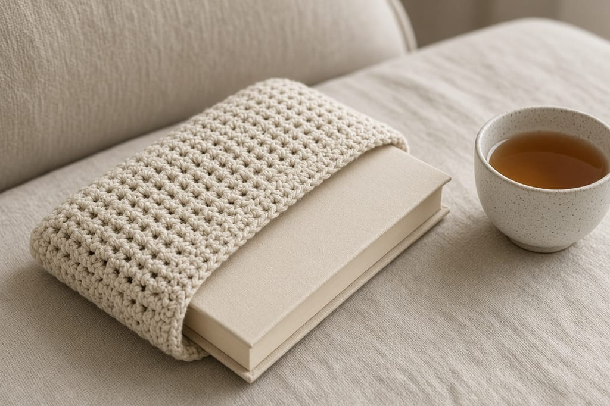
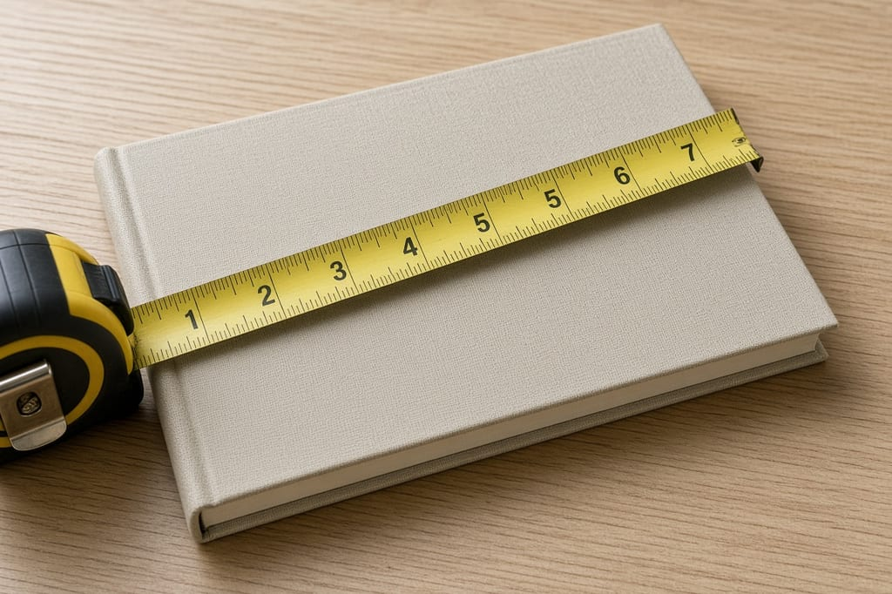
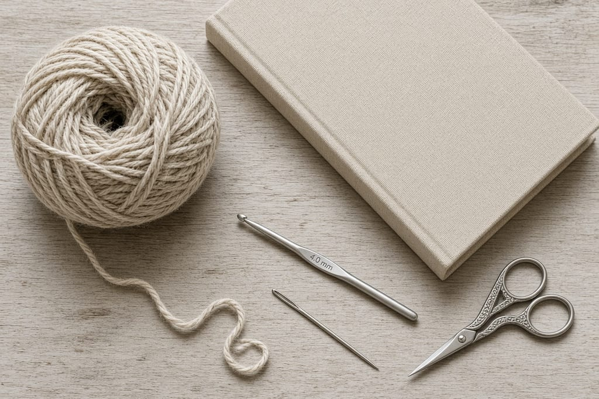
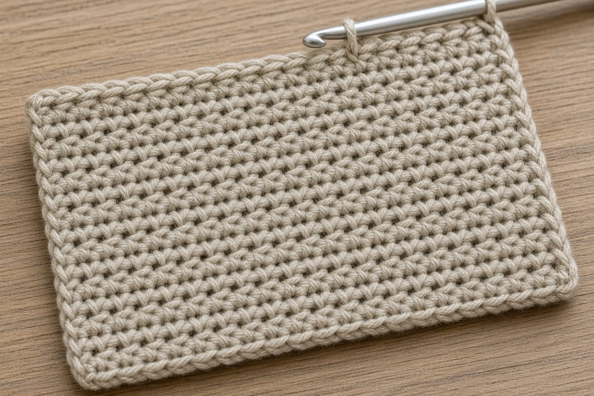
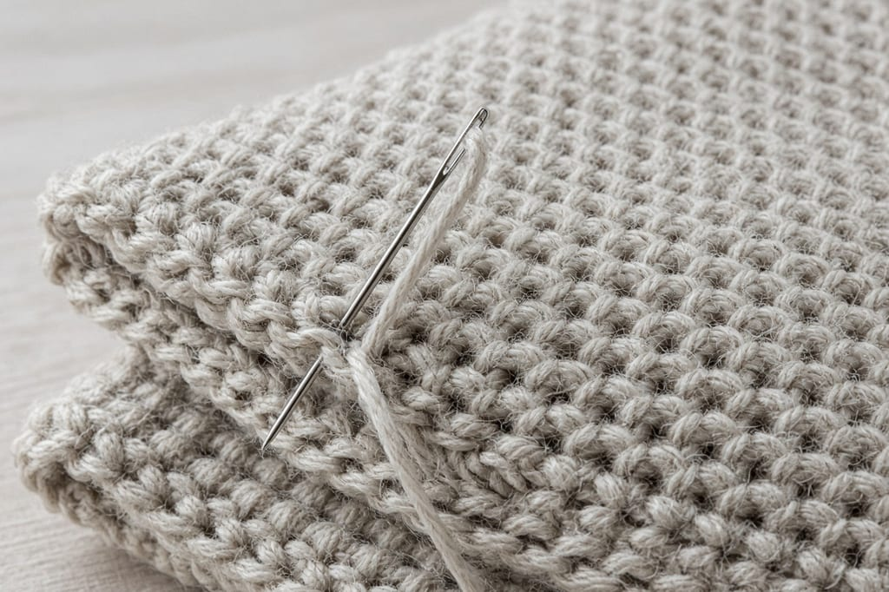
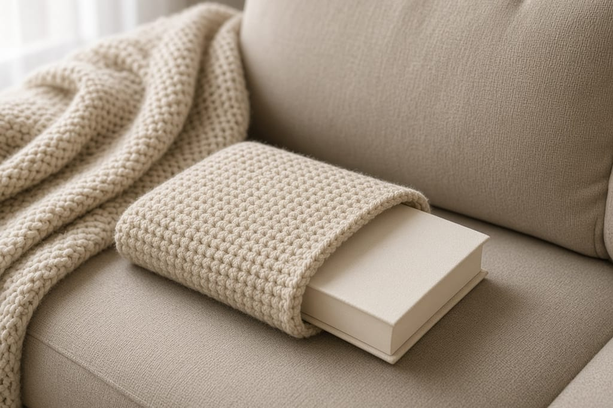

A book sleeve is a single-crochet rectangle folded in half and seamed on both sides. The stitch width becomes the opening. The row length, folded, becomes how far the book slides in. Single crochet still has gaps. It will not stop a leak, and it will not save a paperback from being sat on.

US terms. US single crochet is UK double crochet. [Abbreviations](/crochet-abbreviations-chart/). The pictures are illustrations of the example size. No sleeve for this page was fitted on a book.

## What is a technique, and what is only a plan

| Piece of this page | What it is |
| --- | --- |
| Single crochet, chain-1 not counted | The fabric. Denser than mesh. Still not a rain cover. |
| Fold the rectangle so the first row meets the last | The construction. The fold is the bottom. |
| Opening width = cover width plus a gap | A planning model. The example gap is 1/2 inch. It was not tested. |
| Sleeve height about 3/4 of the book, so the book can be grabbed | A choice, not a required proportion. |
| 4 sc and 5 rows to the inch | An unverified gauge. |
| 22 stitches and 60 rows | The 5 by 8 inch example at that gauge: 5.5 inches wide, 12 inches of fabric, folded to 6. |
| About 120 yards | An old line. It was not weighed. |

## Step 1: Measure the closed book

Write three numbers:

1. Cover width.
2. Cover height.
3. Thickness at the spine, if the book is more than a thin paperback.

The example is a book **5 inches wide and 8 inches tall**. Thickness is not in that pair of numbers.

Add a gap to the width so the cover is not scraped on the way in. The example gap is **1/2 inch**: 5 + 0.5 = **5.5 inches**. That half inch is a planning gap. It is not a measured allowance for a thick spine. If the book is a hardcover, add the spine thickness into the width before you multiply, as a separate allowance, and still try the book before you weave the ends.

Choose how much of the cover stays visible. Three quarters of the height is the example, so you can pull the book out: 0.75 × 8 = **6 inches** of sleeve. The fabric has to be twice that, because you fold it: 6 × 2 = **12 inches**.

<figure class="diagram">

<figcaption>The half inch and the three-quarter height are choices. A different book replaces both before you chain.</figcaption>
</figure>

## Step 2: Swatch, then multiply

Planning gauge: **4 sc = 1 inch** and **5 rows = 1 inch**. It was not taken from a finished sleeve. [Gauge](/crochet-gauge/).

At 4 stitches per inch, 5.5 × 4 = **22 stitches**. The chain is 23, because you start in the second chain and the chain-1 turn does not count.

At 5 rows per inch, 12 × 5 = **60 rows**.

If your swatch is 3.5 stitches per inch, do not keep 22. 5.5 × 3.5 = 19.25, so you choose 19 or 20 and then try the book. Rows get the same treatment: 12 times your rows per inch, rounded, then measure the fabric before you seam.

## Materials

Worsted cotton. [Yarn weights](/yarn-weight-chart/). The example hook is a US G/6 (4.0 mm) only if it gives you 4 single crochet to the inch. [Hook chart](/crochet-hook-size-conversion-chart/). Yarn needle and scissors. Weigh a swatch if you need a shopping number. Do not buy from 120 yards.

## Step 3: A rectangle that stays 22 wide

These rows are the example. Use your counts if step 2 changed them.

Chain 23.

**Row 1:** Single crochet in the second chain from the hook and across. Chain 1, turn. (22)

**Rows 2–60:** Single crochet in each stitch. Chain 1, turn. (22)

Count every 10 rows. A gained stitch on one side makes a wedge. The fold will not meet, and one side seam will be longer than the other.

Checkpoint before you fold: the fabric is about 5.5 inches wide and about 12 inches long, or your own targets. If the length is short, add rows. If the width is short, start again with more stitches. Cotton single crochet will not stretch an extra inch over the book.

## Step 4: Fold, seam the sides, try the book

Fold so row 1 meets row 60. The fold is the bottom. Sew both side edges through both layers. Leave the top open.

<figure class="diagram">

<figcaption>Sixty divided by 5 is 12, and half of 12 is 6. Twenty-two divided by 4 is 5.5. Both divisions use the example gauge.</figcaption>
</figure>

Slide the book in before you weave the seam ends. It should enter without folding the cover, and stop with some of the cover still out if you chose the three-quarter height. If it will not enter, the opening is narrow. Do not stretch the seam. The next rectangle needs more stitches.

This example has no flap. If the book slides around in a loose bag, you can add a button and a chain loop, or a short chain tie on each side of the opening. Place the button only after the book is inside, so the loop reaches. Skip both if you have not tried the fit.

One book. Two thin books in one sleeve bow the seam. A pen in the same pocket can mark a pale cover through the stitches. The sleeve is denser than the mesh on the [lace bandana](/how-to-crochet-a-lace-bandana/). Density is not a rain shell.

A borrowed book should not be forced into a tight sleeve, and it should not sit in a damp one.

## Mistakes

**The top is sewn.** The book cannot go in. The fold is the bottom. The last row is part of the opening.

**The book stops halfway and will not go deeper.** The folded height is short, or the book is thicker than the sleeve expected. Height is rows. Thickness belongs in the width allowance before you chain, not as extra rows after the seam.

**A lacy stitch on a white cover.** Gaps let marks through. This page uses single crochet for that reason. It is still not waterproof.

## Care

Take the book out. Hand wash cool. Dry flat. Put the book back only when the cotton is dry. Damp cotton cockles paper.

## Frequently asked

### Will the 22 by 60 rectangle fit every paperback?

No. It is the paper plan for a cover near 5 by 8 inches, a half-inch gap, a three-quarter height, and a gauge of 4 stitches and 5 rows to the inch. Measure yours.

### Is it all right in the rain?

No. If rain is the risk, use a bag that is actually water resistant.

## Next

The same fold, sized from a closed laptop instead of a book, is the [laptop sleeve](/how-to-crochet-a-laptop-sleeve/). If the row count keeps drifting, the fix is the swatch in [crochet gauge](/crochet-gauge/), before the 60 rows.
