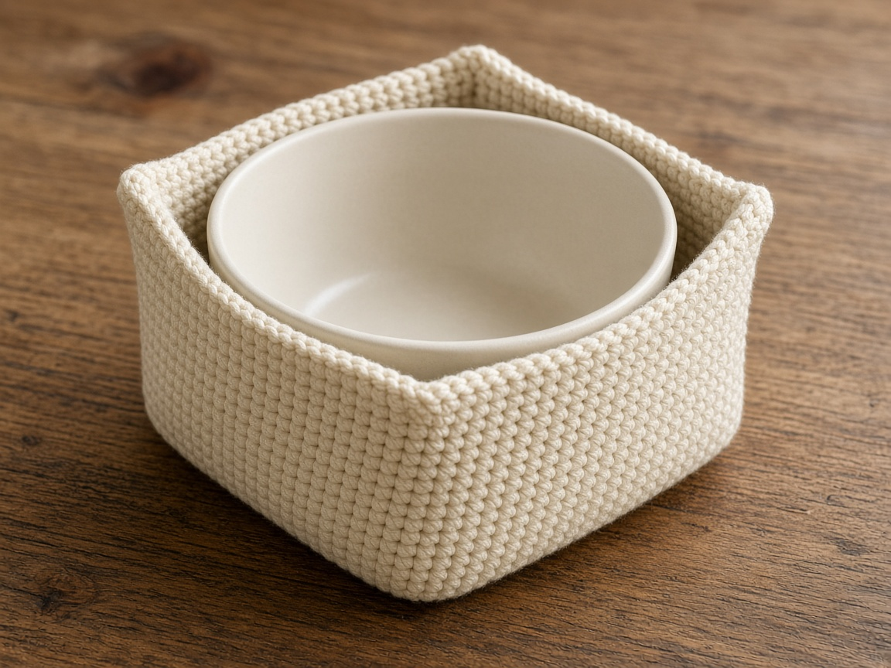

A hot bowl on a bare table walks, and picking it up with a dish towel means the towel is also in the sink a minute later. A bowl cozy is a cotton square, made in two layers, with the corners pinched so the square can sit up around the bowl. The size comes from the bowl you measured. The heat behavior of this object is unknown.

US terms. US single crochet is UK double crochet. [Abbreviations](/crochet-abbreviations-chart/). The photos are illustrations. This cozy has not been yarn-tested, and it has not been heat-tested. The inches and the yardage are estimates from the gauge below. Measure your bowl. Do not treat the example as a fit for every soup bowl in the cupboard.

Cotton only. Acrylic can melt and can burn. Do not use metal thread, metallic yarn, wire, sequins, or metal buttons. This page does not recommend putting the cozy in a microwave, on a stove, or in an oven. It has not been heat-tested, and it is not protection from a hot bowl. A thin cotton layer can scorch, and a bowl that is too hot to hold can burn you through it.

## Measure the bowl

Outside of the bowl, in inches:

- Diameter across the rim.
- Height from the table to the rim.

A starting square has a side about equal to the diameter plus twice the height. The middle of the square covers the bottom. Each side of that middle needs enough fabric to come up the wall. The corners will bunch, and you will pinch that extra into a short seam.

Example: a bowl **6 inches across and 3 inches tall**. The side of the square is 6 + 3 + 3 = **12 inches**. At the gauge below, that is **48 stitches and 60 rows**, and you make two of them. Twelve inches is arithmetic from that bowl and that gauge. It is not a fitted cozy, and it is not a heat test. If your bowl is wider or taller, use your own numbers.

## Materials

- Worsted **cotton** only. About **300 yards** for two example squares and the joining round. That is a shopping estimate from the stitch count, not a weighed cozy. A larger bowl needs more. [Yarn weights](/yarn-weight-chart/).
- US G/6 (4.0 mm) hook, or the hook that hits gauge. [Hook chart](/crochet-hook-size-conversion-chart/).
- Yarn needle and scissors. If you use stitch markers, take every one out when you finish. Metal does not belong in the cozy.

Read the yarn label. If it is acrylic, a blend, metallic, or not clearly cotton, do not use it here. Acrylic can melt and can burn. Metallic thread can get hot. Wool can scorch. No buttons, beads, wire, sequins, or metal markers left in the fabric.

The fabric is solid single crochet. Some older drawings of this cozy showed open holes. Those holes are not in the instructions. Follow the rows.

## Gauge (estimate)

**4 sc = 1 inch. 5 rows = 1 inch.**

Swatch and measure. [Gauge](/crochet-gauge/) decides whether the square reaches around the bowl. These numbers were not taken from a finished cozy. If your gauge is off, redo the side length with your stitches per inch.

Ch 1 does not count as a stitch.

## Two squares

Make 2. They should match. If the second square comes out wider, you changed tension or you gained a stitch. Rip it back and match the first. A lopsided double layer gathers into a cozy that tips.

Chain 49.

**Row 1:** Sc in the 2nd chain from the hook and across. Ch 1, turn. (48)

**Rows 2–60:** Sc in each stitch. Ch 1, turn. (48)

At 4 single crochet and 5 rows to the inch, 48 stitches and 60 rows are both 12 inches. If your row gauge is not 5 rows to the inch, 60 rows will not match the width. Measure both sides before you join. Two layers make the fabric thicker. They do not make it a hot pad.

Count every 10 rows. Measure the square. If your bowl math is different, stop at your own row count.

Hold the squares together. Join yarn at a corner. Single crochet through both layers all the way around, with 3 sc in each corner. One sc in each stitch along the tops and bottoms, and about one sc in each row end along the sides. If the side ripples, you used too many stitches in the row ends. If it pulls in, you used too few.

Do not skip the second square. One layer gathers and flops. Fasten off, weave the ends, and check that no metal needle or marker is still in the cotton.

## Pinch the corners

Put the bowl in the center of the flat square. You want four walls and a flat enough bottom that the bowl does not rock.

At each corner, pinch the two edges together so they lie on top of each other, starting at the corner and running toward the middle of each side. For the example bowl, sew that pinch for about **2 inches**. Two inches is a starting estimate from a 3 inch wall, not a measured cozy. A taller bowl needs a longer pinch. A wide, shallow bowl needs a shorter one.

Sew through both layers of both edges. Four pinches. Sew two opposite corners, set the bowl in, and adjust the last two so the rim sits inside the walls. If the bowl will not sit down, the pinches are too long. Take one out. If the pinches steal the flat bottom, shorten them.

The bottom should stay wide enough for the bowl's base.

## Heat

Do not microwave this cozy. Do not use it as a pot holder, an oven mitt, or a trivet for a bowl you cannot hold with your bare hands. Cotton can scorch and can burn. Acrylic, if someone substitutes it, can melt onto skin. A metal stitch marker, a needle, or metallic thread does not belong in the fabric.

This page has no heat test. Nothing here is evidence that the cozy protects you from a hot dish. If the bowl is too hot to hold, leave it on a trivet you already trust and wait. The cozy is a shape for a bowl that is cool enough to handle.

## A different bowl

1. Diameter plus twice the height, in inches. That is the side of the square.
2. Multiply by your stitches per inch for the stitch count, and by your rows per inch for the row count.
3. Make two squares. Join them. Then pinch, with the bowl sitting in the square, until the walls clear the rim and the base still sits flat.

The 12 inch example is step 1 for a bowl 6 inches across and 3 inches tall. Your bowl replaces those numbers.

## Mistakes

**Acrylic, or a blend, or metallic thread.** Acrylic can melt. Metal does not belong in this project. If the skein is not cotton, choose a different project.

**One layer.** It gathers, and it flops. Make two squares and join them.

**Pinching before you measure.** You can sew a cozy that fits the example and not your bowl. The bowl goes on the square first.

**A metal marker left in the corner.** Take it out when you finish sewing. Metal does not belong in this object.

**Using it on a bowl you cannot hold.** That is a burn risk. The thickness of the cotton is not a heat test.

## Care

Wash off food. Hand wash cool. Dry flat, fully, before it is used again. Do not iron it. Do not store it wet. The heat warning still stands after washing.

## Frequently asked

**Can I microwave it?**

No. This page does not recommend microwaving the cozy. It has not been heat-tested, and cotton can scorch. Use the cozy only with a bowl that is already cool enough to hold.

**Why not acrylic if that is the yarn I have?**

Acrylic can melt. Use it for a different project. This one is cotton.

**Will the 12 inch square fit my bowl?**

Only if your bowl is about 6 inches across and 3 inches tall and your gauge matches. Measure the bowl and redo the side length.

## Next

A cotton wrap for a cup you have measured is the [tumbler sleeve](/how-to-crochet-a-tumbler-sleeve/). Fiber names are in the [yarn weight chart](/yarn-weight-chart/).
