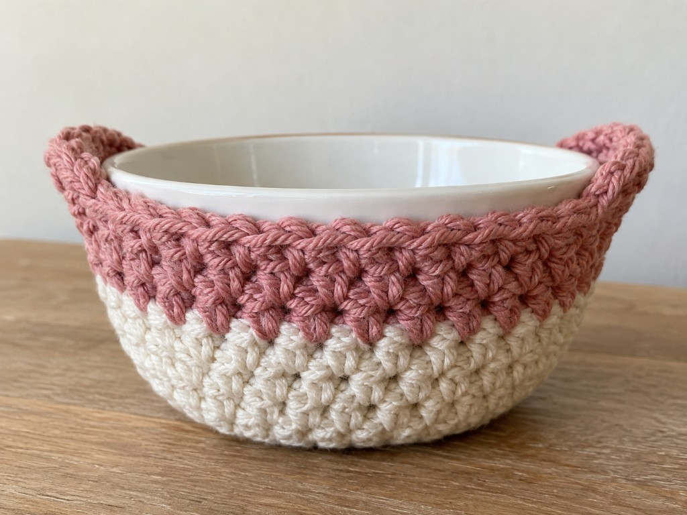
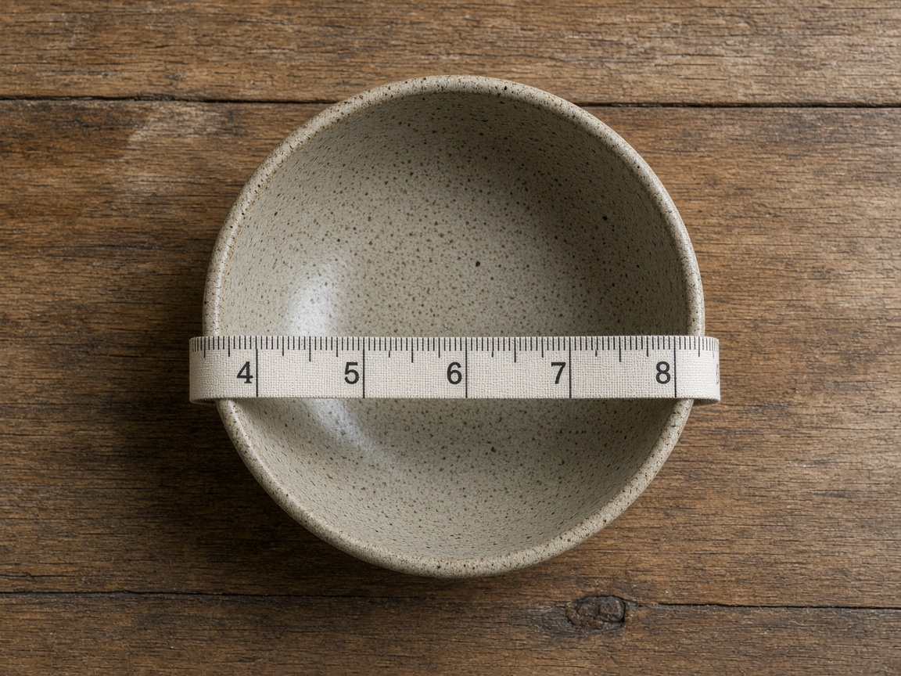
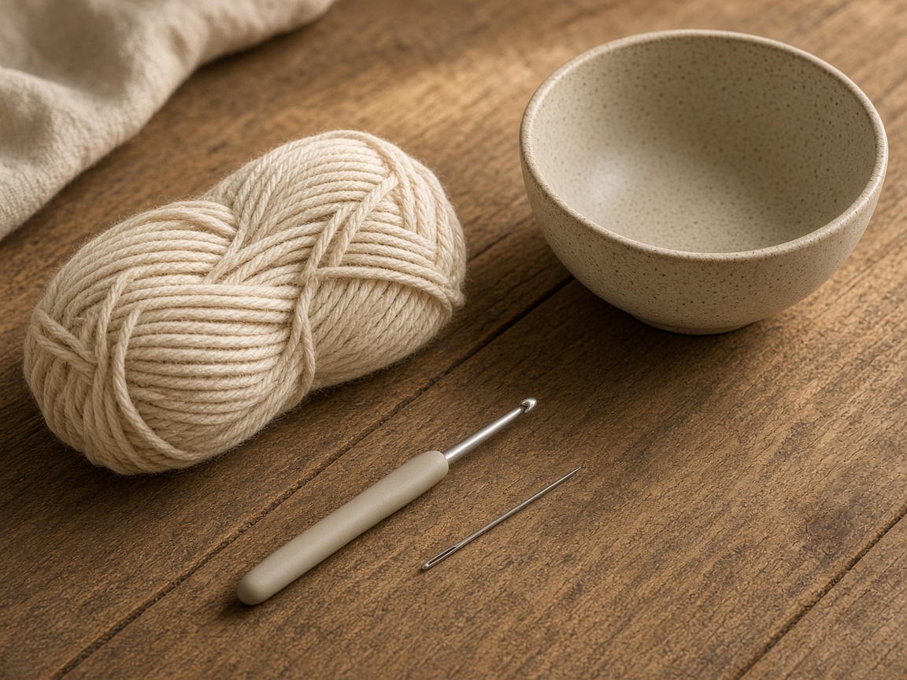
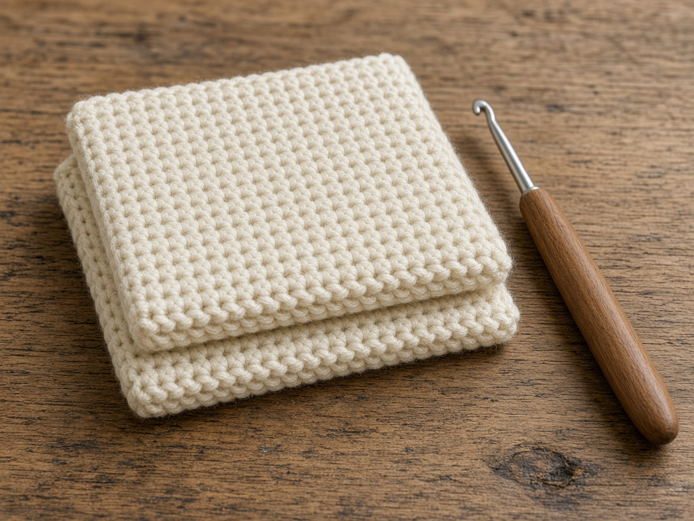
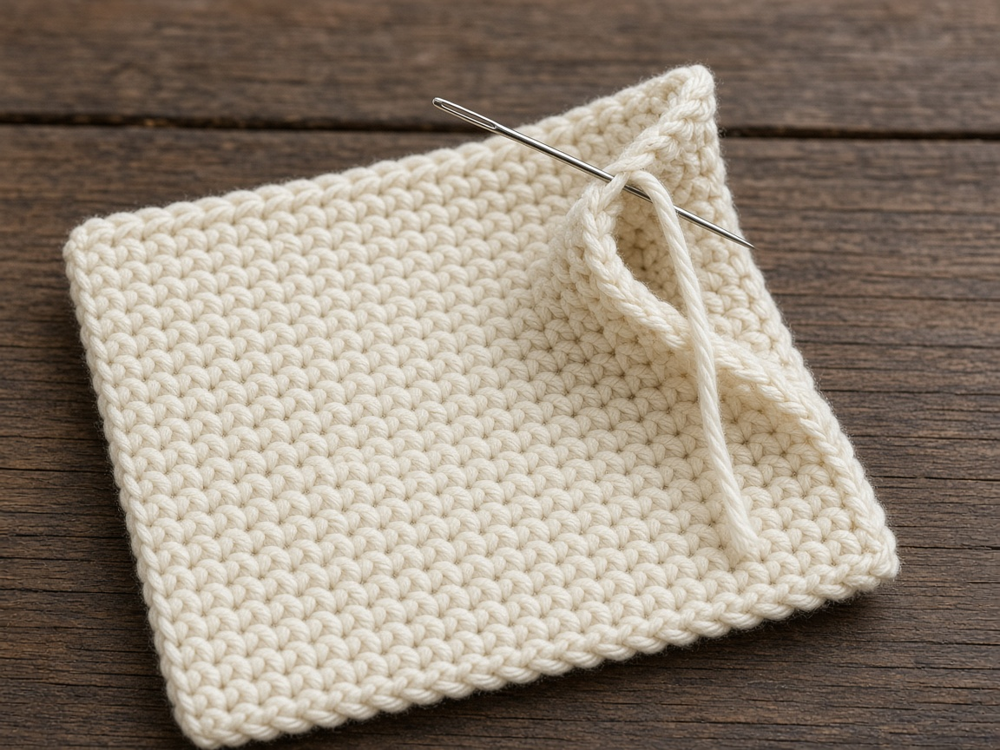
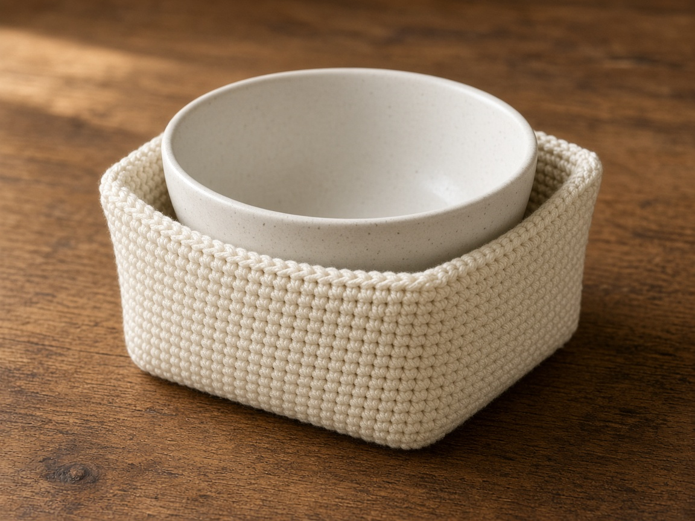

A bowl cozy is a cotton square made of two layers, with the four corners sewn so the square can stand up around a bowl. The stitches are ordinary [single crochet](/basic-crochet-stitches/). The part that needs thinking is the square itself: how wide it has to be, how to join the layers without a ruffle, and how long a corner pinch can be before the bowl no longer sits flat.

US terms. US single crochet is UK double crochet. [Abbreviations](/crochet-abbreviations-chart/). The pictures are illustrations. No cozy for this page was crocheted, fitted on a bowl, or held against heat. The 12 inch square below is arithmetic for one example bowl. It is not a size to copy onto a different bowl.

Cotton only. Acrylic can melt and can burn. Do not use metal thread, metallic yarn, wire, sequins, or metal buttons. Do not put this cozy in a microwave, on a stove, or in an oven. It has not been heat-tested, and it is not protection from a hot bowl. A thin cotton layer can scorch. A bowl that is too hot to hold can burn you through it.

## What is a technique, and what is only a plan

| Piece of this page | What it is |
| --- | --- |
| Single crochet under both loops, chain-1 not counted | The stitch rule for this page. The chain-1 is only height. |
| Two squares, joined | A construction choice so the square has enough body to stand. It is not a heat rating. |
| Side = rim diameter + wall + wall | A planning model. It does not know the base of the bowl. |
| 4 sc and 5 rows to the inch | An unverified gauge used only so the example has numbers. Replace it with your swatch. |
| A 2 inch pinch | Arithmetic that can fail the base and the wall at the same time. Pin with the bowl in the square. |
| Cotton, and no metal left in the fabric | A safety rule. |
| Microwave, oven, or hot-pad use | Not supported. Do not. |

## Step 1: Measure three places on the bowl

Write down three inches, not two:

1. Rim diameter, across the top, outside the bowl.
2. Wall height, from the table to the rim.
3. Base diameter, where the bowl actually sits on the table.

The rim and the base are different on a bowl that flares. The square formula below uses the rim. The pinch check later uses the base. If you skip the base, you can sew a cozy that looks large enough and still rocks.

The planning side is the rim plus the wall twice. Treat that as a starting estimate for the flat square, not a formula that fits every bowl. A flare, a thick join, and the pinches all change the finished shape. The middle of the square is standing in for the bottom. Each side of that middle has to climb a wall. The corners of a square stick out past a round bowl, and those corners are what you will pinch.

<figure class="diagram">

<figcaption>Planning sketch. The dashed middle is the rim diameter, not the base. The corners are surplus.</figcaption>
</figure>

Example, for a bowl **6 inches across the rim and 3 inches tall**. The base is not in that sentence, so this example cannot prove a fit.

6 + 3 + 3 = **12 inch** side.

At the unverified gauge of 4 single crochet and 5 rows to the inch:

- 12 × 4 = **48 stitches**
- The chain is 49, because you single crochet into the second chain and the chain-1 turn does not count
- 12 × 5 = **60 rows**

Twelve inches is that multiplication. It is not a cozy anyone has set a bowl into. A wider rim or a taller wall replaces the 6 and the 3 before you chain anything.

## Step 2: Swatch and turn inches into stitches

**The example gauge is 4 sc = 1 inch and 5 rows = 1 inch.** It was not measured on a finished cozy. [Gauge](/crochet-gauge/) is the whole difference between a 12 inch square and a square that misses the rim.

Chain about 20, work single crochet for about 10 rows with the cotton and the hook you will use, then measure the middle. If 4 stitches are not 1 inch, do not keep the 48. Multiply 12 by your own stitches per inch, and multiply 12 by your own rows per inch. A hook change is the usual fix when the stitch width is off. [Hook chart](/crochet-hook-size-conversion-chart/).

Checkpoint before the real square: you can state your stitches per inch and your rows per inch from a swatch, and both numbers came from the middle of the fabric, not from a stretched edge.

## Materials

- Worsted **cotton**. Read the label. If it says acrylic, a blend, metallic, or it does not say cotton, use it on a different project. Acrylic can melt. Metallic thread can get hot. Wool can scorch. [Yarn weights](/yarn-weight-chart/).
- The hook that produced your swatch. The example hook is a US G/6 (4.0 mm) only if that hook actually gives you 4 single crochet to the inch.
- Yarn needle and scissors. If you mark a corner, take the marker out when you finish. Metal does not belong in the cozy. No buttons, beads, wire, or sequins.

The example stitch count is 48 × 60 = **2,880 single crochets in one square**, and **5,760 in two**. The joining round adds more, about 200 if you follow the 4-for-5 rate below (4 sides × 48, plus 3 stitches in each of 4 corners). That is a count, not a yardage. Weigh the yarn in your swatch, count the stitches in that swatch, and scale up. An older line on this page said about 300 yards. That figure was not weighed off a cozy. Do not shop from it.

The fabric is solid single crochet. Some drawings of this shape show holes. Those holes are not in these rows.

## Step 3: Make two squares that match

Chain-1 does not count as a stitch. Put the first and last stitch of every row in the last real stitch, not in the turning chain. If the count drifts, the [turning chain](/crochet-turning-chain/) is the usual place it happens.

These rows are the **12 inch example**. If your bowl or your swatch changed the count, use your count. The shape of the row does not change: one single crochet in each stitch, same number every row.

Chain 49.

**Row 1:** Single crochet in the second chain from the hook and in each chain across. Chain 1, turn. (48)

<figure class="diagram">

<figcaption>Chain 49 for 48 sc, 12 inches at 4 sc per inch. Make two squares from the same count.</figcaption>
</figure>

**Rows 2–60:** Single crochet in each stitch across. Chain 1, turn. (48)

<figure class="diagram">

<figcaption>Two squares only match if both keep 48. The first stitch of each row goes in the edge stitch.</figcaption>
</figure>

Checkpoint every 10 rows: the row still has 48 stitches, and the piece is still a rectangle. At the example row gauge, 10 rows are 2 inches and 60 rows are 12. If your rows per inch are different, 60 rows will not match the width. Stop at your own row count, then measure both sides. They should match each other before you join.

Make the second square to the same count. If it comes out wider, the tension changed or a row gained a stitch. Rip it back. A lopsided pair gathers into a cozy that tips. One square is not a shortcut. A single layer gathers and flops. Two layers make the fabric thicker. They do not make it a hot pad.

## Step 4: Join so the sides do not ripple

Hold the squares together, wrong sides in, if you can tell a wrong side. Join the cotton at a corner. Single crochet through both layers.

Along the top and the bottom, put one single crochet in each stitch. That is 48 on the example.

Along the sides, do not put one single crochet in every row end. The example has 5 rows in the same inch that holds only 4 stitches. One stitch per row end puts **60** stitches on an edge whose top has **48**. Those extra 12 stitches have nowhere to go, so the side is likely to ripple. Matching the counts removes that difference on paper. It does not promise a smooth join in yarn, because a row end is shaped differently from the top of a stitch. If you put in too few, the side can pull in and the square can cup. Look at the square after the join and move stitches if it waves.

<figure class="diagram">

<figcaption>Worked for the example gauge only. The equal count is arithmetic, not a promise that the join lies flat. Recount the groups if your swatch is not 4 stitches and 5 rows to the inch.</figcaption>
</figure>

The rate is 4 single crochets for every 5 row ends. The example side has 60 row ends, and 60 ÷ 5 = 12 groups, and 12 × 4 = 48. Mark every fifth row end and work four single crochets before the next mark.

In each corner, work 3 single crochet so the join can turn. Those three are the corner. They are not part of the 48.

Checkpoint after the join: each side, between corner stitches, has the same count, and the square still measures the same on the width and the height. Fasten off, weave the ends, and look through the fabric for a marker or a needle. Then look again.

## Step 5: Pinch with the bowl sitting in the square

Put the bowl in the center while the square is still flat. You are trying to get four walls and a flat bottom the base can sit on.

At each corner, pinch the two edges together so they lie on top of each other, starting at the corner and running toward the middle of the side. Sew through both layers of both edges.

A pinch removes fabric from the flat center. For a first look, the flat center left on one side is about the side length minus one pinch at each end.

<figure class="diagram">

<figcaption>The 8 inches is arithmetic from a 2 inch pinch. It is the check against the base, not a length to sew without the bowl.</figcaption>
</figure>

On the example, a 2 inch pinch gives 12 − 2 − 2 = **8 inches** of planning center. Two inches was an old estimate taken from a 3 inch wall. Set next to the wall, it is already shorter than the wall, so the rim can stand above the fabric. Set next to an unknown base, 8 inches may be wider than the base, or it may be narrower. If the base is wider than the flat center, the bowl can sit on the darts and rock. If the pinch is shorter than the wall, the rim can end up outside the cozy. Neither result has been sewn and checked. Both can be true for this example, which is why **2 inches is not an instruction**.

Sew two opposite corners first, set the bowl in, and adjust the last two. If the bowl will not sit down, the pinches are too long. Take one out. If the rim is above the fabric, the pinches are too short, or the square was too small before you sewed. Shortening a pinch gives the center back. It does not add yarn to a square that was never tall enough. In that case, undo the pinches and add rows.

The bottom should stay wide enough for the base you measured in step 1.

## Heat

Do not microwave this cozy. Do not use it as a pot holder, an oven mitt, or a trivet for a bowl you cannot hold with your bare hands. Cotton can scorch and can burn. Acrylic, if someone substitutes it, can melt onto skin. A metal stitch marker, a needle, or metallic thread does not belong in the fabric.

Nothing on this page is evidence that the cozy protects you from a hot dish. Two layers are not that evidence. If the bowl is too hot to hold, leave it on a trivet you already trust and wait. The cozy is a shape for a bowl that is cool enough to handle.

## Another bowl

1. Measure rim, wall, and base.
2. Side = rim + wall + wall.
3. Multiply by your stitches per inch and your rows per inch.
4. Make two squares. Join them at the rate your gauge requires, so each side gets the same number of stitches the top got.
5. Pinch with the bowl in the square until the walls clear the rim and the base still sits on flat fabric.

The 12 inch example is step 2 for a rim of 6 and a wall of 3. It never had a base measurement, so it stops being useful at step 5.

## Mistakes

**The side ripples after joining.** The row ends got more stitches than the top. On the example gauge, that means you used one stitch per row instead of four stitches per five row ends. Take the join out and recount.

**The second square is wider.** A row gained a stitch, usually at the start. Count 48, or your own number, at the end of every tenth row.

**The bowl rocks.** The flat center is smaller than the base. The pinches are too long. Undo one pair and try a shorter pinch with the bowl sitting there.

**The rim sticks out.** The pinch is shorter than the wall, or the square was short to begin with. A shorter pinch will not add height. Add rows if the flat square, before any pinch, is already shorter than rim + wall + wall at your gauge.

**Acrylic, a blend, or metallic thread.** Acrylic can melt. Metal does not belong in this project. If the skein is not cotton, choose a different project.

**One layer.** It gathers and flops. Make two squares.

**A metal marker left in the corner.** Take it out after the sewing. Metal does not belong in this object.

**Using it on a bowl you cannot hold.** That is a burn risk. The thickness of the cotton is not a heat test.

## Care

Wash off food. Hand wash cool. Dry flat, fully, before it is used again. Do not iron it. Do not store it wet. The heat warning still stands after washing.

## Frequently asked

### Can I microwave it?

No. This page does not recommend microwaving the cozy. It has not been heat-tested, and cotton can scorch. Use the cozy only with a bowl that is already cool enough to hold.

### Why not acrylic if that is the yarn I have?

Acrylic can melt. Use it for a different project. This one is cotton.

### Will the 12 inch square fit my bowl?

Only as a paper plan for a rim of about 6 inches and a wall of about 3 inches, and only after your swatch matches the example gauge. It still ignores the base. Measure all three and redo the side. Do not sew the 2 inch pinch just because the example used it.

### Why not one single crochet in every row end?

On the example gauge the side would have 60 stitches and the top would have 48. The difference is what ruffles the join. Match the stitch count, then look at the square.

## Next

A cotton wrap for a cup you have measured, with the same rule that the cup decides the size, is the [tumbler sleeve](/how-to-crochet-a-tumbler-sleeve/). If the row count keeps changing, the fix is the swatch in [crochet gauge](/crochet-gauge/), worked before the 60 rows and not after.
