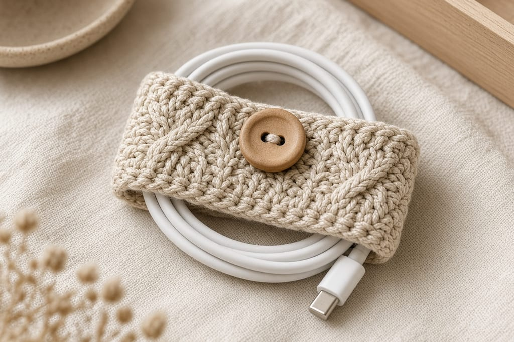
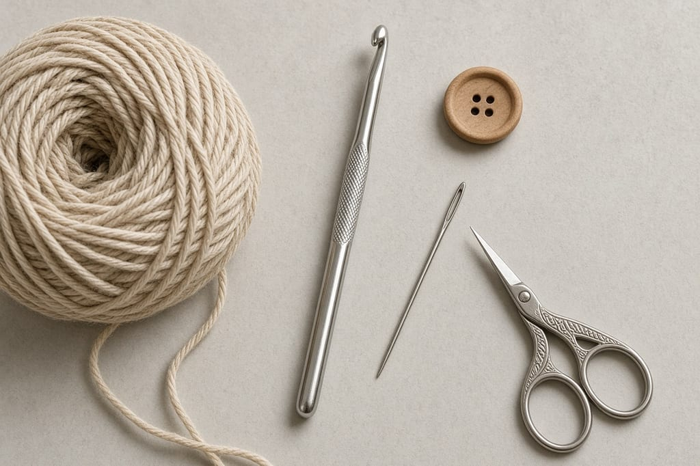

A charging cable in a bag turns into a knot because nothing holds the coil. A buttoned strap does. This is about the smallest useful thing you can crochet, and it still has one measurement that decides whether it works: the distance around the coiled cable where the strap will sit. Make the strap to a fixed row count and it will either not reach the button or flap loose around a thin cable.

US terms. US single crochet is UK double crochet. [Abbreviations](/crochet-abbreviations-chart/). The pictures are illustrations. No strap for this page was crocheted or buttoned around a cable. The 4 inch coil in the example is invented so the arithmetic has numbers.

## How the strap works

The strap is a narrow rectangle in rows. A button is sewn near the first row. The last row has a buttonhole made by chaining over skipped stitches. Wrapped around the coil, the buttonhole meets the button.

So the length is not a style choice. The distance from the button to the buttonhole has to equal the distance around the coil. Everything else on the strap is a small margin at each end. A fixed 36 rows with the button 4 rows up leaves 32 rows, about 6.4 inches, between them. That fits a fat laptop coil and leaves a loose loop around a thin phone cable. Measure the coil you have.

## Measure the coil

Coil the cable the way it already wants to sit. Forcing it the other way puts a twist in it, and the strap will hold that twist just as well.

Wrap a strip of paper around the bundle where the strap will go, snug but not squeezing. Mark the overlap and measure the strip flat. In the example, it is **4 inches**.

<figure class="diagram">

<figcaption>The strap's working length is the button-to-buttonhole distance. The rest is margin.</figcaption>
</figure>

## Yarn and hook

- **Smooth worsted cotton**, from scraps. It is firm and does not stretch much once buttoned. [Yarn weights](/yarn-weight-chart/).
- **US G/6 (4.0 mm) hook**, or one that makes firm fabric. [Hook chart](/crochet-hook-size-conversion-chart/).
- **A button about 1/2 inch across.**
- Yarn needle, scissors.

Crochet three or four rows and measure stitches and rows per inch. The example uses 4 stitches and 5 rows per inch.

## The worked example

| Part | Arithmetic | Result |
| --- | --- | --- |
| Width | 2 in × 4 sts | 8 sts, chain 9 |
| Margin below the button | 3 rows | 0.6 in |
| Button to buttonhole | the coil measurement | 4 in, 20 rows |
| Buttonhole row | 1 row | 0.2 in |
| Total | 0.6 + 4 + 0.2 = 4.8 in | 24 rows |
| Buttonhole | 3 + 2 + 3 | sc 3, ch 3, skip 2, sc 3 |

The buttonhole spans 2 skipped stitches, about half an inch at this gauge, to suit a half-inch button. For a larger button on the same eight-stitch strip, work sc 2, ch 4, skip 3, sc 3; test before fastening off.

Why 8 stitches wide: in worsted cotton, a strip much narrower than 2 inches tends to roll into a cord. If you want a narrow strap, use a finer yarn and keep the stitch count.

## Stage 1: the strip

Chain 9.

**Row 1:** Sc in the second chain from the hook and in each chain across. Ch 1, turn. (8)

<figure class="diagram">

<figcaption>Step 1. Chain 9 for an 8-stitch strap, about 2 inches wide at 4 sc per inch.</figcaption>
</figure>

**Rows 2–23:** Sc in each stitch. Ch 1, turn. (8)

<figure class="diagram">

<figcaption>A narrow strap shows a gained stitch at once. Start each row in the edge stitch, not the ch 1.</figcaption>
</figure>

The ch 1 does not count as a stitch. Count the eight stitches every few rows. A ninth makes the end wider than the buttonhole row.

**Checkpoint at row 20:** wrap the strip around the coil. The far end should reach about 0.6 inch past where row 3 lands. If it does not, keep going. If it overshoots, stop early.

## Stage 2: the buttonhole

**Row 24:** Sc 3, ch 3, skip 2, sc 3. (6 sc and a ch-3 space)

<figure class="diagram">

<figcaption>Step 2. The ch 3 spans 2 skipped stitches. One extra chain keeps the hole from pinching the button.</figcaption>
</figure>

Fasten off. Three plus two skipped plus three is eight, so the end keeps its width, and the chain lies flat across the gap.

## Stage 3: the button

<figure class="diagram">

<figcaption>Diagram. The button is at the end of the strip.</figcaption>
</figure>

Sew the button on row 3, centered across the eight stitches, through several stitches. Wrap the strap around the coil and button it. The button should meet the buttonhole without stretching the strap and without bending the cable tighter than it sat.

## Optional: keep the strap on the cable

A strap that comes off every time you use the cable gets lost. To keep it attached, chain 10 with a new length of yarn and sew both ends to the back of the strap near row 1. Pass one end of the cable through that small loop before you plug it in. The strap stays on the cable when you unbutton it.

## Measure between the closures, not the strip ends

Place a removable marker at row 3 where the button will sit. Wrap the finished strip around the relaxed coil and mark where that location meets the buttonhole end; do not stretch the cable or compress it to force a match. The 24-row example is only a starting count. For a three-stitch buttonhole on eight base stitches, use sc 2, ch 4, skip 3, sc 3: 2 + 3 + 3 = 8 base positions. Test the button and adjust the chains before fastening off. A retaining loop must be large enough for the connector; do not force a plug through a fixed ten-chain loop.

## Troubleshooting

**It will not reach the button.** The coil is fatter than the strip. Add rows before the buttonhole row.

**It buttons loose and the coil slides out.** Too long for the coil. Pull out rows and rework the buttonhole row.

**The strip rolls into a tube.** Too narrow for the yarn, or the tension is tight. Add two stitches or go up a hook size.

**The button pushes through the hole.** The hole is too big for the button. Chain fewer, or skip fewer.

**The end flares at the buttonhole.** The chain is longer than the skipped stitches can hold flat. Chain one fewer.

## Use and care

One cable per strap. Two cables in one strap make a tangle inside the strap. Leave the plug ends outside so you can see which cable it is. To tell straps apart, tie a short tail of colored yarn through the button end. Hand wash cool, dry flat, and button it only when dry.

## Frequently asked

**Will this fit a laptop charger?**

The cable, yes, once you measure that coil. Laptop cables are thicker, so the coil is fatter and the strap longer. Do not strap the power brick. It makes a lump that will not button.

**Does it stop the cable twisting?**

No. You still coil it by hand. The strap holds the coil you made.

**Can I sell them?**

Finished straps, yes. Do not republish the rows.

## Next

A pouch for the earbud case that goes with the cable is the round-pouch method in the [device case guide](/how-to-crochet-a-device-case/). The same buttonhole on a wider flap closes a [strap bag](/how-to-crochet-a-strap-bag/).
