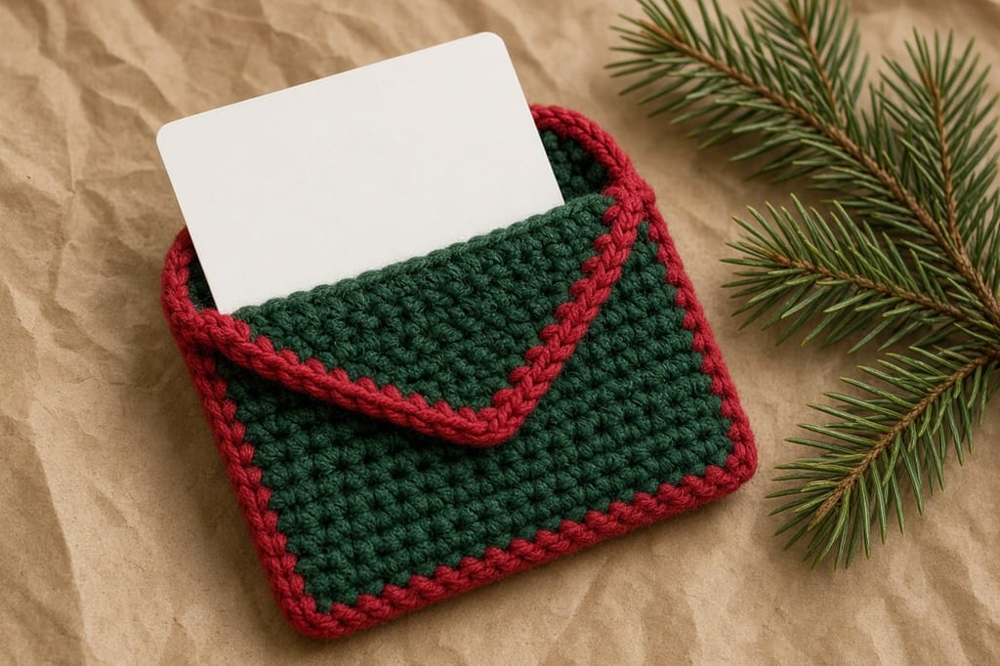
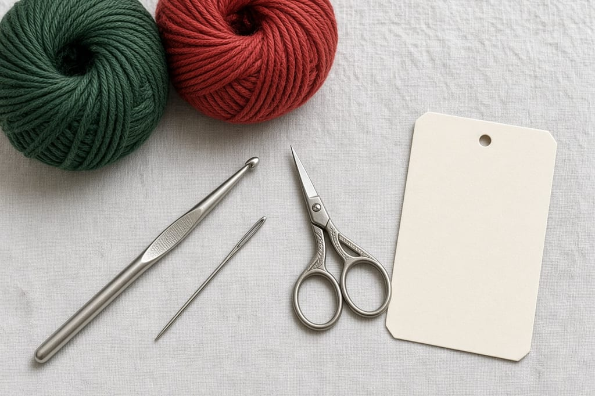

A gift card in a plain envelope looks like an afterthought. A small crochet pocket gives it a front. It also has to do two practical things: let the card in without bending it, and let the person you give it to get the card back out. The first is about width. The second is about where you fold, and that is the part most card-pocket patterns get wrong.

Most US gift cards follow the ID-1 size used for bank cards: **85.60 × 53.98 mm**, which is **3.370 × 2.125 inches**, under ISO/IEC 7810. Some store cards are smaller. Measure the card you are giving.

US terms. US single crochet is UK double crochet. [Abbreviations](/crochet-abbreviations-chart/). The pictures are illustrations. No pocket for this page was crocheted or fitted to a card.

## What is fact, and what is only a plan

| Piece of this page | What it is |
| --- | --- |
| 3.370 × 2.125 in | The ISO/IEC 7810 ID-1 card size. |
| A rectangle folded and seamed at the sides | Standard construction. |
| Front shorter than the card, back taller | Geometry. The card has to stick out to be pulled. |
| 4 sc and 5 rows to the inch | An unverified example gauge. |
| About 30 yards of green and 8 of red | An old line. Not weighed. Withdrawn. |

## How the pocket is built

One rectangle of single crochet, 16 stitches wide and 24 rows long. It is folded up from the bottom so the first 9 rows become the front and the remaining 15 rows become the back. The sides of the front are sewn to the back. The top of the front stays open. A row of red along the front edge is the only decoration.

### Why fold off center

The earlier version of this page folded the rectangle in half, 12 rows to a side. At 5 rows per inch that is a pocket 2.4 inches deep. A 2.125 inch card drops right in and sits about a quarter of an inch below the opening, with nothing to grab. The page then said the card should "stop before it disappears", which it would not do.

Folding after row 9 makes the front 1.8 inches tall, shorter than the card, so about a third of an inch of card stands above it. The back is 15 rows, 3.0 inches, so it rises behind the card and gives the front of the gift something to frame.

<figure class="diagram">

<figcaption>The front is shorter than the card on purpose. The visible strip is how the card comes out.</figcaption>
</figure>

### Why 16 stitches

Sixteen stitches at 4 per inch is 4 inches. Whipstitched side seams take up roughly one stitch, leaving about 3.75 inches inside for a 3.37 inch card. That is about three-eighths of an inch of ease, enough for the card to slide in flat. If your gauge is 5 stitches per inch, 16 stitches is 3.2 inches and the card will not go in at all. Keep the count and go up a hook size.

## Yarn and hook

- **Worsted cotton** in green, and a scrap of red. Cotton keeps the pocket flat. Fuzzy yarn catches the card's smooth face. [Yarn weights](/yarn-weight-chart/).
- **US G/6 (4.0 mm) hook**, or the size that gives 4 stitches per inch. [Hook chart](/crochet-hook-size-conversion-chart/).
- A gift card, or a piece of card stock cut to 3.370 × 2.125 inches.
- Yarn needle, scissors.

## The worked example

| Part | Arithmetic | Result |
| --- | --- | --- |
| Width | 16 sts ÷ 4 per in | 4.0 in fabric, about 3.75 in inside |
| Front | 9 rows ÷ 5 per in | 1.8 in |
| Card showing | 2.125 − 1.8 | about 0.33 in |
| Back | 15 rows ÷ 5 per in | 3.0 in |
| Body stitches | 16 × 24 | 384 sc |

## Stage 1: the rectangle

Chain 17.

**Row 1:** Sc in the second chain from the hook and in each chain across. Ch 1, turn. (16)

<figure class="diagram">

<figcaption>Step 1. Chain 17 for 16 sc, about 4 inches wide.</figcaption>
</figure>

**Rows 2–24:** Sc in each stitch. Ch 1, turn. (16)

The ch 1 does not count as a stitch. Count every few rows. A 15 or a 17 makes the sides bow, and the seams will not line up.

**Checkpoint:** after row 4, lay the card on the fabric. The fabric should be wider than the card by about the width of two stitches.

Fasten off.

## Stage 2: the red edge

The foundation chain becomes the front edge. With red, join in the first chain and work 1 sc in each of the 16 chains along the foundation. Fasten off.

Doing this before the fold keeps the edge stitches out of the side seams. It also firms the front edge, which takes all the wear from the card going in and out.

## Stage 3: fold and seam

Fold the rectangle so the foundation edge sits 9 rows up, with the right sides out. The fold is the bottom. The 9-row front lies against rows 10 to 18 of the back. Rows 19 to 24 stand above it.

<figure class="diagram">

<figcaption>Step 2. Drawn to scale. The fold is off center: 9 rows in front, 15 behind, so the card shows above the front.</figcaption>
</figure>

Slide the card in before you sew. About a third of an inch should show above the red edge. If almost none shows, fold one row lower.

Whipstitch each side from the fold to the top of the front, through both layers and through the outer loop of the edge stitches only. A seam deeper in the stitch narrows the pocket. Make a second stitch at the top of each seam, where the card puts the most strain. Weave the ends in on the inside of the back, not inside the pocket.

## Variations

**A hanging loop.** Chain 12 at the center top of the back, slip stitch back to make a loop, and hang the pocket on the tree with the card in it.

**Embroidery.** The back stands 0.875 inch above the card. A small star in backstitch fits there. Keep the stitches shallow.

**No red.** The pocket still fits without the edge, but the foundation chain will wear faster.

## Troubleshooting

**The card will not go in.** The fabric is tighter than 4 stitches per inch, or the seams went too deep. Go up a hook size and keep 16 stitches.

**The card disappears into the pocket.** The front is taller than the card. Refold lower.

**The card falls out when the pocket is tipped.** The pocket is loose, or the front is very short. Make the next one with one fewer stitch, or fold one row higher.

**The sides bow outward.** The stitch count drifted. Count back to where it was 16.

**The red edge ruffles.** You worked more than one stitch in some chains. Sixteen chains, sixteen stitches.

## Giving it

Tuck the pocket under the ribbon on a wrapped gift, or hand it over on its own. Yarn does not protect a card from bending. Do not fold the pocket with the card inside. One card per pocket. A second card stretches the seams.

Write the amount on a separate note. Embroidering a dollar figure makes the pocket single-use.

## Frequently asked

**Will a credit card fit?**

Yes, it is the same ID-1 size. This is still a gift pocket. It is not a daily wallet.

**What about a smaller store card?**

Measure it. If it is shorter than 1.8 inches, it will vanish into this pocket. Fold after row 7 or 8 so the front stays shorter than the card.

**Can I sell finished holders?**

Yes. Do not republish the rows.

## Next

A card pocket with a flap and a button is the [Halloween card wallet](/halloween-crochet-card-wallet/), which also shows how to size a pocket from any card. December yarn choices are in [yarn for Christmas crochet](/yarn-for-christmas-crochet/).
