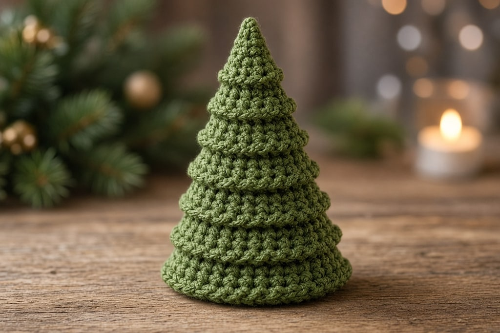
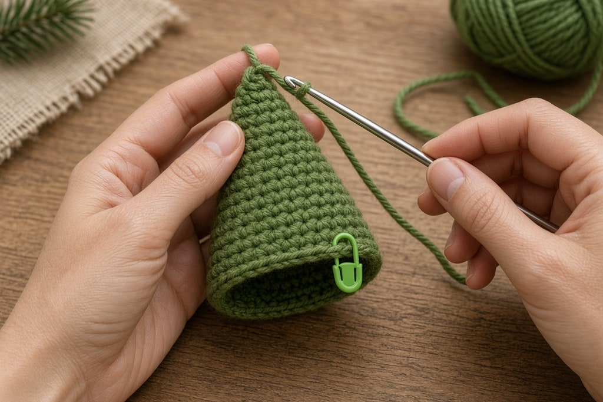
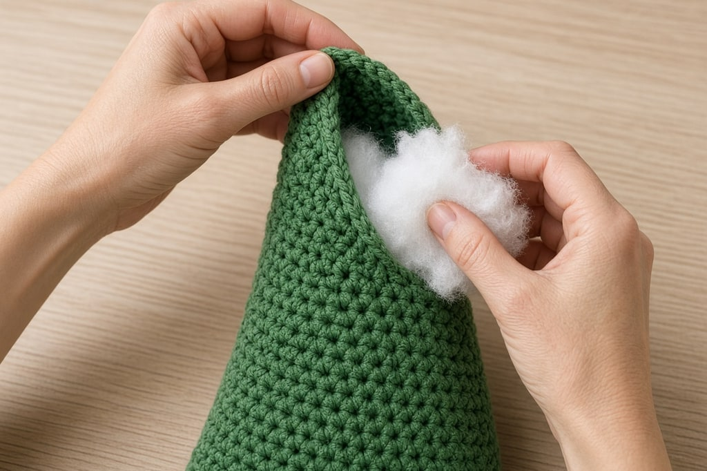
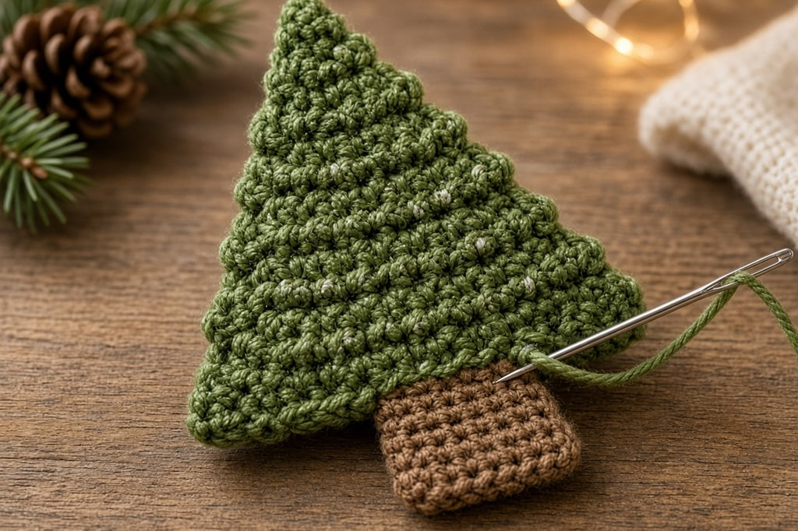

A tree for a mantel has to stand. A tree for a garland has to lie flat. This page gives three builds, and one rule that controls the shape of two of them: **how fast you add or remove stitches sets the slope.** Add stitches slowly and the cone is slim. Add them quickly and it is squat. Add six a round and it lies flat as a coaster.

A standing cone is worked from the tip down, so it gets wider as you go, and its flat base is made last. Some patterns start at the base and increase upward, which makes a cup that is widest at the top.

US terms. [Abbreviations](/crochet-abbreviations-chart/). The pictures are illustrations. No tree for this page was made, and the illustration is not evidence that these counts stand up. No finished size is given.

## Which one do you want

| You want | Build it as |
| --- | --- |
| A tree that stands on a shelf | Tiered cone |
| A tree for a garland, card, or appliqué | Flat triangle |
| A chunky tree with visible layers | Stacked rounds |

## The slope rule

<figure class="diagram">

<figcaption>Average stitches added per round decide the cone. Rows between decreases decide the triangle.</figcaption>
</figure>

A flat circle of single crochet needs about six new stitches each round to stay flat. Fewer than that, and the edge turns up into a cone. The cone below goes from 6 to 36 stitches over 18 rounds, about two stitches a round on average. For a slimmer tree, add more even rounds between increases. For a squatter one, remove them.

## What you need

- **Worsted-weight yarn** in green, or any color. [Yarn weights](/yarn-weight-chart/).
- **A hook one or two sizes smaller than the label** for the stuffed versions. [Hook chart](/crochet-hook-size-conversion-chart/).
- Stuffing, a stitch marker, a yarn needle, scraps for decoration.
- **A weight in a sealed bag** for a standing tree: plastic pellets or clean gravel. Loose grains escape through the stitches.

## Method 1: the tiered cone

Work in a spiral from the tip. Mark the first stitch of each round.

**Round 1:** 6 sc in a magic ring. (6)

**Round 2:** Sc in each stitch. (6)

**Round 3:** (Sc, 2 sc in next) 3 times. (9)

**Round 4:** Sc in each stitch. (9)

**Round 5:** (Sc 2, 2 sc in next) 3 times. (12)

**Round 6:** Sc in each stitch. (12)

**Round 7:** (Sc, 2 sc in next) 6 times. (18)

Push small pieces of stuffing into the tip now with the end of a pencil. Once the cone is wider it is hard to reach, and an empty tip flops.

**Round 8:** Sc in each stitch. (18)

**Round 9:** Sc in the back loop only of each stitch. (18)

**Round 10:** (Sc 2, 2 sc in next) 6 times. (24)

**Round 11:** Sc in each stitch. (24)

**Round 12:** Sc in the back loop only of each stitch. (24)

**Round 13:** (Sc 3, 2 sc in next) 6 times. (30)

**Round 14:** Sc in each stitch. (30)

**Round 15:** Sc in the back loop only of each stitch. (30)

**Round 16:** (Sc 4, 2 sc in next) 6 times. (36)

**Rounds 17–18:** Sc in each stitch. (36)

The back-loop rounds 9, 12, and 15 leave the front loops standing as horizontal ridges, the tiers. Three ridges are enough. A back-loop round every round makes a ribbed cone instead.

**Fuller branches (optional).** Join green in any free front loop on a ridge and work 2 sc in each front loop around, then fasten off. That makes a small ruffle at each tier.

Stuff the cone firmly as you go.

### The base

**Round 19:** Sc in the back loop only of each stitch. (36) This is a fold line so the base sits flat.

**Round 20:** (Sc 4, sc2tog) 6 times. (30)

**Round 21:** (Sc 3, sc2tog) 6 times. (24)

Lay the weight bag flat and centered on the stuffing.

**Round 22:** (Sc 2, sc2tog) 6 times. (18)

**Round 23:** (Sc, sc2tog) 6 times. (12)

**Round 24:** Sc2tog 6 times. (6) Fasten off and pull the hole closed.

## Method 2: the flat triangle

For garlands, cards, and appliqués. Worked from the bottom in rows. Ch 1 does not count as a stitch.

The start needs an **odd** number of stitches. Decreasing two per row from an odd number goes 15, 13, 11 and so on down to 3. From an even number it ends at 2, with nothing tidy to finish on.

**Row 1:** Ch 16. Sc in the 2nd chain from the hook and in each chain across. Turn. (15)

**Row 2:** Ch 1, sc in each stitch. Turn. (15)

**Row 3:** Ch 1, sc2tog, sc to the last 2, sc2tog. Turn. (13)

**Row 4:** Ch 1, sc in each stitch. Turn. (13)

Repeat rows 3 and 4: 11, 11, 9, 9, 7, 7, 5, 5, 3.

**Row 14:** Ch 1, sc3tog. (1) Fasten off.

Decreasing on every other row gives a tree shape. Decreasing on every row from 15 is finished in 8 rows and makes a low, wide triangle. If the sides are wavy, the turning chain is being counted as a stitch. [The turning chain](/crochet-turning-chain/).

On a card, a small brown rectangle sewn to the base reads as a trunk. On a garland, skip it.

## Method 3: stacked rounds

Make three flat circles, increasing six stitches a round as in rounds 1 to 5 of the [pumpkin](/how-to-crochet-a-pumpkin-step-by-step/): 6, 12, 18, 24, 30. Stop at 30 for the largest, 24 for the middle, and 18 for the top. Fold a small pleat into each circle, from the edge to the center, and sew it down. Each circle becomes a shallow cone. Stack them on a dowel, a chopstick, or a tight tube of brown crochet, largest at the bottom. The layered look is the point.

## Making it stand

- **Weight at the bottom**, centered, before the base closes.
- **A flat base.** The back-loop fold round is what makes it sit.
- **Stuff the lower half firmly.** A hard upper half raises the center of gravity.
- **Offset the increases** by a stitch or two from round to round. Stacked increases make a seam that pulls the cone crooked.

## Decorating

French knots in a contrasting color are the tidiest ornaments. Beads and buttons are a choking hazard on a gift for a small child, so embroider instead. A small flat star sewn against the tip stays put. Six ornaments look decorated. Thirty looks like a blob.

## Troubleshooting

**It is a cup, not a cone.** Worked from the base up. Work from the tip down.

**It is nearly flat.** Too many increases per round. Add even rounds between them.

**The tip flops.** Not stuffed early enough.

**The triangle ends on 2 stitches.** It started on an even count.

**It leans.** Off-center weight, or stacked increases.

## Frequently asked

### Can I skip the stuffing?

Yes, by working the cone to fit over a craft foam cone instead of stuffing it. It stands evenly.

### How do I make a matching set?

Same hook, same yarn, same counts, same stuffing. The counts match exactly. Inches vary with how firmly you stuff.

### What should I make next?

A cone with a hat and beard is the [gnome](/how-to-crochet-a-gnome/). A flat motif in rounds is the [snowflake](/how-to-crochet-a-snowflake/).
