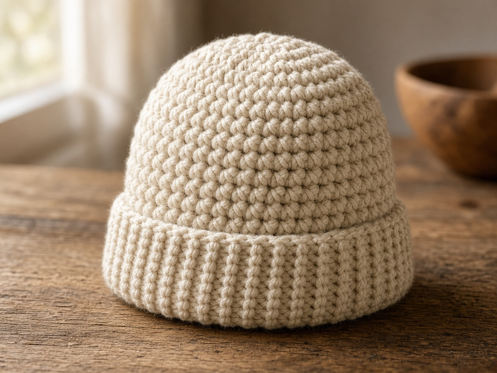
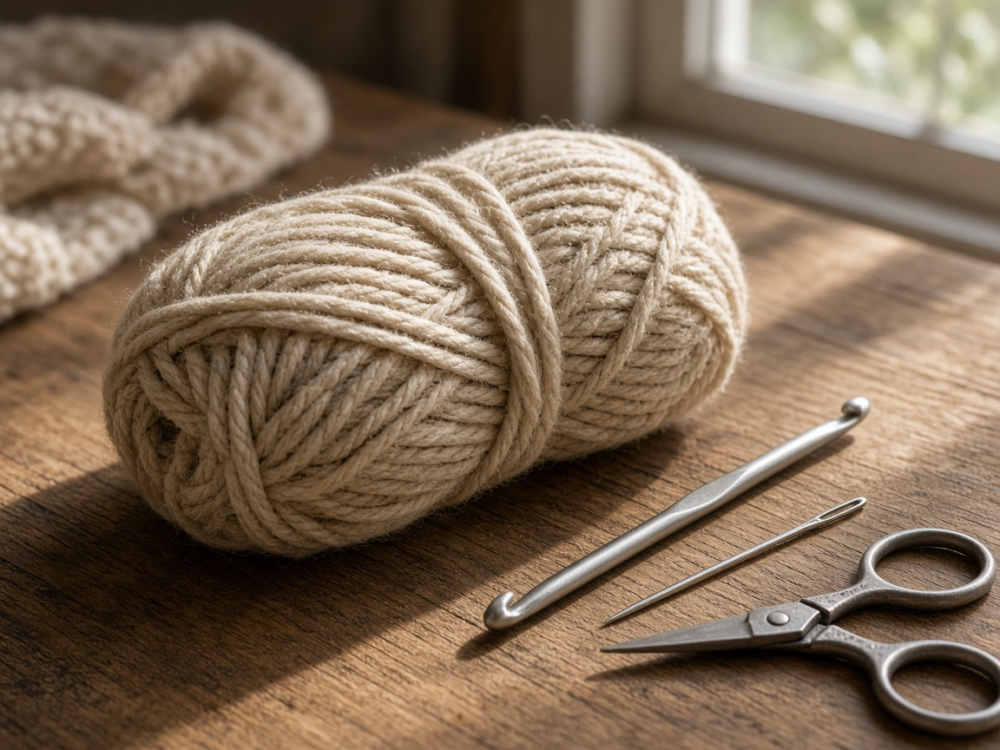
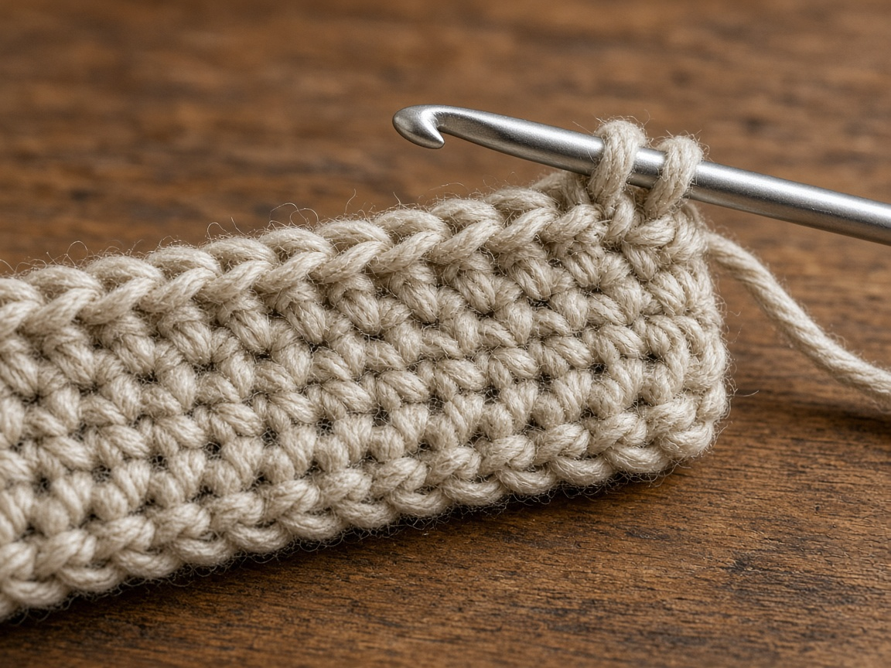
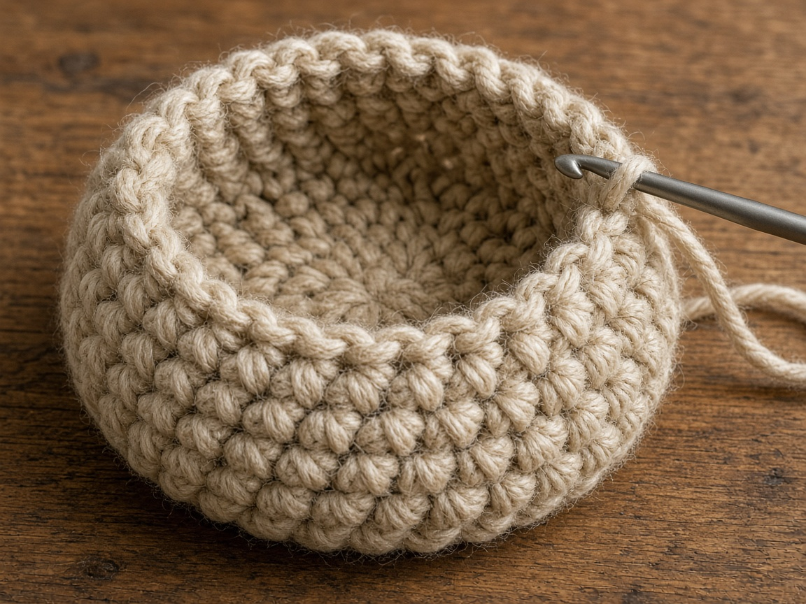
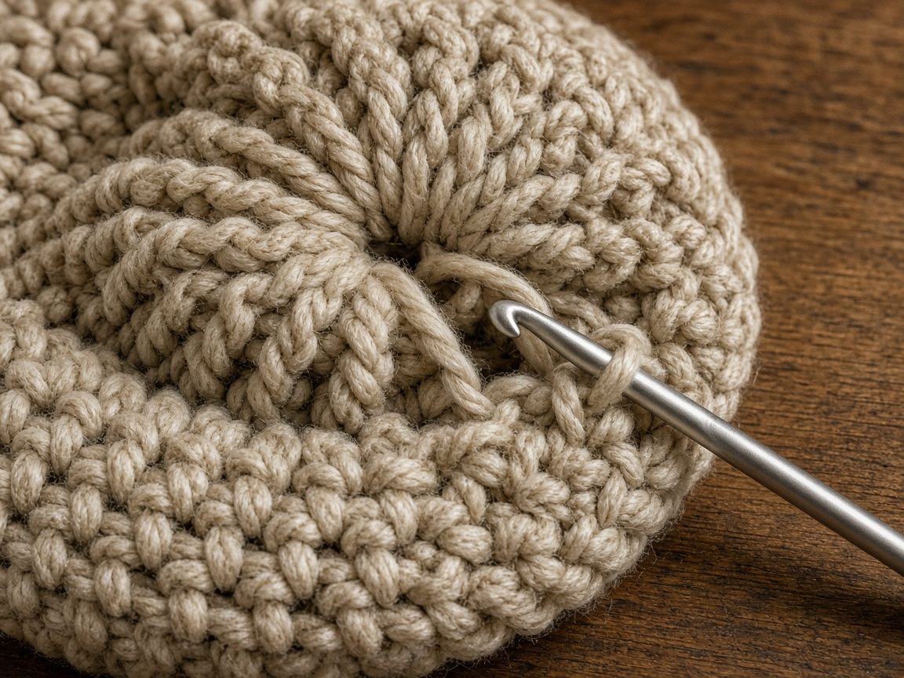

A winter hat fails in one of two ways. It slides off because the brim is too loose, or it leaves a red line because the brim is too tight. Chunky yarn hides uneven stitches and works up fast. It does not hide a brim that was never measured, or a body that flares out above the brim like a chef's hat.

That flare is the mistake this page is built around. The brim is worked sideways in rows, then the body is picked up along its edge. The brim's length is counted in rows, and the body is counted in stitches, and the two are almost never the same number per inch. Pick up one stitch per row and the body comes out the wrong size. Below is how to work out the right count.

US terms. US single crochet is UK double crochet. [Abbreviations](/crochet-abbreviations-chart/). The pictures are illustrations. No hat for this page was crocheted or worn. The example gauges are invented to show the arithmetic.

## What is a technique, and what is only a plan

| Piece of this page | What it is |
| --- | --- |
| Back-loop single crochet rib, worked sideways | Standard. |
| Hat smaller than the head (negative ease) | Standard. The amount depends on the yarn. |
| Picking up stitches evenly along row ends | Standard. |
| Crown decreasing 5 stitches a round | Standard flat-crown shaping for single crochet. |
| 2.5 sts and 3 rib rows to the inch | Invented examples. |
| About 120 yards | Old line. Not weighed. Withdrawn. |

## Measure the head

Measure around the head just above the ears and across the forehead, where the hat will sit. A hat stretches, so it is made smaller than the head. **About 2 inches smaller** is a common starting point. With very stretchy yarn that may be too little. With firm yarn, 1 inch is enough.

Then measure the depth. Run the tape from the bottom of one ear, over the top of the head, to the bottom of the other ear, and halve it. That is roughly how far the hat needs to reach from the brim edge to the crown, with the brim folded the way it will be worn. Treat it as a guide, not a rule, because a slouchy hat is deeper on purpose.

Children's heads are not small adult heads. Measure the child.

The example: a **22 inch** head, so a **20 inch** hat.

## Yarn and hook

- **Bulky yarn**, weight 5 on the [yarn weight chart](/yarn-weight-chart/).
- **The hook printed on the label**, often in the US L to N range (8.0 to 10.0 mm). [Hook chart](/crochet-hook-size-conversion-chart/).
- Yarn needle, scissors, tape measure.

## Two swatches, two gauges

You need two numbers, so make two small swatches or one swatch with two parts.

1. **Body gauge:** 12 sc for several rows. Measure stitches per inch. The example uses **2.5**.
2. **Brim gauge:** 8 sc wide, about 15 rows in back-loop single crochet. Measure rows per inch, relaxed. The example uses **3**.

Back-loop rows squash together into ridges, so the rib's row gauge can be very different from the body's stitch gauge. That difference is the whole reason for the next section. [Gauge](/crochet-gauge/).

## The worked example

<figure class="diagram">

<figcaption>Work out the body count from the body gauge, then spread it along the brim's row ends.</figcaption>
</figure>

| Step | Arithmetic | Result |
| --- | --- | --- |
| Hat | 22 in head − 2 in | 20 in |
| Brim rows | 20 × 3 | 60 rows |
| Body stitches | 20 × 2.5 | 50 sts |
| Pick-up ratio | 60 rows for 50 sts | 5 sts over every 6 rows |
| Crown | 50 − 5 per round | 9 rounds to 5 |

The crown decreases in groups of five, so a body count divisible by 5 makes it neat. If yours is not, round to the nearest multiple of 5.

## Stage 1: the brim

Ch 1 does not count as a stitch.

Chain 9.

**Row 1:** Sc in the 2nd chain from the hook and across. Ch 1, turn. (8)

<figure class="diagram">

<figcaption>Step 1. Chain 9 for an 8-stitch brim. The chain is the brim's height, not the hat's width.</figcaption>
</figure>

**Row 2:** Sc in the back loop only of each stitch. Ch 1, turn. (8)

<figure class="diagram">

<figcaption>Back loop only on every row from row 2 makes the stretchy rib.</figcaption>
</figure>

Repeat row 2 until the band, relaxed, measures the hat size. In the example, about 60 rows. Then wrap it around the head. It should feel snug and stay put without pressing. Add or remove rows until it does, and use that row count.

Eight stitches at 2.5 per inch make a band about 3.2 inches tall, about 1.6 inches folded.

Bring the first row up to the last without twisting the band. Seam the short ends. That seam marks the back.

## Stage 2: pick up the body

Join yarn at the seam, on the edge that will be the fold.

**Round 1:** Work the body count evenly into the row ends. In the example: (sc in each of the next 5 row ends, skip 1 row end) 10 times. Join. (50)

If your numbers do not divide as neatly, work out how many row ends you have for each stitch you need and skip as evenly as you can. Count at the end. The count matters more than perfect spacing.

**Even rounds:** Sc in each stitch. (50) Join each round, or spiral with a marker.

Try it on with the brim folded. Stop the even rounds when the hat reaches about the depth you measured minus 1 inch. The crown adds a little height as it closes.

## Stage 3: the crown

Each round removes 5 stitches, which keeps the crown nearly flat in single crochet.

**Round 1:** (Sc 8, sc2tog) 5 times. (45)

<figure class="diagram">

<figcaption>Step 3. Five decreases a round, spaced evenly, keep the crown flat.</figcaption>
</figure>

**Round 2:** (Sc 7, sc2tog) 5 times. (40)

**Round 3:** (Sc 6, sc2tog) 5 times. (35)

**Round 4:** (Sc 5, sc2tog) 5 times. (30)

**Round 5:** (Sc 4, sc2tog) 5 times. (25)

**Round 6:** (Sc 3, sc2tog) 5 times. (20)

**Round 7:** (Sc 2, sc2tog) 5 times. (15)

**Round 8:** (Sc, sc2tog) 5 times. (10)

**Round 9:** Sc2tog 5 times. (5)

<figure class="diagram">

<figcaption>Step 4. The crown by stitch count: 50 down to 5 in nine rounds, then the gap is closed with the tail.</figcaption>
</figure>

For another count that is a multiple of 5, start with the round whose repeat matches: 55 stitches starts with (sc 9, sc2tog), 60 with (sc 10, sc2tog). Thread the tail through the last 5 stitches, pull closed, and weave it down inside. A knot on the crown shows through bulky yarn.

## Troubleshooting

**The body flares out above the brim.** One stitch per row end. Pick up by the body gauge.

**The body pulls the brim in.** Too few stitches picked up. Recount.

**The rib spirals.** The band was twisted before seaming. Open the seam and resew.

**The top stays a tube.** The crown decreases were skipped.

**Loose on the head.** The brim was measured stretched. Measure it relaxed.

**Covers the eyes.** Too many even rounds, or the brim is not folded. Stop sooner.

## Care

Bulky hats hold water. Squeeze, do not wring. Dry flat with the brim unfolded. Check the label before machine washing or drying.

## Frequently asked

**Will one count fit every adult?**

No. Measure, swatch, then calculate.

**Can I add a pom-pom?**

Yes, after the crown is closed. Sew it on firmly. Glue lets go.

**Can I skip the fold?**

Yes. Stop the even rounds sooner so the hat does not cover the eyes.

**Can I use worsted with these counts?**

No. Worsted has more stitches per inch. Swatch and redo the arithmetic.

## Next

A band with no crown is the [ear warmer](/how-to-crochet-an-ear-warmer/). Picking up stitches along an edge also comes up in the [fingerless gloves](/how-to-crochet-fingerless-gloves/).
