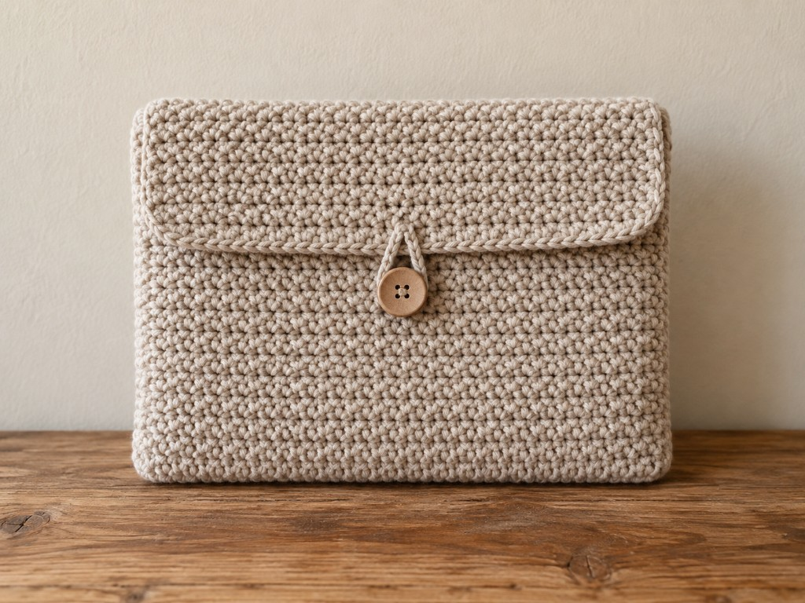
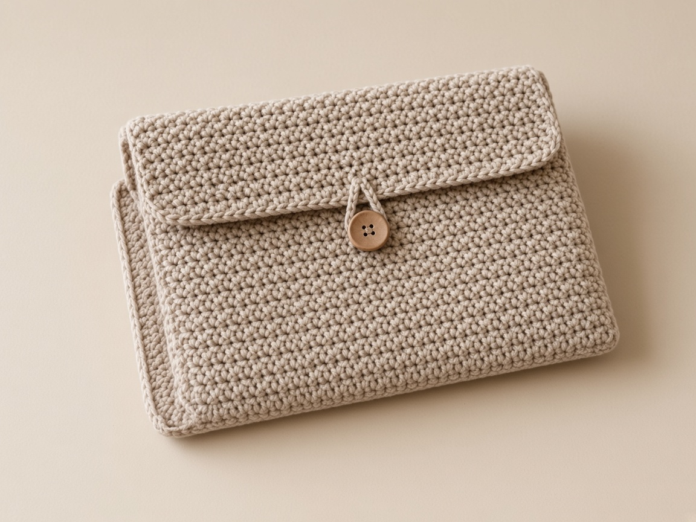

Almost every "crochet case" pattern hands you one stitch count and hopes your phone, your earbuds, or your paperback happens to match it. They rarely do. This guide works the other way round: you measure your device, pick the construction that suits its shape, and size the piece from your own gauge. Two constructions cover nearly everything small enough to carry.

US terms throughout. US single crochet is UK double crochet. See the [abbreviations chart](/crochet-abbreviations-chart/) if a term is new. The sizes are worked out from an example gauge rather than from a finished sample, so swatch first and slide your device in before you sew anything shut. None of these counts is a promise about your yarn.

## Which construction does your device need

The shape of the object decides the method. Do not pick by what the object is called.

- **Flat and rigid** — a laptop, a tablet, an e-reader, a paperback. Fold a rectangle and seam the sides. Jump to [Method 1](#method-1-a-folded-sleeve-for-flat-devices).
- **Small and bulky, with a round-ish footprint** — an earbud case, a lip balm, a small power bank. Work a round base and a straight tube. Jump to [Method 2](#method-2-a-round-pouch-for-small-gear).
- **A phone.** A phone is flat, so it uses Method 1, but it is the most common case people want and it has its own worked page: [how to crochet a phone case](/how-to-crochet-a-phone-case/).
- **A tapered travel cup** that is wider at the top than the bottom needs shaping a straight tube cannot give. That is a [tumbler sleeve](/how-to-crochet-a-tumbler-sleeve/).
- **A coiled cable** needs a strap and a buttonhole, not a pocket: the [cable organizer](/how-to-crochet-a-cable-organizer/).
- **A drawstring makeup or coin pouch** where the opening gathers shut is a different closure again: the [drawstring pouch guide](/how-to-crochet-a-makeup-pouch/).

None of these is waterproof, and none is drop protection. Single crochet has gaps, and yarn does not absorb a fall. A crochet case is a soft cover that keeps lint, scratches, and loose keys off your gear. Say so to anyone you give one to.

## The one thing both methods share: gauge

Everything below is arithmetic on top of your gauge, so the gauge has to be yours, not the example's. Crochet a flat swatch about 4 inches square in the yarn and hook you will use, then measure the middle. The example gauge in this guide is **4 single crochet and 5 rows to the inch** in smooth worsted cotton on a US G/6 (4.0 mm) hook. If your swatch comes out at 3.5 stitches to the inch, your counts change, and that is the point. [Crochet gauge](/crochet-gauge/) walks through measuring it.

A quick note on yarn: smooth worsted cotton is the easiest choice here. It is firm, it holds a stitch shape, and it does not shed into a charging port or a speaker mesh the way a fuzzy acrylic does. Pick a hook a size or two smaller than the yarn label suggests, because a case wants denser fabric than a scarf. [Yarn weights](/yarn-weight-chart/) and the [hook chart](/crochet-hook-size-conversion-chart/) have the ranges.

## Method 1: a folded sleeve for flat devices

A flat sleeve is a single rectangle, folded in half, seamed up both sides, open at the top. The stitch count sets the width of the opening. The row count, folded in half, sets how deep the device sits. The fold becomes the bottom.

### Measure the device, then add its thickness to the width

Close the device and measure three things: its **width**, its **height**, and its **thickness** at the thickest point. The mistake that ruins a folded sleeve is sizing the width to the flat width only. The fabric has to wrap around the edges, so each face of the sleeve must cover the width *plus* the thickness, plus a little ease and a stitch for the seams.

<figure class="diagram">

<figcaption>The thickness is added to the width, not left out. On a thin tablet that is a quarter inch; on a laptop, more.</figcaption>
</figure>

**Worked example, a 12 x 8.5 x 0.6 inch laptop**, at 4 stitches and 5 rows to the inch:

- Width: 12 + 0.6 thickness + 0.25 seams + 0.25 ease = 13.1 in, so 53 single crochet, chain 54.
- Depth per side: 8.5 + 0.3 at the fold + 0.2 ease = 9.0 in. The fabric is twice that before folding, so 18 in, which is 90 rows.

**Worked example, a 5 x 8 inch paperback**, same gauge:

- Width: for a 0.5-inch-thick paperback, 5 + 0.5 thickness + 0.25 seams + 0.25 ease = 6.0 in, so 24 single crochet, chain 25. Measure the spine of any book; thickness is part of the calculation, not an optional hardcover allowance.
- Depth: choose how much of the cover stays visible. Three quarters of 8 in is 6 in of sleeve, so 12 in of fabric before the fold, which is 60 rows.

An e-reader or small tablet is the same sum with its own three numbers. Measure, do not guess from the screen size on the box — that is a diagonal, not the width.

### Work the rectangle, keeping the count honest

Chain your width-plus-one. For the paperback example that is chain 25.

**Row 1:** Single crochet in the second chain from the hook and in each chain across. Chain 1, turn. (24)

<figure class="diagram">

<figcaption>Chain 23 for 22 single crochet, 5.5 inches at 4 stitches per inch.</figcaption>
</figure>

**Every following row:** Single crochet in each stitch to the end. Chain 1, turn. The chain 1 is not a stitch.

<figure class="diagram">

<figcaption>Start every row in the edge stitch, not the turning chain. Over sixty or ninety rows a single gained stitch becomes a wedge, and the fold stops meeting.</figcaption>
</figure>

Count across every ten rows. On a long piece, measure it lying flat, not hanging off your lap — cotton stretches lengthwise under its own weight and reads long while it hangs.

### Fold, seam, and try the device before you weave in ends

Fold so the first row meets the last row, right sides together. The fold is the bottom. Single crochet or whipstitch through both layers up each side, matching row ends, and leave the top open. For a sewn seam, make one whipstitch per matching pair without drawing it tight. For a crocheted sc seam, distribute stitches to your stitch-to-row gauge: at 4 sc and 5 rows per inch, work 4 sc over each 5 paired row ends. Check it lies flat; seam strength depends on yarn, stitch placement, and reinforcement, not the seam name alone.

<figure class="diagram">

<figcaption>One stitch per row end, through both layers, from the fold to the top.</figcaption>
</figure>

Slide the device in before you weave the ends in, while the seam can still be redone. It should enter without bending and stop where you planned. If it will not go in, the opening is too narrow — seams do not add fabric, so the next rectangle needs more stitches, not a harder tug.

To keep a loose device from sliding out, sew a button to the front and chain a loop on the back long enough to reach over it with the device inside. Place the button only once the device is in the sleeve, not on the empty sleeve.

## Method 2: a round pouch for small gear

A small bulky item wants a closed round bottom and a straight tube, not a fold. Six stitches in a magic ring grow into a flat circle; when the circle is wide enough to go around the item, you stop increasing and the walls turn up on their own.

### Size the tube from the perimeter, not the width

The number that matters is the distance **around** the item, because that is what the tube has to stretch over. For a boxy earbud case, measure width and depth and work the perimeter: 2 x (width + depth). For a round lip balm, measure across and multiply by 3.14. Add roughly half an inch to an inch of ease so the item drops in.

<figure class="diagram">

<figcaption>Choose the stitch count from the perimeter plus ease. A round tube around an oblong case leaves a little space at the sides, which soft fabric takes up.</figcaption>
</figure>

**Worked example, a 1.9 x 0.9 x 2.4 inch earbud case:** perimeter 2 x (1.9 + 0.9) = 5.6 in, plus about an inch of ease is 6.6 in, which at 4 stitches to the inch rounds to **27 stitches**. The wall is the case height, 2.4 in plus a little, at 5 rounds to the inch, about **13 rounds**.

**Worked example, a 0.65 inch lip balm:** around is 0.65 x 3.14 = 2.04 in, so **9 stitches** gives about 0.2 in of ease, snug enough to hold by friction. Ten even rounds clears the cap.

### Work the base, then the walls

Work in a spiral without joining, and move a stitch marker up into the first stitch of each round. [Working in the round](/crochet-in-the-round/) explains spirals.

**Round 1:** 6 single crochet in a magic ring. (6)

<figure class="diagram">

<figcaption>The magic ring closes the center completely, so the base has no hole for the item to push through.</figcaption>
</figure>

Then increase six stitches each round until the circle is as wide as your target, slowing to fewer increases on the last round if you need to land on an exact count:

**Round 2:** 2 sc in each stitch. (12)
**Round 3:** (sc, 2 sc in next) 6 times. (18)
**Round 4:** (sc 2, 2 sc in next) 6 times. (24)
**Round 5, to reach 27:** (sc 7, 2 sc in next) 3 times. (27)

<figure class="diagram">

<figcaption>A flat circle adds six stitches a round. A partial last round nudges you onto the exact count the item needs.</figcaption>
</figure>

For the lip balm, round 2 adds only three — (sc, 2 sc in next) 3 times for 9 — so the base cups on purpose and becomes the bottom of a narrow tube. [Increases and decreases](/crochet-increase-decrease/) covers the shaping if it is new.

Then stop increasing and work even rounds for the wall:

**Even rounds:** Single crochet in each stitch, same count every round, until the item sits just below the rim.

<figure class="diagram">

<figcaption>With no more increases, the fabric turns up into the wall by itself. Stand the item in every few rounds and stop when it is covered.</figcaption>
</figure>

### Close it with a flap or a drawstring

A **button flap** suits a case you open often. Work a flap in rows over about a third of the rim stitches, five or six rows tall, and put a chain loop on the last row to catch a sewn-on button.

<figure class="diagram">

<figcaption>The flap is worked on part of the rim; the rest stays open as the mouth. The ch loop on the top row catches the button.</figcaption>
</figure>

A **drawstring** suits a pouch you reach into. It needs an even stitch count: work an eyelet round of (sc, ch 1, skip 1) around, then thread a crocheted cord through and knot it. The [drawstring pouch guide](/how-to-crochet-a-makeup-pouch/) has the full eyelet-and-cord sequence.

A **hang loop** turns a lip-balm tube into a keychain. Sew the loop to the open rim, not the closed base, so the item hangs cap-up and gravity keeps it seated.

<figure class="diagram">

<figcaption>A sleeve hangs from the end the loop is on. Put it at the rim so the closed base hangs down.</figcaption>
</figure>

If you want to decorate a round pouch — bat wings, ears, a face — shape the appliqués separately and sew them on with the item inside so the flap still closes. The [bat earbuds pouch](/gothic-bat-earbuds-pouch/) works through triangle and picot shaping in detail.

## Fit the base footprint before building a tube

A measured perimeter sets the wall circumference but does not ensure a round base covers a rectangular case bottom. Place the item upright on the base: its corners must be supported without stretching the fabric into a different shape. If a round circle leaves corners outside, choose an oval or rectangular construction, or the folded sleeve. For a 27-stitch tube with drawstring closure, first work (sc 8, inc) three times to reach 30, then use fifteen (sc, ch 1, skip 1) repeats and restore thirty positions on the following round. Do not work an even-count eyelet repeat over twenty-seven stitches.

## Troubleshooting

**The device will not go in.** The width (Method 1) or the stitch count around (Method 2) left out the thickness. Start wider; seams and stretching will not add real fabric.

**One side of the sleeve is longer than the other.** A stitch was gained on one edge. Count back to the last row that was right.

**The folded piece came out long and grew longer after a week.** Cotton relaxes under its own weight. Measure flat and stop a little short next time.

**The round base ruffles instead of lying flat.** Too many increases for the count. Ruffling means the circle is growing faster than it should.

**The round base cups into a bowl too early.** The ring or the first increases are tight. Loosen, or add one more increase round.

**The flap pulls into a point and will not reach the button.** The loop is too short or the button is too low. Lengthen the chain before you move the button.

## Care

Take the device out first. Hand wash cool, press the water out in a towel, and dry flat. Put the device back only when the cotton is fully dry — damp cotton marks metal and cockles paper. Heat can shrink cotton enough that a snug case no longer fits, so keep it out of the dryer.

## Frequently asked

**Will one pattern fit every device?**

No, and that is the whole point of sizing from your own measurements. Two cases that share a width can differ by half an inch around, which is the difference between dropping in and not fitting.

**Which method is easier for a first project?**

The folded sleeve. It is straight rows and two seams, with no shaping. The round pouch adds a magic ring and increases, which the [working in the round](/crochet-in-the-round/) page covers.

**Can I sell what I make?**

Finished cases, yes. Do not republish these instructions as your own pattern.

## Next

For the single most-requested flat case, see the worked [phone case](/how-to-crochet-a-phone-case/). For a cup that is wider at the top, the [tumbler sleeve](/how-to-crochet-a-tumbler-sleeve/) adds the taper. For an opening that gathers shut, the [drawstring pouch guide](/how-to-crochet-a-makeup-pouch/) teaches the eyelet-and-cord closure. If your counts keep drifting on a long piece, the fix is upstream in [crochet gauge](/crochet-gauge/).
