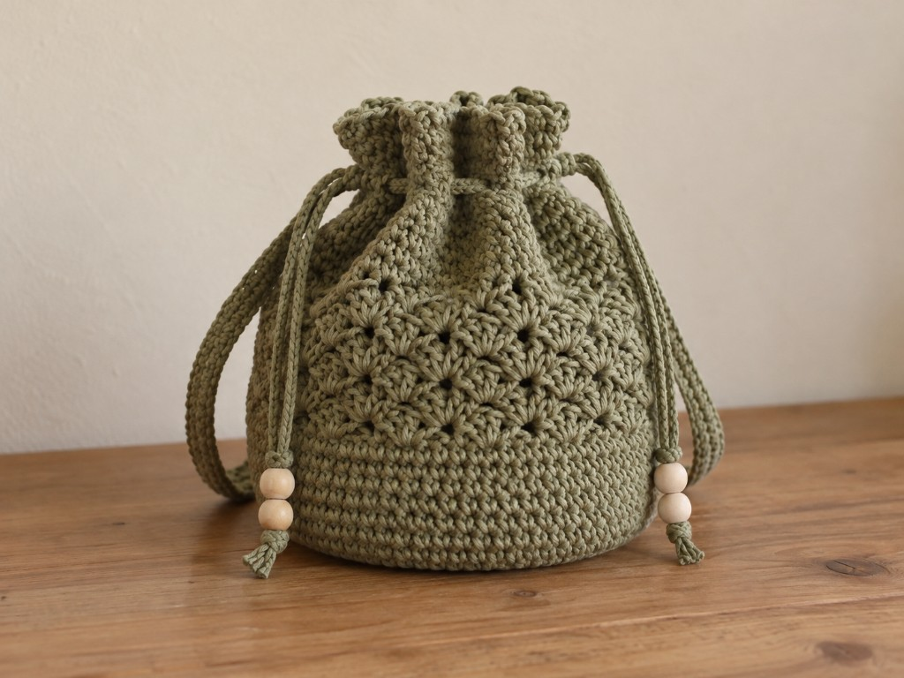

A drawstring bag is the same four pieces every time, whatever you are putting in it: a flat round base, a straight tube, one row of holes, and a cord. Learn it once at coin-pouch size and you can work it at candy-bag size, add a pumpkin belly, or swap a thin cord for a thick one, without a new pattern. This page teaches the method and then shows three worked sizes so you can see the choices.

US terms throughout. US single crochet is UK double crochet. See the [abbreviations chart](/crochet-abbreviations-chart/) if a term is new. The inch figures are worked out from an example gauge, not from a finished bag, so swatch first and drop the real contents in before you fix the cord length.

If your opening gathers shut, this is your page. If instead you want a flat pouch that folds and seams with a drawstring across a straight top, that is the [makeup pouch](/how-to-crochet-a-makeup-pouch/). If you want a zipper rather than a cord, that is the [pumpkin zipper pouch](/how-to-crochet-a-pumpkin-zipper-pouch/).

## The method, start to finish

1. **A flat circle** grows from a magic ring, six stitches added every round, until it is as wide as you want the bottom.
2. **A straight tube** forms on its own the moment you stop increasing and work even rounds.
3. **An eyelet round** near the top makes the holes by chaining over skipped stitches.
4. **A cord** threads in and out of the holes; pulling both ends gathers the top shut.

Everything after that — a face, a stem, a belly, a thicker cord — is a variation on those four pieces.

## Shared setup: gauge and yarn

The counts below are at an example gauge of **4 single crochet and 5 rounds to the inch** in smooth worsted cotton on a US G/6 (4.0 mm) hook. Your first five rounds of the base are your swatch: measure across the flat circle and compare. [Crochet gauge](/crochet-gauge/) explains the measuring. Smooth cotton holds the round shape and does not grab wrappers the way a fuzzy acrylic does; pick a hook a size or two down from the label so the fabric is firm enough to stand up. [Yarn weights](/yarn-weight-chart/) and the [hook chart](/crochet-hook-size-conversion-chart/) have the ranges.

## Stage 1: the base, sized to the bottom you want

Work in a spiral without joining, and move a stitch marker up into the first stitch of each round. [Working in the round](/crochet-in-the-round/) covers spirals.

**Round 1:** 6 sc in a magic ring. (6)

<figure class="diagram">

<figcaption>The magic ring closes the center so nothing falls out of the bottom.</figcaption>
</figure>

Each round adds six, with one more plain stitch between the increases each time:

**Round 2:** 2 sc in each stitch. (12)
**Round 3:** (sc, 2 sc in next) 6 times. (18)
**Round 4:** (sc 2, 2 sc in next) 6 times. (24)
**Round 5:** (sc 3, 2 sc in next) 6 times. (30)
**Round 6:** (sc 4, 2 sc in next) 6 times. (36)
**Round 7:** (sc 5, 2 sc in next) 6 times. (42)
**Round 8:** (sc 6, 2 sc in next) 6 times. (48)
**Round 9:** (sc 7, 2 sc in next) 6 times. (54)

<figure class="diagram">

<figcaption>Stop when the circle is as wide as the bottom you want. The stitch count you land on is the count the whole tube and the eyelet round work from.</figcaption>
</figure>

**Stop where your bag wants to stop.** A small coin pouch ends the base at round 5 (30 stitches, about 2.4 in across). A candy bag runs to round 9 (54 stitches, about 4.3 in across). Lay the circle flat each time you add a round: flat is right, a ruffle means too many increases, and a bowl means the ring or your stitches are too tight, which makes the finished bag tip over.

End the base on a count the eyelet round can divide. Small eyelets (two stitches each) need an even number. Large eyelets (six stitches each) need a multiple of six, like 48 or 54. Choosing 30, 48, or 54 keeps both options open.

## Stage 2: the tube

**Even rounds:** Single crochet in each stitch, the same count every round, until the wall is as tall as you need. The fabric turns up into a tube by itself once the increases stop.

<figure class="diagram">

<figcaption>The coin-pouch profile: a short base, ten even rounds of tube, then the eyelet round and a short frill above it.</figcaption>
</figure>

Drop the real contents in every few rounds and stop when they sit well below where the holes will go — the cord needs fabric above the contents to gather, or the bag will not close over a full load.

### Optional: shape a belly without starting over

You can widen a straight tube in the middle and bring it back in, which is how a plain orange cylinder becomes a pumpkin. Work one round of six evenly spaced increases where you want the belly to start, some even rounds, then one round of six evenly spaced decreases to return to the neck count.

<figure class="diagram">

<figcaption>Six stitches out, six stitches back in. Keep the belly gentle so the bag still stands when it is full.</figcaption>
</figure>

For a 48-stitch neck: at the belly, **(sc 7, 2 sc in next) 6 times** widens to 54; work the belly rounds; then **(sc 7, sc2tog) 6 times** brings it back to 48. The same move shapes a vase, a bottle cozy, or a toy body.

## Stage 3: the eyelet round

The eyelet round repeats one idea: single crochet into some stitches, then chain over a skipped stitch or two. The chain bridges the gap so the round keeps its length, and the opening under each chain is a hole. The repeat must divide evenly into your stitch count, or the last hole lands short and the cord bunches there.

<figure class="diagram">

<figcaption>Small close holes gather tightly and take a thin cord. Large spaced holes take a thick cord and close in fewer, deeper folds.</figcaption>
</figure>

- **Small holes:** (sc, ch 1, skip 1) all the way around. Each repeat is two stitches, so the count must be even. Thirty stitches make fifteen holes.
- **Large holes:** (sc 4, ch 2, skip 2) around. Each repeat is six stitches, so the count must be a multiple of six. Fifty-four stitches make nine holes.

After the eyelet round, work one round putting a stitch into each single crochet and into each chain space to restore the full count, then one or two plain rounds. That short frill above the holes stops the cord riding up over the top edge when you pull it.

## Stage 4: the cord

The cord goes once around the opening and leaves two tails to tie. Measure the opening circumference and add about 4 inches per tail: a 7.5-inch opening wants roughly 7.5 + 4 + 4 = 15.5 inches.

- **A chain cord** is quickest. Chain to length, then slip stitch back along the chain so it cannot stretch open every time you pull it.
- **A twisted cord** is rounder, firmer, and easier for small hands. Cut two strands about three times the finished length, knot the ends, twist one end until the strands kink, then fold in half and let them ply around each other. Knot and trim.

Thread the cord in and out of the holes with a yarn needle, starting and finishing at the front so the bow sits where you want it, and knot each end so it cannot pull back through.

## Three worked sizes

**Coin pouch** — base to round 5 (30 stitches), ten even rounds, small eyelets (15 holes), a thin chain cord, a small embroidered face. About 2.4 inches across. The full-size walkthrough with the eyelet close-up is below in the earlier sections; this is the smallest useful version.

**Candy bag** — base to round 9 (54 stitches), about 23 even rounds, large eyelets (9 holes), a thick twisted cord, two embroidered eyes. About 4.3 inches across and 4.6 inches tall. The larger holes and thick cord are easier for a child to pull.

<figure class="diagram">

<figcaption>The candy bag's nine large eyelets, spaced six stitches apart around a 54-stitch tube.</figcaption>
</figure>

**Pumpkin treat bag** — base to round 8 (48 stitches), a belly widened to 54 and brought back to 48, small eyelets (24 holes), a chain cord, and a short green stem sewn beside the rim. The belly is the optional shaping from Stage 2.

<figure class="diagram">

<figcaption>The pumpkin's belly: six spaced increases to 54, even rounds, then six spaced decreases back to 48.</figcaption>
</figure>

To decorate, embroider the face after you have gathered the top once to find the front, and keep the stitches shallow so contents do not catch on lumps inside. A stem is 5 sc in a magic ring worked as a short tube and sewn between two eyelets, not through one.

## Troubleshooting

**One spot will not gather.** A missing hole: the count did not divide by the repeat, or a repeat was skipped. Count the holes before you cord it.

**The cord will not pass through.** The cord is thicker than the holes. Use larger (ch-2) eyelets, or a thinner cord.

**The cord stretches and the top reopens.** A bare chain cord. Slip stitch back along it, or use a twisted cord.

**The bag tips over.** The base cupped instead of lying flat. Rework rounds 1 to 5 more loosely.

**A small item falls through the side.** A stitch was skipped in the tube, or the fabric is a taller stitch than single crochet, which leaves gaps.

## Care

Empty it and shake out any wrappers or crumbs. Hand wash cool and dry flat, pushing a shaped bag back into its form. Keep cotton out of the dryer; it can shrink enough to stiffen the drawstring.

## Frequently asked

**How do I make it bigger or smaller?**

Change where you stop the base. A wider base needs more increase rounds; a narrower one, fewer. Everything downstream works from whatever count you land on.

**Which cord for a child's bag?**

The thick twisted cord through large eyelets. It grips better and does not cut into small fingers. Knot the ends, and never put a cord around a child's neck.

**Can I sell what I make?**

Finished bags, yes. Do not republish these instructions as your own pattern.

## Next

For a flat pouch that folds and seams instead of working in the round, see the [makeup pouch](/how-to-crochet-a-makeup-pouch/). For a firm case rather than a soft bag, the [device case guide](/how-to-crochet-a-device-case/) covers folded sleeves and round pouches with flaps. If spirals still feel new, start with [crochet in the round](/crochet-in-the-round/).
