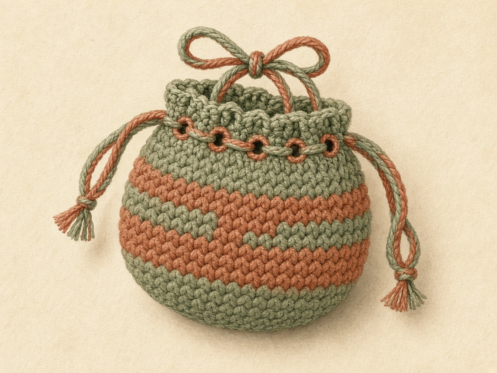
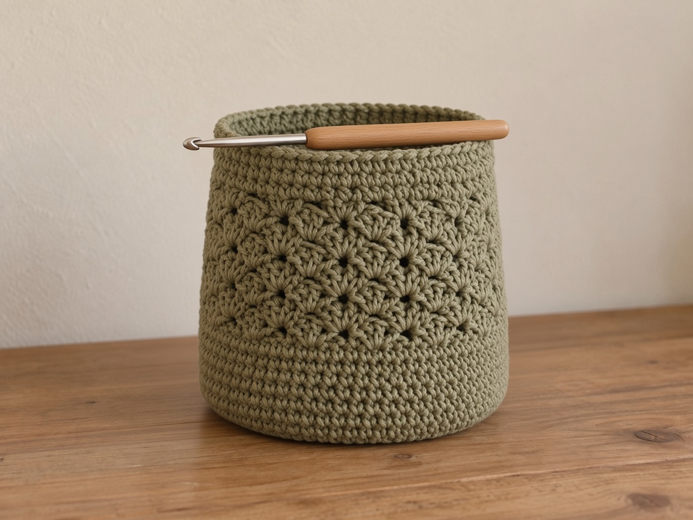
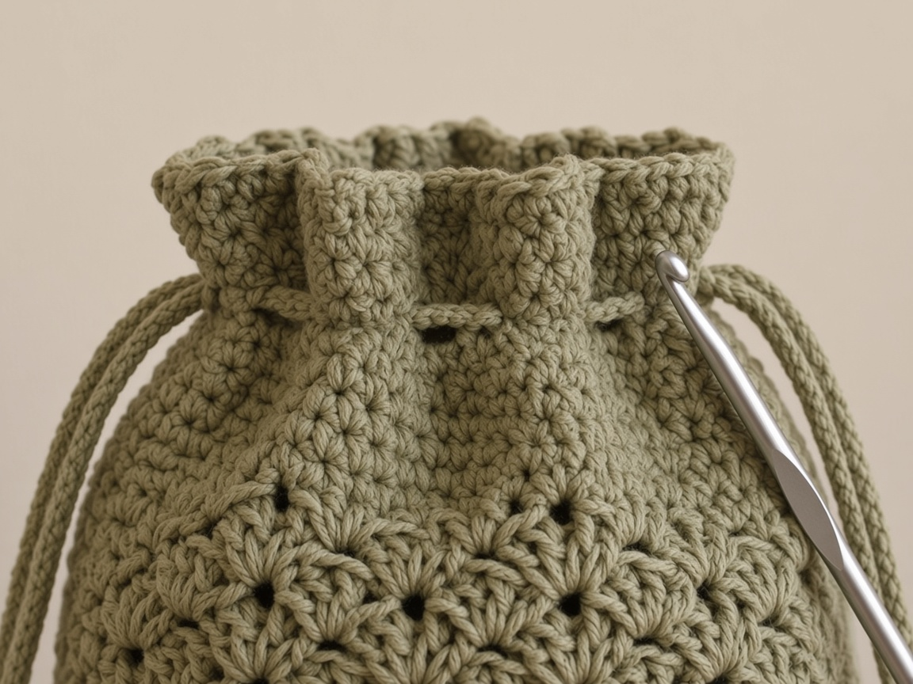
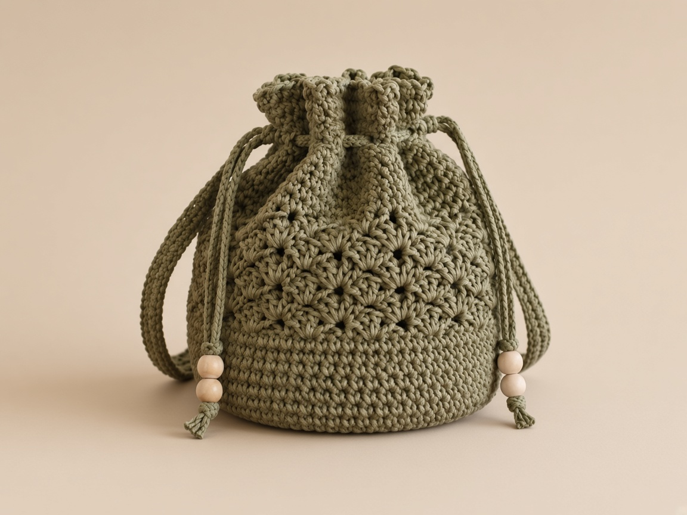

A drawstring bag is the same four pieces every time, whatever you are putting in it: a flat round base, a straight tube, one row of holes, and a cord. Learn it once at coin-pouch size and you can work it at candy-bag size, add a pumpkin belly, or swap a thin cord for a thick one, without a new pattern.

This page teaches the method and then shows three worked sizes so you can see the choices.

US terms throughout. US single crochet is UK double crochet. See the [abbreviations chart](/crochet-abbreviations-chart/) if a term is new. The inch figures are worked out from an example gauge, not from a finished bag, so swatch first and drop the real contents in before you fix the cord length.

If your opening gathers shut, this is your page. If instead you want a flat pouch that folds and seams with a drawstring across a straight top, that is the [makeup pouch](/how-to-crochet-a-makeup-pouch/). If you want a zipper rather than a cord, that is the [pumpkin zipper pouch](/how-to-crochet-a-pumpkin-zipper-pouch/).

## The method, start to finish

1. **A flat circle** grows from a magic ring, six stitches added every round, until it is as wide as you want the bottom.
2. **A straight tube** forms on its own the moment you stop increasing and work even rounds.
3. **An eyelet round** near the top makes the holes by chaining over skipped stitches.
4. **A cord** threads in and out of the holes; pulling both ends gathers the top shut.

Everything after that, a face, a stem, a belly, a thicker cord, is a variation on those four pieces.

## Shared setup: gauge and yarn

#### Use the first five rounds as the swatch

1. The counts below are at an example gauge of **4 single crochet and 5 rounds to the inch** in smooth worsted cotton on a US G/6 (4.0 mm) hook.
2. Your first five rounds of the base are your swatch. Measure across the flat circle and compare.
3. [Crochet gauge](/crochet-gauge/) explains the measuring.
4. Smooth cotton holds the round shape and does not grab wrappers the way a fuzzy acrylic does.
5. Pick a hook a size or two down from the label so the fabric is firm enough to stand up.
6. [Yarn weights](/yarn-weight-chart/) and the [hook chart](/crochet-hook-size-conversion-chart/) have the ranges.

The first five rounds are the swatch. If that circle is floppy, change hooks before you build a tube on it.

## How to measure the bottom before round 1

#### Decide the diameter from the thing that has to sit on it

1. The base is a circle, and the circle's width is the bottom of the bag.
2. Decide that width from the thing that has to sit on it, not from a wish to make a medium bag.
3. A coin wants a small circle. A handful of wrapped candy wants a wider one.
4. A pumpkin-shaped bag still starts from a flat bottom that can stand.
5. Put the object on a piece of paper and trace the footprint, or set a tape across the widest part of the bottom.
6. "Across" on this page means the diameter, the straight line through the center, not the distance around.

#### The two example circles belong to the example gauge

1. The coin-pouch example ends at round 5, 30 stitches, about 2.4 inches across.
2. The candy example runs to round 9, 54 stitches, about 4.3 inches across.
3. At 4 single crochet to the inch, 30 stitches is 7.5 inches around, and 7.5 divided by 3.14 is about 2.4 inches across.
4. Fifty-four stitches is 13.5 inches around, about 4.3 inches across.
5. Those two pairs belong to the example gauge.
6. If your swatch is not 4 stitches to the inch, a 30-stitch circle will not be 2.4 inches, and you should not stop at round 5 just because the coin pouch does.

| Stop | Stitches | Around at 4 sc to the inch | Across |
| --- | --- | --- | --- |
| Round 5 | 30 | 7.5 inches | about 2.4 inches |
| Round 9 | 54 | 13.5 inches | about 4.3 inches |

<figure class="diagram">

<figcaption>Diagram. Lay the circle on the real bottom. Flat and wide enough is ready. A ruffle or a bowl is not.</figcaption>
</figure>

#### Measure the five-round circle flat

1. Measure your swatch from the first five rounds, which the gauge section already tells you to do.
2. Lay that circle flat.
3. Do not measure it in your hand, where your fingers cup it and the number shrinks.
4. [Crochet gauge](/crochet-gauge/) is the longer version of that measuring.
5. Write stitches per inch on a card, next to the diameter you want.

A circle measured in your hand reads small. Your fingers cup it. Lay it on the table before you decide the base is wide enough.

#### Pick a count the eyelet round can divide

1. Small eyelets, single crochet, chain 1, skip 1, need an even number.
2. Large eyelets, single crochet 4, chain 2, skip 2, need a multiple of 6.
3. Thirty, 48, and 54 are the counts this page uses because they keep those options open.
4. If the diameter you want lands between them, choose the count that divides, not the count that is merely close.
5. A circle that is an eighth of an inch off and divides evenly will close.
6. A circle that is exact and does not divide will bunch the cord at one hole.

| Stitch count | Small holes (2 stitches each) | Large holes (6 stitches each) |
| --- | --- | --- |
| 30 | 15 holes | Does not divide |
| 48 | 24 holes | Divides |
| 54 | 27 holes | 9 holes |

#### A square box is the wrong footprint for this circle

1. If you are covering a square box rather than a round tin, a circle leaves the corners unsupported.
2. Set the box on the circle before you start the tube.
3. Corners hanging off the edge mean this round base is the wrong plan.
4. A folded rectangle, the method on the [device case guide](/how-to-crochet-a-device-case/), will cover a flat rigid object.
5. Forcing a square into a small circle makes the tube stretch at four points and the bag tips.

#### Write the hole count before you chain a cord

1. Write on the card: target diameter, stitch count you will stop on, whether the eyelets are the small repeat or the large one, and how many holes that repeat will make.
2. Thirty stitches and small eyelets make 15 holes.
3. Fifty-four and large eyelets make 9 holes.
4. Forty-eight and small eyelets make 24 holes.
5. Those are the counts already used in the worked sizes.
6. Knowing the hole count before you chain the cord tells you whether a missing hole is a mistake or the plan.

#### Change a floppy hook before round 1

1. Yarn and hook stay as in the shared setup: smooth worsted cotton, a hook that gives firm fabric, often a size or two below the label.
2. The ranges are on the [yarn weight chart](/yarn-weight-chart/) and the [hook chart](/crochet-hook-size-conversion-chart/).
3. A loose circle will not stand.
4. A bag that will not stand is the troubleshooting line about a cupped base, except the cup can also come from a loose fabric that collapses rather than from tight stitches.
5. If the swatch is floppy, change hooks before round 1.
6. Ripping a floppy tube after the eyelets are in is a long job.

## Stage 1: the base, sized to the bottom you want

Work in a spiral without joining, and move a stitch marker up into the first stitch of each round. [Working in the round](/crochet-in-the-round/) covers spirals.

**Round 1:** 6 sc in a magic ring. (6)

<figure class="diagram">

<figcaption>Diagram. The magic ring closes the center so nothing falls out of the bottom.</figcaption>
</figure>

Each round adds six, with one more plain stitch between the increases each time:

**Round 2:** 2 sc in each stitch. (12)
**Round 3:** (sc, 2 sc in next) 6 times. (18)
**Round 4:** (sc 2, 2 sc in next) 6 times. (24)
**Round 5:** (sc 3, 2 sc in next) 6 times. (30)
**Round 6:** (sc 4, 2 sc in next) 6 times. (36)
**Round 7:** (sc 5, 2 sc in next) 6 times. (42)
**Round 8:** (sc 6, 2 sc in next) 6 times. (48)
**Round 9:** (sc 7, 2 sc in next) 6 times. (54)

<figure class="diagram">

<figcaption>Diagram. Stop when the circle is as wide as the bottom you want. The stitch count you land on is the count the whole tube and the eyelet round work from.</figcaption>
</figure>

#### Stop where your bag wants to stop

1. A small coin pouch ends the base at round 5 (30 stitches, about 2.4 in across).
2. A candy bag runs to round 9 (54 stitches, about 4.3 in across).
3. Lay the circle flat each time you add a round.
4. Flat is right.
5. A ruffle means too many increases.
6. A bowl means the ring or your stitches are too tight, which makes the finished bag tip over.

| What the circle does on the table | What it means |
| --- | --- |
| Lies flat and matches the bottom | Stop increasing. This count is the tube. |
| Ruffles | Too many increases. Rip one round. |
| Cups into a bowl | The ring or rounds 1 to 5 are tight. Loosen them. |

End the base on a count the eyelet round can divide. Small eyelets (two stitches each) need an even number. Large eyelets (six stitches each) need a multiple of six, like 48 or 54. Choosing 30, 48, or 54 keeps both options open.

## How to keep the count in a spiral

#### The marker is the seam

1. A spiral has no seam to tell you where the round started. The stitch marker is that seam.
2. Put it in the first stitch of round 1.
3. Move it up into the first stitch of every new round before you work the second stitch.
4. If you wait until the end of the round, you will not know whether the increase you just made was the sixth or the seventh.

[Working in the round](/crochet-in-the-round/) covers the spiral itself. The counts on this page are the standard six-increase circle:

1. Round 1 is 6. Round 2 is 12. Round 3 is 18. Round 4 is 24. Round 5 is 30.
2. Round 6 is 36. Round 7 is 42. Round 8 is 48. Round 9 is 54.
3. Each round adds six, and the number of plain stitches between increases goes up by one: none, then one, then two, and so on.
4. If your marker round is not one of those numbers, an increase was skipped or doubled.

<figure class="diagram">

<figcaption>Diagram. The marker starts the round. Each increase round adds six. Even rounds keep the count the eyelets will use.</figcaption>
</figure>

#### Count six increases before you leave the round

1. Count at the marker, every round, while the base is still growing.
2. Six increases are easy to see if you place a second, temporary marker in each increase as you make it, then pull those out at the end of the round after you have seen six of them.
3. On round 5 the repeat is single crochet 3, then 2 single crochet in the next, six times.
4. If you only find five increases, the count is 29, not 30, and the small eyelet round will not divide.
5. Do not add one somewhere on the next round to fudge it.
6. That extra stitch makes a lump, and the following round's repeat will not land.
7. Rip back to the marker and work the round again.

| Increases you can find | Count | What the eyelets will do |
| --- | --- | --- |
| 5 on a round that should add 6 | 29 instead of 30 | The small repeat will not divide |
| 6 | The number in the round list | The next round's repeat can land |
| 7 | One over | The edge ruffles. Rip the round. |

A 29-stitch round will not take the small eyelet repeat. Adding one stitch "somewhere" on the next round leaves a lump and throws the repeat after it. Rip back to the marker.

### What a missed increase and an extra increase look like

#### A missed increase sands one side flat

1. A missed increase leaves a flat spot on an otherwise round edge.
2. The circle looks like a coin with one side sanded straight.
3. Later, the tube rises with a narrow panel there, and the eyelet over that panel sits closer to its neighbor.
4. You will think the cord is bunching because of the holes.
5. The holes are only reporting the short count underneath.

#### An extra increase waves the edge

1. An extra increase waves the edge.
2. The circle ruffles, it will not lie under a book, and the finished bag will not sit flat.
3. A ruffle means too many increases.
4. Rip the last increase round.
5. Do not skip increases for several rounds to use up the extra stitches.
6. Skipping makes a bowl on top of a ruffle. You get a wavy disk that also cups.

#### A tight ring cups the base into a bowl

1. A tight magic ring, or tight stitches in rounds 1 to 5, cups the base into a bowl before you meant to shape anything.
2. The bag tips.
3. Loosen those rounds.
4. The ring should close the hole when you pull the tail, and the fabric around it should still lie flat.
5. Pulling the tail until the center puckers is too far.
6. Ease it until the hole is shut and the first round is flat.
7. [Increases and decreases](/crochet-increase-decrease/) shows what an increase looks like in the stitch if you are not sure you worked two into one.

Close the center hole. Stop pulling when the first round still lies flat. A puckered center is what tips the finished bag.

### When the marker falls out

#### Count before you invent a new start

1. It will fall out. Before you invent a new start, count the stitches you have and divide by the round you think you are on.
2. If you count 30 and you meant to be on round 5, you are at the end of round 5 or the start of the even work, and you can put the marker in the next stitch you would have called the first.
3. If you count 33, you are in the middle of a bad round. Do not keep going.
4. Count back along the repeats until you find a complete round of 30, or 24, or whichever number is still a clean six-increase total, and rip to there.

| Count in your hand | Where you are |
| --- | --- |
| 30, and you meant to finish round 5 | End of round 5, or the start of even work. Mark the next first stitch. |
| 24, 36, 42, 48, or 54 | A clean six-increase total. You can mark a new start. |
| 33, or any number that is not on the list | Middle of a bad round. Rip to the last clean total. |

#### Write the round number on the card

1. Write the round number on the card when you stop for the day.
2. "Base done at 48" is more useful than a marker you will knock out when you put the bag in a project bag.
3. The even rounds that follow do not change the count.
4. Say the count out loud at the end of the first even round, and again every few rounds.
5. The coin pouch holds 30 for ten even rounds.
6. The candy bag holds 54 for about 23 even rounds.
7. That is a long time to assume you have not skipped a stitch.
8. A skipped stitch in the tube is a hole a small item can fall through, which is its own troubleshooting line.
9. Single crochet is the stitch that keeps the wall tight.
10. A taller stitch opens gaps.
11. If you switch to double crochet because the tube feels slow, you have left this pattern.
12. US double crochet is the tall stitch, not the UK name for single crochet.
13. Check the [abbreviations chart](/crochet-abbreviations-chart/) before you change stitches.

US double crochet is the tall stitch. It opens gaps a small item can fall through. This tube is single crochet. The [abbreviations chart](/crochet-abbreviations-chart/) is the US and UK table if the names have crossed.

### Even rounds and the height check

#### Stop increasing only when the circle matches and the count divides

1. Stop increasing when the circle matches the bottom and the count divides.
2. The tube is single crochet in each stitch, same count, until the wall is tall enough.
3. Drop the real contents in every few rounds.
4. They need to sit below the holes, with fabric left above them to gather.
5. If the contents already touch the round where you planned the eyelets, work more even rounds before the eyelet round.
6. Do not put the holes down at the level of the contents and hope the cord will close over them. It will not.

#### Measure the wall, not only the diameter

1. The candy bag's about 4.6 inches of height matches about 23 even rounds at 5 rounds to the inch.
2. That 4.6 is the wall, not the diameter.
3. If your row gauge is 6 rounds to the inch, 23 rounds is shorter than 4.6 inches.
4. Measure the wall flat, the same way you measure a swatch, and compare it with the contents.
5. The round count is a plan. The contents are the test.

About 23 even rounds is 4.6 inches of wall only at 5 rounds to the inch. At 6 rounds to the inch the same 23 rounds are shorter. Stand the contents in the tube and look.

#### A belly leaves and comes back to the neck count

1. A belly, if you want one, is six increases in one round and six decreases later, back to the neck count.
2. For a 48-stitch neck the increase round is single crochet 7, 2 single crochet in the next, six times, to 54.
3. The decrease round is single crochet 7, single crochet two together, six times, back to 48.
4. Count 54 in the middle and 48 after the decrease before you start the eyelets.
5. A belly that never returns to 48 makes the eyelet math of the neck wrong.
6. The pumpkin worked size uses three even rounds at 48, the increase to 54, four even rounds at 54, the decrease to 48, then three even rounds at 48 before the eyelets.
7. If your counts at those checkpoints are anything else, stop and fix the round you are on.
8. Do not start the eyelet round on 50 or 52 and try to skip stitches until it comes out even.

| Checkpoint | Count |
| --- | --- |
| Neck before the belly | 48 |
| After (sc 7, 2 sc in next) 6 times | 54 |
| After (sc 7, sc2tog) 6 times | 48 |
| Eyelet round started on 50 or 52 | Wrong. Do not skip stitches to force it even. |

## Stage 2: the tube

**Even rounds:** Single crochet in each stitch, the same count every round, until the wall is as tall as you need. The fabric turns up into a tube by itself once the increases stop.

<figure class="diagram">

<figcaption>Diagram. The coin-pouch profile: a short base, ten even rounds of tube, then the eyelet round and a short frill above it.</figcaption>
</figure>

#### Leave fabric above the contents

1. Drop the real contents in every few rounds.
2. Stop when they sit well below where the holes will go.
3. The cord needs fabric above the contents to gather, or the bag will not close over a full load.

### Optional: shape a belly without starting over

#### Six out, then six back

1. You can widen a straight tube in the middle and bring it back in, which is how a plain orange cylinder becomes a pumpkin.
2. Work one round of six evenly spaced increases where you want the belly to start.
3. Work some even rounds.
4. Then work one round of six evenly spaced decreases to return to the neck count.

<figure class="diagram">

<figcaption>Diagram. Six stitches out, six stitches back in. Keep the belly gentle so the bag still stands when it is full.</figcaption>
</figure>

#### The 48-stitch neck, written out

1. For a 48-stitch neck: at the belly, **(sc 7, 2 sc in next) 6 times** widens to 54.
2. Work the belly rounds.
3. Then **(sc 7, sc2tog) 6 times** brings it back to 48.
4. The same move shapes a vase, a bottle cozy, or a toy body.
5. Keep the belly gentle so the bag still stands when it is full. On this profile the belly is about a quarter inch wider on each side.

## Stage 3: the eyelet round

#### The chain is what keeps the round the same length

1. The eyelet round repeats one idea: single crochet into some stitches, then chain over a skipped stitch or two.
2. The chain bridges the gap so the round keeps its length, and the opening under each chain is a hole.
3. The repeat must divide evenly into your stitch count, or the last hole lands short and the cord bunches there.

<figure class="diagram">

<figcaption>Diagram. Small close holes gather tightly and take a thin cord. Large spaced holes take a thick cord and close in fewer, deeper folds.</figcaption>
</figure>

#### Pick the hole size that divides

1. **Small holes:** (sc, ch 1, skip 1) all the way around. Each repeat is two stitches, so the count must be even. Thirty stitches make fifteen holes.
2. **Large holes:** (sc 4, ch 2, skip 2) around. Each repeat is six stitches, so the count must be a multiple of six. Fifty-four stitches make nine holes.
3. On 54 stitches, the small repeat makes 27 small holes for a thin chain cord and many small gathers.
4. The large repeat, nine times, makes 9 larger holes 1.5 inches apart for a thicker cord and fewer, deeper folds.

#### Restore every skipped stitch, then work the frill

1. After the eyelet round, work one round putting 1 sc into each single crochet and 1 sc into each ch-1 space, or 2 sc into each ch-2 space, to restore the full count.
2. Then work one or two plain rounds.
3. That short frill above the holes stops the cord riding up over the top edge when you pull it.

| Eyelet | Restore | Back to |
| --- | --- | --- |
| ch-1 space | 1 sc in the space | The tube count |
| ch-2 space | 2 sc in the space | 54, on the large-hole example |
| 1 sc in a ch-2 space | Short | 45 on 54 stitches, and the rim narrows |

## What a failed eyelet round looks like, and how to fix it before the cord

Count the holes before you cut a cord. A cord threaded through a bad round has to come out again, and it packs the yarn into the chain spaces so the round is harder to rip.

<figure class="diagram">

<figcaption>Diagram. Even holes mean the repeat divided. A short last gap means rip the eyelet round. Restore every skipped stitch on the next round.</figcaption>
</figure>

#### The last gap is a slit, not a hole like the others

1. You ran out of stitches before the repeat finished.
2. The count did not divide by two for small holes, or by six for large holes.
3. The cord will slide freely until that slit, then bunch.
4. Rip the eyelet round back to the marker.
5. Do not skip a stitch on the next plain round to absorb the error. The error is in the eyelet round.
6. Put the marker in, count the tube one more time, and work the repeat only if the count divides.
7. If it does not, you are on the wrong count for this closure.
8. Either work even rounds that increase or decrease by the few stitches you need to land on 30, 48, or 54, spaced evenly, and count again, or choose the other eyelet size if the count allows it.
9. Thirty accepts small holes and not large ones.
10. Fifty-four accepts both. Forty-eight accepts both.
11. Twenty-seven, which shows up on the [device case](/how-to-crochet-a-device-case/) earbud tube, does not accept an even eyelet repeat until you add three stitches to reach 30.

A short last gap is where the cord bunches. Rip that eyelet round. Do not skip a stitch on the next plain round to hide it.

#### A skip with no chain over it

1. You have the right number of holes, but one hole is a single crochet with a gap beside it and no chain over the gap.
2. The skip happened and the chain did not.
3. The round is short by that chain, the next round will pucker, and the cord may not pass.
4. Rip back to that hole and chain over the skip.
5. The chain is what keeps the round the same length as the tube.

#### The holes are even, and the next round narrowed the rim

1. This is the restore mistake.
2. On 54 stitches the large-hole round is nine repeats of single crochet 4, chain 2, skip 2.
3. The next round wants 4 single crochet in those 4 single crochet, and 2 single crochet in each chain-2 space.
4. That is 6 stitches per repeat, times 9, which is 54.
5. One single crochet in the chain-2 space is 5 per repeat, times 9, which is 45.
6. The rim draws in, the bag will not open to the width of the tube, and contents that fit the belly will not come out.
7. Count the restore round before you work the frill.
8. If you have 45, rip it and put 2 single crochet in each chain-2 space.

| Restore on 54 large holes | Stitches per repeat | Round count |
| --- | --- | --- |
| 4 sc in the 4 sc, plus 2 sc in the ch-2 space | 6 | 54 |
| 4 sc in the 4 sc, plus 1 sc in the ch-2 space | 5 | 45, and the rim narrows |

#### The small-hole restore is one stitch in the space

1. On the small-hole round, 30 stitches become 15 single crochet and 15 chain-1 spaces.
2. The next round is 1 single crochet in each single crochet and 1 single crochet in each chain-1 space, back to 30.
3. Skipping the space drops you to 15 and closes the bag by accident.
4. The same rule at 48 stitches is 24 holes and a return to 48.
5. At 54 with small holes, the spacing is 27 holes and a return to 54.
6. Whichever pair you used, the restore round matches the tube count you wrote on the card.
7. If it does not, you are not ready for the frill or the cord.

#### The frill is missing and the cord rides over the top edge

1. The eyelet round was the last round.
2. When you pull, the cord climbs out of the holes.
3. Work the restore round and one or two plain rounds above it before you thread anything.
4. If you already threaded, pull the cord out, work those rounds, and thread again.
5. A cord left in while you try to crochet the frill will be caught under stitches.

#### An odd number of holes is a missed repeat

1. Sometimes a second pass through the starting hole is what brings both ends to the outside.
2. That second pass is not a substitute for a round that failed to divide.
3. If you count 14 holes on a 30-stitch bag, you missed a repeat. Find it.
4. Do not hide it with an extra pass of cord.

#### Join a new ball away from the holes

1. Join a new ball before the eyelet round or after the frill, not in the middle of a chain space.
2. A knot inside a hole blocks the cord.
3. [Weaving in ends](/weaving-in-ends-and-blocking/) is where the tails go: along the wrong side, above or below the holes, not across them.

## Stage 4: the cord

<figure class="diagram">

<figcaption>Diagram. The cord goes through the eyelets.</figcaption>
</figure>

#### Measure the opening, then add both tails

1. The cord goes once around the opening and leaves two tails to tie.
2. Measure the opening circumference and add about 4 inches per tail.
3. A 7.5-inch opening wants roughly 7.5 + 4 + 4 = 15.5 inches.

#### Make a cord that will not stretch open

1. **A chain cord** is quickest. Chain to length, then slip stitch back along the chain so it cannot stretch open every time you pull it.
2. **A twisted cord** is rounder, firmer, and easier for small hands. Cut two strands about three times the finished length, knot the ends, twist one end until the strands kink, then fold in half and let them ply around each other. Knot and trim.
3. Thread the cord in and out of the holes with a yarn needle, starting and finishing at the front so the bow sits where you want it, and knot each end so it cannot pull back through.

## What a failed cord looks like, and how to correct it before you trim

#### Do not cut every cord to 15.5 inches

1. Measure the opening, then the cord.
2. The example is a 7.5 inch opening plus about 4 inches for each tail: 7.5 + 4 + 4 = 15.5 inches.
3. That 7.5 inch opening is the distance around, which is what 30 stitches gives at 4 single crochet to the inch.
4. A 54-stitch opening is longer around. Measure the one you have.
5. Do not cut every cord to 15.5 inches because that is the number written next to the small pouch.

<figure class="diagram">

<figcaption>Diagram. Both tails come out at the front. A cord that is too thick, or a bare chain, will not hold the gather.</figcaption>
</figure>

#### The cord stops halfway around

1. It is thicker than the hole.
2. Forcing it with pliers frays the yarn and can split a chain. Pull it back out before it locks.
3. Either work the large eyelet, chain 2 over two skipped stitches, or make a thinner cord.
4. Do not enlarge one hole with your fingers. That hole then gapes and the gather is uneven.
5. The candy bag uses the large holes and a thick twisted cord on purpose, so a child's hand can pull it.
6. The coin pouch uses small holes and a thin chain. Match the pair.
7. A thick cord in the coin pouch's 15 small holes is this failure.

Do not stretch one hole with your fingers. That hole gapes, the gather goes uneven, and the yarn can split. Change the cord or the eyelet size instead.

#### The top closes, then opens again by itself

1. The cord is a bare chain.
2. Each pull lengthens the chain, the tails get shorter, and the gather relaxes.
3. Slip stitch back along the chain so it cannot stretch open, or replace it with a twisted cord.
4. A twisted cord uses two strands about three times the finished length, knotted, twisted until they kink, then folded so they ply.
5. If you cut those strands at the finished length instead of three times that length, the ply runs out before the cord is long enough. Cut again.
6. Knot the finished ends so they cannot pull back through a hole.
7. Trim only after you have gathered the bag once with the contents in and seen that the tails are still long enough to tie.

#### Both tails come out at the back, or one tail is inside

1. You started at the wrong hole, or you did not come back to the outside.
2. The bow should sit at the front.
3. Pull the cord out and thread again, in and out, starting and finishing at the front.
4. An odd hole count may need a second pass through the first hole so both ends are outside.
5. That second pass is a threading choice. It is not a reason to skip a hole in the middle.

#### The bag will not close over a full load

1. The contents already fill the tube up to the holes.
2. The cord gathers fabric, and there is no fabric left above the load.
3. Work more even rounds before the eyelet round on the next bag.
4. On this one, if you have not cut the yarn, add the rounds below the eyelet by ripping back to the last even round and continuing.
5. If the frill and the cord are already in, you cannot shove extra rounds under the holes without ripping the eyelet round.
6. Empty the bag and use it for less, or rip back to the tube and rebuild the top.
7. Packing harder will not create the missing wall.

#### The gather is tight on one side and loose on the other

1. Count the holes.
2. A missing hole, or a hole that is only a skip with no chain, stalls the cord on that side.
3. Fix the round.
4. Do not tie the bow tighter to compensate.
5. The tight side will pucker and the loose side will spill.

#### You trimmed the tails, and now they pull through

1. The knots were too small, or you trimmed before the first real gather.
2. Thread a new cord.
3. A dab of glue on the yarn is not a fix this page uses, and it gums the hole for the next cord.
4. Knot, gather with the contents in, then trim so a small knot remains.

#### A cord is not a necklace

1. Do not put it around a child's neck.
2. The thick cord through large eyelets is the one for a child's bag because it is easier to grip. It is still a cord.
3. The bag is also not a food-safe container and not waterproof.
4. Wrapped candy is what the candy size is planned around.
5. Crumbs and moisture go through single crochet.

## Three worked sizes

#### Coin pouch

1. Base to round 5 (30 stitches).
2. Ten even rounds.
3. Small eyelets (15 holes).
4. A thin chain cord, and a small embroidered face.
5. About 2.4 inches across.
6. The full-size walkthrough with the eyelet close-up is in the earlier sections. This is the smallest useful version.

#### Candy bag

1. Base to round 9 (54 stitches).
2. About 23 even rounds.
3. Large eyelets (9 holes).
4. A thick twisted cord, and two embroidered eyes.
5. About 4.3 inches across and 4.6 inches tall.
6. The larger holes and thick cord are easier for a child to pull.

<figure class="diagram">

<figcaption>Diagram. The candy bag's nine large eyelets, spaced six stitches apart around a 54-stitch tube.</figcaption>
</figure>

#### Pumpkin treat bag

1. Base to round 8 (48 stitches).
2. A belly widened to 54 and brought back to 48.
3. Small eyelets (24 holes), a chain cord, and a short green stem sewn beside the rim.
4. For the 48-stitch version, work three even rounds at 48, the increase round to 54, four even rounds at 54, the decrease round to 48, then three even rounds at 48 before the eyelets.
5. The belly is the optional shaping from Stage 2.

<figure class="diagram">

<figcaption>Diagram. The pumpkin's belly: six spaced increases to 54, even rounds, then six spaced decreases back to 48.</figcaption>
</figure>

#### Embroider after you have found the front

1. Embroider the face after you have gathered the top once to find the front.
2. Keep the stitches shallow so contents do not catch on lumps inside.
3. A stem is 5 sc in a magic ring worked as a short tube and sewn between two eyelets, not through one.

Sewing a stem through one eyelet closes that hole. Sew it between two eyelets. The cord still has to pass.

## Restore every skipped stitch after the eyelets

#### Count the restore before you thread

1. At fifty-four stitches, the large-hole round has nine repeats: sc 4, ch 2, skip 2.
2. The next round must make four sc in the four sc and two sc in the ch-2 space for each repeat, returning to fifty-four.
3. One sc in that space would reduce the round to forty-five and narrow the rim.
4. For the small-hole version, thirty positions become fifteen sc and fifteen ch-1 spaces, then thirty sc again.
5. Before threading a cord, count the holes and check the packed bag has fabric above the contents to gather.
6. An odd number of holes may need a second pass through the starting eyelet to return both cord ends to the outside.

#### Run the empty check, then the full check

1. Before you weave the last ends, run the checklist once with the bag empty and once with the contents in it.
2. The empty check is the counts: base stitches, tube stitches, number of holes, restore round back to that same number, two tails outside at the front.
3. The full check is whether fabric remains above the load so the cord can gather.
4. If either check fails, fix that round before the ends are woven through it.
5. A tail woven through a bad eyelet round has to be pulled out before you can rip, and it is easy to cut a stitch while you do.

## Troubleshooting

**One spot will not gather.** A missing hole: the count did not divide by the repeat, or a repeat was skipped. Count the holes before you cord it.

**The cord will not pass through.** The cord is thicker than the holes. Use larger (ch-2) eyelets, or a thinner cord.

**The cord stretches and the top reopens.** A bare chain cord. Slip stitch back along it, or use a twisted cord.

**The bag tips over.** The base cupped instead of lying flat. Rework rounds 1 to 5 more loosely.

**A small item falls through the side.** A stitch was skipped in the tube, or the fabric is a taller stitch than single crochet, which leaves gaps.

## Care

#### Wash empty, dry flat, do not hang it by the cord

1. Empty it and shake out any wrappers or crumbs.
2. Hand wash cool and dry flat, pushing a shaped bag back into its form.
3. Keep cotton out of the dryer. It can shrink enough to stiffen the drawstring.
4. If a wash tightens the holes around the cord, do not cut a stitch to widen them. A cut loop unravels.
5. Pull the cord out, work a thinner cord, and thread it again.
6. If the base no longer sits flat after drying, you blocked it hanging, or the dryer heat got to it anyway.
7. Ease the circle flat with your hands while it is still damp, then leave it on the table until it is dry.
8. Do not hang the bag by the cord to dry. The cord is the piece that stretches, and a wet cord stretches more.

A cut stitch in an eyelet unravels. If the cord is tight after a wash, replace the cord. Do not cut the hole larger.

#### Left-handed work uses the same counts

1. A left-handed spiral uses the same counts.
2. The hook travels the other direction, and the front where the cord tails come out is whichever side you decide is the front after you gather it once.
3. The increases are still six, the eyelet repeat still has to divide, and the restore round still returns the same number.
4. [Left-handed crochet](/left-handed-crochet/) covers holding the hook.
5. It does not change round 5 from 30, round 8 from 48, or round 9 from 54.

## Frequently asked

### How do I make it bigger or smaller?

1. Change where you stop the base.
2. A wider base needs more increase rounds. A narrower one needs fewer.
3. Everything downstream works from whatever count you land on.
4. Stop on a count the eyelet round can divide: an even number for small holes, a multiple of six for large holes.
5. Thirty, 48, and 54 are the counts this page keeps using because they do.
6. A circle that is the right diameter and will not divide is the wrong place to stop.
7. Work one more increase round, or stop one round earlier, and measure the flat circle against the real bottom.

### Which cord for a child's bag?

1. The thick twisted cord through large eyelets. It grips better and does not cut into small fingers.
2. Knot the ends, and never put a cord around a child's neck.
3. The candy size is the one with nine large holes on 54 stitches.
4. The coin pouch's fifteen small holes and thin chain are a poor match for small hands.
5. A cord is still a cord. Do not lengthen it into a strap that goes over a shoulder and around a neck.
6. A shoulder strap is the [strap bag](/how-to-crochet-a-strap-bag/), and that page has its own warning about loops and children.

### Can I sell what I make?

Finished bags, yes. Do not republish these instructions as your own pattern.

### What if my gauge is not 4 stitches and 5 rounds to the inch?

1. The inch labels move.
2. Thirty stitches is about 2.4 inches across only at 4 single crochet to the inch, because 30 stitches is 7.5 inches around and that circumference is about 2.4 inches across.
3. At a looser gauge the same 30 stitches make a wider pouch.
4. At a tighter gauge they make a smaller one.
5. Measure the flat circle and compare it with the bottom you want.
6. Do not stop at round 5 because the coin pouch does, if your circle is still smaller than the coins.
7. [Crochet gauge](/crochet-gauge/) is how to measure the swatch.
8. The stitch repeats stay the same. The inches are what change.

### Why does the last hole look shorter than the others?

1. The repeat did not divide into the stitch count, or you skipped a chain.
2. Small holes need an even count. Large holes need a multiple of six.
3. Rip the eyelet round, count the tube at the marker, and work the repeat only when it divides.
4. A short last gap is where the cord bunches.
5. Adding a random chain at the end of the round to finish the hole changes the length of the round and the restore count.
6. Fix the tube count first.

### I put one single crochet in each chain-2 space and the rim got small. Is that right?

1. No. On 54 stitches, each large-hole repeat is 4 single crochet and a chain 2.
2. The next round needs 4 single crochet in the 4 single crochet and 2 single crochet in the chain-2 space, nine times, back to 54.
3. One single crochet in the space makes 45.
4. The rim narrows and a full bag will not empty.
5. Rip that round before you thread the cord.
6. The small-hole version puts 1 single crochet in the chain-1 space, not 2, and that is what returns 30, 48, or 54 to itself.
7. The two restores are not interchangeable.

| Space | Stitches that restore the count |
| --- | --- |
| ch-2, on the 54-stitch large holes | 2 sc in the space, with the 4 sc beside it, nine times, back to 54 |
| 1 sc in that ch-2 space | 45, and the rim narrows |
| ch-1, on the small holes | 1 sc in the space, which returns 30, 48, or 54 to itself |

### Can I start the eyelet round on 27 stitches?

1. Not with the repeats on this page.
2. Twenty-seven is odd, so the small repeat will not divide, and it is not a multiple of six, so the large repeat will not either.
3. The device-case pouch that lands on 27 adds three stitches, (single crochet 8, increase) three times, to reach 30, then uses fifteen small eyelets.
4. Do that before the eyelet round, count 30, and then work the holes.
5. Do not skip stitches inside the eyelet round to force the repeat.

### How do I know the base is flat enough to stop?

1. Lay it on the table.
2. A flat circle that matches the bottom you measured is ready for even rounds.
3. A wavy edge is too many increases. Rip the last increase round.
4. A bowl is a tight ring or tight early stitches. Rework rounds 1 to 5 more loosely.
5. Pull the magic-ring tail until the center hole closes and the first round still lies flat.
6. A puckered center is what tips the finished bag.
7. The coin example is about 2.4 inches across at round 5.
8. The candy example is about 4.3 inches across at round 9.
9. Your swatch decides whether those rounds are those inches.

### The marker fell out in the middle of the tube. Where is the start?

1. Count the stitches.
2. If you have exactly 30, or 48, or 54, you are on an even round of a known size, and the next stitch can hold the marker.
3. If the count is off by one or two, do not keep the spiral going.
4. Look back for the last complete round that matches a six-increase total, or the even count you wrote down, and rip to it.
5. A skipped stitch in the wall is a gap a small item can fall through.
6. Single crochet is what keeps that wall tight.
7. US double crochet is a taller stitch and leaves holes this bag is not planned around.
8. The [abbreviations chart](/crochet-abbreviations-chart/) is the US and UK table if the names have crossed.

### How long is the cord on a bag that is not the 7.5 inch opening?

1. Measure around the opening you actually have, then add about 4 inches for each tail.
2. The 15.5 inch figure is 7.5 + 4 + 4, and 7.5 inches is the 30-stitch circumference at 4 stitches to the inch.
3. A 54-stitch tube is longer around.
4. Cut to the measurement, gather once with the contents inside, and only then trim the knots.
5. A bare chain needs a slip stitch back along it or it will stretch and the top will reopen.
6. A twisted cord starts from strands about three times the finished length.

### Can I embroider the face before the cord is in?

1. Wait until you have gathered the top once and found the front, which is where the tails come out.
2. A face sewn on the back, or across an eyelet, is in the wrong place, and stitches through a hole block the cord.
3. Keep the embroidery shallow so the inside stays smooth.
4. A stem, on the pumpkin size, is 5 single crochet in a magic ring worked as a short tube, sewn between two eyelets, not through one.
5. Sewing it through a hole closes that hole.

### What if I want a zipper or a flat fold instead?

1. A zipper is the [pumpkin zipper pouch](/how-to-crochet-a-pumpkin-zipper-pouch/).
2. A flat pouch that folds and seams, with a drawstring across a straight top, is the [makeup pouch](/how-to-crochet-a-makeup-pouch/).
3. This page is the round base, the straight tube, one eyelet round, and a cord.
4. Mixing a zipper into the eyelet round means the holes and the zipper are fighting for the same edge.
5. Pick one closure before you work the top.

### Does the belly change the eyelet count?

1. Only if you forget to decrease.
2. The pumpkin neck is 48. The belly goes to 54 and comes back to 48 before the holes.
3. Small eyelets on 48 make 24 holes.
4. If you leave the bag at 54, you are on the candy-bag count, and the large-hole repeat makes 9 holes instead.
5. Count 48 after the decrease round, (single crochet 7, single crochet two together) six times, before you start the eyelets.
6. The worked pumpkin sequence is three even rounds at 48, the increase, four even rounds at 54, the decrease, three even rounds at 48, then the holes.
7. Those checkpoints are where you catch a missed increase.

### Can I wash it, and will the cord shrink shut?

1. Empty it first.
2. Hand wash cool and dry flat, pushing a shaped bag back into its round.
3. Keep cotton out of the dryer.
4. Heat can shrink the fabric enough to stiffen the drawstring and to make a cord that used to slide sit tight in the holes.
5. If a cord is already tight after a wash, replace it with a slightly thinner one.
6. Do not cut the holes larger. A cut stitch runs.

### Where do I join a new ball of yarn?

1. At the side of an even round, not in a chain space and not in the middle of the front where you will embroider.
2. A knot inside a hole stops the cord.
3. Leave a tail long enough to weave along the wrong side, above or below the eyelet round, not across the holes.
4. [Weaving in ends](/weaving-in-ends-and-blocking/) is the method.
5. Weave after you have counted the holes and restored the stitch count, so you are not weaving a tail through a round you still might rip.

## Next

For a flat pouch that folds and seams instead of working in the round, see the [makeup pouch](/how-to-crochet-a-makeup-pouch/). For a firm case rather than a soft bag, the [device case guide](/how-to-crochet-a-device-case/) covers folded sleeves and round pouches with flaps. If spirals still feel new, start with [crochet in the round](/crochet-in-the-round/).
