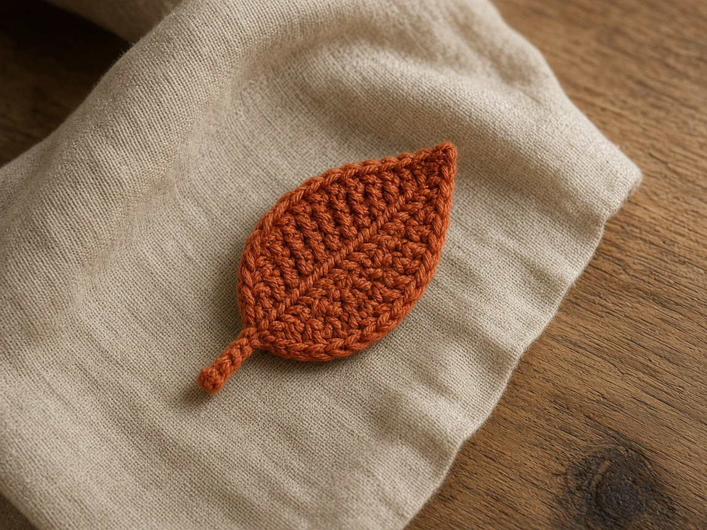

A fall leaf is a small flat appliqué. Sew it to a [pumpkin](/how-to-crochet-a-pumpkin-step-by-step/), a [treat bag](/how-to-crochet-a-pumpkin-treat-bag/), or a [mug cozy](/crochet-mug-cozy-for-beginners/), or string a few into a garland.

It also teaches a technique that shows up in a lot of motifs: **shaping with stitch height alone.** There are no increases or decreases. You chain a short line, then work one row of stitches up one side of the chain and back down the other. Short stitches at the ends and tall stitches in the middle make a pointed oval. Change the order of heights and you change the shape.

US terms. US single crochet is UK double crochet, and US double crochet is UK treble. [Abbreviations](/crochet-abbreviations-chart/). The pictures are illustrations of the finished leaf, and the inch sizes come from gauge, so measure as you go.

## How the shape works

<figure class="diagram">

<figcaption>Heights rise and fall along each side of the chain. Three stitches in the end chain turn the corner and make the tip.</figcaption>
</figure>

Each stitch height is roughly a step: a single crochet is short, a half double is taller, a double taller again. Laid along a chain, they make a curve. Work the same curve on the other side of the chain and you get a symmetrical leaf. Three stitches crowded into the end chain turn the work around the corner and make the point.

## What you need

- **Worsted-weight yarn** in rust, gold, or olive, plus a scrap of brown or green for the stem if you want contrast. [Yarn weights](/yarn-weight-chart/).
- **US G/6 (4.0 mm) hook.** A smaller hook makes a neater, smaller leaf. [Hook chart](/crochet-hook-size-conversion-chart/).
- Yarn needle.

Gauge does not change the shape, only the size. For a matching set, make one leaf, then copy the hook and the chain tension.

## The small leaf

Work along one side of the chain, around the tip, and back along the other side. Do not turn.

**Chain 9.**

**First side.** Starting in the 2nd chain from the hook: sc, hdc, dc in each of the next 4 chains, hdc, sc. (8)

That uses 8 chains: 1 + 1 + 4 + 1 + 1 = 8. The chain closest to the hook is skipped, and the last stitch lands in the first chain you made. That first chain is the tip.

**Tip.** Work 2 more sc into that same chain, so it holds 3 sc. (10 so far)

**Return side.** Rotate the work. Working into the free loops on the underside of the chain: hdc, dc in each of the next 4 chains, hdc, sc. (7 more, 17 total)

That uses the remaining 7 chains. The return side has no single crochet at the tip end because the tip already has three.

Sl st into the first sc. Fasten off with a long tail for sewing.

**Count check.** If the return side runs out of chain early, a stitch on the way out landed in the wrong chain. If it has chains left over, one was skipped.

## The larger leaf

The same plan, with a longer middle.

**Chain 13.**

**First side.** Starting in the 2nd chain from the hook: sc, hdc, dc in each of the next 8 chains, hdc, sc. (12)

**Tip.** 2 more sc in the last chain. (14 so far)

**Return side.** In the free loops: hdc, dc in each of the next 8 chains, hdc, sc. (11 more, 25 total)

Sl st into the first sc. Fasten off.

The check is the same: 1 + 1 + 8 + 1 + 1 = 12 on the first side, 11 on the return, and 2 extra at the tip.

## The stem

Join the stem color at the base, the end opposite the tip. Ch 6. Slip stitch in the 2nd chain from the hook and in each chain back to the leaf. (5 slip stitches) Fasten off and weave that short end into the stem.

## Veins (optional)

With a contrasting color or a darker shade, work surface slip stitch from the base to the tip, down the middle: hold the yarn behind the leaf, insert the hook from front to back, pull up a loop, and pull it through the loop on the hook. Work along the line of the chain. One center vein is enough on the small leaf. On the large leaf, add two short side veins angled toward the tip.

Alternatively, embroider the veins with a yarn needle and backstitch.

## Troubleshooting

**It twists.** The return side went into the front of the first-side stitches, not the free loops of the chain. Undo to the tip and use the underside loops.

**The tip is blunt.** The 3 sc are spread across two chains. All three go in the end chain.

**It cups.** The chain is tighter than the stitches. Chain with a hook one size larger.

**One side is fatter.** A stitch height is different between the sides. Compare the list.

**The stem curls into a corkscrew.** The slip stitches are tighter than the chain. Chain more loosely, or use a larger hook for the stem.

## Customizing

Change the heights to change the shape. More doubles in the middle make a longer, slimmer leaf, like the larger version. Treble crochet in the middle makes it wider. Single crochet all the way along makes a narrow willow-like strip. Two colors of leaf on one pumpkin read as fall without any other decoration.

For a garland, chain a cord long enough for the window and sew the leaves on, spacing them evenly.

## Frequently asked

### Should I block it?

If it cups, yes. Pin it flat and steam lightly, or wet-block cotton. [Blocking](/weaving-in-ends-and-blocking/).

### Can I use it on a baby item?

Sew it on firmly all the way round and check that the stem cannot pull free. A loose appliqué is a poor idea on anything a baby can mouth.

### What should I make next?

The same sewn-on idea is the [simple flower](/how-to-crochet-a-simple-flower/). A flat motif worked in rounds instead of around a chain is the [snowflake](/how-to-crochet-a-snowflake/).
