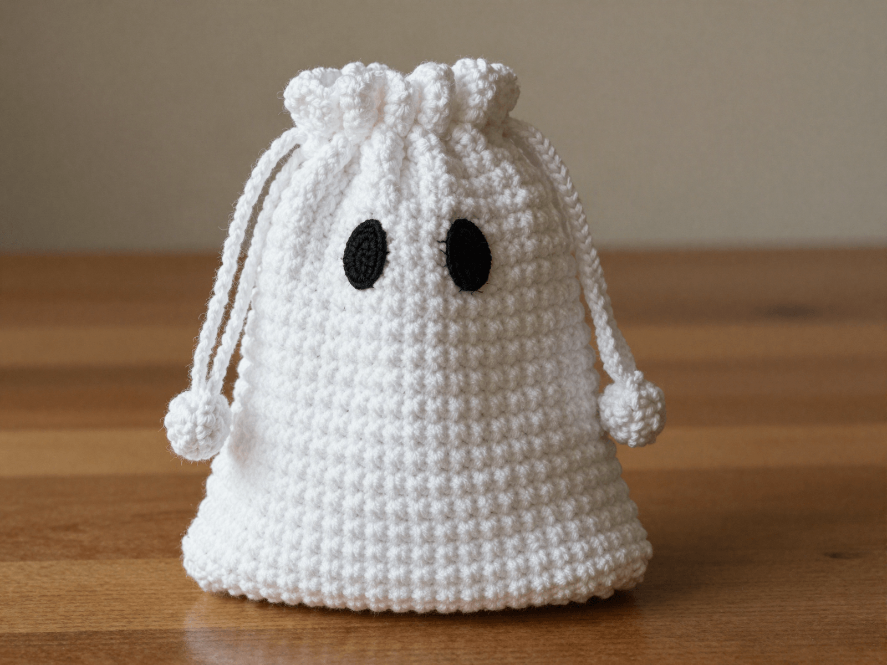
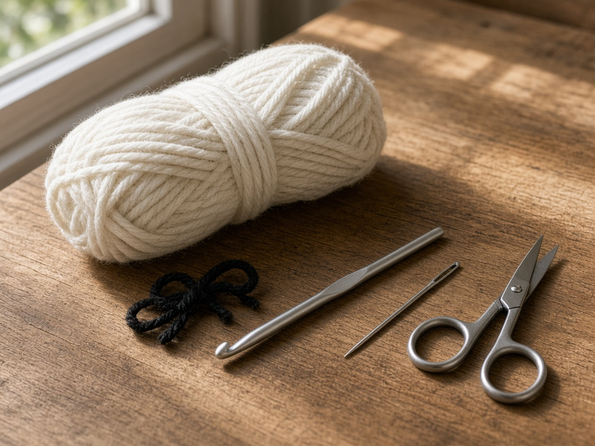
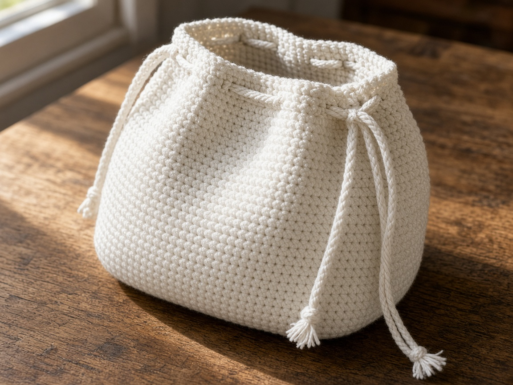

A handful of wrapped candy loose in a coat pocket comes out stuck to a receipt. A small ghost bag is a soft white cup with two black eyes and a cord at the top. Pulled shut, the gathered top looks like a ghost's head.

The construction is the same flat base and tube as the [ghost coin pouch](/how-to-crochet-a-ghost-coin-pouch/), only larger. What is different is the drawstring. The coin pouch uses many small holes and a thin chain cord. This bag uses nine large holes and a thick twisted cord, which closes in fewer, deeper folds and is easier for small hands to pull. This page explains how to choose between the two and how to make a twisted cord.

US terms. US single crochet is UK double crochet. [Abbreviations](/crochet-abbreviations-chart/). The pictures are illustrations. No bag for this page was crocheted or filled. Inches are estimates from the example gauge.

## What is a technique, and what is only a plan

| Piece of this page | What it is |
| --- | --- |
| Flat circle to 54, then even rounds | Standard construction. |
| (Sc 4, ch 2, skip 2) eyelet round | Standard. The repeat must divide the stitch count. |
| Twisted cord from two strands | A standard cord-making technique. |
| 4 sc and 5 rounds to the inch | An unverified example gauge. |
| About 90 yards; 80-chain cord | Old lines. Not measured. Withdrawn. |

## How the bag is built

Rounds 1 to 9 make a flat circle of 54 stitches, about 4.3 inches across. Rounds 10 to 32 build a straight tube about 4.6 inches tall. The base lies flat underneath and adds no height. Round 33 makes nine large eyelets. Rounds 34 to 36 add a short frill above them, which keeps the cord from slipping off the top. A twisted cord threads through the eyelets. Eyes go on the front.

## Small eyelets or large ones

Any eyelet round skips stitches and bridges them with chains. The size of the repeat decides how many holes you get and how big they are.

<figure class="diagram">

<figcaption>Small, close holes close tighter. Large, spaced holes take a thicker cord. Both need a stitch count the repeat divides into.</figcaption>
</figure>

**Small holes** (sc, ch 1, skip 1) close the top tightly in many small gathers. They need a thin cord, because a thick one will not pass through a one-chain gap.

**Large holes** (sc 4, ch 2, skip 2) take a thick cord. The top closes in fewer, deeper folds, and a thick cord is easier to grip and less likely to cut into small fingers. The cost: a gathered top with nine folds leaves slightly larger gaps than one with 27. For wrapped candy, that does not matter.

Either way, the repeat has to divide the count. The large-hole repeat uses six stitches: 54 ÷ 6 = 9. On 48 stitches it would be 8 repeats. On 50 it would not work.

## Yarn and hook

- **Worsted cotton**, white or cream, and a scrap of black for the eyes. Cotton keeps a rounder bag. Fuzzy acrylic looks more ghostly and grabs candy wrappers. [Yarn weights](/yarn-weight-chart/).
- **US G/6 (4.0 mm) hook**, or the size that gives firm fabric. [Hook chart](/crochet-hook-size-conversion-chart/).
- Yarn needle, scissors, stitch marker.

## The worked example

| Part | Arithmetic | Result |
| --- | --- | --- |
| Base | 6 × 9 rounds | 54 sts |
| Around | 54 ÷ 4 | 13.5 in |
| Across | 13.5 ÷ 3.14 | about 4.3 in |
| Wall | 23 rounds ÷ 5 | about 4.6 in |
| Eyelets | 54 ÷ 6 | 9 holes, 1.5 in apart |
| Cord | 13.5 in around + 2 tails of 6 in | about 25 in finished |

## Stage 1: the base

Joined rounds: slip stitch to the first stitch and ch 1 (does not count) at each round. To spiral, skip both and use a marker.

**Round 1:** 6 sc in a [magic ring](/crochet-in-the-round/). (6)

**Round 2:** 2 sc in each stitch. (12)

**Round 3:** (Sc, 2 sc in next) 6 times. (18)

**Round 4:** (Sc 2, 2 sc in next) 6 times. (24)

**Round 5:** (Sc 3, 2 sc in next) 6 times. (30)

**Round 6:** (Sc 4, 2 sc in next) 6 times. (36)

**Round 7:** (Sc 5, 2 sc in next) 6 times. (42)

**Round 8:** (Sc 6, 2 sc in next) 6 times. (48)

**Round 9:** (Sc 7, 2 sc in next) 6 times. (54)

<figure class="diagram">

<figcaption>Step 1. Nine rounds of 6 increases give a 54-stitch base, about 4.3 inches across.</figcaption>
</figure>

**Checkpoint:** flat and about 4.3 inches across. If it ruffles, stop at round 8 and use the 48-stitch version below.

## Stage 2: the tube

**Rounds 10–32:** Sc in each stitch. (54)

Drop in some candy around round 25. It should sit well below the top. Add rounds now if you want a taller bag. Count round 32 before you go on. It must be 54.

## Stage 3: eyelets and frill

**Round 33:** (Sc in the next 4 stitches, ch 2, skip 2) 9 times. (36 sc, 9 ch-2 spaces)

**Round 34:** Sc in each sc and 2 sc in each ch-2 space. (54)

<figure class="diagram">

<figcaption>Step 2. Nine ch-2 spaces, 6 stitches apart. Round 34 puts 2 sc in each space to restore 54.</figcaption>
</figure>

**Rounds 35–36:** Sc in each stitch. (54) Fasten off.

## Stage 4: a twisted cord

A twisted cord is two strands twisted until they kink, then folded so they twist around each other. It is round, firm, and does not stretch like a bare chain.

1. Cut two lengths of white yarn, each about three times the finished length you want. For a 25 inch cord, start with about 75 inches. Twisting and folding take up most of it, and the exact amount depends on the yarn. If your first cord comes out short, cut longer.
2. Knot the strands together at each end. Hook one end over a doorknob, or have someone hold it.
3. Twist the other end in one direction until the strands kink back on themselves when you relax them slightly.
4. Keeping it taut, bring the free end to the fixed end. Let go of the middle. It twists into a two-ply cord.
5. Knot the two ends together and trim.

Thread the cord through the nine eyelets with a yarn needle, in and out, starting and ending at the front.

## Stage 5: the eyes

Close the cord once to see the front. Embroider two short vertical ovals in black about 8 rounds below the eyelets, or sew on two small flat circles of 6 sc worked in a magic ring. Keep them above the candy line so they still show on a full bag.

## Smaller version

Stop the base at round 8 (48 stitches, about 3.8 inches across). Work the tube on 48. Round 33 becomes (sc 4, ch 2, skip 2) 8 times. Round 34: sc in each sc and 2 sc in each space, 48.

## Troubleshooting

**The cord will not pass through the holes.** The cord is too thick, or the holes are ch-1. Use ch-2 holes, or a thinner cord.

**The last eyelet is crowded.** The count was not a multiple of six. Fix it on round 32.

**The cord stretches and the top opens.** A bare chain. Use a twisted cord.

**The bag tips over.** The base cupped. Rework it more loosely.

**A mini candy falls through the side.** A stitch was skipped in the tube, or the walls are a taller stitch than single crochet.

## Care

Empty it and shake out wrappers. Hand wash cool. Dry flat.

## Frequently asked

**Can a child carry it?**

In a hand, yes. Do not hang it around a neck. A cord loop and a child's neck do not go together. Knot the cord ends so the cord cannot pull out and leave a loose string.

**Will it fit a full-size chocolate bar?**

Probably not lying flat across a 4.3 inch base. Measure the bar, then keep increasing the base until the circle is wider than the bar.

**Can I sell finished bags?**

Yes. Do not republish the pattern.

## Next

The same bag, orange and shaped with a pumpkin bulge, is the [pumpkin treat bag](/how-to-crochet-a-pumpkin-treat-bag/). A zipped version is the [pumpkin zipper pouch](/how-to-crochet-a-pumpkin-zipper-pouch/).
