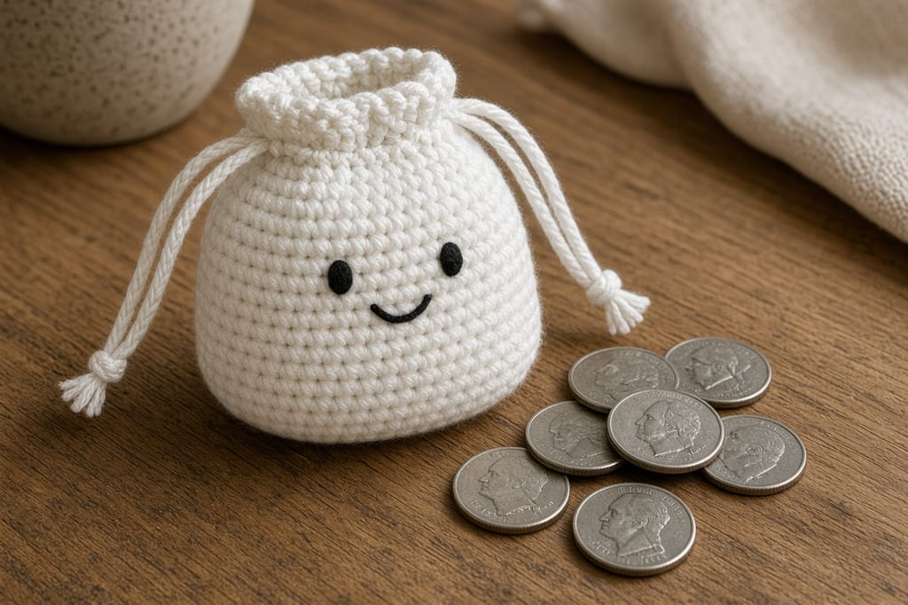
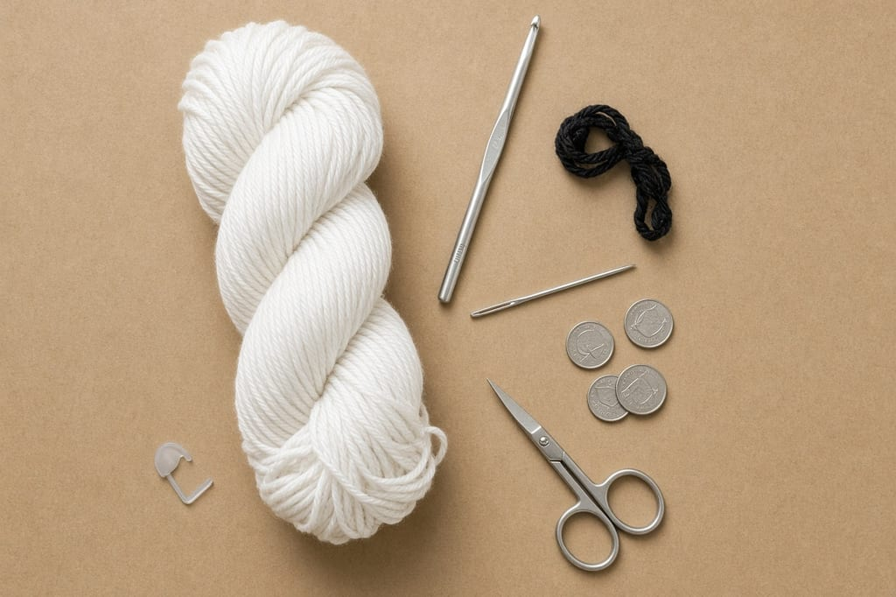
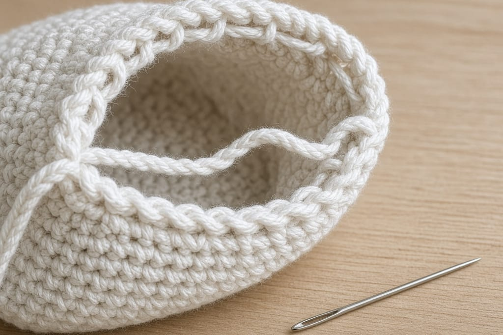

Loose change in a coat pocket ends up in the washing machine. A small drawstring pouch keeps it together. This one is a white single-crochet tube with a flat base and an embroidered ghost face. The construction is the same one most small pouches use. What this page adds is the drawstring: how the eyelet round makes its holes, why it needs an even stitch count, and how long the cord should be.

US terms. US single crochet is UK double crochet. [Abbreviations](/crochet-abbreviations-chart/). The pictures are illustrations. No pouch for this page was crocheted or measured. The inches are estimates from the example gauge.

## What is a technique, and what is only a plan

| Piece of this page | What it is |
| --- | --- |
| Flat circle increasing by 6, then even rounds | Standard construction. |
| (Sc, ch 1, skip 1) eyelet round | A standard drawstring round. Needs an even count. |
| A US quarter is about 0.955 in across | The US Mint specification, 24.26 mm. |
| 4 sc and 5 rounds to the inch | An unverified example gauge. |
| About 40 yards | An old line. Not weighed. Withdrawn. |

## How the pouch is built

Rounds 1 to 5 make a flat circle of 30 stitches, about 2.4 inches across at the example gauge. Rounds 6 to 15 are even, so the edge turns up into a tube about 2 inches tall. Round 16 is the eyelet round. Rounds 17 and 18 add a short frill above the holes, which keeps the cord from riding up over the top edge when you pull it. A chain cord goes in and out of the holes, and pulling both ends gathers the top shut.

The [earbud pouch](/how-to-crochet-an-earbud-pouch/) is the same tube with a flap instead of a drawstring.

## How the eyelet round makes holes

The eyelet round repeats three moves: single crochet in one stitch, chain 1, skip the next stitch. The chain bridges the skipped stitch, so the round keeps its length, but nothing is worked into that stitch. The gap under each chain is a hole.

Each repeat uses two stitches of the round below. Thirty stitches make fifteen repeats and fifteen holes. With 31 stitches, the fifteenth repeat ends one stitch short of the start. You get a solid stitch beside the first single crochet, a missing hole, and a cord that bunches at that spot. That is why you count before you start the round.

<figure class="diagram">

<figcaption>Every repeat uses two stitches. An odd count leaves one over, and that stitch closes a hole.</figcaption>
</figure>

## Yarn, hook, and gauge

- **Smooth worsted cotton**, white, and a scrap of black. Fuzzy yarn pills inside the pouch, and coins wear through soft fibers faster. [Yarn weight chart](/yarn-weight-chart/).
- **US G/6 (4.0 mm) hook**, or the size that gives firm fabric. [Hook size chart](/crochet-hook-size-conversion-chart/).
- Stitch marker, yarn needle, scissors, and a few coins to test with.

Your first five rounds are a swatch. Measure across the flat circle. At 4 stitches per inch, 30 stitches make a circle about 2.4 inches across, because 30 ÷ 4 = 7.5 inches around and 7.5 ÷ 3.14 ≈ 2.4.

## Stage 1: the base

Work in a spiral. Do not join. Mark the first stitch of each round. See [crochet in the round](/crochet-in-the-round/).

**Round 1:** 6 sc in a magic ring. (6)

**Round 2:** 2 sc in each stitch. (12)

**Round 3:** (Sc, 2 sc in next) 6 times. (18)

**Round 4:** (Sc 2, 2 sc in next) 6 times. (24)

**Round 5:** (Sc 3, 2 sc in next) 6 times. (30)

**Checkpoint:** lay the circle on the table. Flat is right. Ruffled means extra increases. A bowl means the ring or the increases are tight. A cupped base tips over and the coins slide to one side.

## Stage 2: the tube

**Rounds 6–15:** Sc in each stitch. (30)

No increases. The edge turns up on its own once you stop adding stitches. Ten rounds is about 2 inches. For a taller pouch, add rounds here and keep the count at 30.

**Count round 15 before you go on.** It must be 30.

## Stage 3: the eyelets and the frill

**Round 16:** (Sc, ch 1, skip 1) 15 times. (15 sc and 15 ch-1 spaces)

**Round 17:** Sc in each sc and 1 sc in each ch-1 space. (30)

**Round 18:** Sc in each stitch. (30)

Slip stitch into the next stitch to smooth the end of the spiral. Fasten off and weave in the end.

In round 17, work the stitch over each chain into the space, around the chain, rather than into the chain itself. Either way the hole underneath stays open, but working into the space keeps the edge of the hole neater.

## Stage 4: the cord

A cord has to go once around the opening and leave two tails long enough to tie: 7.5 + 4 + 4 = **15.5 inches**.

Chain until the chain measures 15.5 inches without stretching. Then slip stitch in the back bump of each chain back along it. A bare chain stretches every time you pull it. The slip stitches lock it.

Thread the cord through the holes with a yarn needle, out through one and in through the next. Start and finish at the same hole, on the front, so the bow sits under the face. Knot each end.

**Checkpoint:** drop in a few coins and pull the cord tight. The gathered top should close smaller than a quarter, which is just under an inch across.

## Stage 5: the face

Pull the drawstring closed once so you can see which side is the front. Embroider two short black eyes about 4 stitches apart, three or four rounds below the eyelets, and a small wide V under them for a mouth. Keep the stitches shallow so they do not form lumps the coins catch on. Do not stitch the face on the eyelet round. The gathers would fold it in half.

## Troubleshooting

**One spot will not gather.** A missing hole. The count was odd before round 16, or a repeat was skipped. Count the holes. There should be 15.

**The top will not close past a gap.** The cord is too short to cinch, or the frill is pulling the holes apart. Make the cord longer, or work only one round above the eyelets.

**The cord slides out over the top.** No frill. Add round 17 and 18.

**The cord stretches and the top reopens.** A bare chain. Slip stitch back along it.

**The pouch leans.** A cupped base. Rework rounds 1 to 5 more loosely.

## Care

Empty the coins first. Hand wash cool and dry flat. Do not machine dry. Cotton can shrink enough to make the drawstring stiff.

## Frequently asked

**Will it hold bills?**

A bill folded very small may fit. The pouch is sized for coins. For bills, a card-sized pocket like the [ghost mini wallet](/ghost-crochet-mini-wallet/) works better.

**Can I use DK yarn?**

Yes, with a smaller hook. The round numbers still describe the shape. The inch figures will be smaller, so recalculate the cord.

**Can I sell finished pouches?**

Yes. Do not republish the pattern.

## Next

A drawstring bag for candy, using the same eyelet round on a bigger tube, is the [ghost candy bag](/how-to-crochet-a-ghost-candy-bag/). If spirals still feel new, start with [crochet in the round](/crochet-in-the-round/).
