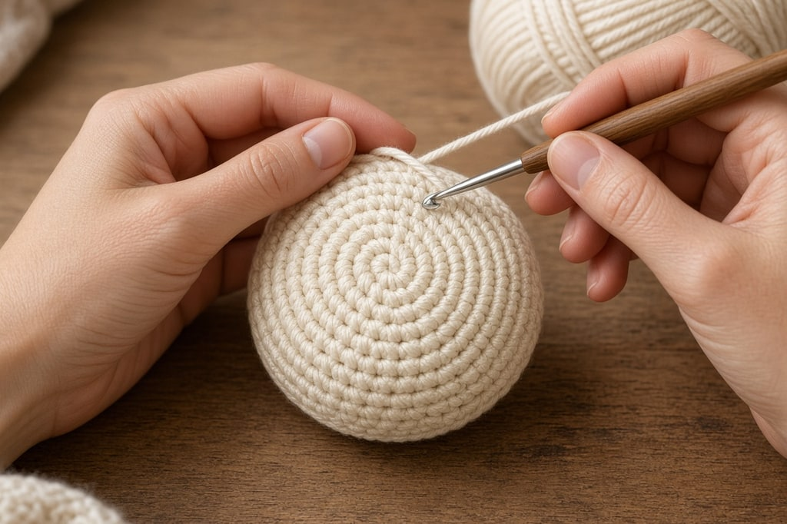
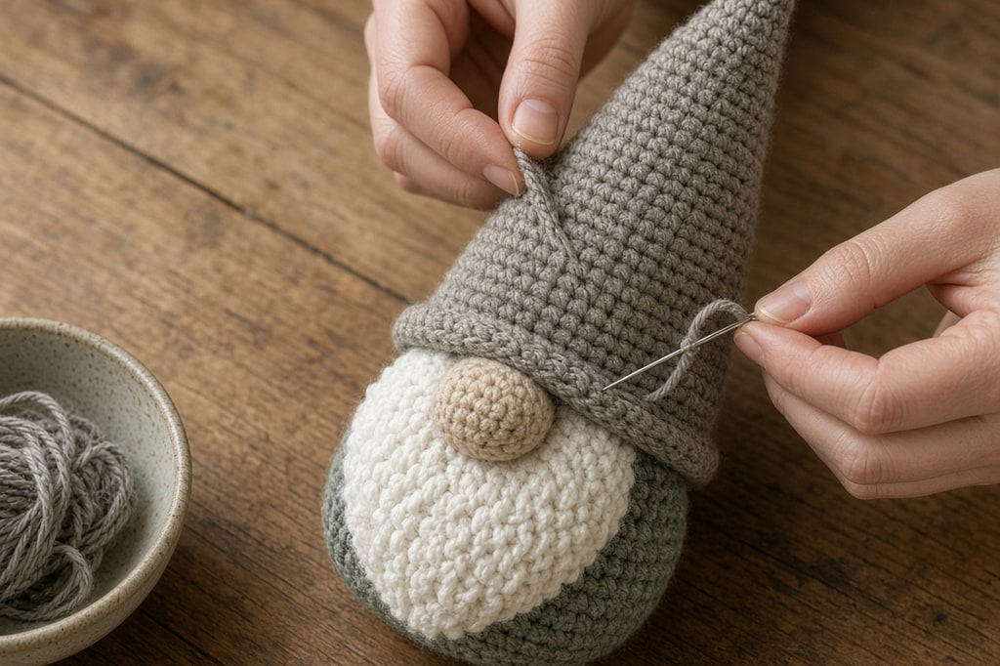

A crochet gnome is a body, a hat, a nose, and a beard. None of those pieces is hard. Two things make it work. The first is proportion: **the hat comes down far enough to cover where the eyes would be, and the brim touches the top of the nose.** Stop the brim higher and you have a person in a cap.

The second is direction. A gnome is wider at the bottom than at the top, and it has to stand. The body is worked **from the top down**: a flat top, then a few spaced increase rounds so it widens, then a flat base made last, with a weight inside before it closes. Starting at the base and increasing upward makes the opposite shape, a cup that is widest at the top.

US terms. [Abbreviations](/crochet-abbreviations-chart/). The pictures are illustrations of the finished gnome, which has not been made up in yarn here, so its size depends on your yarn, hook, and stuffing.

## How it fits together

<figure class="diagram">

<figcaption>The body widens toward the base. The hat covers the top half, and its brim sits on the nose.</figcaption>
</figure>

## What you need

- **Worsted-weight yarn** in a body color, a hat color, and a skin tone for the nose. [Yarn weights](/yarn-weight-chart/).
- **Something pale and fluffy for the beard**: bouclé, a fuzzy yarn, or cut strands of worsted. [Yarn for Christmas crochet](/yarn-for-christmas-crochet/).
- **A hook one or two sizes smaller than the label**, so stuffing does not show. [Hook chart](/crochet-hook-size-conversion-chart/).
- Stuffing, a yarn needle, a stitch marker.
- **A weight in a closed bag**: plastic stuffing pellets or clean aquarium gravel in a small sealed bag, or a scrap of fabric sewn shut. Loose grains work out through the stitches. Rice and lentils can be used, but they are food, and food attracts pests and does not survive a wash.

## Step 1: the body, top down

Body color. Work in a spiral and mark the first stitch of each round.

**Round 1:** 6 sc in a magic ring. (6)

<figure class="diagram">

<figcaption>Round 1 starts in a magic ring, pulled tight so the top has no hole.</figcaption>
</figure>

**Round 2:** 2 sc in each stitch. (12)

**Round 3:** (Sc, 2 sc in next) 6 times. (18)

**Round 4:** (Sc 2, 2 sc in next) 6 times. (24)

**Round 5:** (Sc 3, 2 sc in next) 6 times. (30)

That flat circle is the top of the head. The hat will cover it.

**Rounds 6–7:** Sc in each stitch. (30)

**Round 8:** (Sc 4, 2 sc in next) 6 times. (36)

**Rounds 9–10:** Sc in each stitch. (36)

**Round 11:** (Sc 5, 2 sc in next) 6 times. (42)

**Rounds 12–14:** Sc in each stitch. (42)

One increase round every two or three rounds makes the gentle widening. Increasing every round would make a flat circle, not a body. [Why six increases behave this way](/crochet-increase-decrease/).

Shift where each increase round starts by a stitch or two, so the increases do not stack into six visible ridges.

## Step 2: the flat base

**Round 15:** Sc in the back loop only of each stitch. (42)

The back-loop round makes a fold line, so the base turns under at a crisp edge and sits flat.

**Round 16:** (Sc 5, sc2tog) 6 times. (36)

**Round 17:** (Sc 4, sc2tog) 6 times. (30)

**Round 18:** (Sc 3, sc2tog) 6 times. (24)

Stuff the body firmly, then lay the weight bag flat on top of the stuffing, against the base. Keep it centered. An off-center weight makes the gnome lean.

**Round 19:** (Sc 2, sc2tog) 6 times. (18)

**Round 20:** (Sc, sc2tog) 6 times. (12)

**Round 21:** Sc2tog 6 times. (6) Fasten off and pull the hole closed.

<figure class="diagram">

<figcaption>The body widens in steps with even rounds between, then the back-loop round 15 turns the base flat.</figcaption>
</figure>

Stand it on a table. If it rocks, the base domed: press it flat with your palm while it is still easy to adjust the weight.

## Step 3: the hat

Hat color. Worked from the tip down.

**Round 1:** 6 sc in a magic ring. (6)

**Rounds 2–4:** Sc in each stitch. (6) This thin tube is the floppy tip.

**Round 5:** (Sc, 2 sc in next) 3 times. (9)

**Rounds 6–7:** Sc in each stitch. (9)

**Round 8:** (Sc 2, 2 sc in next) 3 times. (12)

**Rounds 9–10:** Sc in each stitch. (12)

**Round 11:** (Sc, 2 sc in next) 6 times. (18)

**Round 12:** Sc in each stitch. (18)

**Round 13:** (Sc 2, 2 sc in next) 6 times. (24)

**Round 14:** Sc in each stitch. (24)

**Round 15:** (Sc 3, 2 sc in next) 6 times. (30)

**Round 16:** Sc in each stitch. (30)

**Round 17:** (Sc 4, 2 sc in next) 6 times. (36)

**Round 18:** Sc in each stitch. (36)

**Round 19:** (Sc 5, 2 sc in next) 6 times. (42)

**Rounds 20–21:** Sc in each stitch. (42) Fasten off with a long tail.

<figure class="diagram">

<figcaption>The hat ends at 42, the same as the body, so it sits over the top instead of perching on it.</figcaption>
</figure>

The hat opening, 42, is slightly wider than the body's 36-stitch middle where it will sit, so it drops over instead of perching. Do not stuff the hat. A stuffed hat stands stiff and loses the flop.

## Step 4: the nose

<figure class="diagram">

<figcaption>Diagram. The nose sits on the face.</figcaption>
</figure>

Skin tone.

**Round 1:** 6 sc in a magic ring. (6)

**Round 2:** 2 sc in each stitch. (12)

**Rounds 3–4:** Sc in each stitch. (12)

**Round 5:** Sc2tog 6 times. (6)

Stuff lightly before round 5. After round 5, fasten off with a sewing tail, thread it through the six remaining front loops, pull closed, and secure it. Pin the nose in place before sewing; its size is a design choice.

## Step 5: the beard

<figure class="diagram">

<figcaption>Diagram. The beard is under the nose.</figcaption>
</figure>

Cut strands about twice the finished length you want. Fold each in half, pull the fold through a stitch with the hook, then pull the ends through the fold. Work an upside-down arc across the front of the body, starting about round 10. Use more strands than you think. Fringe looks full in your hand and sparse on the gnome. Trim straight or to a point.

## Step 6: assembly

1. **Beard first**, so the nose can cover the top of it.
2. **Nose** centered on the top of the beard.
3. **Hat** pulled down until the brim touches the top of the nose. Pin it all the way round, look from a few feet away, then sew around the brim.

## Check the base and hat as separate fittings

After body round 18, redistribute stuffing while you can still reach inside. Keep the weighted insert centered against the base and the lower closure flexible enough to lie flat. After round 21, run the tail through all six front loops, pull closed and secure it. Pin the empty hat on the body before adding the beard: its forty-two-stitch rim must reach the intended position without tugging. Different hat and body yarns can have different gauge even with the same hook. Mark the front, add beard, sew the closed nose, then sew the hat brim through body surface stitches, removing every pin.

## Troubleshooting

**It is wider at the top than the bottom.** It was worked from the base up with increases. Work top down.

**It tips over.** No weight, an off-center weight, or a domed base.

**It looks like a cone in a hat.** The brim is above the nose. Pull it down.

**The hat perches.** The opening is too small. Add a round of increases.

**It leans.** Increases stacked in one line, or the weight is off-center.

## Frequently asked

### Does it need eyes?

No. The hat covers where they would be. Eyes under the brim turn it into a different character.

### Can I skip the nose?

You can, but then it looks like a decorated cone. The nose is what makes it a gnome.

### Is it a toy?

With a sealed weight bag and firmly sewn parts it has no small parts, but it has not been safety tested. Keep weighted figures away from small children.

### What should I make next?

A one-piece body with a visible face is [Santa](/crochet-santa-amigurumi-for-beginners/). A cone with branches is the [Christmas tree](/how-to-crochet-a-christmas-tree/).
