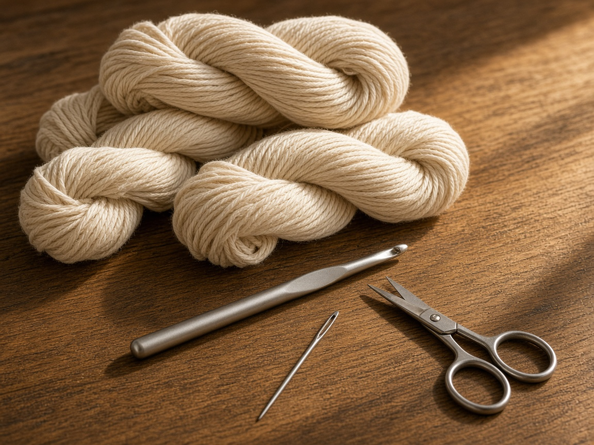
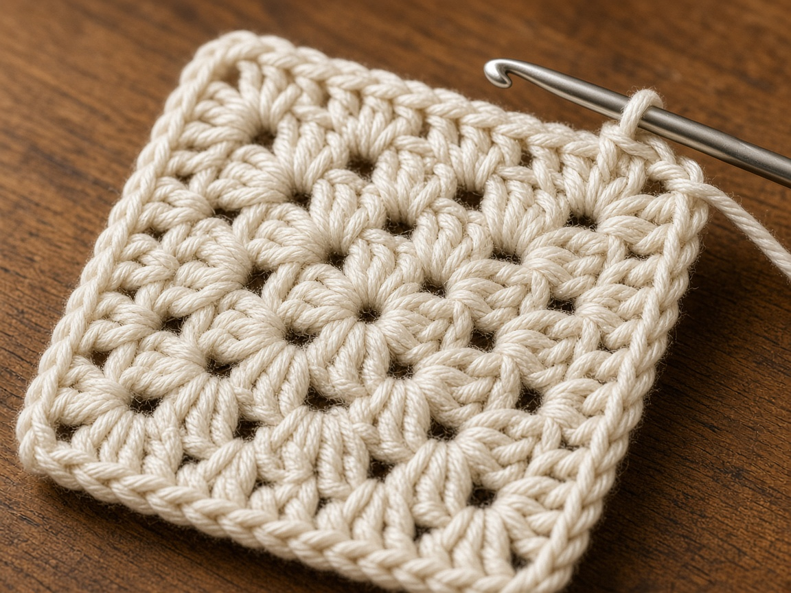

A granny square tote is two flat panels of squares sewn together on three sides, with a firm edge around the opening and two straps. The squares are the easy part. The bag depends on counting: eight squares that match, seams with the same number of stitches on both layers, and straps sewn into something stronger than a chain space.

It is an open bag. A pen will drop through the holes, and rain will not stay out.

US terms. US double crochet is UK treble. US single crochet is UK double crochet. [Abbreviations](/crochet-abbreviations-chart/) and the [basic stitches](/basic-crochet-stitches/). The pictures are illustrations. No tote for this page was crocheted, loaded, or carried. Inches below are estimates from a gauge you still have to swatch.

## How the bag is built

<figure class="diagram">

<figcaption>Two flat panels and three seams. Every number on the drawing follows from the 4-round square.</figcaption>
</figure>

1. Make eight squares, four rounds each.
2. Join them into two panels, two squares by two.
3. Put the panels right sides together and join the sides and the bottom. Leave the top open.
4. Work two rounds of single crochet around the opening.
5. Make two straps and sew them through that edge.

The bag is flat. It has no base, so a bulky item takes height out of it. A boxed bottom would need a separate base strip, which this page does not include. The size follows the square: each panel is about twice the side of one square. If your square is 5 inches, the panel is about 10 by 10 and the opening is about 20 inches around. If your square is 4 inches, every one of those numbers shrinks by a fifth.

## Materials

- **Worsted cotton.** It gives crisp clusters and a firm fabric. Every yarn lengthens when a loaded bag hangs from it, and cotton does not spring back once stretched. That is why the straps are single crochet, not chain, and why the bag should not be overloaded. [Yarn weights](/yarn-weight-chart/).
- **A US H/8 (5.0 mm) hook**, or the hook that gives eight matching squares. [Hook chart](/crochet-hook-size-conversion-chart/).
- Yarn needle, scissors, a few clips or locking markers to hold squares together while you seam.

To estimate yarn, weigh your first finished square and multiply by eight. Then weigh 10 rows of strap and multiply by 22 for two 110-row straps. Add some for the seams and the edge.

## The square

The beginning ch-3 counts as a double crochet. Clusters go into chain spaces, never into the tops of stitches. The center is a chain ring. See [working in the round](/crochet-in-the-round/).

### Step 1: round 1, four clusters in the ring

1. Chain 4.
2. Slip stitch into the first of those chains. You now have a small ring. All of round 1 goes into that ring, not into the chains one by one.
3. Chain 3. Count it as the first double crochet.
4. Make 2 more double crochet into the ring. That is cluster 1: 3 double crochet, if you count the chain 3.
5. Chain 2. That chain 2 is corner 1. Do not put a stitch into it yet.
6. Into the ring: 3 double crochet, then chain 2. That is cluster 2 and corner 2.
7. Into the ring: 3 double crochet, then chain 2. Cluster 3, corner 3.
8. Into the ring: 3 double crochet, then chain 2. Cluster 4, corner 4.
9. Slip stitch into the top of the beginning chain 3.
10. Count. You need 12 double crochet and 4 corner spaces. There are no side spaces yet. If you have 15, an extra cluster went into the ring.

<figure class="diagram">

<figcaption>Round 1: four clusters with a ch-2 corner between each. The ch 3 counts as the first dc.</figcaption>
</figure>

### Step 2: round 2, two clusters in every corner

1. Slip stitch into the next double crochet, then the next, then into the chain-2 corner space. You are moving to a corner without adding a cluster on the way.
2. Chain 3. It counts as the first double crochet.
3. In that same corner space: 2 double crochet, chain 2, 3 double crochet. One corner now holds two clusters with a chain 2 between them.
4. Chain 1. That chain 1 is a side space. Leave it empty.
5. In the next corner space: 3 double crochet, chain 2, 3 double crochet.
6. Chain 1.
7. Do that same corner, then chain 1, two more times. Four corners in all.
8. After the fourth corner, chain 1 and slip stitch into the top of the beginning chain 3.
9. Count 24 double crochet. Each side has one empty chain-1 space. Round 3 fills those. A cluster in this round goes into a corner space only.

<figure class="diagram">

<figcaption>Round 2: each corner space gets two clusters, and a ch 1 sits between corners.</figcaption>
</figure>

### Step 3: round 3, one side cluster between corners

1. Slip stitch across into the next chain-2 corner space.
2. Chain 3, then 2 double crochet, chain 2, 3 double crochet, all in that same corner.
3. Chain 1.
4. Find the chain-1 space on the side, the gap between the clusters below. Make 3 double crochet in that gap. Do not put them into the top of a double crochet. If the gap closes, the square starts to cup.
5. Chain 1.
6. In the next corner: 3 double crochet, chain 2, 3 double crochet.
7. Repeat that side-then-corner pattern until you have been around all four sides.
8. Finish the last side with chain 1, 3 double crochet in the last side space, chain 1, and slip stitch into the top of the beginning chain 3.
9. Count 36 double crochet. That is 12 times 3.

### Step 4: round 4, two side clusters between corners

1. Slip stitch into the next corner space.
2. Chain 3, 2 double crochet, chain 2, 3 double crochet in that corner.
3. Along the side you will meet two spaces. For each space: chain 1, then 3 double crochet in the space. After the second side cluster, chain 1 again.
4. Next corner: 3 double crochet, chain 2, 3 double crochet.
5. Walk the other three sides the same way: chain 1, side cluster, chain 1, side cluster, chain 1, corner.
6. After the last side, slip stitch into the top of the beginning chain 3.
7. Count 48 double crochet. That is 12 times 4. Fasten off.
8. Weave the ends in before you start the next square.

Make **8 squares** this way. Turn every square between rounds, or turn none of them. Do not mix the two habits. Stack the eight. Measure each one flat, without pulling a corner. If one is smaller, make it again. Do not stretch it into a seam.

<figure class="diagram">

<figcaption>Round 4: the corner spaces (ch 2) and the side spaces (ch 1) are worked differently. Mixing them up is the usual reason a square twists.</figcaption>
</figure>

**Checkpoint each round:** round n has 12 × n double crochet, and n clusters along each side if you count the corner halves. A count that is not a multiple of 12 means a cluster was added or missed, often because one went into a stitch top instead of a space.

<figure class="diagram">

<figcaption>Clusters go in the gaps between the clusters below, never on top of them.</figcaption>
</figure>

Some people turn the square over between rounds to reduce a slight twist. The instruction above already asks you to pick one habit and keep it.

## Counting the seam edge

<figure class="diagram">

<figcaption>Both squares in a seam have the same edge, so both layers take the same 19 stitches. That is what keeps the seam flat.</figcaption>
</figure>

### Step 5: count 19 along one edge before you join anything

Lay one square flat. Walk one side from corner to corner and touch each spot:

1. The first corner chain-2 space.
2. Then, along the side: 12 double crochet tops and 3 chain-1 spaces between the clusters.
3. The corner space at the other end.

When you seam, that edge takes 2 single crochet in the first corner space, 1 single crochet in each of the 12 double crochet, 1 single crochet in each of the 3 chain spaces, and 2 single crochet in the far corner space. Add them: 2 + 12 + 3 + 2 = **19**. For a square of n rounds the same edge is 4n + 3. A 4-round square is 19. Do not start the second seam until the first one is 19.

## Assembly

### Step 6: join two squares, then two pairs

1. Hold square A and square B with right sides together. Line up one edge, stitch spot to stitch spot.
2. Join yarn at the corner. Single crochet through both layers: 2 in the corner space, 1 in each double crochet, 1 in each chain space, 2 in the far corner. Count 19. Fasten off.
3. If that seam is 18 or 20, pull it out. Do not copy a bad count onto the next pair.
4. Join square C to square D the same way. Another seam of 19.
5. Hold the AB pair against the CD pair, right sides together, along the long edge. That edge is two squares: 19 + 19 = **38**.
6. Single crochet through both layers and count 38. Where the seams cross in the middle, four corners meet. Put 2 single crochet in the corner space of each square. Skip one and a finger fits through the hole. Add extra stitches and the center bunches.
7. Make the second panel the same way: two pairs, then one long seam of 38.
8. Each panel should lie flat. It is about twice the side of one square.

<figure class="diagram">

<figcaption>Squares are joined right sides together with one sc in each stitch and space along the edge, 19 per square.</figcaption>
</figure>

Where the long seam crosses the short seam in the middle, four corners meet. Keep to the count: 2 sc in the corner space of each square. Skip there and you leave a hole a finger can pass through. Add stitches and the center bunches.

**Checkpoint:** each panel lies flat and square, about twice the side of one square.

### Step 7: three seams, and leave the top open

<figure class="diagram">

<figcaption>Diagram. Three edges of 38. The opening is not a seam.</figcaption>
</figure>

1. Put the front panel and the back panel right sides together.
2. Start at the top of one side. Single crochet down that side through both layers. Count 38.
3. At the bottom corner, the two corner spaces already give you 4 single crochet in that turn. Do not add a separate turning chain.
4. Single crochet across the bottom. Count 38.
5. Turn the other bottom corner the same way, then single crochet up the second side. Count 38.
6. Stop at the top. Do not seam the opening.
7. Turn the bag right side out. The seam ridges stay inside.

## The top edge

<figure class="diagram">

<figcaption>Diagram. Seventeen stitches per square, 68 around, worked twice.</figcaption>
</figure>

1. Join yarn at a side seam on the top edge, with the bag right side out.
2. Work around the opening: 1 single crochet in each double crochet, 1 in each chain-1 space, and 1 in each corner space.
3. One square's top edge is 17 stitches at 4 rounds. Four edges make the round: 17 + 17 + 17 + 17 = **68**.
4. Slip stitch to the first single crochet.
5. Chain 1 and work a second round of 1 single crochet in each of those 68 stitches. Slip stitch to join.
6. Count both rounds. More than 68 and the opening ruffles. Fewer than 68 and it draws in. Pull the round out and recount before you sew straps. The straps go into this edge, not into a chain space of a square.

This edge is the structural part of the bag. The straps are sewn into it, not into the squares. If the first round ruffles, you have more than 68. If it draws the opening in, you have fewer.

## Straps

<figure class="diagram">

<figcaption>Diagram. Skip 8, sew 5, skip 8, sew 5, skip 8.</figcaption>
</figure>

Make 2. The chain 1 at the end of a strap row does not count as a stitch.

1. Chain 6.
2. Single crochet in the second chain from the hook and in each chain across. Count 5. Chain 1, turn.
3. Next row: single crochet in each of the 5 stitches. Count 5. Chain 1, turn.
4. Repeat that row until the strap measures about **22 inches** lying flat, not pulled. At 5 rows to the inch that is about **110 rows**. Write down the row count you actually made.
5. A 22 inch strap is for a hand. For a shoulder, measure from the bag at your side, up over the shoulder, and back down, and crochet to that length instead.
6. Make the second strap to the same row count. Do not match them by stretching one to the tape.

**Where the ends go.** Each panel's top is half of 68, which is 34 stitches.

1. From a side seam, count 8 stitches and stop.
2. The next 5 stitches are the first strap end.
3. Count 8 more and stop.
4. The next 5 stitches are the other end of the same strap.
5. Count the last 8. That is 8 + 5 + 8 + 5 + 8 = 34.
6. Lay about 1 inch of the strap end inside the bag, over those 5 stitches.
7. Sew through both rounds of the edge, around the overlap and across it. Also catch solid cluster stitches under the edge. One inch of strap is longer than the two edge rounds, so the lower end of the overlap has to be sewn to the clusters, not left hanging behind a chain gap.
8. Do the same four ends. A strap sewn only through a granny space will tear out.

A pen, a key, or a lipstick will fall through the holes. Use the [makeup pouch](/how-to-crochet-a-makeup-pouch/) for those. Rain comes through too. A [book sleeve](/how-to-crochet-a-device-case/) helps only on a dry day.

## Before you load it

1. All eight squares match.
2. Every square-to-square seam is 19, and every panel edge is 38.
3. The top edge is 68 on both rounds.
4. Both straps have the same number of rows.
5. Each strap end is sewn through both edge rounds, 8 stitches in from a side seam.

## While you crochet it

**The ring.** Chain 4, slip stitch into the first chain. Every stitch of round 1 goes into the ring, not into the individual chains. Chain 3 counts as the first double crochet. Two more double crochet in the ring finish the first cluster. Chain 2. That chain 2 is a corner, and you do not work into it until the next round. Three more times: 3 double crochet in the ring, chain 2. Slip stitch to the top of the first chain 3. Count 12 double crochet and 4 corners. No side spaces yet.

**Round 2.** Slip stitch across the next two double crochet and into a corner space. You are moving, not adding a cluster. In that corner: chain 3, 2 double crochet, chain 2, 3 double crochet. Chain 1. In the next corner: 3 double crochet, chain 2, 3 double crochet. Chain 1. Do that until four corners are done, then chain 1 and join. Count 24 double crochet. Each side has one empty chain-1. Clusters in this round go in corners only.

**Round 3.** Start in a corner the same way: chain 3, 2 double crochet, chain 2, 3 double crochet. Chain 1. The next hole is a side space, the gap between clusters, not the top of a stitch. Put 3 double crochet in the gap. Chain 1. Next corner. Repeat around. Count 36. If a side looks solid, with no gap, the cluster went into a stitch top. That square will cup. Pull the round.

**Round 4.** Same corners. Each side now has two gaps. Chain 1, 3 double crochet in the first gap, chain 1, 3 double crochet in the second gap, chain 1, then the corner. Count 48 and fasten off. Weave the ends before the next square. Make eight. Turn between rounds on all of them, or on none of them. Measure them flat. Remake any square that is smaller. Do not ease it into a seam.

**A seam of 19.** From one corner space to the next: 2 single crochet in the first corner, 1 in each of 12 double crochet, 1 in each of 3 chain spaces, 2 in the far corner. Count 19 before you fasten off. Hold the squares right sides together so the ridge ends up inside. If the first seam is 18 or 20, pull it out. The long seam that joins two pairs is 19 + 19 = 38, and where four corners meet you still put 2 single crochet in each square's corner space.

**The bag.** Front and back right sides together. Down one side 38, across the bottom 38, up the other side 38. At each bottom corner the two corner spaces already give you 4 single crochet. Do not add a chain to turn. Leave the top open. Turn the bag right side out.

**The edge.** Each square's top is 17: the side stitches and spaces, with the corners counted once because they are shared with the seam. Four tops are 68. Work 68, join, then another 68. More than 68 ruffles. Fewer draws the mouth in. The straps sew into this edge.

**The straps.** Chain 6, single crochet 5, then repeat the row of 5 until the strap is about 22 inches lying flat, not pulled. Write down the row count. The second strap uses that count. On one panel's 34 stitches: skip 8, place a strap over 5, skip 8, place the other end over 5, skip 8. Overlap about an inch inside and sew through both rounds and into the clusters under them. A strap sewn only through a chain space tears out when the bag is picked up.

## Make the joins visible before sewing straps

For a four-round square, a complete side includes twelve dc and three side ch-1 spaces. The two corner allocations determine whether it has nineteen seam positions or seventeen top-edge positions; they are not interchangeable. Mark the center seam of each two-square top edge and divide the full opening into two thirty-four-position panels. At each strap overlap, sew through both solid edging rounds and several underlying crochet stitches without crossing the opening. A one-inch overlap is longer than two sc rounds at the example gauge, so its lower end must also be anchored to solid cluster stitches rather than dangling behind a chain gap.

## One square, then the seams, as separate checks

Finish round 1 and stop. You want four clusters and four chain-2 corners, 12 double crochet. The center hole should be a small ring, not a spiral. If you worked into the chains instead of the ring, you have a small arc, not a square. Pull it out. This round is the one that is worth redoing, because every later round copies it.

On round 3 and round 4, stop at the first side cluster and look at where the hook is. It should be in a chain space, with a cluster to the left of the hook and a cluster to the right, and empty chain on both sides of the new cluster. If the hook is under the top two loops of a double crochet, you are in the wrong place even if the stitch looks neat. Move it. A whole square of stitches in the wrong place will not block flat.

When eight squares are piled up, measure one side of each without pulling the corner. They do not have to match a 5 inch guess. They have to match each other. The odd one out gets remade. A seam can hide a quarter inch, and then the panel twists.

The first seam is the pattern for the rest. Count 19 and fasten off. Only then make the second 19. The long seam is 38, and you count it in two halves of 19 so you notice the middle, where four corners meet. Two single crochet in each of those corner spaces. After both panels lie flat, the bag seams are the same 38, three times, right sides together, top left open.

The 68 around the mouth is two rounds. Count the first round at each side seam, 17 per square, before you work the second. Straps use the row count of the first strap for the second strap. On the bag, skip 8 edge stitches, cover 5, skip 8, cover 5, skip 8. Sew the inch of overlap through both rounds and down into the clusters. Picking the bag up by a strap sewn only through a chain space is how the strap comes off.

## Troubleshooting

**Squares come out different sizes.** Your tension changed between them. Redo the odd one. A 4 inch edge eased into a 5 inch edge puckers the whole panel.

**A square cups.** Clusters went into stitch tops, or the hook is small for the yarn.

**A seam puckers or ripples.** The two layers took different counts. Pull it out and match 19 to 19.

**There is a hole where four corners meet.** You skipped the corner space on one square. Work 2 sc there.

**The opening ruffles or draws in.** The edge count is off. It should be 68.

**The straps stretch with use.** Chain straps, or a loose single crochet. Shorten them by rows rather than knotting them.

**The bag sags at the bottom.** It is a flat bag with no base, carrying weight on open fabric. Lighter loads, or a different bag design.

## Care

Empty the bag. Hand wash cool. Dry flat, including the straps. Wet cotton stretches at the seams, so do not load the bag until it is dry.

## Corner spaces and side spaces

A corner is chain 2. A side is chain 1. They are not interchangeable, and round 4 is where they get mixed up because the side now has several chains in a row. On round 4, the chain 2 always has a cluster on both sides of it and sits at the turn. The chain 1 sits between clusters along a straight side. When you start a round, you slip stitch into a chain-2 corner, not into the first chain-1 you see. If you build a "corner" in a side space, that side grows a point and the square becomes a diamond.

In a corner the repeat is 3 double crochet, chain 2, 3 double crochet, all in the same hole. In a side space the repeat is only 3 double crochet, then a chain 1 to travel to the next hole. Putting a chain 2 in a side space opens a hole big enough to be a corner, and the next round will treat it as one. Putting a chain 1 in a corner pulls that corner in, and the square will not lie flat no matter how you block it.

Count double crochet at the end of the round, before you weave anything. Round 1 is 12, round 2 is 24, round 3 is 36, round 4 is 48. Each is 12 times the round number. A count of 45 on round 4 means one cluster of 3 was missed, usually a side cluster that went into a stitch instead of a space and then got skipped because the space had closed. Pull back to the last correct corner and do the side again.

Make all eight squares before you seam any of them. Seaming as you go hides the square that came out smaller, and you only notice it when the panel will not lie flat.

## Frequently asked

**Can I use two colors?**

Yes. Change color at the start of a round, and keep every yarn the same weight. A thinner cotton makes a smaller square, and it will not join cleanly.

**Will it hold books?**

It has not been load-tested, so this page makes no claim about how much it carries. Anything that fits through a granny space will fall out, and rain or a leaking bottle in the same bag will reach the covers.

**Can I make it from two big squares instead of eight?**

Yes. Work both squares to the same number of rounds, n. Seam three sides at 4n + 3 per edge. The top edge is 2 × (4n + 1). Work the strap spacing out from that number the same way as above.

**Can I sell totes?**

Finished bags, yes. Do not republish these rounds as your pattern.

The bag's size is the square's size, twice. Measure one finished square flat. Double that measurement for the panel. The opening is about four of those sides. A 5 inch square makes a panel about 10 by 10 and an opening about 20 inches around. A 4 inch square shrinks all of those by about a fifth. Do not promise yourself a 10 inch bag and then crochet a 4 inch square. Make one square, measure it, and only then make the other seven to the same hook and the same round count.

Weigh that first square and multiply by eight for the body. For the straps, weigh 10 rows of the 5-stitch strap and multiply by 11 for one 110-row strap, then double it for two straps. Add yarn for the seams and the two edge rounds. That is an estimate from pieces you can weigh, not from a finished tote on a scale. No tote for this page was loaded or carried, so the strap length of about 22 inches is a hand-carry length at the example gauge, not a tested fit on a shoulder. Measure the shoulder path yourself if you want it longer, and make both straps to that new row count.

## Next

The same square, stopped at four rounds and worked in Halloween colors, is the [coaster set](/free-pattern-halloween-coasters/). The same shell and corner worked in rows instead of rounds makes the [lace bandana](/how-to-crochet-a-lace-bandana/). A closed cotton pocket for the things this tote would lose is the [makeup pouch](/how-to-crochet-a-makeup-pouch/).
