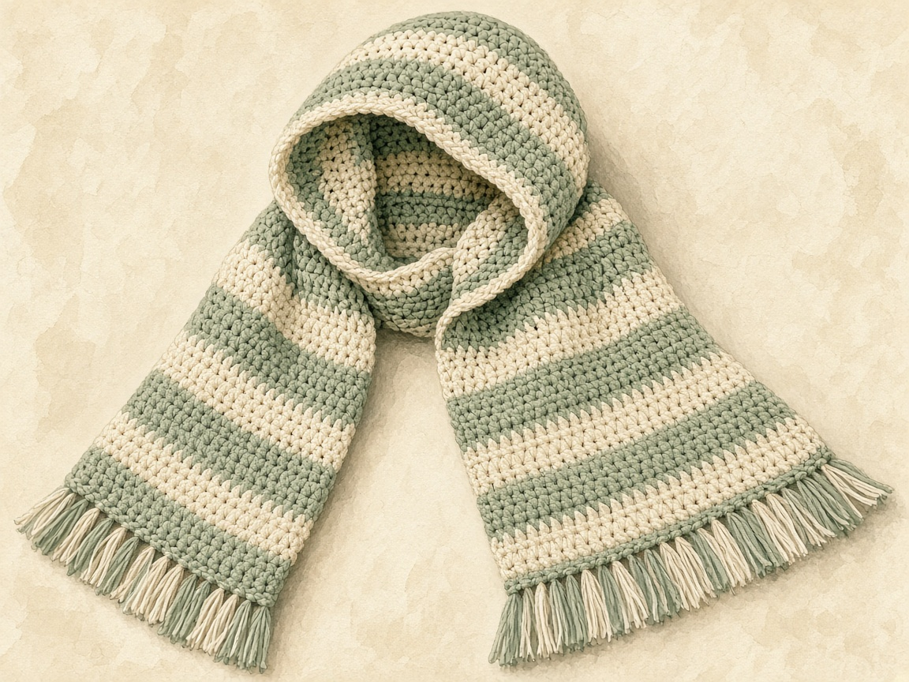

A hooded scarf joins a folded hood to the center of a long scarf. The hood has three different edges: the crown seam, the face opening, and the neck edge attached to the scarf. This guide sizes the rectangles from a hood that fits the wearer. It has not been crocheted or wear-tested; the numerical example is a planning example, not a graded adult size.

US terms. US half double crochet (hdc) is UK half treble. Ch 2 does not count as a stitch on this page. Work the first hdc into the first real stitch and the last into the last real stitch, ignoring the turning chain.

## Materials and measurements

Use a smooth yarn suitable for a scarf, its matching hook, a tape measure, a tapestry needle, removable markers, and a hood that already fits the intended wearer. Swatch and wash/dry according to the yarn label before measuring. Record hdc stitches per inch and rows per inch separately. Estimate yarn from the combined hood and scarf area using a weighed swatch in the same stitch; no finished sample yardage is available.

Lay the reference hood sideways, folded at the center back. Measure **D**, from its center-back fold to the face edge, and **H**, from neck to crown. A rectangle hood is box-shaped; a shaped coat hood may not be reproduced by these two numbers alone. Measure the reference face-edge length and check that it is compatible with about 2H for this construction. Include any desired seam allowance in your planned rectangle. Baste and try the new hood rather than assume the coat measurements guarantee fit.

## The fold and the three edges

Let W be the rectangle width in the stitch direction and H its height in the row direction. Choose W = 2D. Fold W in half by bringing its two short H-length edges together. The folded piece is D deep and H tall. The fold is center back.

- **Crown:** the two upper half-width edges are sewn together from the fold to the face. The seam is D long.
- **Face:** the two original short edges remain unsewn. Together their exposed length is 2H. This is an open front, not a closed hat brim that must be pulled over the head.
- **Neck:** the two lower half-width edges remain unsewn and open out to a W-length neck edge. This edge attaches to the scarf.

Adding stitches changes W and therefore depth D. Adding rows changes H and therefore face-edge length 2H. Head circumference alone does not determine either dimension. The neck edge is W. The face edge is about 2H. Do not resize one by measuring the other.

<figure class="diagram">

<figcaption>Construction diagram: crown seam, open face, and scarf attachment edge are different edges.</figcaption>
</figure>

## Calculate your hood rectangle

Stitches across = 2 × D × your stitches per inch. Foundation chains = stitch count + 2. Rows = H × your rows per inch, rounded to whole rows. Measure the actual fabric as you go; estimates are not more authoritative than the tape.

**Planning example only:** if a suitable reference hood measures D = 10 inches and H = 12 inches, and the washed swatch is 3 hdc and 2.5 rows per inch, W = 20 inches, so work 60 hdc starting with ch 62, for about 30 rows. Folded depth is 10 inches, face-edge length about 24 inches, and neck edge about 20 inches. These are derived dimensions, not a tested fit or an adult size recommendation.

## Crochet the hood

**Row 1:** Chain your calculated stitch count plus 2. Hdc in the third chain from the hook and each chain across. (Your calculated count; 60 in the example.)

**Row 2:** Ch 2, turn. Hdc in each real stitch across. (Same count.)

**Every later row:** Repeat row 2 until the relaxed fabric measures your planned H. Mark the first and last real stitch and count each row. Fasten off with a sewing tail long enough for the crown seam, or use a separate yarn length for sewing.

Lay it flat and mark the midpoint of both W-length edges. Fold it in half, public faces together, so the two H-length edges line up. Do not sew those edges. They are the face opening. The midpoint of the fold is center back. Baste one paired W/2 edge as the crown, from the fold out to the face, matching stitch to stitch. Leave the other paired W/2 edge open at the neck. Turn it right side out and try it on before permanent sewing. The crown should cover the top of the head without tugging and the neck should reach its intended position. If depth is wrong, revise the stitch-direction width; if height is wrong, revise the row count. Neither change guarantees a fit until tried.

## Crochet the scarf

Choose a scarf width and length with a tape. For an illustrative 8 × 60 inch scarf at 3 hdc and 2.5 rows per inch, work 24 hdc across from ch 26 for about 150 rows. Substitute your own washed gauge and intended dimensions.

**Row 1:** Ch 26 for the example; hdc in the third chain and across. (24)

**Row 2 and later:** Ch 2, turn, hdc in each real stitch. (24) Stop at the intended relaxed length; fasten off and weave the tails.

For a different width, calculate width × stitches per inch and add two foundation chains. For a different length, calculate length × rows per inch as a forecast, then measure. Do not seam the scarf into a loop.

## Attach the hood to the scarf

Once the hood fits and the crown is permanently sewn, open its neck edge out: it has the original W length. Mark its center-back fold and the center of the scarf length. Lay the scarf flat and match those centers along **one long scarf edge**. Distribute half the hood neck to each side of the scarf-center marker. The hood's face ends are the two ends of this attachment span.

Baste the hood neck to the scarf's long edge without gathering or stretching either piece. This matches hood stitch-direction fabric to scarf row ends, so the counts need not be identical. At the example gauges, 20 inches of hood neck contains 60 stitches and 20 inches of scarf edge contains 50 row ends. Distribute five row ends across six hood stitches rather than trying a one-to-one match. Keep both ends of the scarf free and check nothing is twisted.

Try the basted assembly on, then whipstitch with relaxed tension through the paired edges. Weave ends in separate directions and inspect the seam from both sides. No drawcord, button, or ornament is needed.

## Check the result before finishing

1. Crown seam closes the top only; the face remains open.
2. Center back matches the scarf center and both scarf ends hang evenly.
3. Hood depth and height suit the wearer without pulling the scarf upward.
4. Attachment seam lies flat without gathering the scarf or leaving loose loops.
5. All markers and basting threads are removed and ends secured.

## Troubleshooting

**It is too shallow front to back.** W was too short; more rows only increase H. Remake or redesign the width after checking the reference.

**It is too short neck to crown.** H was too short; add rows before closing the crown.

**The face was sewn shut.** The seam followed the H-length short edges rather than the top D-length crown edge. Open it and identify the marked edges again.

**The scarf bunches below the hood.** The attachment was stretched or pulled tight, or the two edge lengths differ. Unpick and distribute equal measured lengths.

**It sits over one ear.** The center-back fold was not matched to the scarf center, or the scarf twisted during sewing.

## Care and next steps

Follow the yarn label. Support the wet piece and dry flat with the hood opened out. Recheck fit after washing. This is a sizing and construction guide; a sample must still be made and worn before reporting a confirmed size or yardage.

For the scarf stitch alone, use the [beginner scarf](/how-to-crochet-a-beginner-scarf/). For a smaller fitted project, see the [ear warmer](/how-to-crochet-an-ear-warmer/) or [chunky beanie](/how-to-crochet-a-chunky-beanie/).
