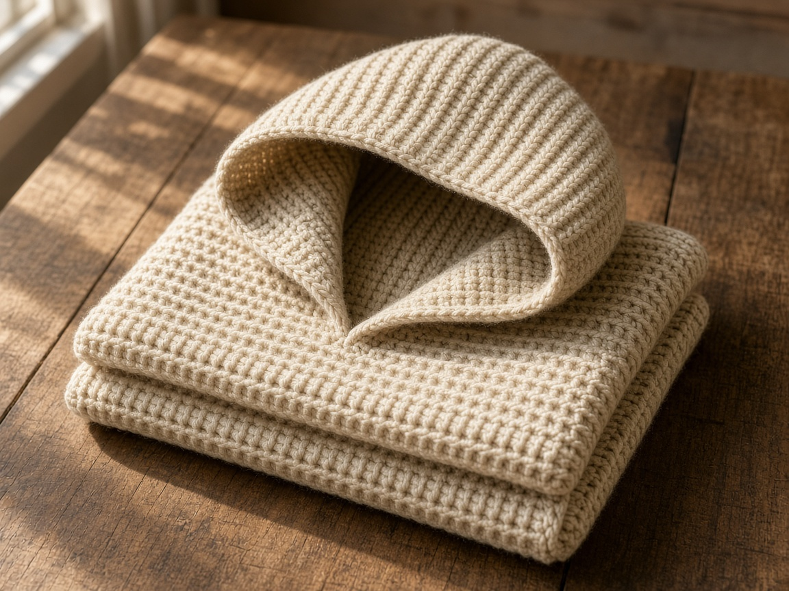
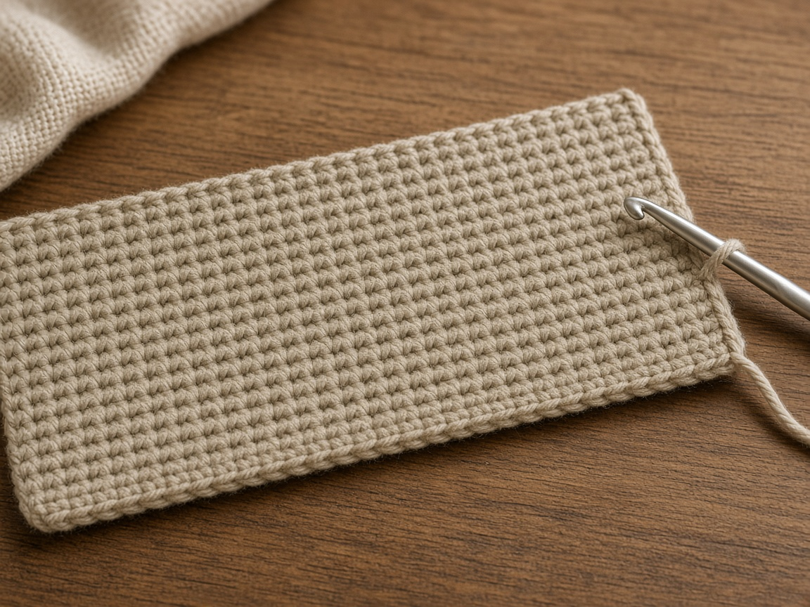
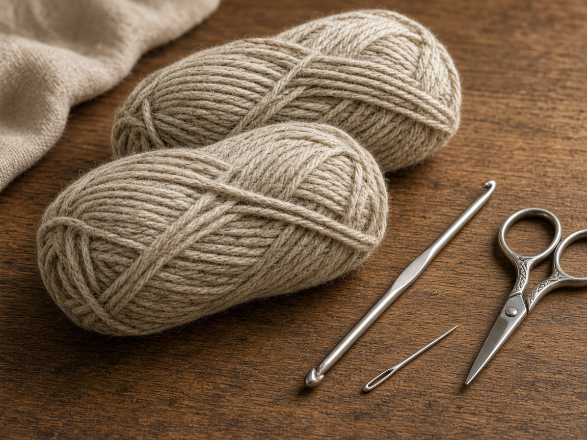
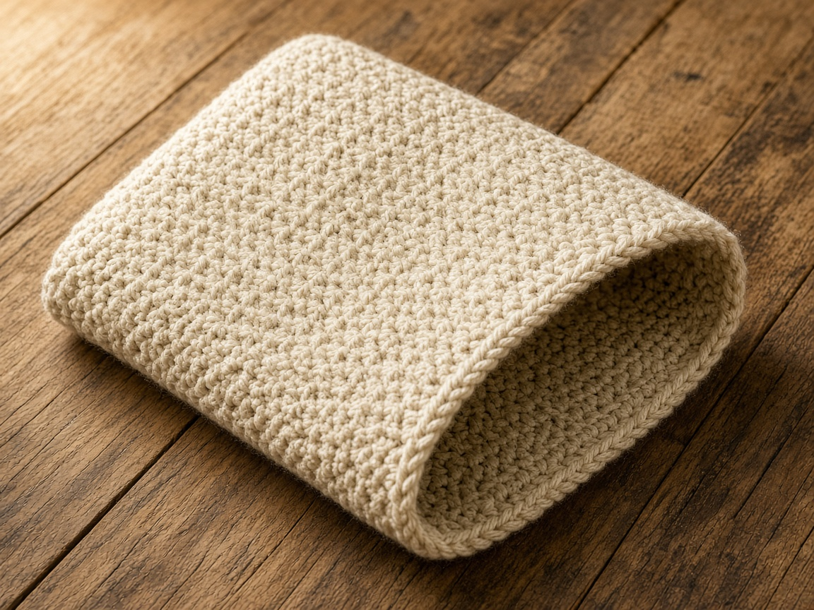
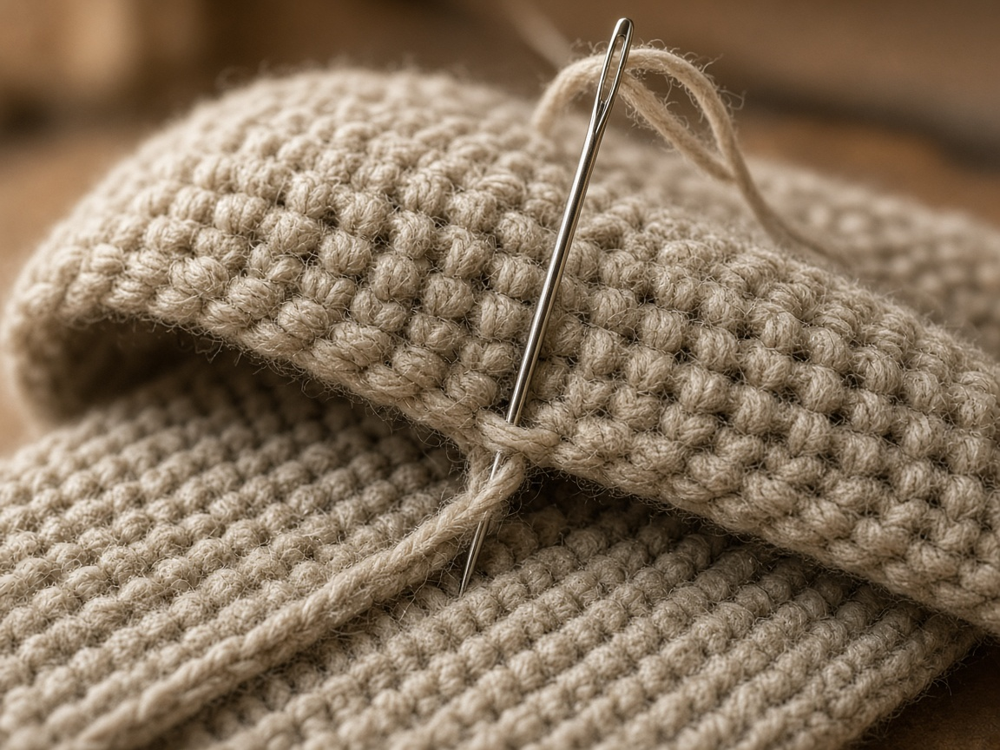
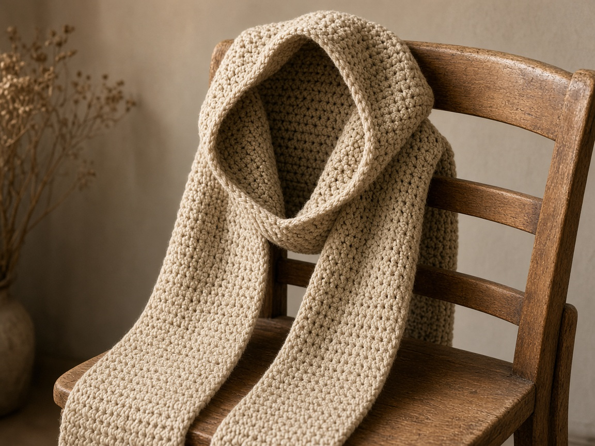

This is a construction and sizing guide, not a fitted pattern. A hooded scarf is two rectangles. The long one is the scarf. The shorter one is folded in half, seamed along the crown, and sewn to the middle of the scarf. The stitches are [half double crochet](/basic-crochet-stitches/). The part that decides whether a person can wear it is the fold: which edge becomes the face opening, and how that edge gets its length.

US terms. US half double crochet is not the UK half treble. On this page it is: yarn over, insert the hook, pull up a loop, yarn over, pull through all three loops. [Abbreviations](/crochet-abbreviations-chart/). The pictures are illustrations. This scarf has not been crocheted, worn, or measured in yarn.

The old hood on this page is about **12 inches wide**. Folded, the open edge is still about **12 inches**, and the depth from the center back to the face is about **6 inches**. The Craft Yarn Council's head chart lists an adult woman at **21–23 inches** around and an adult man at **22–24 inches**. A 12 inch opening does not pass that head. A child on the same chart is **18–20 inches**, and a baby is **14–16**. Twelve inches overlaps only the preemie range, and this is not a baby pattern.

Do not chain 38 and call it a hood. Those numbers stay below as the mistake, so the arithmetic can be checked. They are not instructions. Until someone measures a hood that already fits, crochets to that measurement, and wears the result, this page should not be published as a wearable pattern.

## What is a technique, and what failed

| Piece of this page | What it is |
| --- | --- |
| Half double crochet, chain-2 not counted | The stitch rule here. Skipping the chain-2 is a choice, not a law. Another pattern may count its turning chain. |
| Fold the width in half, seam the crown, leave the far edge open | The construction. The open edge keeps the full width. |
| 3 hdc and 2.5 rows to the inch | An unverified gauge, used only to turn the old chains into inches. |
| Chain 38, 36 half doubles, about 30 rows | A worked example of a hood that is too small. Do not make it. |
| A 60 inch scarf at 24 stitches | Arithmetic for one length and one width, at that same unverified gauge. A scarf can be an inch off and still be a scarf. A hood cannot. |
| About 500 yards | An old shopping line. It was not weighed. |

## Step 1: Learn which edge is the opening

Work the rectangle with the stitches running across the width. Call that width W and the row-direction height H.

Fold W in half so the two short ends meet. The fold is a straight line that will sit at the center back of the head. You now have a double layer, H tall and W/2 deep.

Sew the two layers together along the top, from the fold toward the face. That seam is the crown. On the folded piece it is W/2 long, and it runs over the top of the head.

Leave the bottom edge open. You did not seam it. Opened out around the neck, that edge is still the original width W. That is the edge that has to go around the face and neck. The depth, from the center-back fold to the face, is W/2.

<figure class="diagram">

<figcaption>The opening is the width you chained, not half of it, and not the row count. Adding rows makes the hood taller. It does not enlarge the opening.</figcaption>
</figure>

This is why the old "about 6 inches" line was only half the diagnosis. At 3 half double crochet to the inch, 36 stitches are 36 ÷ 3 = **12 inches of width**. Folding does not turn the opening into 6 inches. The opening stays 12. The 6 inches is the depth, W/2. Both numbers are too small for the heads on the Craft Yarn Council chart, and they fail in different ways. A short depth never reaches the crown. A short opening never lets the head in. Extra rows fix neither one.

<figure class="diagram">

<figcaption>The stitch itself is not the sizing problem. The width of the rectangle is.</figcaption>
</figure>

## The failed hood, checked on paper

Gauge used for this check, and not taken from a swatch: **3 hdc = 1 inch. 2.5 rows = 1 inch.**

Chain 38. Half double in the third chain from the hook. The two skipped chains are the turning chain, and on this page they do not count, so the row has **36** stitches, not 38.

36 ÷ 3 = **12 inches wide**.

About 30 rows at 2.5 rows to the inch is 30 ÷ 2.5 = **12 inches tall**.

| | This example | What the opening has to pass |
| --- | --- | --- |
| Open edge | 12 inches | A head. Adult woman 21–23 in, adult man 22–24 in, on the [Craft Yarn Council head chart](https://craftyarncouncil.com/standards/head-circumference-chart). |
| Depth, fold to face | 6 inches | Whatever a hood that already fits measures. This page has no worn depth. |
| Height, neck to crown | 12 inches | Same. H is real only after you measure a hood. |

A head circumference is not a hood pattern. It is the reason a 12 inch opening is not in the running. A hood opening also has to clear ears, a chin, and the seam allowance you have not tested. This fabric is plain half double, not ribbing, so do not subtract "ease" from a hat formula and hope the head squeezes through. That subtraction was never tried here.

Do not scale the 36 stitches up by a guess, and do not shrink them for a child. A wrong rectangle, multiplied, is still the wrong rectangle.

## Step 2: Measure a hood that already fits

Use a hood the person wears and likes. A coat hood and a scarf hood are not the same shape. Measure the scarf-like one if that is what you are making.

1. The length of the edge that goes around the face and neck. That length is W.
2. The distance from the center back to that face edge. On this fold, it should land near W/2. If the hood you measured is much deeper or much shallower than half its opening, it was not built as this rectangle. Do not force these steps onto it.
3. The distance from the neck edge up to the crown seam. That distance is H.

If you cannot put a tape on a hood that fits, stop. This page cannot hand you W.

Stitches across = W multiplied by your own half doubles per inch. Chains = that stitch count plus 2, because you will start in the third chain and the chain-2 will not count. Rows = H multiplied by your own rows per inch. Round to a whole stitch only after you have looked at the swatch, and then try the opening before you sew the hood to the scarf.

## Step 3: Swatch half double crochet

The 3-per-inch and 2.5-rows figures are not a promise. Chain about 20, work half double for several rows, and measure the middle. [Gauge](/crochet-gauge/) on the scarf mostly changes yarn use and drape. On the hood it changes whether the opening matches the tape.

Chain-2 at the start of each row does not count. The first stitch of the new row goes into the first real stitch. If you work into the chain instead, the piece grows a stitch every row and the side becomes a diagonal.

<figure class="diagram">

<figcaption>Same stitch count every row keeps the side straight. A gained stitch at the turning chain is the usual slant.</figcaption>
</figure>

Checkpoint: 15 half doubles in the middle of the swatch, divided by their width in inches, is the number you will multiply by W. Write it down. Do not go back to 3 unless the swatch actually gave you 3.

## Step 4: Plan the scarf from a tape

The scarf does not use the head chart. Measure the length you want, from one hip, around the neck, to the other hip, if that is how it will be worn. Choose a width you are willing to have against the coat. Eight inches is one example of a width, not a fit.

At the unverified example gauge, an 8 inch width is 8 × 3 = **24 stitches**. The chain is 24 + 2 = **26**. A 60 inch length is 60 × 2.5 = **150 rows**. Change the 3 and the 2.5 to your swatch before you trust either number. A taller person, or someone who wants the ends inside a coat, needs a longer tape, not a longer guess.

Chain-2 does not count.

Chain 26, only if your swatch really gives 3 half doubles to the inch and you really want 8 inches.

**Row 1:** Half double in the third chain from the hook and across. Chain 2, turn. (24)

**Row 2:** Half double in each stitch. Chain 2, turn. (24)

Repeat row 2 until the scarf matches the tape. Count every 20 rows. Count the stitches every few rows. You want 24, or your own number, not a slow climb to 30.

Fasten off. Do not seam the scarf to itself.

The example scarf is 24 × 150 = **3,600 half doubles**, before any hood. Yardage depends on the yarn and on the hood width you have not measured. The old "about 500 yards" was not weighed off a finished piece. Do not buy from it. Weigh a swatch, or keep the labels and stop when the piece matches the tape.

The stitch is a beginner stitch. The page is intermediate because the fold is easy to misread and the sewing has to be centered. A 60 inch rectangle is a lot of rows. Plan more than one sitting. The example hook is a US H/8 (5.0 mm) only if that hook hits your swatch. [Hook chart](/crochet-hook-size-conversion-chart/). [Yarn weights](/yarn-weight-chart/).

## Step 5: Fold, seam the crown, and stop if the head will not pass

Only start this step with a W and an H from step 2.

Chain the stitches-plus-2 you calculated. Half double in the third chain and across. Repeat until the piece measures H. Count the stitches at the end of the first row and again near the last. They should match.

Fold on the center of W. The fold is center back. Sew from the fold along the crown edge, through both layers, and stop at the face edge. Leave the face edge open. You are making a hood, not a bag.

Put the hood on, or over the head it was measured for, before you attach it to the scarf. If the head does not go through, W is short. Undo the seam if you need to, and add stitches at the side of a new panel. Do not gather the opening to make it look finished. If the crown seam is sitting on the forehead, H or the depth is wrong. Adding a round of single crochet around the face will not turn 12 inches into 22.

An older line said to sew "about 8 inches" down the back. That length was a guess from the row gauge, not a seam measured on a person. Sew the crown. Stop where the hood you measured stops. If you are unsure, baste, try it, then sew.

## Sew the hood to the center of one edge

Find the center of the scarf's length and mark it with a scrap of yarn, not a metal marker you might forget. The hood's neck edge is the open bottom after folding. Sew that edge to **one long edge** of the scarf, centered on the mark. The face opening points the same way as that edge, so the hood sits on the neck and the rest of the scarf hangs down the front.

<figure class="diagram">

<figcaption>Center is along the length. The seam stays on the near edge.</figcaption>
</figure>

Sew with the yarn needle through both layers. Do not pull so tight that the scarf puckers. Put it on before you weave the sewing end in.

If the scarf rides up to the mouth, the seam has crossed onto the width of the scarf. Take it off and sew closer to the edge. If the hood sits over one ear, the mark was not the center. If one end of the scarf flips, the scarf was twisted when you sewed. Lay it flat, both ends the same way up, and sew again.

## Mistakes

**Making the 36-stitch hood.** The opening is about 12 inches at the example gauge. That is the defect in the old instructions. Measure a hood that fits.

**Adding rows because the face will not go in.** Rows change H. The opening is W. You need more stitches, not more rows.

**Hood at one end of the scarf.** It looks like a pocket on a runner. Measure the center of the length.

**Crown seam closed around the face edge.** There is no opening. The face edge stays unsewn.

**Chunky yarn with these stitch counts.** This page's arithmetic is worsted, and the counts are already the failed example. Chunky yarn with 36 stitches is a smaller hood, not a warmer one. Swatch, and still start from a measured hood.

**Quoting 500 yards for a scarf with no hood.** Even the scarf alone was not weighed. A hoodless scarf uses the 3,600 half doubles of the example, or fewer if your length is shorter, and the hood stitches are absent.

## Care

This is a lot of wet wool or acrylic if you wash it. Squeeze. Dry flat, with the hood open, so the crown seam does not dry as a crease. Check the label before a machine wash. A felted hood does not stretch back to the head you measured.

## Frequently asked

### Can I skip the hood and keep the scarf?

Yes. Stop after the long rectangle. You still have a scarf, and the length still comes from the tape. Do not quote a yardage this page never weighed.

### Is 60 inches the right gift length?

It is one adult example of a tape measurement, at an unverified row gauge. A child needs a shorter scarf so the ends are not under their feet, and a child hood is not the 12 inch panel with fewer rows. Measure a hood they already wear, or do not make the hood.

### Will it stay on in wind?

This page has not been worn in wind, so it does not claim the hood stays on. A coat hood with a button is a different object. If you do not have a hood to measure, the [ear warmer](/how-to-crochet-an-ear-warmer/) is the smaller project.

### Should this pattern stay up as a project page?

Not as a pattern someone can follow to a wearable hood. The fold, the failed arithmetic, and the way to measure a real hood are the useful parts. The chain-38 hood should stay unpublished until a finished one has been worn and the opening has been checked against that person's head.

## Next

Hands that still get cold are the [fingerless gloves](/how-to-crochet-fingerless-gloves/). A hat with no scarf is the [chunky beanie](/how-to-crochet-a-chunky-beanie/). If the edges of the scarf slant, the repair is the same one as on the [turning chain](/crochet-turning-chain/) page: the chain is not a stitch, and the first half double has to go into the first real stitch.
