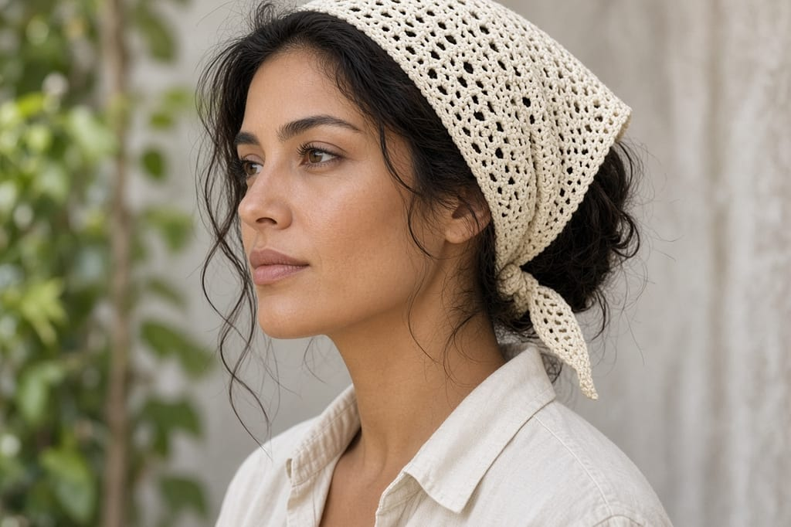
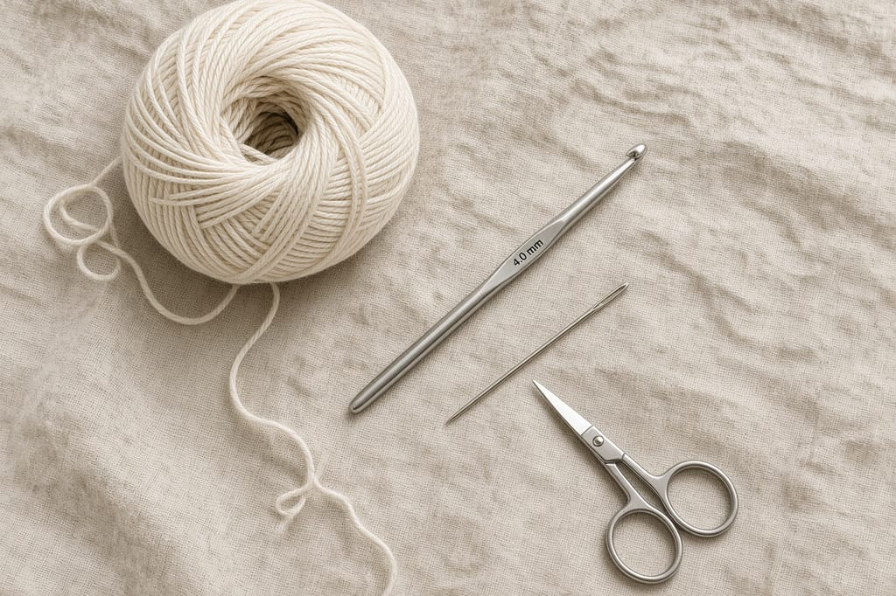
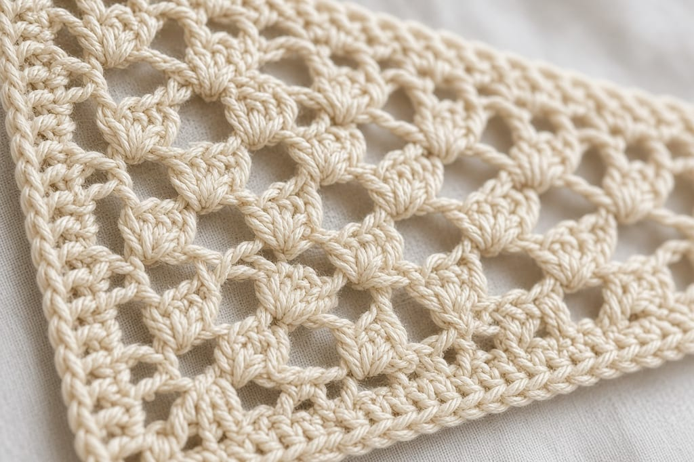

This bandana is a granny triangle: rows of three-double-crochet shells separated by chain spaces, with one corner that becomes the point. What surprises most people is where it starts. The first stitches sit in the middle of the long edge, not at the point. Every row wraps around the one before it like a V, so the long edge grows at both ends while the point moves away from it. Once that picture is clear, the row counts, the sizing, and most of the mistakes make sense.

US terms. US double crochet is UK treble. Names are on the [abbreviations chart](/crochet-abbreviations-chart/). The pictures are illustrations. The 16 inch long edge below is a common stopping point for the math, not a fitted size, so keep going until the triangle fits you.

## What is a technique, and what is only a plan

| Piece of this page | What it is |
| --- | --- |
| Shells in chain spaces, one ch-2 corner per row | Standard granny construction. |
| Ch 3 at the start of a row counts as a dc | The convention on this page. Crochet is not standardized here. |
| Row n has 6n double crochet | Arithmetic you can count on the hook. |
| Depth about half the long edge | Geometry, if the point blocks to a right angle. Not measured. |
| 16 inch long edge, 12 inch ties | A starting target. Not fitted on a head. |
| Yardage | Not weighed. The old 80-yard line was not a finished bandana. |

## How the triangle is built

Row 1 is a tiny V: two shells with a ch-2 corner between them, all worked into a single chain. That chain is the center of what becomes the long edge.

Every later row starts at one end of the long edge, works down one side to the corner, puts a new corner in the corner space, climbs the other side, and ends at the other end of the long edge. Then you turn. Each row adds one shell to each side and pushes the corner one row further away. The ends of all the rows line up into one straight edge. The corners line up into the point.

<figure class="diagram">

<figcaption>The start is the middle of the long edge. The point is the last corner you work, not the first.</figcaption>
</figure>

The corner here, (3 dc, ch 2, 3 dc) in a ch-2 space, is the same corner a granny square uses, and on a square it makes a right angle. If your point blocks square, the triangle is half a square cut corner to corner. The long edge is that square's diagonal, and the depth from the long edge to the point is half of it. A 16 inch long edge gives a point about **8 inches** deep, and each short side is about 16 ÷ 1.414 = **11.3 inches**.

That has a consequence the earlier version of this page missed. You cannot stop at a 16 inch long edge and get a shallow 5 inch bandana. With this corner, depth follows the long edge. If the point would hang too far down your neck, make the long edge shorter and the ties longer.

## Yarn, hook, and tools

- **DK-weight cotton.** It keeps the shells crisp and does not fuzz into the spaces. It also does not spring back after it is pulled, so block it to size rather than tugging it there. Worsted makes a stiff triangle that sits like a napkin. Thread needs a much smaller hook and many more rows. [Yarn weights](/yarn-weight-chart/).
- **A US G/6 (4.0 mm) hook** as a starting point for DK, or the size that keeps the shells open without the fabric looking like a net. [Hook chart](/crochet-hook-size-conversion-chart/).
- **One stitch marker.** Move it into the ch-2 corner every row. Finding the corner is the only hard part of this project, and the marker removes the guess.
- Tape measure, yarn needle, rust-proof pins for blocking.

No gauge is given. The long edge is measured on the work instead, so a different gauge changes the row count, not the fit.

## Measure the long edge you need

Tie a scrap of yarn around your head where the long edge will sit, across the forehead or over the crown, and mark the two points where you want the triangle to end and the ties to begin. Measure the scrap between those marks. That is the long edge.

About 16 inches with 12 inch ties is a common stopping point. Hair volume and placement change it. Before you start, also hold the tape from the long-edge line toward the back of your neck: the point will hang about half the long edge, 8 inches for a 16 inch edge. Decide now whether that suits you.

## Stitches and where they go

- **Shell:** 3 dc in the same place.
- **Corner:** (3 dc, ch 2, 3 dc) in the ch-2 corner space.
- **Turning chain:** ch 3 counts as the first dc of the edge shell. You add 2 dc in the same stitch to finish that shell, and the row's last shell goes into the top of the previous row's turning chain. [The turning chain](/crochet-turning-chain/) explains why counting it and also skipping it makes one edge grow faster.

Inside the row, every shell goes into a chain space, never into the top of a double crochet. Only the two edge shells go into stitches.

## The triangle, row by row

**Row 1:** Ch 4. In the 4th chain from the hook, work 2 dc, ch 2, 3 dc. Turn. (6 dc counting the skipped chains as the first, 1 ch-2 corner)

<figure class="diagram">

<figcaption>Step 1. All of row 1 goes into one chain. The 3 skipped chains count as the first dc on this page.</figcaption>
</figure>

Mark the ch-2. You should see two shells and one corner. A third shell means extra stitches went into the chain.

**Row 2:** Ch 3, 2 dc in the same stitch. Ch 1. (3 dc, ch 2, 3 dc) in the corner. Ch 1. 3 dc in the top of the turning chain. Turn. (12 dc, 2 ch-1, 1 corner)

The earlier version of this page gave 9 dc for this row. Four shells are 12.

<figure class="diagram">

<figcaption>Each row adds 6 double crochet: one shell at each end of the long edge. The corner only moves.</figcaption>
</figure>

**Row 3:** Ch 3, 2 dc in the same stitch. Ch 1, 3 dc in the next ch-1 space, ch 1. Corner in the ch-2. Ch 1, 3 dc in the next ch-1 space, ch 1. 3 dc in the top of the turning chain. Turn. (18 dc, 4 ch-1)

**Row 4 and after:** Ch 3, 2 dc in the same stitch, ch 1. Work (3 dc in the next ch-1 space, ch 1) in each space up to the corner. Corner. Ch 1. Work (3 dc in the next ch-1 space, ch 1) in each remaining space. 3 dc in the top of the turning chain. Turn.

Row n has n shells on each side of the corner, counting the corner halves, 6n double crochet, and 2(n − 1) chain-1 spaces. Row 10 is 60 dc and 18 spaces. Count the shells on each side of the marker before you turn. They should be equal, and equal to the row number.

<figure class="diagram">

<figcaption>Step 2. Every row adds one shell to each arm and keeps one corner, so the counts go 6, 12, 18, 24.</figcaption>
</figure>

### Forecasting rows and yarn from your own swatch

Lay the triangle flat after row 6 and measure the long edge, tip to tip, without stretching. Each row adds about the same width at the two ends, so the long edge grows roughly in step with the row count.

Suppose six rows measure 7 inches. That 7 is an invented example, not a measurement. A 16 inch edge would need about 6 × 16 ÷ 7 = 13.7 rows, so plan on 14 and start measuring after row 12. Treat the forecast as a reason to measure, not as a count to trust over the tape.

Yarn grows faster than width, because every row is longer than the last. Through row N you have worked 3 × N × (N + 1) double crochet: 126 through row 6, and 630 through row 14. So 14 rows need about five times the yarn of the first six. Weigh the triangle at row 6, multiply by N × (N + 1) ÷ 42, and compare with the weight on the label. Leave extra for the ties and the chain spaces, which that count leaves out.

## Ties

Join yarn at one tip of the long edge, working through the last stitch and the turning chain together so the tie is not hanging from one strand. Chain until the chain measures about 12 inches without stretching. Slip stitch in the second chain from the hook and in each chain back to the tip. Fasten off and weave the end into the edge. Repeat at the other tip.

The slip-stitch pass thickens the tie and stops it from stretching and twisting like a bare chain. If you want longer ties because you shortened the long edge, change the chain, not the triangle.

## Block and check the shape

Wet the triangle, press out the water in a towel, and pin it flat with the long edge straight and at your measured length. Use the corner of a sheet of paper to check that the point is square. Measure both short sides. They should match, because each has the same number of shells. Let it dry pinned. Do not iron acrylic. [Weaving ends and blocking](/weaving-in-ends-and-blocking/) has the method.

Before you call it finished:

1. The shells on each side of the corner are equal, and equal to the row count.
2. The two short sides measure within a small fraction of each other.
3. The long edge lies straight when unpinned, not curved inward.
4. The point is a corner, not a rounded tip.

## Troubleshooting

**One side has more shells than the other.** You skipped a space or worked a shell into the top of a stitch. Count back to the row where the sides last matched and pull out to there.

**The long edge draws into a curve.** The ch-3 is shorter than your double crochet, so each row end is short and the edge cannot reach its full width. Work the turning chain looser. Pinning hides the curve only until the next wash.

**The triangle leans.** The corner moved into a ch-1 space on some row. The corner belongs only in the ch-2 space. The marker prevents this.

**The point is blunt or rounded.** The corner chain grew, or you worked extra stitches there. Keep exactly (3 dc, ch 2, 3 dc). A small rounding is normal before blocking.

**The point hangs into your collar.** That is the geometry, not a mistake: depth is about half the long edge. Make the next one with a shorter long edge and longer ties. Do not cut the point off.

**The shells look crowded.** Go up one hook size and start again. Pulling a finished triangle to loosen it distorts the point.

## Wearing and care

Put the long edge at the forehead or over the crown, the point toward the nape, and tie the ends. The open stitches catch earrings and small hair clips, so take those out first.

Hand wash cool. Dry flat, pinned if the edge needs straightening again. Do not machine dry. Cotton can shrink, and a shorter long edge means ties that no longer meet comfortably.

## Frequently asked

**Why does my triangle start in the middle of the top edge?**

Because that is how this construction works. The first chain is the center of the long edge, and the point is the last corner you make.

**Can I make it deeper without making it wider?**

Not with this corner. A square point fixes the depth at about half the long edge. A deeper triangle with the same long edge needs a sharper corner, which is a different pattern.

**Is this a kerchief or a hair scarf?**

It is a triangle you tie on. The name depends on where you put the long edge. The rows do not change.

**Can I sell finished bandanas?**

Yes. Do not republish the rows.

## Next

The same shell and corner, worked in rounds with four corners, is a granny square. The [granny square tote](/how-to-crochet-a-granny-square-tote/) counts those edges and joins the squares. For a flat piece that must keep points crisp, try the [snowflake](/how-to-crochet-a-snowflake/).
