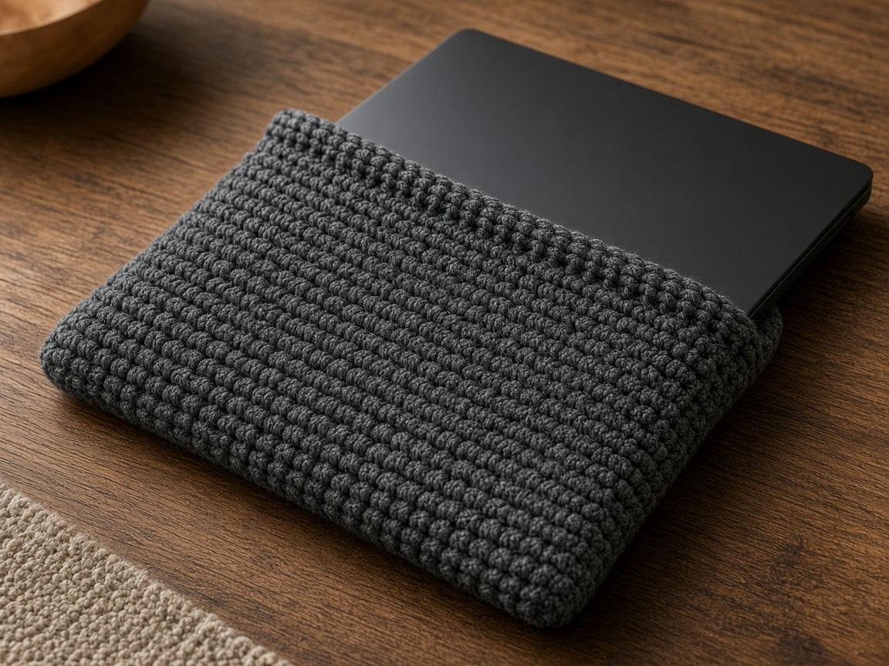
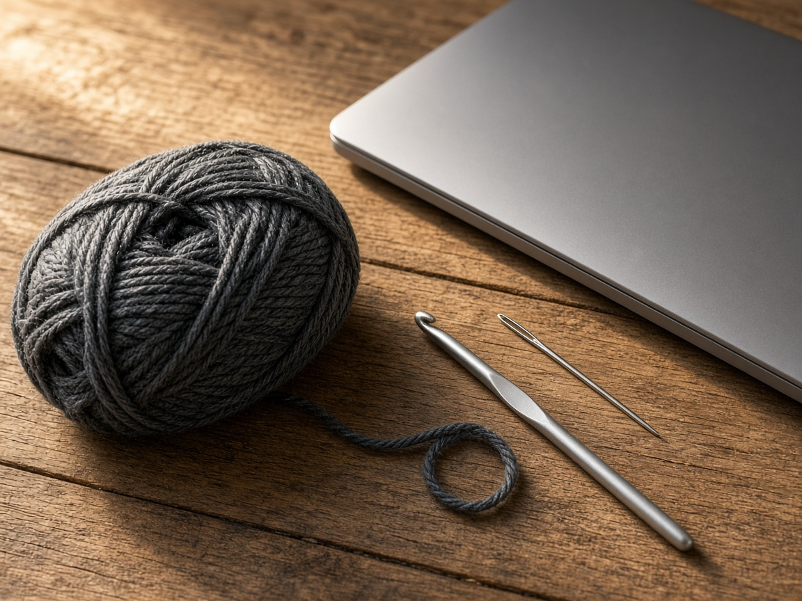
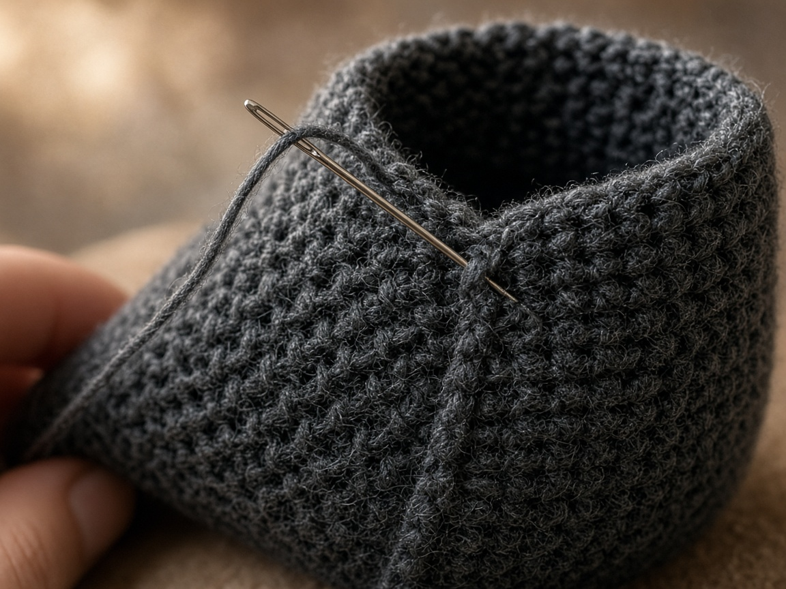

A laptop in a tote shares space with a charger, a pen, and the corner of a notebook, and the lid collects scratches. A crochet sleeve is a soft cover between the lid and everything else. It is not waterproof, and it does not cushion a drop. Single crochet has gaps, and yarn does not absorb a fall.

The construction is a folded rectangle, the same one as the [book sleeve](/how-to-crochet-a-book-sleeve/) and the [phone case](/how-to-crochet-a-phone-case/). What changes at laptop size is the scale. A rectangle of 90 rows takes a long time, small errors add up over that many rows, and a long piece of cotton grows when it hangs. This page covers the sizing, and then how to keep a large rectangle accurate.

US terms. US single crochet is UK double crochet. [Abbreviations](/crochet-abbreviations-chart/). The pictures are illustrations. No sleeve for this page was crocheted or fitted. The laptop in the example is an invented size.

The sleeve will not stop a spill, and it will not save a laptop that falls. It is a soft layer in a bag.

## What is a technique, and what is only a plan

| Piece of this page | What it is |
| --- | --- |
| Rectangle folded at the bottom, sides seamed | Standard construction. |
| Width covers the lid plus the machine's thickness | Geometry. The fabric wraps the edges. |
| A 12 × 8.5 × 0.6 in laptop | An invented example. Measure yours. |
| 4 sc and 5 rows to the inch | An unverified example gauge. |
| About 380 yards | An old line. Not weighed. Withdrawn. |

## Measure the closed laptop

Close the lid and measure on a table:

- **Width**, side to side.
- **Depth**, front edge to back edge.
- **Thickness**, at the thickest point, usually the hinge.

The screen size printed on the box is a diagonal measurement of the screen. It is not the width of the lid. Use a tape.

## How the sleeve is sized

The fabric goes around the laptop, so each face of the sleeve must cover the width plus the thickness. The side seams take up about one stitch. A little ease lets the machine slide in. At the bottom, the fold wraps the front edge, so each side starts about half the thickness above the fold.

<figure class="diagram">

<figcaption>The thickness is added to the width. On a thin laptop that is half an inch; on a thick one, an inch or more.</figcaption>
</figure>

## The worked example

| Part | Arithmetic | Result |
| --- | --- | --- |
| Width | 12 + 0.6 + 0.25 seams + 0.25 ease | 13.1 in, 53 sc, chain 54 |
| Depth per side | 8.5 + 0.3 at the fold + 0.2 ease | 9.0 in |
| Rows | 9 × 2 × 5 | 90 |
| Stitches in all | 53 × 90 | 4,770 sc |

The earlier version of this page added 1 inch to the width and called the result 52 stitches. For a 0.6 inch machine, that leaves about a quarter inch less than the arithmetic above. It may fit. It is tight.

## Yarn and hook

- **Smooth worsted cotton**, in one dye lot. A different lot partway through a large solid piece can show as a band. [Yarn weights](/yarn-weight-chart/).
- **US G/6 (4.0 mm) hook**, or the size that gives dense fabric. [Hook chart](/crochet-hook-size-conversion-chart/).
- Stitch markers, yarn needle, scissors.

## Keeping a large rectangle accurate

**Swatch first, and measure it flat.** At 53 stitches, a gauge error of a quarter stitch per inch changes the width by almost an inch. [Gauge](/crochet-gauge/) is worth the twenty minutes here.

**Start without a tight chain.** A chain of 54 is long, and most people chain tighter than they crochet. The foundation edge then pulls in and the fold puckers. Chain with a hook one or two sizes larger, or use foundation single crochet, which makes the chain and the first row of stitches together and stretches the same way as the rows above it.

**Count and mark.** Put a marker in the first stitch of row 1 and move a second marker up every 10 rows. Count the stitches in each tenth row. A single crochet edge often gains a stitch when the first stitch of a row goes into the turning chain.

**Measure lying flat.** Cotton is heavy and stretches lengthwise under its own weight. A rectangle measured while it hangs off your lap reads long. Lay it on a table to measure.

## Stage 1: the rectangle

Chain 54 with a larger hook, then switch to your working hook. Or work 53 foundation single crochet.

**Row 1:** Sc in the second chain from the hook and in each chain across. Ch 1, turn. (53)

**Rows 2–90:** Sc in each stitch. Ch 1, turn. (53)

The ch 1 does not count as a stitch.

**Checkpoint at row 45:** fold the work in half around the closed laptop, without seaming. The side edges should meet beside the machine with no strain. If they gap, the sleeve is too narrow. Start again wider. Seams do not add fabric.

## Stage 2: seam

Fold so row 1 meets row 90, right sides together. Join yarn at the fold and single crochet through both layers along each side, one stitch per row end, to the top. Turn it right side out so the seam ridges are inside.

Single crochet seams hold better than a whipstitch under the weight of a laptop. At each bottom corner, work back over the first inch of seam a second time with a yarn needle. That keeps the corner from opening in ordinary carrying. It is not drop protection.

Slide the laptop in. It should go in without bending the lid, and the opening should come at least to the top edge of the machine.

## Optional closure

Sew a button to the center of the front, about an inch below the opening. On the back, join yarn at the center of the top edge and chain a loop long enough to reach over the top and around the button, with the laptop inside. Slip stitch back into the same stitch. Place the button with the laptop in the sleeve, not on the empty sleeve.

## Troubleshooting

**The laptop will not go in.** The width did not include the thickness, or the gauge is tighter than planned. Start again wider.

**The bottom edge puckers.** A tight foundation chain. Use a larger hook for the chain, or foundation single crochet.

**One side is longer.** Stitches were gained or lost. Count back to the row that was right.

**The sleeve was long when made and longer after a week.** Cotton relaxes. Next time, measure flat and stop a little short.

**A corner seam opens.** Reinforce the first inch with a second pass.

## Care

Take the laptop out. Hand wash cool. Dry flat. Put the laptop back only when the sleeve is completely dry.

## Frequently asked

**Will it fit every laptop?**

No. The counts above are for the invented example. Measure your closed machine and redo the table.

**Is it safe in the rain?**

No. Water goes through single crochet. Use a water-resistant bag on wet days.

**How is this different from the book sleeve?**

Same fold and seam. The [book sleeve](/how-to-crochet-a-book-sleeve/) lets the cover show. This one covers the whole lid, and it is big enough that tension control matters.

## Next

The same width-plus-thickness rule on a small object is the [phone case](/how-to-crochet-a-phone-case/). For a swatch you can trust before 90 rows, see [crochet gauge](/crochet-gauge/).
