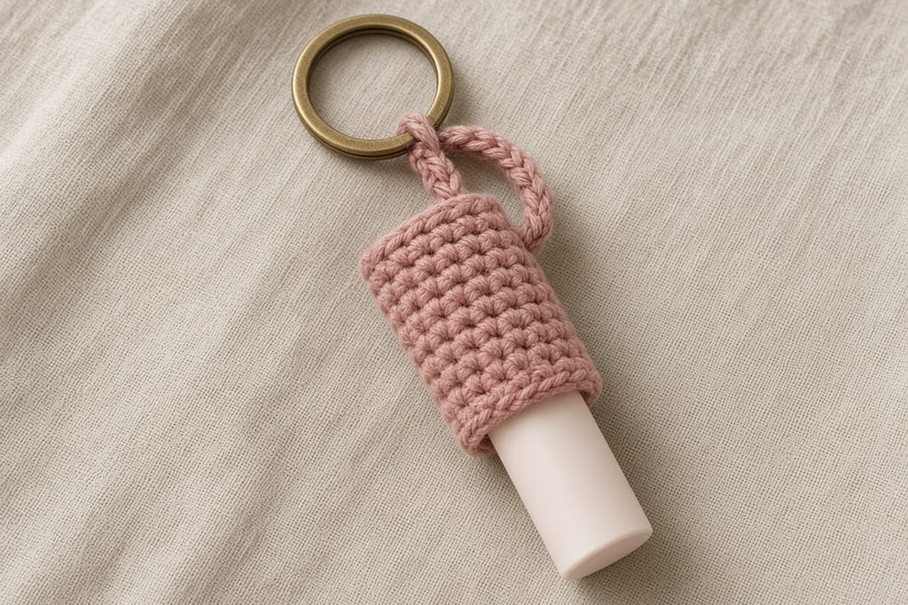
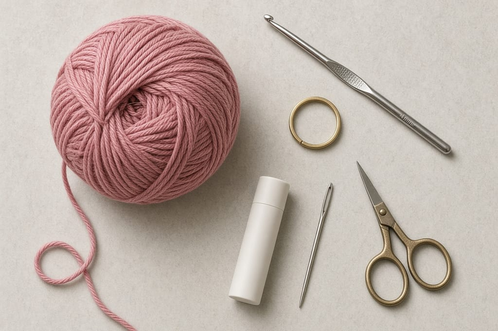
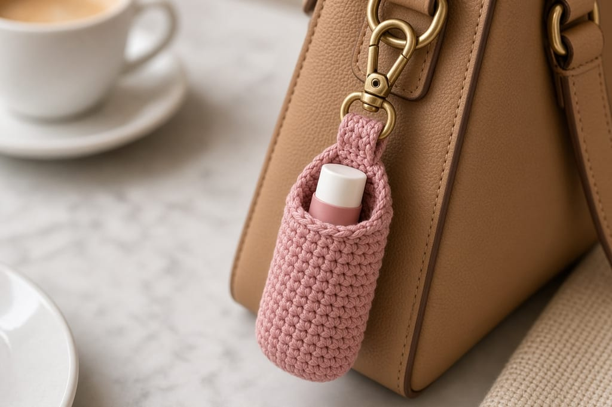

A lip balm loose in a bag sinks to the bottom. A short sleeve on a key ring keeps it on hardware you already reach for. The sleeve itself is quick: a tiny flat base and a narrow tube. The two things that decide whether it works are how many stitches go around and where the loop is sewn. Get the count wrong and the tube drops out. Sew the loop to the wrong end and the tube hangs upside down.

US terms. US single crochet is UK double crochet. [Abbreviations](/crochet-abbreviations-chart/). The pictures are illustrations. No holder for this page was crocheted or fitted to a tube. The tube in the example is an invented size, 0.65 inch across, so the arithmetic has numbers. Measure your own.

## What is a technique, and what is only a plan

| Piece of this page | What it is |
| --- | --- |
| Small flat base, then even rounds | Standard construction for a closed tube. |
| Circumference = 3.14 × tube width | Geometry. |
| 0.65 in tube, 1.9 in below the cap | An invented example. |
| 4 sc and 5 rounds to the inch | An unverified example gauge. |
| About 15 yards | An old line. It was not weighed and is withdrawn. |

## How the sleeve is built, and why it hangs from the rim

Round 1 is six single crochet in a magic ring. Round 2 increases to the count that goes around the tube. Every round after that is even, so the fabric turns up into a straight tube. The base is closed, so the tube cannot fall through the bottom.

The loop decides which way up the sleeve hangs. A sleeve hangs from the end the loop is sewn to. Sew it to the closed base and the open rim points at the floor, and every bump in the bag shakes the tube toward the opening. Sew it at the rim and the closed base hangs down, and gravity keeps the tube seated with the cap up where you can reach it. The earlier version of this page had this the wrong way round.

<figure class="diagram">

<figcaption>The loop end is the top. Put it at the rim and the closed base becomes the bottom.</figcaption>
</figure>

## Measure the tube

1. **Width.** Measure across the tube. Example: 0.65 inch.
2. **Around.** Multiply by 3.14: 0.65 × 3.14 = **2.04 inches**. Or wrap a strip of paper around it and measure the strip.
3. **Height below the cap.** From the bottom of the tube to the lower edge of the cap. Example: 1.9 inches. The sleeve should stop below this so the cap twists freely.

## Yarn, hook, and gauge

- **Smooth worsted cotton.** Fuzzy yarn catches the cap's thread. Sequins catch everything. [Yarn weights](/yarn-weight-chart/).
- **US G/6 (4.0 mm) hook**, or the size that gives firm fabric. [Hook chart](/crochet-hook-size-conversion-chart/).
- A split ring or a lobster clasp.
- Stitch marker, yarn needle, scissors.

At this size a square swatch is more work than the project. Make the sleeve, then measure the tube you made around. That measurement is your gauge for the next one.

## The worked example

| Count around | At 4 sc per inch | Against a 2.04 in tube |
| --- | --- | --- |
| 8 | 2.0 in | Tighter than the tube. It will not go in. |
| **9** | **2.25 in** | About 0.2 in ease. Snug, holds by friction. |
| 10 | 2.5 in | About 0.45 in ease. Loose. The tube rattles. |

Wall height: 1.9 inches × 5 rounds per inch is about 9.5 rounds. Ten even rounds, with the base adding a little, leaves the cap clear.

Stitches in all: 6 + 9 + (10 × 9) = 105 single crochet. If you want a yardage figure, weigh the finished sleeve. Do not trust a number that was never weighed.

## Stage 1: the base

Work in a spiral. Mark the first stitch of each round. [Crochet in the round](/crochet-in-the-round/) explains spirals.

**Round 1:** 6 sc in a magic ring. Pull the ring tight. (6)

**Round 2, for 9:** (Sc, 2 sc in next) 3 times. (9)

For 8: (sc 2, 2 sc in next) 2 times. For 10: (2 sc in next, 2 sc in next, sc) 2 times.

Round 2 adds fewer than six stitches, so the base will cup a little. That is what you want. It is the bottom of a tube, not a coaster.

## Stage 2: the tube

**Rounds 3–12:** Sc in each stitch. (9)

Slide the tube in after round 7. The bottom of the tube should touch the base. Stop when the rim sits just below the cap.

**Checkpoint:** hold the sleeve rim down and shake it once. A snug sleeve keeps the tube. If it slides out, start again with a smaller hook at the same count, rather than adding a decrease round to an already-finished tube.

Slip stitch into the next stitch to smooth the step at the end of the spiral, and fasten off with a tail long enough to sew the loop.

## Stage 3: the loop

Chain 14 with a new length of yarn. Fold the chain in half. Sew both ends to the outside of the last round, side by side over two stitches, so the loop stands up above the rim. Go through several stitches, then weave the tail back through the chain.

Put the split ring through the loop, not through the fabric. You will want the ring off to wash the sleeve.

Keys are hard on the loop. It rubs every time they drop. If the holder lives on keys, sew the loop through four stitches instead of two.

## Troubleshooting

**The tube will not go in.** The count is too small for the tube, or your gauge is tighter than 4 per inch. Go up one count or one hook size.

**The tube slides out.** Too much ease, or the loop is on the base. Check where the loop is first.

**The cap will not twist.** The sleeve is too tall. Pull out a round.

**The base is a flat disc and the tube wobbles on it.** Round 2 added too many stitches for the count you then worked. Recount round 2.

**The loop pulled out.** It was sewn through one stitch. Resew through several and weave the tail into the chain.

## Care

Take out the tube and the ring. Wipe the rim of the tube before you put it back, because balm on the yarn picks up dirt. Hand wash cool and dry flat. Heat can shrink cotton enough that the tube no longer fits.

## Frequently asked

**Will any lip balm fit?**

No. Tubes vary in width. Measure, then pick the count from the table.

**Can I make a set?**

Yes, for tubes of the same width. Sleeves of different counts in one bunch mean one tube fits and the next falls out.

**Can I use sock yarn?**

Yes, with a smaller hook and more stitches. Ignore the inch figures and redo the table from your gauge.

**Can I sell them?**

Finished holders, yes. Do not republish this page.

## Next

The same base and tube, wider and with a flap, is the [earbud pouch](/how-to-crochet-an-earbud-pouch/). The flat-sleeve version of the "measure around, not across" rule is the [phone case](/how-to-crochet-a-phone-case/).
