A lipstick tube will not stay put in a sleeve that was sized for a different brand. This holder is a small open cylinder in [single crochet](/basic-crochet-stitches/), worked from a round base, with a folded strap for a ring or clasp.

#### Check the base before the walls

1. Treat the stitch counts below as counts worked out from the rounds.
2. Lay the base against your own closed lipstick before you crochet the walls.
3. Read the pictures as illustrations of the shape.
4. Read the drawings as the stitch counts.

US terms are used throughout. US single crochet is the UK double crochet. US half double crochet, used only on the optional flower, is the UK half treble.

## What the holder is

#### Name the object before you count stitches

1. Make a sleeve for one closed lipstick, lip balm, or a tube of a similar size.
2. Keep it as one pocket. This is not a makeup bag.
3. Sit the tube upright in the pocket.
4. Put a strap near the top for a lobster clasp, a swivel clasp, or a split ring so you can clip it to a bag.

The sleeve does not replace the lipstick cap. Keep the original cap on. The crochet is an extra cover around the closed tube.

#### How the pieces join

1. Work the main piece as one spiral.
2. Do not seam a rectangle into a tube.
3. Crochet a separate strip for the strap.
4. Expect fewer joins than a pouch made from flat panels.
5. If you want a pocket for several items, use the [makeup pouch](/how-to-crochet-a-makeup-pouch/) instead.

Five parts:

- A round base.
- A cylinder in single crochet, with the same stitch count on every round after the base.
- An open top.
- A folded strap sewn to the outside.
- An optional five-petal flower.

## Project at a glance

| Detail | What to use |
| --- | --- |
| Skill | Confident beginner |
| Stitches | Magic ring or a chain start, single crochet, increases, back loop only, sewing |
| Yarn | DK cotton, or another smooth yarn that makes a firm fabric |
| Hook | 3.0 mm to start |
| Starting circumference | 18 single crochet |
| Construction | Bottom up, continuous rounds |
| Strap | A separate strip, 5 stitches wide, folded through the hardware |
| Terms | US |

Eighteen stitches is a starting count, not a size that fits every lipstick. Yarn, hook, and tension change the diameter. Measure the tube you have.

## Materials

#### Set up the counting surface

1. Work on a flat surface in decent light.
2. Count the small circle as you go. A missed stitch shows up fast.

### Yarn

#### Choose a yarn you can count

1. Use smooth DK cotton, or a yarn of similar thickness that does not fuzz.
2. Prefer cotton when you are counting increases in the round, because the stitches show.
3. Ask the sleeve to hold a shape.
4. Set aside a drapey or very stretchy yarn. It collapses, and the tube rattles inside it.

#### How much, and when a second color is safe

1. Plan a small amount for the sleeve and the strap.
2. A leftover ball is often enough.
3. Do not start a stripe unless you have enough of each color to finish the round you are on.

#### Color on a piece this small

1. Colors that read clearly: dusty rose, cream, sage, lavender, black, burgundy.
2. Keep a second small amount of a contrast color for the flower.
3. A blush sleeve with a cream flower is one contrast, not a pattern of many colors.

Acrylic can work if the fabric at your hook is firm. Fuzzy, loosely spun, or very elastic yarn makes the stitches hard to see and the sleeve soft. Skip those for the first one.

Yarn labels and the standard weight numbers are on the [yarn weight chart](/yarn-weight-chart/).

### Hook

#### Start at 3.0 mm, then match the fabric

1. Start with a 3.0 mm hook for DK cotton.
2. That size sits between the letter sizes on the [hook chart](/crochet-hook-size-conversion-chart/).
3. If the fabric is stiff and unpleasant to work, go up a hook size.
4. If you can see holes the lipstick could slip against, or the stitches look loose, go down a hook size or ease your tension.

The sleeve should be flexible enough to take the tube and dense enough that the tube does not fall through the opening when the holder tips.

### The rest

- A stitch marker. Continuous rounds need one. A scrap of yarn works.
- Scissors and a tapestry needle.
- The closed lipstick you are sizing to.
- A tape or a ruler.
- A lobster clasp, a swivel clasp, or a split ring, with no sharp edge against the yarn.
- Optional contrast yarn for the flower.
- Optional clips to hold the strap while you sew.

Do not rely on glue for the strap. The join has to hold the weight of the tube. Sew it.

## Measure the lipstick first

Put the closed tube on the table. Write down four numbers. They are for this tube only.

1. Height, from the bottom of the tube to the top of the closed cap.
2. The widest point. On a round tube, that is the diameter. On a square tube, measure width and depth. The widest part decides whether it fits.
3. How much of the tube you want covered. Leave some of the cap above the sleeve so you can pinch it out.
4. Circumference, if the tube is round. Wrap the tape around the widest point.

### One example, not a standard size

#### Walk the example arithmetic

1. Suppose a tube is about 7.5 cm tall and about 2.2 cm across at the widest point.
2. A sleeve that covers about 5.5 cm would leave about 2 cm of cap to hold.
3. Treat those figures as an example of the arithmetic.
4. They are not the size of a named brand, and they are not the size this pattern produces in every yarn.

7.5 cm of tube, minus about 5.5 cm of sleeve, leaves about 2 cm of cap. Use that only to see the subtraction. Measure your own tube for the real numbers.

### The rule that matters

Use the tube in your hand. A stitch count cannot promise a fit, because thickness, hook, and tension all move the fabric.

## Abbreviations

| Abbreviation | Meaning |
| --- | --- |
| MR | Magic ring |
| ch | Chain |
| sc | Single crochet (US) |
| hdc | Half double crochet (US) |
| sl st | Slip stitch |
| st, sts | Stitch, stitches |
| inc | Increase: 2 single crochet in the same stitch |
| BLO | Back loop only |
| rnd | Round |
| FO | Fasten off |

#### Read (1 sc, inc) x 6 before round 3

1. Make one single crochet in the next stitch.
2. Make two single crochet in the stitch after that.
3. Do that pair six times.
4. Each pair turns 2 stitches into 3.
5. Six pairs make 18 stitches.

The full abbreviation list is the [crochet abbreviations chart](/crochet-abbreviations-chart/). Working in a spiral, without joining every round, is covered in [crochet in the round](/crochet-in-the-round/).

## The pattern

#### Before round 1

1. Work from the bottom up.
2. Do not join a round unless the line says to.
3. Mark the first stitch of the round, and move the marker each time you pass it.
4. Count after every increase round.

#### What the later steps are allowed to change

1. Crochet the strap as a separate strip.
2. Keep the strap out of the pocket stitch count.
3. Let the height of the tube depend on your lipstick and on how tall your rounds are.
4. Treat rounds 5 to 20 as a working length to pause at, not a required finished height.

## Step 1: Make a magic ring

<figure class="diagram">

<figcaption>Diagram. The chain that secures the ring is not a stitch.</figcaption>
</figure>

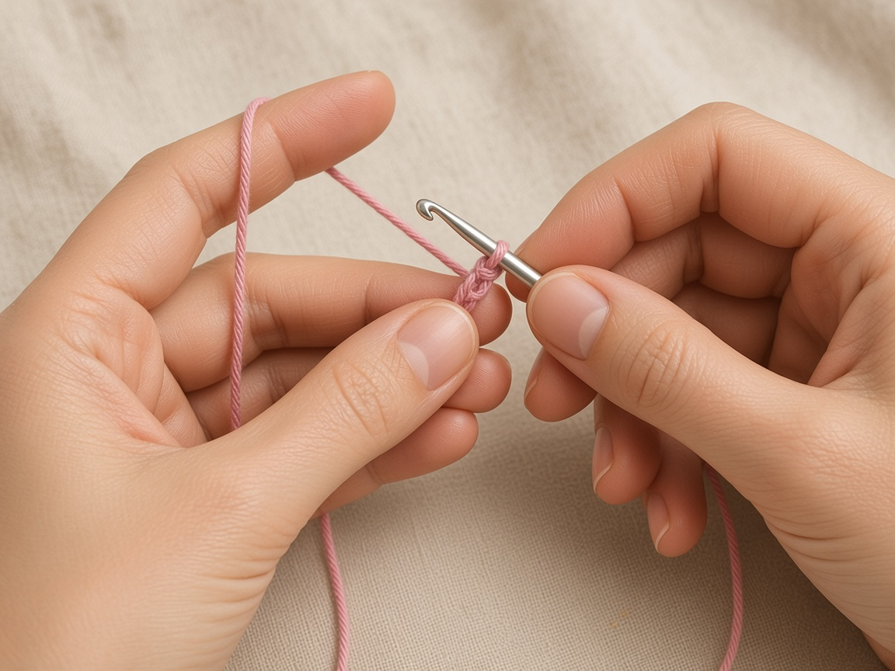

#### What the ring is for

1. Treat the magic ring as an adjustable loop.
2. Crochet into it, then pull the tail to close the hole.
3. A lipstick base wants that hole closed.

1. Wrap the yarn into a loop.
2. Insert the hook through the loop.
3. Yarn over and pull up a loop.
4. Chain 1 to hold the start. That chain is not a single crochet.
5. Leave the ring open until the six stitches of round 1 are in it.

If the ring is new, practice it on a scrap before you count the real round. Pulling it shut before the six stitches are made makes the first round miserable.

#### Chain 2, if you skip the ring

1. Chain 2.
2. Work the six single crochet of round 1 into the second chain from the hook.
3. Expect the center to stay a little open.
4. Close it later with the tail and a needle.
5. Check the bottom in the light before you call it done.

## Step 2: Round 1, six single crochet

<figure class="diagram">

<figcaption>Diagram. Round 1 is six stitches. The starting chain is not one of them.</figcaption>
</figure>

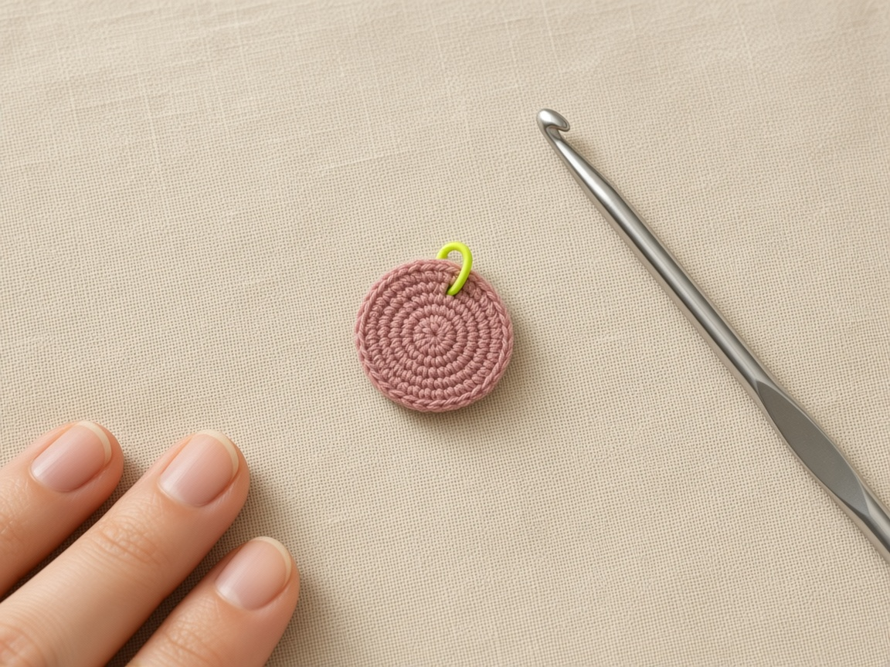

**Round 1:** 6 sc into the magic ring. (6 sts)

#### Make six single crochet in the ring

1. Insert the hook into the ring.
2. Yarn over and pull up a loop.
3. Yarn over and pull through both loops. That is one single crochet.
4. Do it six times.
5. Pull the tail until the center is closed.
6. Put the marker in the first single crochet.

#### Look at the disc before round 2

1. Count six stitches.
2. You should see a small disc, not a hole you could push a pencil through.
3. If a gap remains, tighten the tail again.
4. Do not cut the tail. You will weave it through the base later.

| What you counted | What it means |
| --- | --- |
| 6 single crochet, chain left out | Round 1. The marker sits in the first single crochet. |
| The chain from step 1 counted as stitch number one | The next rounds are off by one. That chain is not a stitch. |

The chain from step 1 is the mistake that throws the next rounds off. It is not stitch number one. Round 1 is six single crochet, nothing else.

## Step 3: Increase to 12

<figure class="diagram">

<figcaption>Diagram. Two stitches in each of the six. The count is 12.</figcaption>
</figure>

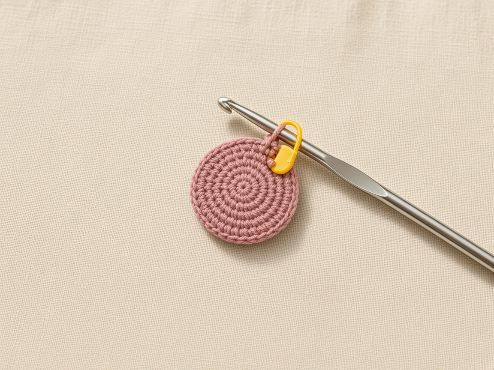

**Round 2:** 2 sc in each stitch around. (12 sts)

#### Put two single crochet in each of the six

1. Start at the marked stitch.
2. Make one single crochet, then a second single crochet in the same stitch.
3. Move to the next stitch and do the same.
4. Six increases give 12 stitches.
5. Move the marker to the first stitch of this round when you come around to it.

A flat circle has to gain stitches as it grows. One stitch in every stitch, from the start, makes a tube too soon. This round doubles 6 into 12.

#### Smooth the disc and count 12

1. The disc is still small. Set it on the table and smooth it without stretching.
2. Strong cupping often means tight tension.
3. A wavy edge often means an extra stitch or uneven tension.
4. Count 12 before you go on.

| Count | What happened |
| --- | --- |
| 12 | Two single crochet in each of the six stitches of round 1. |
| 11 | One stitch of round 1 got only one single crochet. |
| 13 | One stitch got three, or you worked into the chain. |

## Step 4: Increase to 18, then compare it to the lipstick

<figure class="diagram">

<figcaption>Diagram. One single crochet, then two in the next stitch, six times.</figcaption>
</figure>

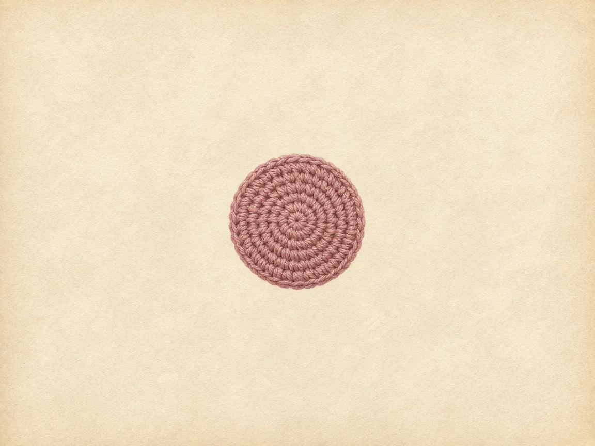

**Round 3:** (1 sc, inc) x 6. (18 sts)

1. Single crochet in the next stitch.
2. Two single crochet in the stitch after that.
3. Repeat that pair until you have done it six times.

#### Set the lipstick on the 18-stitch disc

1. You have 18 stitches.
2. The diameter is whatever your yarn and tension made. It is not a fixed centimeter measurement.
3. Put the closed lipstick on the disc.
4. The circle should be close to the footprint of the tube.
5. You should not have to stretch the fabric hard to imagine the tube sitting on it.

If the disc is much too small, another full increase round can jump the size too far. Read the options before you add stitches.

**Wider tube, optional next round:** (2 sc, inc) x 6. (24 sts)

#### Take 24 only when 18 is clearly small

1. Work two single crochet, then an increase, six times.
2. 6 times 4 stitches is 24.
3. Use it only if the 18-stitch disc is clearly too small for the tube in your hand.
4. If you take this round, every body round after it is 24 stitches.
5. Do not switch back to 18.

**Narrow tube:** stop after round 2, at 12 stitches, and make the body at 12.

#### Stop at 12 only after you see the disc

1. Check that disc against the tube before you commit.
2. A 12-stitch circle in a thick yarn can still be wide.
3. A 12-stitch circle in a thin yarn can be tiny.
4. Decide from the fabric on the table, not from a number that sounded typical.

| Base you keep | Body count after it |
| --- | --- |
| 12, stopped after round 2 | 12 on every later round |
| 18, after (1 sc, inc) x 6 | 18 on every later round |
| 24, after (2 sc, inc) x 6 | 24 on every later round. Do not switch back to 18. |

## Step 5: Turn the edge up

<figure class="diagram">

<figcaption>Diagram. Back loop only for one round. The count does not change.</figcaption>
</figure>

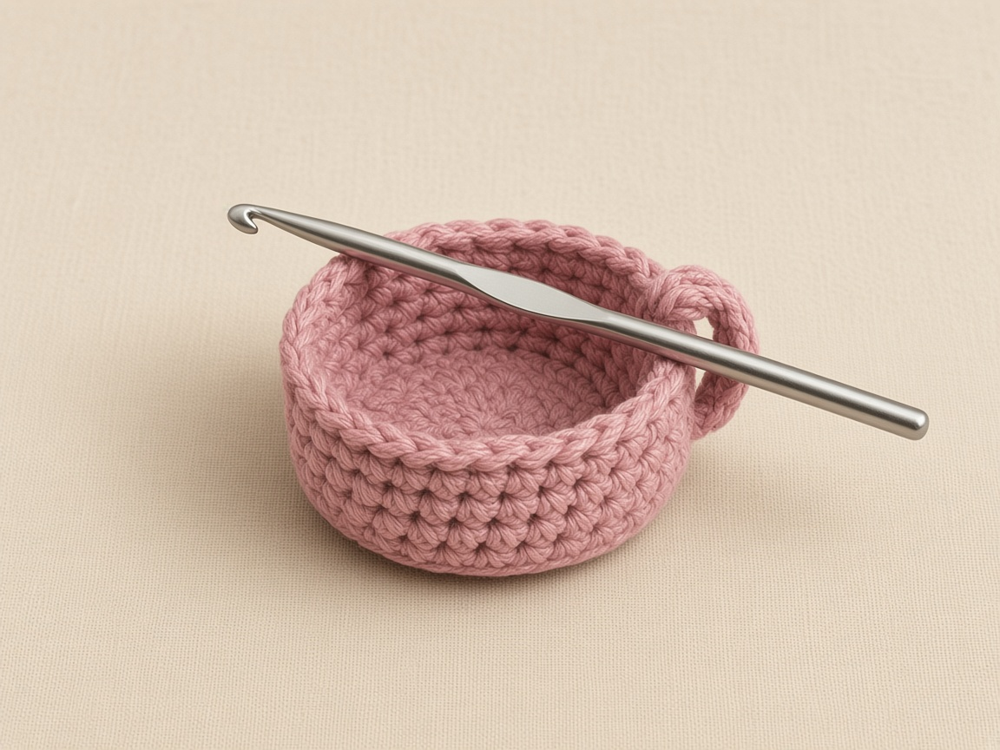

The next round is the corner between the floor and the wall.

**Round 4:** 1 sc in the back loop only of each stitch around. (18 sts)

#### Find the back loop, then use only that

1. The top of a single crochet is a V of two loops.
2. The front loop is the one closer to you.
3. The back loop is the one farther from you when the right side faces you.
4. Insert the hook under the back loop only, and finish the single crochet as usual.
5. Do that in all 18 stitches.
6. If you chose the 24-stitch base, this round is 24 back-loop single crochet. If you stopped at 12, it is 12.

#### Read the ridge

1. The unworked front loops sit as a ridge.
2. The following rounds stand up from that ridge more readily than they do from a round worked through both loops.
3. Working both loops still makes a pocket. The bottom stays rounder, and the ridge is weaker.
4. Use the back loop for the first holder so you can see the corner.

After this round: same stitch count as the base you chose, the fabric starting to turn up, no new increases. Fix a wrong count here. Every round after this one repeats that number.

| Base you chose | Back-loop round |
| --- | --- |
| 18 | 18 single crochet in the back loop only |
| 12 | 12 single crochet in the back loop only |
| 24 | 24 single crochet in the back loop only |

## Step 6: Crochet the tube

<figure class="diagram">

<figcaption>Diagram. Same count every round. The sides get taller. The width stays put.</figcaption>
</figure>

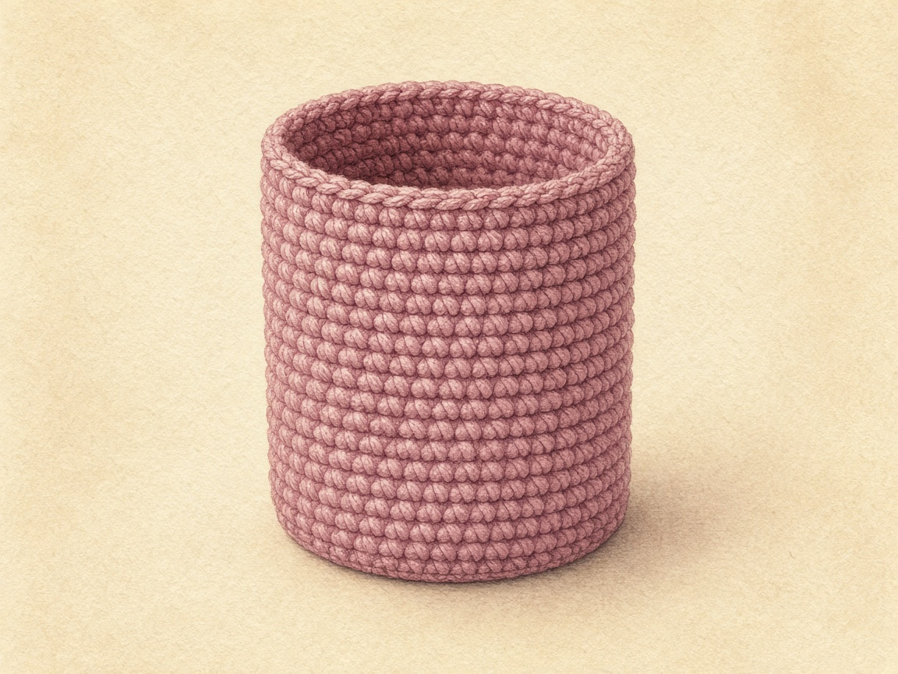

**Rounds 5 to 20:** 1 sc in each stitch around. (18 sts each round)

#### One stitch, one home, no increase

1. Make one single crochet in the next stitch, then the next, until you are back at the marker.
2. Move the marker up.
3. Do not increase.

#### What the spiral is allowed to look like

1. The bottom can look domed for the first few rounds. That settles as the wall gets taller.
2. Keep the yarn in the same place in your hand.
3. Do not yank the last stitch of the round tighter than the others.
4. In a spiral, the start of the round walks slowly around the tube.
5. That jog is normal. It is not a seam you failed to hide.

#### Count every few rounds

1. Count eighteen, or 12, or 24, whichever base you kept.
2. Nineteen means two stitches landed in one stitch.
3. Seventeen means a stitch was skipped.
4. On a narrow tube, one stitch is enough to change the fit.

| Count on an 18-stitch body | What happened |
| --- | --- |
| 18 | One single crochet in each stitch. Keep going. |
| 19 | Two stitches landed in one stitch. |
| 17 | A stitch was skipped. |

On a 12-stitch or 24-stitch body, use that number in place of 18. Nineteen and seventeen are the off-by-one counts for the 18-stitch start only.

#### Slide the lipstick in after about five body rounds

After about five body rounds, slide the closed lipstick in.

- If it goes in without a fight, continue.
- If it is already tight, stop. Forcing it stretches the stitches and does not fix the size.
- If it knocks around, the circumference is large for that tube. A smaller count, a smaller hook, or firmer tension is the fix. Do not wait until the strap is sewn.

#### Judge the friction

1. A little friction is useful.
2. A tug that bends the tube is not.
3. If the first try is tight and the count is right, remake from the base with a larger hook, or use the 24-stitch base for a clearly wider tube.
4. Shrinking a finished sleeve by pulling on it does not give an even fit.

Do not stuff the holder. The lipstick is what fills it. Stuffing, and stray tails left in the middle, block the tube.

## Step 7: Set the height from the tube

<figure class="diagram">

<figcaption>Diagram. Cover enough to support the tube. Leave the cap where your fingers can reach it.</figcaption>
</figure>

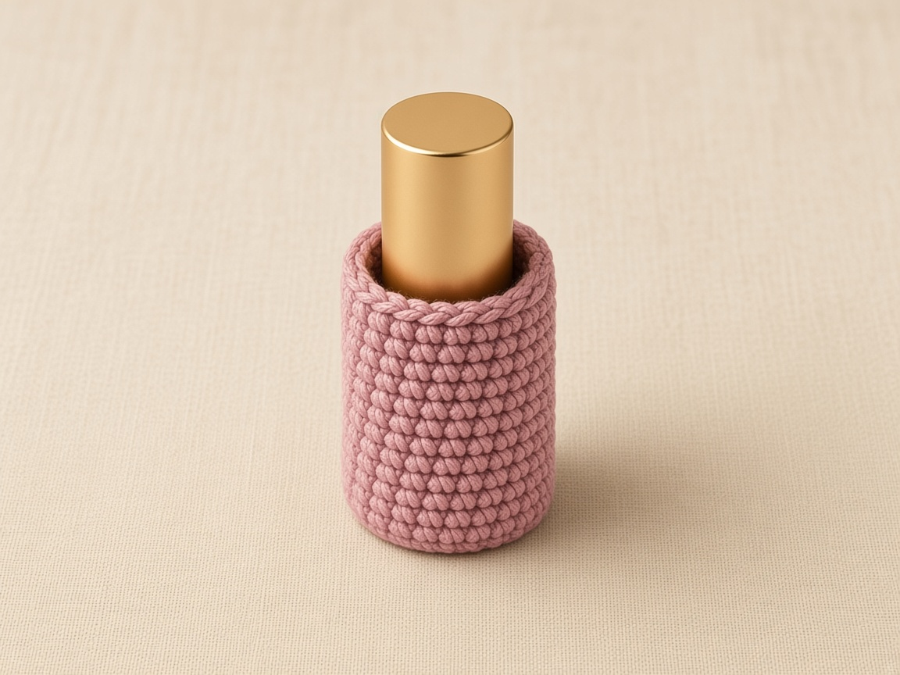

#### Pause at round 20 and look at the cap

1. At round 20, put the closed lipstick in.
2. Look at how much cap is still above the opening.
3. If the sleeve is short, keep going.

**Later rounds:** 1 sc in each stitch around, same count, until the height is right.

#### There is no single correct number of rounds

1. Your row height is part of the answer.
2. A short sleeve lets the tube tip.
3. A tall sleeve hides the cap and you end up pulling on the yarn.
4. Stand the holder on the table with the lipstick in it.
5. Then take the lipstick out the way you would in a bag.
6. If either of those feels awkward, change the height before you fasten off.

The base is crochet, not a rigid cup. Soft yarn will flex. You want the tube supported, not a sleeve that mimics plastic.

## Step 8: Finish the opening

<figure class="diagram">

<figcaption>Diagram. If you slip stitch the rim, keep those stitches loose.</figcaption>
</figure>

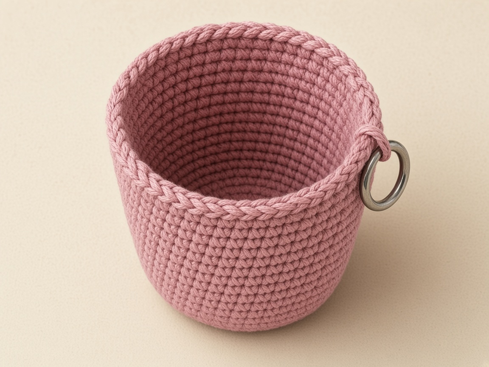

#### Fasten off, or add a loose slip-stitch round

1. You can fasten off after the last single crochet round. That is a clean edge.
2. A slip-stitch round is optional.
3. Slip stitch loosely in each stitch around the opening.
4. Tight slip stitches shrink the mouth, and the lipstick then fights you on the way out.
5. If that happens, pull the slip-stitch round out and fasten off from the single crochet instead.

#### Bury the tail

1. Leave a tail.
2. Weave it through several stitches on the inside.
3. Change direction once.
4. Trim it only after it is buried.

Skip a scalloped border on a piece this small. Scallops crowd the opening and fight the flower if you add one. A straight rim is the one that still lets the tube out.

## Step 9: Crochet the strap

<figure class="diagram">

<figcaption>Diagram. Chain 6 gives five single crochet. The turning chain is not a stitch.</figcaption>
</figure>

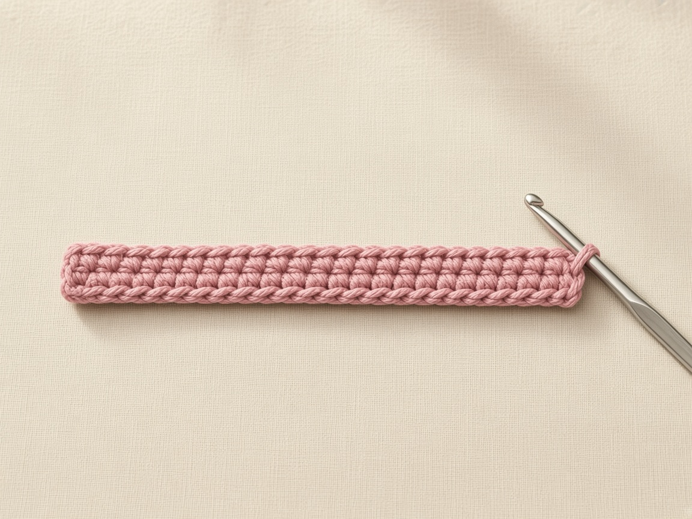

#### Why the strap is a strip

1. The strap is a separate strip, folded, with the hardware in the fold.
2. A single chain loop puts the whole lipstick on one strand.
3. The strip spreads the sewing across several stitches of the sleeve.

**Foundation:** ch 6.

**Row 1:** Starting in the second chain from the hook, 1 sc in each chain. (5 sts)

**Rows 2 to 18:** Ch 1, turn, 1 sc in each stitch. (5 sts)

#### Count five, then fold

1. The turning chain does not count.
2. Fasten off and leave a long tail for sewing.
3. Fold the strip in half before you sew anything.
4. The ring or the clasp sits in the fold.
5. The two ends go to the outside of the sleeve.
6. If the fold will not go around the hardware with room to sew, add rows.
7. If the strap will hang far past the sleeve, stop earlier than row 18.
8. The hardware decides the length. Eighteen rows is a starting strip, not a measured drop.

| Stitches across the strap | What happened |
| --- | --- |
| 5 | Row 1 started in the second chain, and later rows skipped the turning chain. |
| 6 | You crocheted into the turning chain. |
| 4 | You missed an edge stitch. |

A separate strap can be replaced later without remaking the tube. You can also choose which side of the sleeve faces out when it hangs.

## Step 10: Sew the strap and the hardware

<figure class="diagram">

<figcaption>Diagram. The ring sits in the fold. Both ends are sewn down.</figcaption>
</figure>

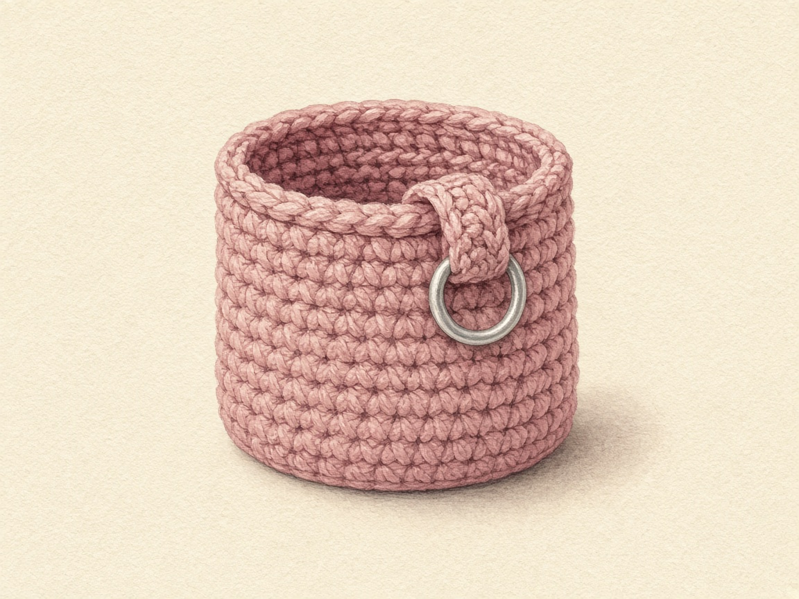

#### Seat the hardware in the fold

1. Thread the strip through the clasp or the ring.
2. Fold it so the short ends meet.
3. The metal sits in the fold.

#### Place both ends before you sew

1. Set the ends on the outside of the sleeve, near the top, running down the side.
2. The opening stays clear.
3. Clip them.
4. Check that the lipstick still comes out without catching the strap.
5. When the piece hangs, the sleeve should point the same way you want the lipstick to point.
6. Flip the clasp now if it is backwards.

#### Sew both ends, twice

1. Sew with the long tail.
2. Go through the strap and into the sleeve, across the width of the strip, and through more than one round of the body so the pull is not on a single row.
3. Sew both ends.
4. Go over the join a second time.
5. Match the yarn color if you want the stitches quiet.

#### Look inside, then lift

1. Look inside. Loops of tail will catch the lipstick. Tuck them.
2. Put the lipstick in again after the sewing, not only before.
3. Hold the clasp and lift the empty sleeve over a soft surface.
4. Then lift it with the closed lipstick in it.
5. Look for stitches that open or a ring that can slide out of the fold.

Do not clip it to a bag you care about until that join looks sound. Yarn is not a guarantee. A heavy tube on a thin join can pull free. Keep expensive lipstick inside the bag rather than swinging from an outside clasp.

## Step 11: The flower, if you want one

<figure class="diagram">

<figcaption>Diagram. Five petals, one in each stitch of a five-stitch ring.</figcaption>
</figure>

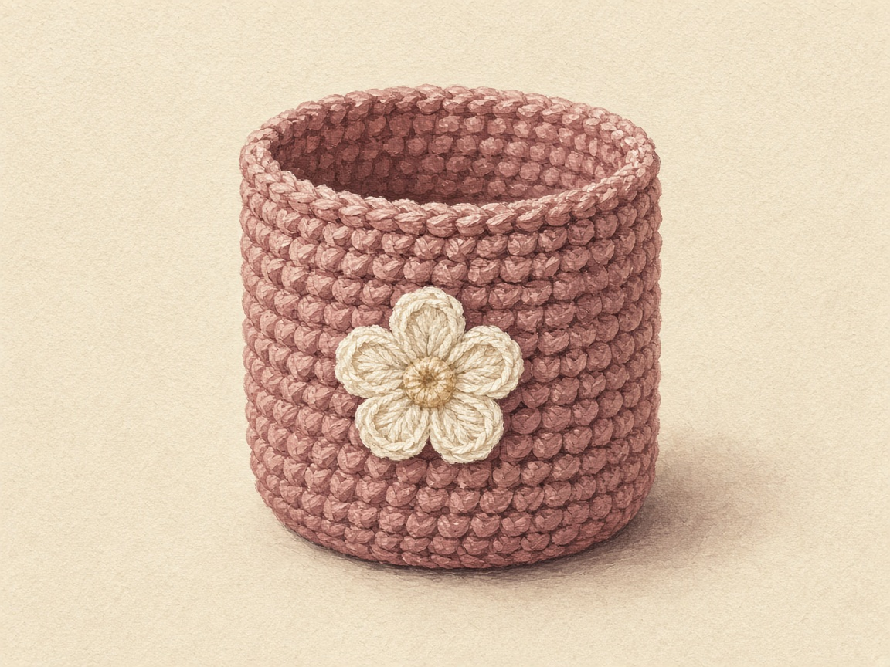

#### Pick the contrast

1. Use a contrast color.
2. Cream, white, or a pale yellow reads against dusty rose.

**Center:** Magic ring, 5 sc into the ring, pull the ring closed, slip stitch to the first single crochet to join. Five stitches.

**Each petal,** worked into the next base stitch, and then into each of the other four:

(sl st, ch 2, 2 hdc, ch 2, sl st)

#### Five petals, one stitch each

1. Keep the chains loose enough that the petal can round out.
2. Five petals, one on each base stitch.
3. Because several stitches share one base stitch, the flower spreads instead of stacking into a tube.
4. Fasten off. Leave a tail long enough to sew.

| Petals | What you see |
| --- | --- |
| 5, one in each of the 5 center stitches | The flower the pattern describes. |
| A stitch left empty | That base stitch has no petal. |
| Two petals in one stitch | That stitch is holding two petals. The pattern puts one petal in each of the five. |

Arrange the petals with your fingers. Do not yank them. A handmade flower will not be identical on every side.

#### Sew below the opening

1. Sew it to the front, below the opening, so it does not cover the mouth.
2. Catch the inner part of the petals so the flower does not flop forward.
3. An embroidered center in a second color is optional.
4. Skip buttons and beads if a child might handle the piece.
5. If the flower swamps the sleeve, make it in a thinner yarn or a smaller hook, or replace it with a few embroidered stitches.

## Step 12: Weave the ends

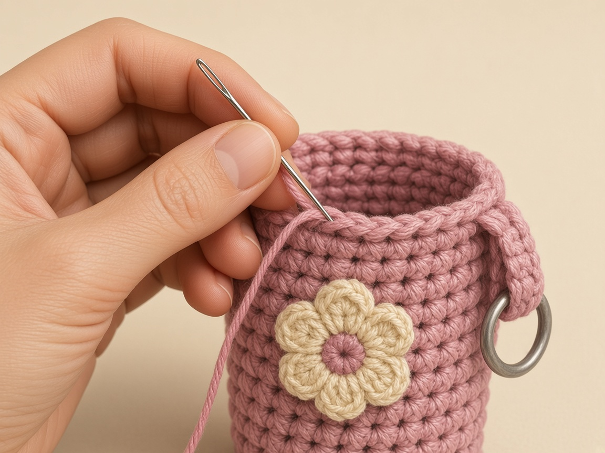

#### Weave so the lipstick cannot snag

1. A small piece shows every tail, and a piece that lives in a bag rubs those tails loose.
2. Weave each tail through several stitches.
3. Do not pile every tail in one spot inside the sleeve, or the lipstick will snag.
4. Spread them.

#### Close, strap, petals

1. Check the center of the ring again. If it opened, use the original tail to close it from the inside.
2. Check the strap a second time. Both ends sewn.
3. The ring or clasp should be unable to slip out of the fold.
4. No sharp edge should be cutting the yarn.
5. Lift each petal. If one is only caught by a single loose loop, add a stitch.

## Step 13: Try the finished holder

<figure class="diagram">

<figcaption>Diagram. Cap on. The sleeve is a cover, not a second lid.</figcaption>
</figure>

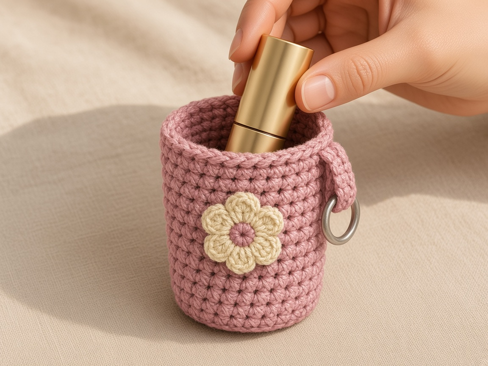

#### Put the closed tube in and take it out

1. Slide the closed lipstick in. Do not force it.
2. You want it to move, and you want a little grip so it is not obviously loose.
3. Hang it from the clasp over a soft surface.
4. Take the lipstick out and put it back a few times.

#### What to look for

1. A fit you can live with.
2. A cap you can pinch.
3. An opening that stays roughly round.
4. A strap that does not open.
5. A flower that stays on.
6. No tails sticking into the pocket.

The sleeve is not a sealed case. Heat can spoil the lipstick whether or not it is in yarn. If a tube leaks, take it out. Makeup pigment does not always leave cotton.

## The finished holder

#### Name every part

1. When the sewing is done, you should be able to name every part without turning the piece over twice.
2. The body is one open cup.
3. The top is a round mouth, the same stitch count as the last body round, with nothing stuffed inside.
4. The flower, if you added one, sits on the front wall below that mouth.
5. It does not cover the opening, and it has five petals.
6. The strap is on the outside, near the top.
7. The ring or clasp sits in the fold.
8. Both ends of the strip are sewn to the sleeve, so the hardware is not a loose ring sitting beside the cup and not a single chain loop.
9. Hung from the ring, the opening stays up and the base stays down.
10. That is the point of sewing the strap at the top rather than at the bottom.

These drawings show that arrangement. They are illustrations of the shape, not photographs of a finished sample.

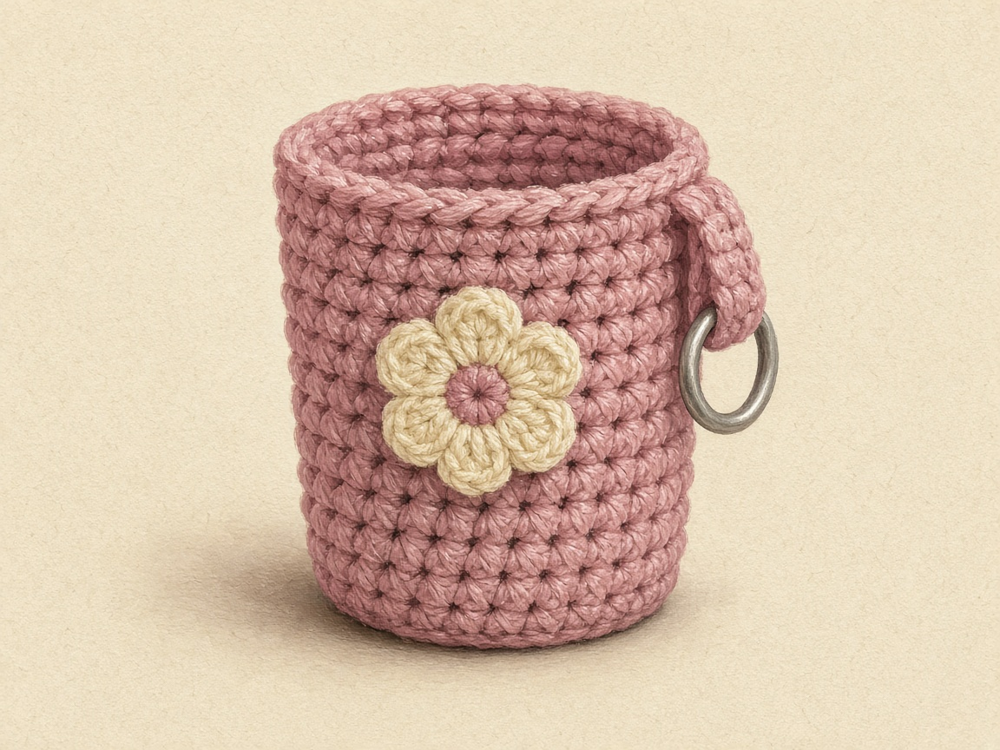

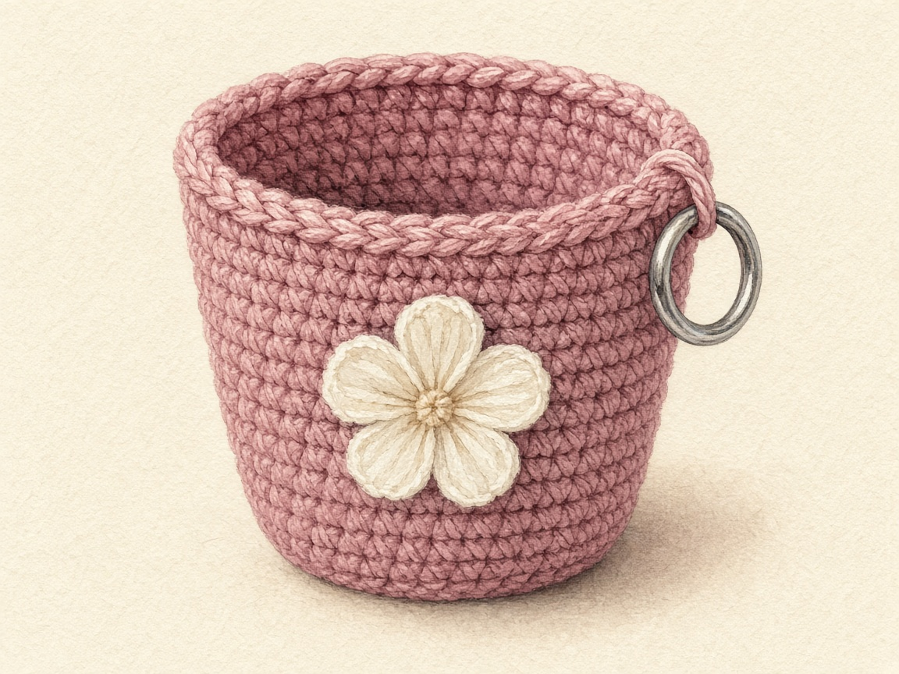

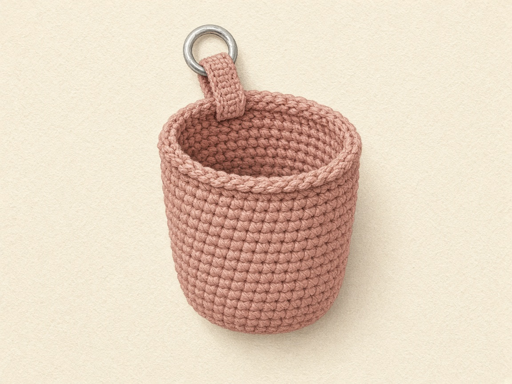

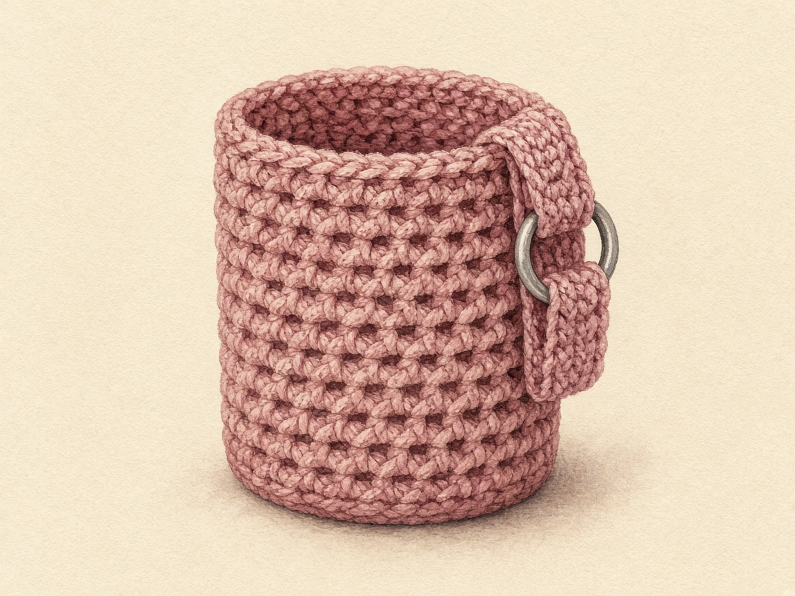

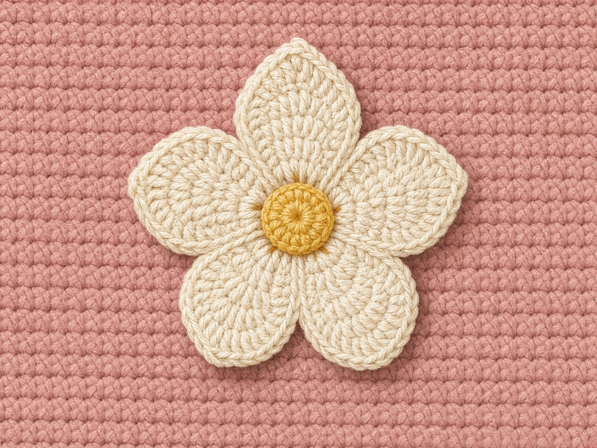

If your piece does not match this layout, fix the placement before you weave the last tail. A flower across the mouth, a strap at the base, or a ring that can slip out of the fold will show up the first time you hang it.

## Quick pattern

Use this once the steps above are familiar.

### Sleeve, 18-stitch start

- Rnd 1: 6 sc in a magic ring. (6)
- Rnd 2: inc in each st. (12)
- Rnd 3: (1 sc, inc) x 6. (18)
- Rnd 4: sc in back loop only. (18)
- Rnds 5 to 20: sc around. (18)
- More rounds: sc around until the height matches your tube.
- Optional: loose slip stitch around the opening.
- Fasten off. Weave the ends.

Optional wider base, only if round 3 is too small: (2 sc, inc) x 6. (24). Then every later round is 24.

Optional narrower base: stop at 12 after round 2, and keep 12 for the tube.

### Strap

- Ch 6.
- Row 1: sc in the second chain from the hook and across. (5)
- Rows 2 to 18, or until the fold fits the hardware: ch 1, turn, sc across. (5)
- Fasten off. Leave a sewing tail.
- Fold through the hardware. Sew both ends to the upper outside of the sleeve.

### Flower

- Magic ring, 5 sc, join.
- In each of the 5 stitches: sl st, ch 2, 2 hdc, ch 2, sl st.
- Fasten off. Sew it below the opening.

| Stage | Stitches |
| --- | --- |
| Round 1 | 6 |
| Round 2 | 12 |
| Round 3 | 18 |
| Back-loop round | 18, or 12, or 24 if you changed the base |
| Each body round | Same as the back-loop round |
| Each strap row | 5 |
| Wider base | 24, then 24 on every body round |

## Fit a different tube

#### Change the count, not the printed 18

1. A few millimeters change this object.
2. Adjust the count.
3. Do not follow 18 because it was printed.

#### Slim lipstick or many lip balms

1. Try the 12-stitch base.
2. Check after a few body rounds.
3. If 12 is a struggle, change hook or yarn.
4. Do not stretch 12 stitches around a tube that wants 18.

#### Wide lipstick

1. Use the 24-stitch round.
2. Then a back-loop round of 24.
3. Then a body of 24.
4. Test after a few rounds.

#### Square packaging

1. A circle can go around a square, and the corners will press.
2. Measure the width and the distance across the corners.
3. A very boxy compact is a [makeup pouch](/how-to-crochet-a-makeup-pouch/), not this cylinder.

#### Taller tube

1. Add body rounds.
2. Do not increase if the width stays the same.
3. If the tube gets wider near the cap, the opening has to clear that wider part.

#### Shorter tube

1. Stop the body sooner.
2. A sleeve taller than the product hides the cap.

### A gauge estimate, then a real try

#### Multiply, then test the disc

1. Crochet a small single-crochet swatch in the yarn and hook you will use.
2. Suppose the swatch has 20 stitches across 8 cm.
3. That is 20 divided by 8, or 2.5 stitches per centimeter.
4. Suppose the tube measures 7.2 cm around.
5. 7.2 times 2.5 is 18 stitches.
6. That is why 18 is the starting count in this pattern.
7. It is an example of the multiplication, not a promise that your swatch is 2.5 stitches per centimeter.

| Piece of the example | Number |
| --- | --- |
| Stitches across the swatch | 20 |
| Width of that swatch | 8 cm |
| Stitches per centimeter | 2.5 |
| Tube around | 7.2 cm |
| 7.2 times 2.5 | 18 stitches, the starting count |

A flat swatch is not a tube. The spiral, the fiber, and how snug you want the sleeve all move the result. Use the number to pick a start. Use the lipstick to accept it.

#### How snug is useful

1. Snug helps the tube stay.
2. Too snug makes it a fight.
3. Too loose and it falls out when the holder turns over.
4. A smooth metal tube slips more than a textured one.
5. There is no single ease number that covers both.

## When it goes wrong

#### Too wide

1. Count the body.
2. An increase after the base is the usual cause.
3. If the count is right, the hook is large for that tube, or you needed 12 stitches instead of 18.
4. Remake a sleeve that is far too big.
5. Decreasing only at the rim makes a neck, not a fit.

#### Too narrow

1. Stop pushing the lipstick in.
2. Check the count, the yarn, and the hook.
3. A larger hook or the 24-stitch base is the usual repair.

#### A hole in the bottom

1. Pull the magic-ring tail, then weave it.
2. If you used chain 2, close the center with the needle.

#### The tube leans

1. A spiral has a small jog.
2. A strong lean means a missed stitch or an extra one, or tension that changed halfway up.
3. Lay it down and look along the stitches.

#### A tight mouth

1. Take out a tight slip-stitch round.
2. Fasten off from the single crochet, or redo the slip stitches loosely.

#### The strap grows

1. Soft yarn and loose stitches stretch.
2. Sew across more of the sleeve, shorten the strip, or remake the strip at a firmer tension.
3. Find out whether the strip itself is growing or the sewing is opening.

#### Uneven stitches

1. Keep the yarn held the same way.
2. Do not pick at single stitches to bully them into line after the fact.

#### A flower that is too big

1. Use thinner yarn, a smaller hook, or embroidery instead.

## Color, without crowding the shape

#### Keep the palette small

1. One main color, one contrast, and hardware that matches the scale of the sleeve is enough.
2. An oversized clasp makes a light piece hang badly.
3. A tiny ring is hard to sew around.

#### Change color at the marker

1. A two-tone sleeve changes color at the start of a round.
2. Weave both ends.
3. In a spiral, the color change shows a small step.
4. That step can sit at the back, under the strap.

#### Stripes use the same stitch count

1. Stripes are the same rule: same stitch count, color change on a round, ends woven.
2. The step in the spiral is still there.

The strap should be long enough to use and short enough that the sleeve does not dangle far below the clasp.

## Gifts and selling

#### A gift needs a checked tube

1. The piece is small, so it is a reasonable gift if you have checked it on the recipient's kind of tube, or you include the measurements of the sleeve you actually made.
2. Skip decorations that snap off in a bag.

#### If you sell a finished holder

1. Say what you know from the one in your hand: the fiber, the clasp, about how wide the opening is, about how tall the sleeve is, and that it will not fit every brand.
2. Do not write that it fits all lipsticks.
3. Price it from your time, yarn, hardware, and the rest of your costs.

#### Look before it leaves

1. Look at the base.
2. Look at the walls.
3. Look at the opening with the tube in it.
4. Look at the strap, the hardware, the flower, and the tails.

## Care

#### Spot-clean

1. Spot-clean with a damp cloth and a little mild soap.
2. Blot.
3. Do not soak the metal if you can help it.
4. Dry it fully before it goes back in a bag.

#### If the label allows washing

1. Hand wash.
2. Reshape the damp sleeve, and dry it flat.
3. Do not wring it.
4. Take off hardware that will rust.

Lipstick and other makeup stain cotton. The cap stays on so the product is not rubbing the yarn. If it leaks, take it out.

Check the strap when you would check any soft loop that carries a small weight.

## Rounds 1 to 4, one stitch at a time

#### Use only the stitches in the list

1. If the abbreviations are still noisy, work the standard 18-stitch base like this.
2. Do not add stitches that are not in the list.

### Round 1

#### The chain on the hook is not stitch 1

1. The ring is open.
2. The chain you made to secure it is sitting on the hook and does not count.

1. Insert the hook into the ring.
2. Yarn over, pull up a loop. Two loops on the hook.
3. Yarn over, pull through both loops. That is stitch 1.
4. Repeat that pair of yarn-overs until you have stitch 2, stitch 3, stitch 4, stitch 5, and stitch 6.
5. Stop. Count the posts, not the chain.
6. Pull the tail until the hole closes.
7. Marker in stitch 1.

### Round 2

#### Two single crochet in every stitch of round 1

1. You are putting two single crochet in every stitch.
2. Say the pairs out loud if you lose the count.

1. Stitch 1 of round 1: one single crochet, then another in the same stitch.
2. Stitch 2: two single crochet.
3. Stitch 3: two single crochet.
4. Stitch 4: two single crochet.
5. Stitch 5: two single crochet.
6. Stitch 6: two single crochet.

#### The new count is 12

1. You have used every stitch of round 1 exactly once as a home for an increase.
2. The new count is 12.
3. Move the marker to the first of those 12.

| Count | What happened |
| --- | --- |
| 12 | Every stitch of round 1 holds two single crochet. |
| 11 | One stitch of round 1 got only one single crochet. |
| 13 | One stitch got three, or you worked into the chain. |

### Round 3

#### The repeat is one, then two

1. The repeat is "one, then two."
2. Walk it.

1. Next stitch: 1 sc. Stitch after that: 2 sc. End of pair 1. Running count 3.
2. Pair 2. Running count 6.
3. Pair 3. Running count 9.
4. Pair 4. Running count 12.
5. Pair 5. Running count 15.
6. Pair 6. Running count 18.

#### Six pairs should land on 18

1. Six pairs, and you should be back at the marker.

| Where the marker arrives | What happened |
| --- | --- |
| 18 | Six pairs of one single crochet, then an increase. |
| 15 | You skipped a pair. |
| 21 | One of the "one" stitches was actually an increase. |

Set the lipstick on the disc now, before round 4. This is the cheapest moment to change your mind.

### Round 4

#### Back loop only, no extras

1. Back loop only, one single crochet per stitch, no extras.

1. Find the V on top of the first stitch.
2. Hook under the back strand only.
3. Finish the single crochet.
4. Do that 18 times.
5. Count 18. The front strands you skipped should show as a ridge at the corner.

#### The body goes under both loops again

1. Then the body is the same motion as round 4, except you go under both loops again.
2. One stitch, one home, marker, count, repeat.

## A second fit example

#### See when 18 is the wrong start

1. The 7.2 cm circumference in the gauge section was one multiplication.
2. Here is another, still an example, so you can see when 18 is the wrong start.

#### A slim balm at 2.25 stitches per centimeter

1. Suppose your swatch is 18 stitches across 8 cm.
2. That is 18 divided by 8, or 2.25 stitches per centimeter.
3. Suppose the tube is 6 cm around, a slim balm.
4. 6 times 2.25 is 13.5.
5. You cannot crochet half a stitch, so you would try 12 and then 14 only if 12 will not take the tube.
6. You would not start at 18 and hope the fabric shrinks.

#### A 10 cm tube on the same swatch

1. Suppose the tube is 10 cm around and the same swatch is 2.25 stitches per centimeter.
2. 10 times 2.25 is 22.5.
3. The pattern's next full increase lands on 24, which is the nearer whole repeat.
4. Try 24, and test after a few rounds.
5. Do not invent a 23-stitch round by increasing once in the middle of the wall.
6. A single extra increase makes a bump, not a size.

| Example | Product | Start that matches the repeat | Start to refuse |
| --- | --- | --- | --- |
| 20 stitches across 8 cm, tube 7.2 cm around, 2.5 per cm | 18 | 18, the printed starting count | Treating 18 as a promise for a different swatch |
| 18 stitches across 8 cm, tube 6 cm around, 2.25 per cm | 13.5 | 12, then 14 only if 12 will not take the tube | 18, hoping the fabric shrinks |
| Same 2.25 swatch, tube 10 cm around | 22.5 | 24, the next full increase | A 23-stitch round made by one extra increase in the wall |

Write your own two numbers, stitches per centimeter and centimeters around the tube, and multiply. Then ignore the product if the disc on the table disagrees with it.

## Changing color on the tube

#### Start the new color at the marker

1. A second color starts at the beginning of a round, at the marker.

1. On the last stitch of the old color, stop when two loops are still on the hook.
2. Drop the old color. Put the new color over the hook and pull it through those two loops.
3. The next single crochet is the first stitch of the new color. That is where the marker moves.
4. Carry nothing up the inside unless you are coming back to that color within a round or two. For a sleeve this small, cut the old color and weave it.
5. Weave the new tail in the opposite direction from the old tail so they are not a lump in one spot.

#### Put the step at the back

1. In a spiral the color change looks like a step, not a straight line around the tube.
2. Put that step at the back, on the same side as the strap, if you care where it shows.

#### Narrow stripes

1. For narrow stripes, change every two or three rounds and keep the same stitch count.
2. If you change in the middle of a round, you get a jagged patch.
3. Wait for the marker.

## Strap, row by row

#### The loop on the hook is not one of the six

1. Chain 6.
2. The loop on the hook is not one of the six.

1. Skip the chain nearest the hook. Single crochet in the next chain. That is strap stitch 1.
2. One single crochet in each of the remaining four chains. Five stitches.
3. Chain 1, turn. The chain is not a stitch.
4. Single crochet in each of the five stitches.
5. Repeat the turn-and-five until the folded strip goes around the hardware with both ends long enough to sew.

#### Fold when the hardware fits

1. Eighteen rows is only a place to stop and fold.
2. Fold at row 12 if the clasp is small.
3. Keep going past 18 if the clasp is thick.
4. Count five across every row.

| Stitches across the row | What happened |
| --- | --- |
| 5 | The turning chain was skipped. |
| 6 | You crocheted into the turning chain. |
| 4 | You missed an edge stitch. |

When you fold, the ring should sit in yarn, not on a single strand you pulled out to the side. Both ends lie flat on the sleeve, one on top of the other or side by side, and the needle goes through both.

## Sew the strap in two passes

#### Clip before the first stitch

1. Clip the folded ends where you want them, with the opening still clear.
2. Use the long tail.
3. Do not start a new piece of yarn if the tail is long enough.

Pass one:

1. Come up from the inside of the sleeve, through the lower end of the strap.
2. Take a small stitch across the strap, then back into the sleeve one round lower or one stitch to the side.
3. Travel across the width of the five-stitch strip. That is several stitches, not one.
4. Do the same for the upper end of the fold, so both layers of the strip are caught.
5. Stop on the inside. Look at the path. If one end is only tacked at a corner, it will peel when the lipstick hangs.

Pass two:

1. Repeat the path, shifted by one stitch, so the second line sits next to the first.
2. Finish on the inside.
3. Weave the tail through the inside stitches, change direction once, and trim.

#### Pull the clasp

1. Pull the clasp. The sleeve should come with it as one piece.
2. If the strap rotates inside the ring, the fold is too loose.
3. Sew a couple of stitches through the fold just under the metal so the ring stays in the pocket of yarn you made for it.
4. Those stitches should not close the opening of the sleeve.

## The flower, petal by petal

#### Five stems, one petal each

1. After the five single crochet and the slip stitch join, you have five stems to put a petal on.
2. Keep the flower flat on the table while you do this, so you can see which stitch is next.

1. Petal 1, in the first of the five stitches: slip stitch, chain 2, half double crochet, half double crochet, chain 2, slip stitch. All of that is in the same stitch.
2. Petal 2, in the next stitch: the same sequence.
3. Petal 3, petal 4, and petal 5: the same sequence, one stitch each.
4. You should be back at the first petal, with no stitch left empty and no stitch holding two petals.
5. Fasten off.

#### Half double, not double

1. A half double crochet is yarn over, insert the hook, pull up a loop, yarn over, pull through all three loops.
2. If you pull through two and then two, you have made a double crochet, and the petal will be taller than the others.
3. Rip that petal back and use the three-loop pull-through.

A double crochet petal is taller than the half double petals beside it. The sequence is 2 hdc, not 2 dc.

#### Sew through the center

1. Sew the flower with the tail, through the center ring and the sleeve, four or five stitches.
2. Then catch the base of any petal that sticks straight out.
3. The opening of the sleeve stays above the flower.

## What to check before you give it away

#### Eight yes-or-no checks

1. Go in this order. Each one is a yes or a no.

1. The center of the base is closed.
2. The body count matches the base you chose, on a round near the top and on a round near the ridge.
3. The closed lipstick goes in and comes out without you bracing the sleeve with the other hand.
4. Some of the cap is still visible.
5. Both strap ends are sewn, and a gentle lift does not open a stitch.
6. The metal does not slide out of the fold.
7. The flower, if there is one, is below the opening.
8. The inside has no tail you can pinch.

#### If the eight checks become a listing

1. If you are selling the holder, those eight checks are the listing, in plainer words: fiber, clasp type, about how wide the opening is on the one you measured, about how tall the sleeve is, and that another brand may not match.
2. Measure with a tape on the finished sleeve.
3. Do not copy the example centimeters from this page into a product note.

## Frequently asked

### Is this a beginner project?

The sleeve is a magic ring, single crochet, increases, and a spiral. The strap is rows and sewing. The part that takes patience is the marker and the count, not a fancy stitch.

### How long does the crochet take?

#### What takes the time

1. The tube is most of the work.
2. The strap and the flower are short.
3. A first magic ring, or a first sewn clasp, takes longer than the same steps the next time.
4. There is no timed sample behind a single number of minutes.

### What yarn should I use?

#### Start where the stitches show

1. Smooth DK cotton is the useful start, because you can see the stitches and the fabric can stay firm.
2. The hook you start with is 3.0 mm.
3. Change it if the fabric is stiff or holey.

### Can I skip the magic ring?

Yes. Chain 2, and put the six single crochet into the second chain from the hook. Close the center with the tail when you finish.

### Will 18 stitches fit my lipstick?

#### 18 is a start, then the tube decides

1. Maybe.
2. It is the count you get from 6, then 12, then 18, and it matches the example gauge in the section above.
3. Your tube and your tension decide.
4. Try the base before round 5.

### Can I use acrylic?

Yes, if the fabric is firm enough and does not stretch into a loose sock around the tube.

### Do I need a stitch marker?

Yes. In a spiral there is no join to tell you the round ended.

### Can I use a different clasp?

Yes. Lobster, swivel, or a split ring, as long as the folded strap fits the bar and the metal does not cut the yarn.

### Will it fit every brand?

No. Compare your tube with the sleeve you made.

### Can it hold lip balm?

#### Match the balm, often at 12

1. The same tube can, at a stitch count that matches that balm.
2. Many balm tubes are slimmer.
3. Start at 12 and test.

### How do I keep the lipstick from falling out?

#### Snug helps. An open top does not lock

1. A snug sleeve helps.
2. An open top cannot promise the tube will stay in if the holder turns upside down and gets a knock.
3. Keep it inside the bag, or plan a flap you have actually tried with the cap in place.

### Can I add a button?

Only with a flap or a loop you have tested, so the cap still comes out and the button is not pressing on it. Skip small buttons on anything a young child will handle.

### Should I line it?

You do not need to. If you add cloth, the lipstick still has to fit in what remains.

### Can I sell holders from this pattern?

#### Say what you measured

1. You can sell a holder you made and checked.
2. Say what that holder measures.
3. Do not describe an untried stitch count as a fit you have confirmed.

### What else uses these rounds?

The same base-and-tube idea shows up in the [AirPods case](/halloween-crochet-airpods-case/) and in any small cylinder. The [makeup pouch](/how-to-crochet-a-makeup-pouch/) is the flat-rectangle version, for more than one item.

## Common mistakes

- Counting the starting chain as a stitch in round 1, so every later round is off by one.
- Adding increases in the body, so the sleeve flares.
- Waiting until the strap is on before the first try with the lipstick.
- Slip stitching the rim tightly.
- Sewing only one end of the folded strap, or sewing through a single round.
- Leaving tails inside the pocket.
- Stuffing the sleeve.
- Calling 18 stitches a universal lipstick size.

The useful check is the same at the start and at the end. The closed tube goes in, the cap comes out, and the strap holds when you lift it.

#### Count the top round again before the last tail

1. If you set the holder down for a day and come back, count the top round once more before you weave the last tail.
2. A sleeve that was 18 in the middle and 19 at the rim will not match the base you tested.
3. Fix that round, then weave.
4. The marker is there so this count takes a few seconds.
5. When the top round matches the base, the sleeve you measured is the sleeve you are finishing.
6. Count it in the same light you used when you first set the lipstick on the disc.

| Where you count an 18-stitch sleeve | What to do |
| --- | --- |
| 18 in the middle and 18 at the rim | Weave the last tail. |
| 18 in the middle and 19 at the rim | Fix that round, then weave. The base you tested is not the rim you have. |
