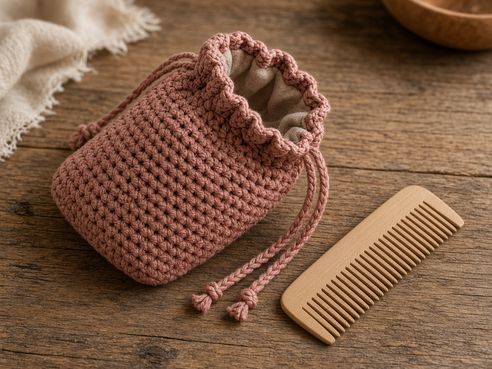
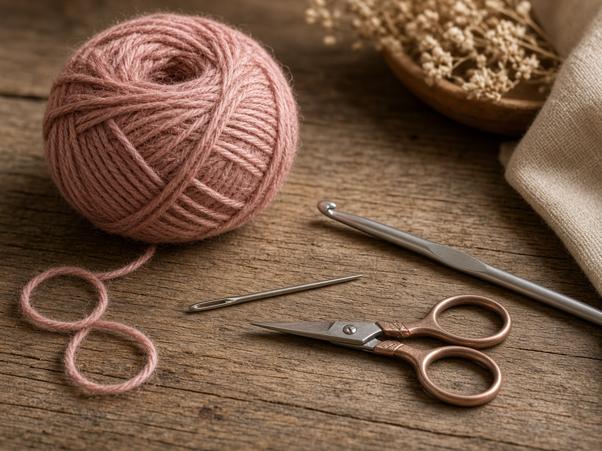
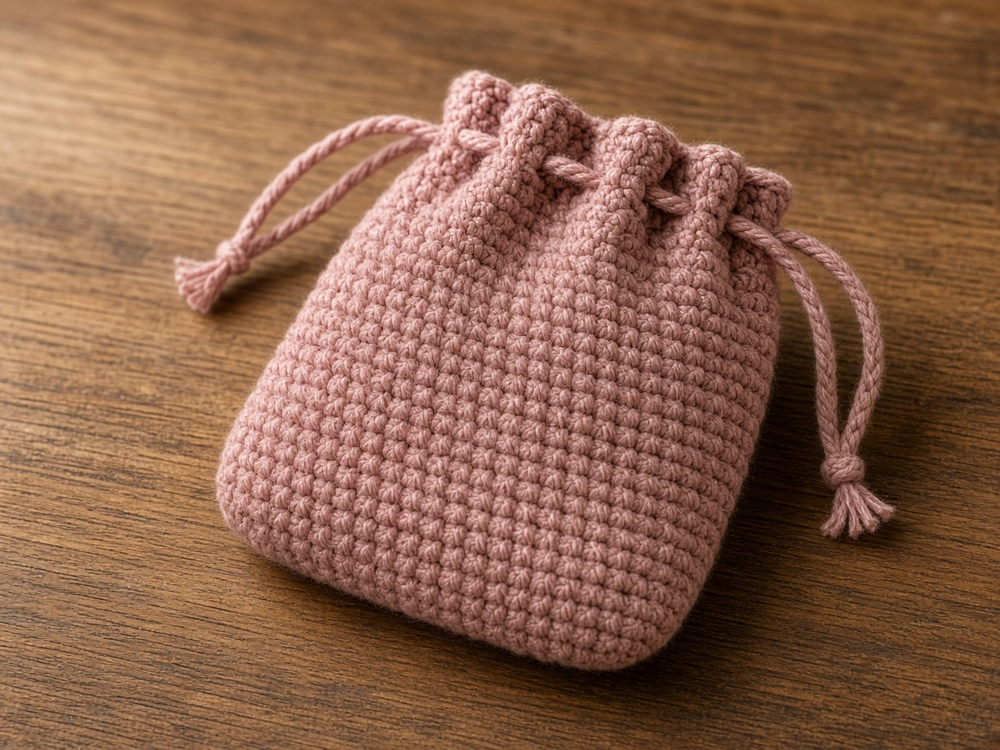

Makeup at the bottom of a bag picks up crumbs, and an open tube leaves a mark on whatever it touches. A small drawstring pouch keeps everything together so you can lift it out in one go. This one is a single-crochet rectangle, folded and seamed, with an eyelet round and a cord at the top.

The construction is simple. The sizing is where most pouches go wrong, in two ways. A flat pouch has to be wider than the widest item, because thick items take up width too. And a drawstring needs spare fabric above the contents to gather. A pouch cut to the exact height of the tallest tube will not close over it.

US terms. US single crochet is UK double crochet. [Abbreviations](/crochet-abbreviations-chart/). The pictures are illustrations. No pouch for this page was crocheted or packed. The item sizes below are an invented example.

## What is a technique, and what is only a plan

| Piece of this page | What it is |
| --- | --- |
| Rectangle folded at the bottom, sides seamed | Standard construction. |
| Width covers the item's width and its thickness | Geometry. The fabric goes around the item. |
| 1.5 in above the tallest item for the gather | A starting allowance. |
| 4 sc and 5 rows to the inch | An unverified example gauge. |
| About 100 yards, a 110-chain tie | Old lines, not measured. Withdrawn. The cord is now measured. |

## How the pouch is built

Crochet a rectangle twice as long as the pouch is tall. Fold it in half so the fold is the bottom. Seam both sides with single crochet through both layers, on the wrong side. Turn it right side out. Around the opening, work an eyelet round and a round above it. Thread a cord through the eyelets and pull.

Seaming on the wrong side matters. A single crochet seam leaves a ridge. Turned inside, the ridge is hidden, and the outside shows only a neat fold line at each side.

## Measure what goes in

Lay out what you will carry and find three numbers:

1. **The widest item**, lying flat. Example: a palette, 5.75 inches.
2. **The thickest item.** Example: a compact, 0.75 inch.
3. **The tallest item**, standing. Example: a brush or tube, 3.5 inches.

<figure class="diagram">

<figcaption>Thickness counts as width. Gathering needs height. Both come from the contents.</figcaption>
</figure>

**Width.** Widest item + thickest item + about half an inch of ease. A flat pouch with a 0.75 inch compact inside bulges, and the bulge takes fabric from the width. The same rule sizes the [phone case](/how-to-crochet-a-phone-case/).

**Height.** Tallest item + about 1.5 inches. The eyelets sit near the top, and gathering pulls the fabric above the contents into the middle. Without that spare height, the cord closes on top of the tallest tube and leaves a gap.

## Yarn, hook, and gauge

- **Smooth worsted cotton.** It washes. It also stains: makeup oil and dark lipstick will not come out of pale cotton just because it is cotton. Pick a color that can wear a mark. Fuzzy yarn grabs powder and pills. [Yarn weights](/yarn-weight-chart/).
- **US G/6 (4.0 mm) hook**, or the hook that gives dense fabric. [Hook chart](/crochet-hook-size-conversion-chart/).
- Yarn needle, scissors.

Single crochet is the whole fabric. Taller stitches leave holes, and a pressed powder will dust through them. Swatch and measure; [gauge](/crochet-gauge/) turns inches into stitches. The example uses 4 stitches and 5 rows per inch.

## The worked example

| Part | Arithmetic | Result |
| --- | --- | --- |
| Width | 5.75 + 0.75 + 0.5 | 7.0 in, 28 sc, chain 29 |
| Height per side | 3.5 + 1.5 | 5.0 in |
| Rows | 5.0 × 2 sides × 5 rows | 50 rows |
| Opening | 28 + 28 | 56 sts, even |
| Cord | 14 in around + 2 tails of 5 in | 24 in |

## Stage 1: the rectangle

Chain 29. Keep the chain loose. The foundation edge becomes half of the opening, and a tight chain draws it in.

**Row 1:** Sc in the second chain from the hook and in each chain across. Ch 1, turn. (28)

<figure class="diagram">

<figcaption>Step 1. Chain 29 for 28 sc. The foundation edge becomes half of the opening, so keep it loose.</figcaption>
</figure>

**Rows 2–50:** Sc in each stitch. Ch 1, turn. (28)

<figure class="diagram">

<figcaption>The first sc of each row goes into the edge stitch, not the ch 1. That keeps 28 stitches, and the opening count of 56.</figcaption>
</figure>

The ch 1 does not count as a stitch. Count every 10 rows. An extra stitch makes one side seam longer than the other, and the pouch twists.

**Checkpoint:** fold the rectangle in half and set the contents on it. The fabric should close around them with the edges meeting and about an inch and a half above the tallest item. If not, add rows now.

## Stage 2: seam

Fold so row 1 meets row 50, right sides together. The fold is the bottom. Join yarn at the fold on one side and single crochet through both layers, one stitch in each row end, up to the opening. Fasten off. Repeat on the other side. Start each seam in the fold itself, not one row above it, or powder leaks out of the corner. Turn the pouch right side out.

<figure class="diagram">

<figcaption>Step 2. Drawn to scale: a 7 by 10 inch rectangle folds into a 7 by 5 inch pouch. Row 1 and row 50 together make the 56-stitch opening.</figcaption>
</figure>

## Stage 3: eyelets and the top round

Join yarn at one side seam at the opening. You will work around both top edges: 28 stitches along row 50 and 28 along the foundation chain, 56 in all.

<figure class="diagram">

<figcaption>Each side seam is one sc in each row end, through both layers, starting in the fold itself.</figcaption>
</figure>

**Eyelet round:** Ch 1, (sc in the next stitch, ch 1, skip 1) 28 times. Slip stitch to the first sc. (28 sc, 28 ch-1 spaces)

**Top round:** Ch 1, sc in each sc and in each ch-1 space. Slip stitch to the first sc. (56) Fasten off.

The eyelet round needs an even count, because each repeat uses two stitches. If the seams took a stitch at the corners and you have 55, work 2 sc in one corner stitch before you start. The [drawstring bag](/how-to-crochet-a-drawstring-bag/) shows what an odd count does to the last hole.

## Stage 4: the cord

The cord goes once around the opening, 14 inches, and leaves two tails to knot, about 5 inches each: 24 inches. Chain to 24 inches without stretching, then slip stitch back along the chain so it does not stretch in use.

Thread it in and out of the eyelets, starting and finishing at the center front. Knot each tail so it cannot pull back through.

**Checkpoint:** pack the pouch and pull the cord. The top should close above the tallest item with no gap you can see into.

Do not put nail polish, a leaking bottle, or a wet brush in this pouch. Cotton holds the stain and passes the liquid on to whatever it touches. This is a dry organizer, not a wash bag.

## Troubleshooting

**The top will not close over the items.** Not enough height for the gather. Add rows, or carry fewer tall things.

**It bulges and the seams strain.** The width did not include the thickness of the thickest item.

**The pouch twists.** The rows gained or lost stitches, so one side seam is longer.

**One spot will not gather.** An odd count on the eyelet round left a missing hole.

**The cord stretches and the top reopens.** Slip stitch back along the chain.

**Powder escapes at a bottom corner.** A seam started above the fold. Close the corner with a few stitches.

## Care

Empty it. Hand wash cool. A makeup stain may not come out. Dry flat with the cord pulled loose so the eyelets do not dry crushed. Refill only when dry.

## Frequently asked

**Can I line it?**

A cloth lining stops crumbs and some stains. Cut it from the finished pouch, not from these numbers. This page does not include a lining pattern.

**What about a bigger pouch?**

Redo the table from your own three measurements. The method does not change.

**Can I sell pouches?**

Finished pouches, yes. Do not republish the rows as your pattern.

## Next

A pouch with a zipper instead of a cord is the [pumpkin zipper pouch](/how-to-crochet-a-pumpkin-zipper-pouch/). The same rectangle with a strap is the [strap bag](/how-to-crochet-a-strap-bag/).
