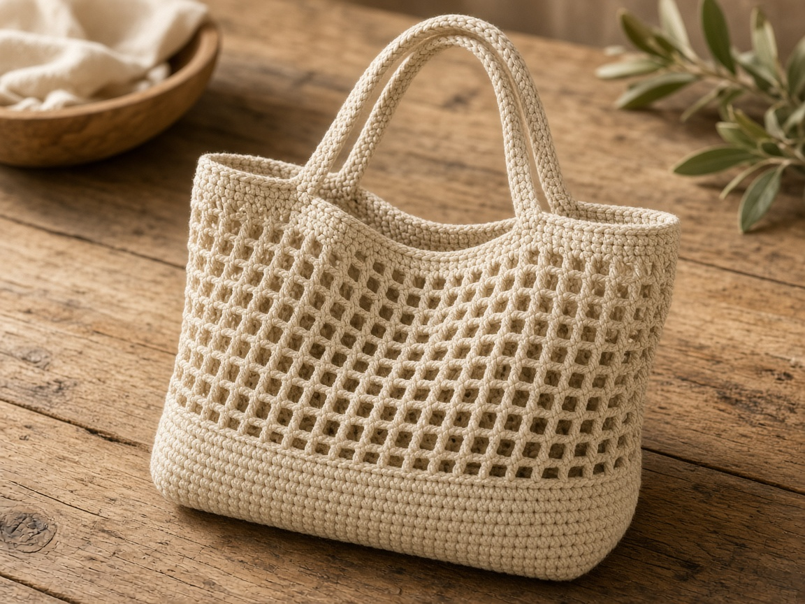
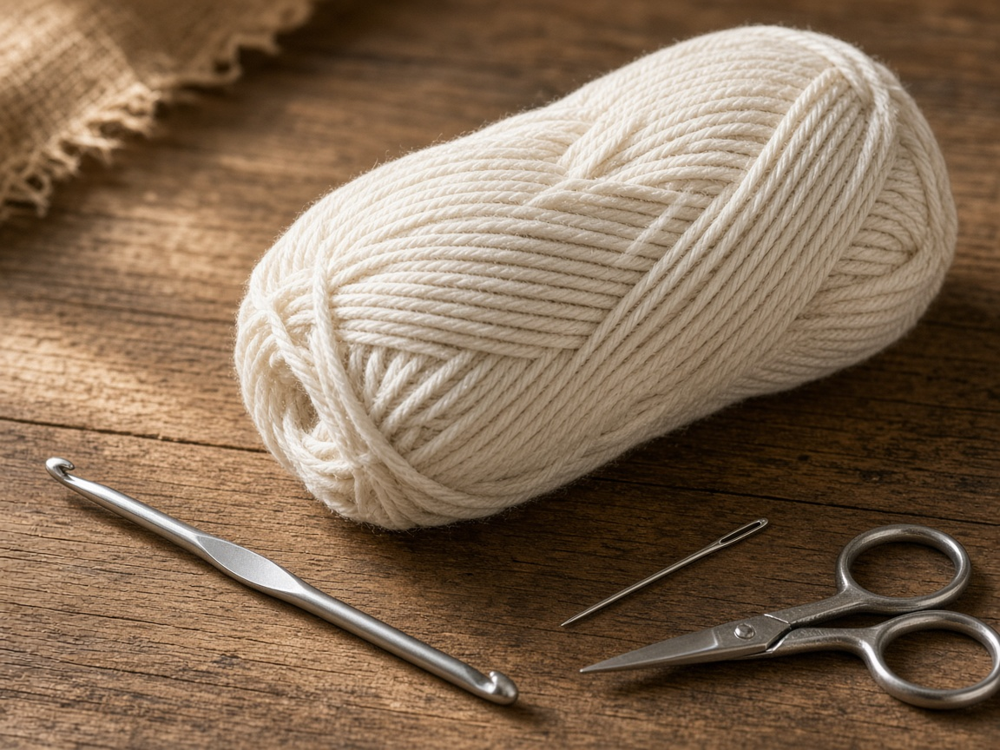
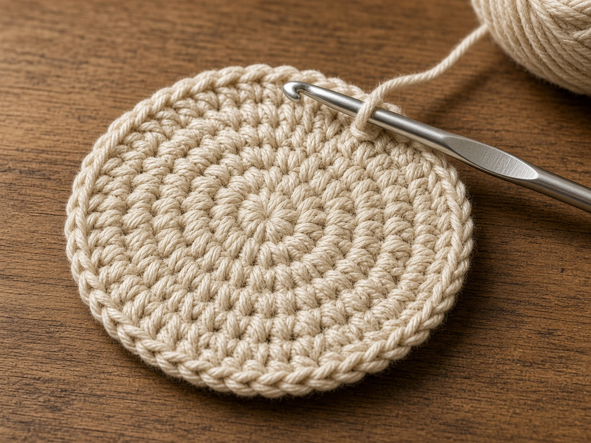
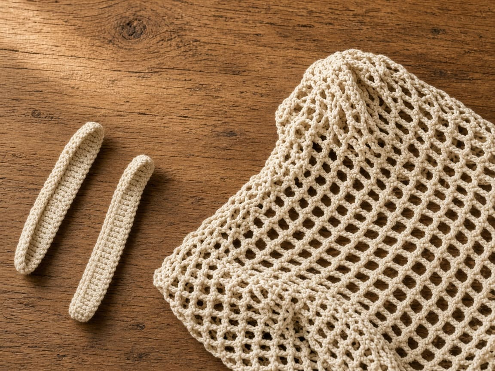

A plastic sack splits at the handle. A cloth tote with no base falls over in the cart. A crochet market bag sits between the two: a solid base that holds its shape, open mesh sides that weigh almost nothing and expand around what you put in, and a firm band at the top where the handles attach.

Three things decide whether it works. The base has to stop increasing at the right moment, or the bag turns into a cone. The mesh has to keep its count, or the sides flare. And the handles have to go into the solid band, spaced evenly, or one side carries all the weight. This page covers each.

US terms. US single crochet is UK double crochet. US double crochet is UK treble. [Abbreviations](/crochet-abbreviations-chart/). The pictures are illustrations. No bag for this page was crocheted, filled, or carried. Inches are estimates from the example gauge.

There is no load rating for this bag, and this page gives no weight limit. Cotton mesh stretches. If the handles pull thin, the holes grow long, or the base pulls into a cone, take items out.

## How the bag is built

<figure class="diagram">

<figcaption>Solid where it needs strength, open where it needs to be light. The handles go only into the solid band.</figcaption>
</figure>

**Base.** A flat circle grows by six stitches a round. Each round adds one stitch height to the radius, and a circle's edge is 2 × 3.14 times its radius, so the edge gains about 6.28 stitch heights. In single crochet that comes out near six stitches. The exact figure depends on how tall your stitches are for their width, which is why one person's circle lies flat and another's cups or ruffles slightly. The [coaster page](/free-pattern-halloween-coasters/) shows how to correct either. Sixteen rounds give 96 stitches. At 4 per inch that is 24 inches around and 24 ÷ 3.14 ≈ **7.6 inches** across.

**Turn.** One round with no increases. That is where the flat base starts to become a wall. Keep increasing into the mesh and the sides lean outward and the bag becomes a cone.

**Mesh.** Each repeat is a double crochet and a chain 1 over two stitches of the round below: 96 stitches make 48 mesh units. Double crochet posts are tall and thin, and the chain spaces between them open sideways under load. That is why the bag expands around a melon and why it stretches.

**Band.** Back to solid single crochet for three rounds. It stops the top from stretching and gives the handles something solid to hold.

## Yarn and hook

- **Smooth worsted cotton.** Every fiber stretches under a load. Acrylic mesh tends to stay stretched once it has gone. [Yarn weights](/yarn-weight-chart/).
- **US G/6 (4.0 mm) hook**, or the size that gives the base gauge. [Hook chart](/crochet-hook-size-conversion-chart/).
- Stitch markers, yarn needle, scissors.

Swatch the single crochet and measure. [Gauge](/crochet-gauge/) sets the base diameter. Measure the real mesh as you go; the 2 rounds per inch figure is a planning number, not a measurement.

## The worked example

| Part | Arithmetic | Result |
| --- | --- | --- |
| Base | 6 × 16 rounds | 96 sc |
| Around | 96 ÷ 4 | 24 in |
| Across | 24 ÷ 3.14 | about 7.6 in |
| Mesh | 96 ÷ 2 | 48 dc and 48 ch-1 |
| Mesh height | about 12 in × 2 rounds per in | about 24 rounds, measured as you go |
| Band | 48 dc + 48 spaces | 96 sc |
| Handle placement, per half | 10 + 8 + 12 + 8 + 10 | 48 |

## Stage 1: the base

Joined rounds: slip stitch to the first stitch, ch 1 (does not count), then work the round.

**Round 1:** 6 sc in a magic ring. (6)

<figure class="diagram">

<figcaption>The base starts in a magic ring.</figcaption>
</figure>

**Round 2:** 2 sc in each stitch. (12)

**Round 3:** (2 sc in next, sc in next) 6 times. (18)

**Round 4:** (2 sc in next, sc 2) 6 times. (24)

Keep going, with one more plain stitch between increases each round. Round 8 is 48. Round 12 is 72. **Round 16 is 96.**

<figure class="diagram">

<figcaption>Step 1. Sixteen rounds of six increases each. Round 16 is 96.</figcaption>
</figure>

**Checkpoint:** lay the base flat. It should be flat, not cupped or ruffled, and about 7.6 inches across. Set your usual shopping on it. If the footprint is bigger, keep increasing by six a round. The final count must be even.

To keep the edge round rather than hexagonal, move the increases: in alternate rounds, start the repeat with half the plain stitches, put the increase in the middle, and end with the rest. [Increase and decrease](/crochet-increase-decrease/) explains staggering.

<figure class="diagram">

<figcaption>Sixteen rounds of stacked increases make a clear hexagon. Moving them keeps the base round.</figcaption>
</figure>

## Stage 2: the turn

**Round 17:** Sc in each stitch. (96)

Put a marker in this round. Measure the side height from here.

## Stage 3: the mesh

Decide now whether the starting ch 3 counts as a double crochet. On this page it does. If you count the ch 3 and then also work a dc into the same place, you add a mesh unit every round.

**Mesh round 1:** Ch 3 (counts as dc), ch 1, skip the next stitch. (Dc in the next stitch, ch 1, skip the next stitch) around. Slip stitch to the top of the ch 3. (48 dc, 48 ch-1 spaces)

<figure class="diagram">

<figcaption>Step 3. The mesh: 48 dc with a chain space over every skipped stitch. The ch 3 counts as the first dc.</figcaption>
</figure>

**Mesh round 2:** Slip stitch into the first ch-1 space. Ch 3 (counts as dc), ch 1. (Dc in the next ch-1 space, ch 1) around. Slip stitch to the top of the ch 3. (48 dc, 48 ch-1 spaces)

Repeat mesh round 2 until the side, measured from the marker, is the height you want. The example is about 12 inches. Count the double crochet every few rounds. 47 or 49 means a unit was dropped or added, and the bag will twist or flare.

If the mesh rim comes out much wider than the base, switch to a hook one size smaller for every remaining mesh round.

A key or a loose berry will find a hole. Put small things inside something larger.

## Stage 4: the band

**Round 1:** Ch 1, (sc in the next dc, sc in the next ch-1 space) around. Slip stitch to the first sc. (96)

**Rounds 2–3:** Ch 1, sc in each stitch. Slip stitch to the first sc. (96)

Fasten off. Weave that end into the band. The handles are separate pieces.

## Stage 5: the handles

<figure class="diagram">

<figcaption>Eight-stitch handles match the eight-position attachment spans.</figcaption>
</figure>

Make 2. Chain 9.

**Row 1:** Sc in the second chain from the hook and across. Ch 1, turn. (8)

**Next rows:** Sc in each stitch. Ch 1, turn. (8)

Work to about 18 inches, about 90 rows at 5 rows per inch. Fasten off, leaving a tail long enough to sew the end down. Pin one handle on, put some weight in the bag, and try it in your hand and on your shoulder before you decide the length. If you change the length, make the second handle to the same row count.

**Placement.** Put a marker at the start of the band round and another at stitch 49. Each half has 48 stitches. On each half: skip 10, sew a handle end over 8, skip 12, sew the other end over 8, skip 10. The two handles sit opposite each other, and the four ends are spaced the same way on both sides, so neither handle pulls the band crooked.

Overlap each handle end on the inside of the band and sew through every one of its 8 stitches across all three band rounds, then back the other way. Keep the sewing out of the mesh. A handle sewn into a chain space pulls that space into a long tear.

## Keep handle width consistent with its attachment span

Each handle is eight sc wide and starts with ch 9. On each forty-eight-stitch half of the band, mark 10 unworked positions, an eight-position attachment, 12 unworked positions, another eight-position attachment, and 10 unworked positions. The full round has four attachment spans. Overlap each end inside the bag and sew across all three solid band rounds plus solid stitches below where available; do not rely on a single chain space. Match the two handles by row count, then check both attachments lie at the same height. Test gently with light contents while supporting the base; this does not establish a load rating.

## Troubleshooting

**The bag is a cone.** Increases continued past the base, or the mesh grew. Stop increasing at round 16 and count the mesh.

**The bag twists as it grows.** That is common in joined mesh rounds, because each round starts a little to one side. Count the units. If the count is right, a slight lean is cosmetic.

**The base is a hexagon.** Increases stacked in the same place. Stagger them.

**One handle sits lower.** Placement counts differ between the halves. Recount from the markers.

**The handles thinned.** Cotton stretched under weight. Carry less, or make the handles wider.

## Care

Empty it. Hand wash cool. Dry flat on a towel with the handles straight. Drying it hanging by a handle stretches that handle.

## Frequently asked

**How much will it hold?**

This page does not say. There is no tested load rating. Watch the fabric and take items out if it distorts.

**Can I use acrylic?**

It will make a bag. Acrylic mesh stretches and tends to stay stretched, so cotton is the page's choice.

## Next

A flat bag made of squares is the [granny square tote](/how-to-crochet-a-granny-square-tote/). The rounds under the base are practiced in [crochet in the round](/crochet-in-the-round/).
