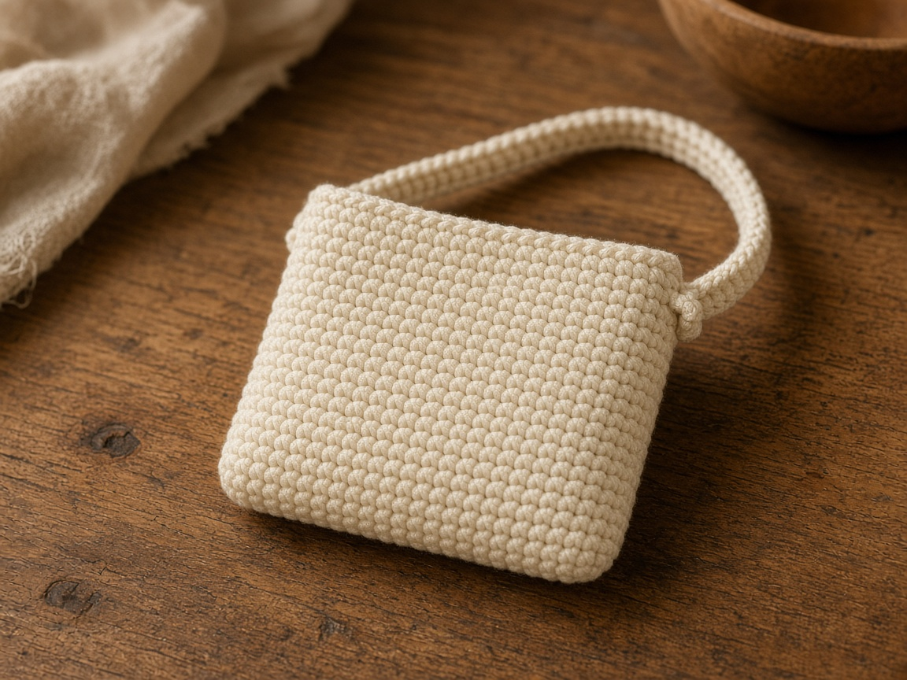
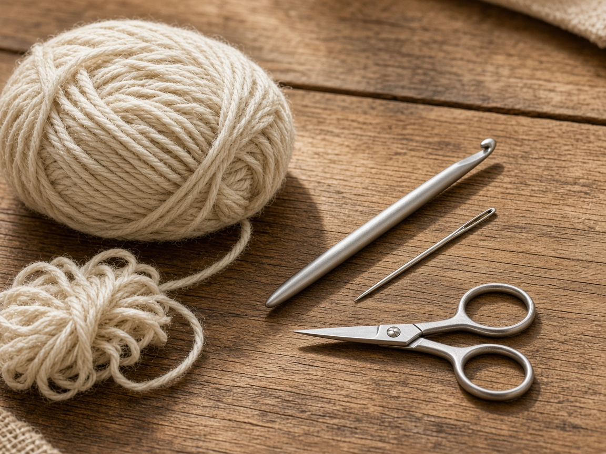
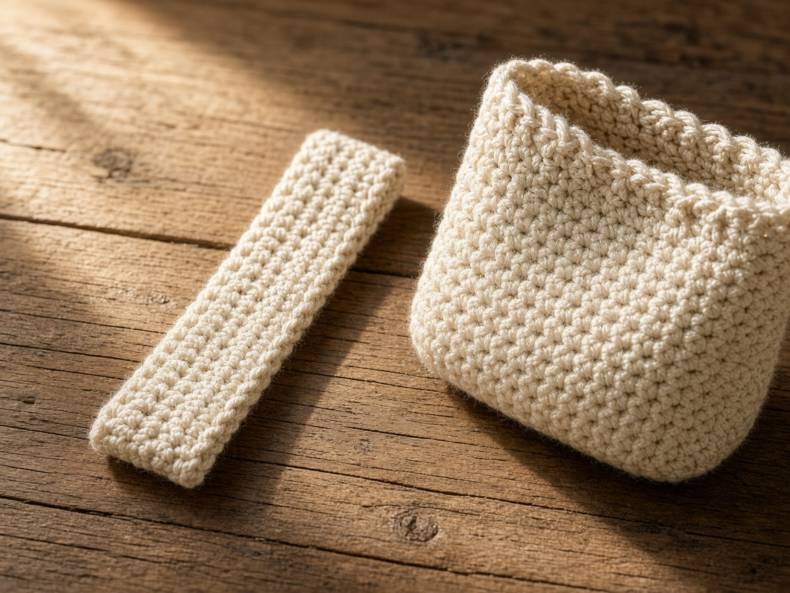

A phone, a slim wallet, and keys vanish into a tote. A mini shoulder bag keeps them at your side. The body is a folded rectangle of single crochet. The strap is a narrow strip that sits on the shoulder, so the bag hangs at about hip height on the same side.

Most of the work is the strap. A strap carries the weight of everything in the bag at two small points. Sewn through one stitch, it tears out. Made to the length that looked right on the table, it ends up longer once the bag is full, because cotton stretches under load and does not recover. This page shows how to size the body from what goes in it, how to attach the strap so it holds, and how to set the strap length after it has stretched.

US terms. US single crochet is UK double crochet. [Abbreviations](/crochet-abbreviations-chart/). The pictures are illustrations. No bag for this page was crocheted, filled, or worn. The item sizes are an invented example.

## What is a technique, and what is only a plan

| Piece of this page | What it is |
| --- | --- |
| Rectangle folded at the bottom, sides seamed | Standard construction. |
| Width covers the widest item plus the whole stack's thickness | Geometry. |
| Strap sewn through an inch of both layers | Standard construction practice. Not a load rating. |
| 4 sc and 5 rows to the inch | An unverified example gauge. |
| About 200 yards, 26 in strap | Old lines. The yardage was not weighed and is withdrawn. The strap is now fitted. |

## Measure what goes in

Stack the things you carry the way they will sit in the bag, side by side front to back. Measure:

- **The widest item.** Example: a wallet, 4.5 inches.
- **The whole stack's thickness.** Example: phone, wallet, and keys together, 1.5 inches.
- **The tallest item.** Example: a phone, 6 inches.

The width is widest + stack + half an inch of ease + about a quarter inch for the seams. The height is the tallest item plus about half an inch, so the top edge does not sit on the phone. This bag has an open top, so it needs no gather allowance. A drawstring pouch does: see the [makeup pouch](/how-to-crochet-a-makeup-pouch/).

## The worked example

| Part | Arithmetic | Result |
| --- | --- | --- |
| Width | 4.5 + 1.5 + 0.5 + 0.25 | 6.75 in, 27 sc, chain 28 |
| Height per side | 6 + 0.5 | 6.5 in |
| Rows | 6.5 × 2 × 5 | 65 rows |
| Top round | 27 + 27 | 54 sc |
| Strap | 4 sc wide, length fitted | starts near 26 in |

## Yarn and hook

- **Smooth worsted cotton.** It holds the rectangle's shape. [Yarn weights](/yarn-weight-chart/).
- **US G/6 (4.0 mm) hook**, or the size that gives firm fabric. [Hook chart](/crochet-hook-size-conversion-chart/).
- Stitch markers, safety pins, yarn needle, scissors.

Swatch and measure. [Gauge](/crochet-gauge/) decides the width.

## Stage 1: the body

Chain 28.

**Row 1:** Sc in the second chain from the hook and in each chain across. Ch 1, turn. (27)

<figure class="diagram">

<figcaption>Step 1. Chain 28 for 27 sc, 6.75 inches at 4 sc per inch.</figcaption>
</figure>

**Rows 2–65:** Sc in each stitch. Ch 1, turn. (27)

<figure class="diagram">

<figcaption>Each row starts in the edge stitch. A gained stitch here shows up as a crooked side seam.</figcaption>
</figure>

The ch 1 does not count as a stitch. Count every 10 rows.

**Checkpoint:** fold the rectangle in half around the stacked items. The side edges should meet without strain, and the fabric should come half an inch above the tallest item.

Fold with right sides together so row 1 meets row 65. Single crochet through both layers along each side from the fold to the top. Turn it right side out.

## Stage 2: the top round

Join yarn at one side seam on the opening. Ch 1, sc in each stitch around both edges: 27 along row 65 and 27 along the foundation chain. Slip stitch to the first sc. (54) Fasten off.

<figure class="diagram">

<figcaption>Step 2. Drawn to scale. The 65 rows fold in half to about 6.5 inches a side, and the top round joins both edges: 54 sc.</figcaption>
</figure>

This round firms the opening so it does not stretch out of shape when you reach in. It also gives the strap something solid to be sewn to.

## Stage 3: the strap

Chain 5.

**Row 1:** Sc in the second chain from the hook and across. Ch 1, turn. (4)

<figure class="diagram">

<figcaption>Step 3. The strap is a narrow strip: chain 5 for 4 sc.</figcaption>
</figure>

**Next rows:** Sc in each stitch. Ch 1, turn. (4)

Stop near 26 inches (about 130 rows at 5 rows per inch) and try it. Hold the strap on your shoulder and let it hang to where you want the top of the bag, usually around the hip on the same side. Add rows or stop sooner.

## Stage 4: attach and test

<figure class="diagram">

<figcaption>The strap's length is decided after it has carried weight, not before.</figcaption>
</figure>

1. **Sew the first end.** Lay one strap end inside the bag at a side seam, overlapping by about an inch. With a yarn needle, sew a box around the overlap and an X across it, through the strap, the top round, and the bag wall. A strap held by one stitch at the corner pulls that stitch out.
2. **Pin the second end.** Check that the strap is not twisted. Pin the other end inside the opposite side seam with two safety pins.
3. **Hang it loaded.** Put in what the bag will carry and hang it by the strap for a day.
4. **Remeasure.** If the bag now hangs lower than you wanted, move the pins or pull out rows. Then sew the second end the same way as the first.

Why: every row of a single crochet strap can give slightly under a steady load, and over 130 rows that adds up. Cotton does not spring back. Setting the length after the stretch means the bag hangs where you want on the second day as well as the first.

## Optional closure

Chain 12 at the center of the back's top edge, slip stitch back into the same stitch to make a loop, and sew a button on the front where the loop reaches with the bag full.

## Troubleshooting

**The bag bulges and the seams strain.** The width left out the stack thickness.

**The phone sits above the top edge.** Too few rows.

**The strap got longer after a week.** It was sewn before the hanging test. Unpick one end, take out rows, and resew.

**A strap end tore out.** It was sewn through too few stitches. Resew with the box-and-X through both layers.

**The strap twists on the shoulder.** It was sewn with a twist. Unpick one end and lay it flat.

## Care

Empty the bag. Hand wash cool. Dry flat with the strap laid straight. Hanging it wet by the strap stretches it.

## Frequently asked

**Can I make the strap long enough to cross the body?**

A crossbody strap goes all the way round the torso, so it is sized differently. See the [phone crossbody](/how-to-crochet-a-phone-crossbody/).

**Is the bag waterproof?**

No. Single crochet lets water through.

**Can I sell finished bags?**

Yes. Do not republish the rows as your pattern.

## Next

A crossbody version, with the strap measured around the body, is the [phone crossbody](/how-to-crochet-a-phone-crossbody/). A larger open carry is the [granny square tote](/how-to-crochet-a-granny-square-tote/).
