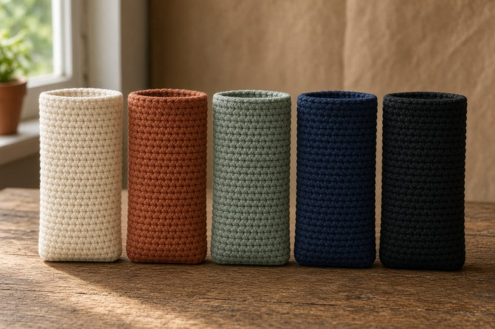
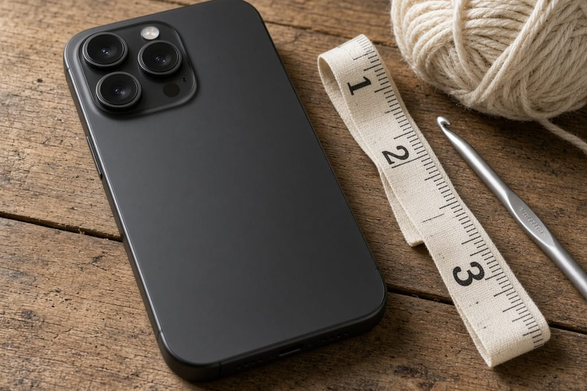
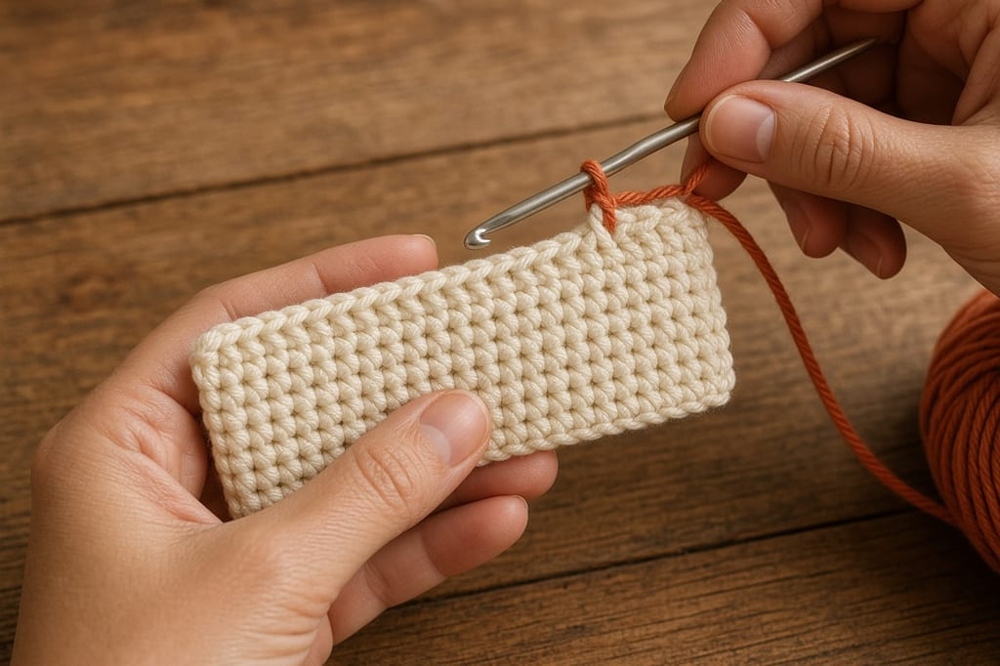

A crochet phone sleeve fails in one predictable way: it is chained to the phone's width, seamed, and then the phone will not go in. The fabric does not only cover the front and back. It also wraps both edges, so the flat sleeve has to be wider than the phone. This page works out by how much, using one specific phone, and then makes the sleeve.

The iPhone 18 Pro Max body is **3.07 inches wide (78.0 mm)**, **6.43 inches tall (163.4 mm)**, and **0.34 inch thick (8.75 mm)**, per [Apple's tech specs](https://support.apple.com/en-us/148591). Those are the bare phone. No sleeve for this page was crocheted or fitted on a phone, and the pictures are illustrations. The method works for any phone. Put your own three numbers into the table.

US terms. US single crochet is UK double crochet. [Abbreviations](/crochet-abbreviations-chart/).

## What is fact, and what is only a plan

| Piece of this page | What it is |
| --- | --- |
| 3.07 × 6.43 × 0.34 in | Apple's published body size. |
| Fabric around the phone = 2 × (width + depth) | Geometry. |
| 4 sc and 5 rows to the inch | An unverified example gauge. Swatch your own. |
| About a stitch lost to the side seams, plus a little ease | A starting allowance. The phone is the test. |
| The camera plateau | Adds thickness at the top. Apple's 0.34 in is the body. Leave the top of the sleeve easy. |

## How the sleeve is built

One rectangle of single crochet. The foundation chain sets the width. The rows build the length. Fold it in half so the fold is the bottom, seam the two sides, and leave the top open. There is no shaping and no separate base.

<figure class="diagram">

<figcaption>The sleeve has to cover the phone's edges as well as its face. That is the 0.34 inch most first sleeves forget.</figcaption>
</figure>

Wrap a strip of paper around the phone the short way and mark where it meets. That length, about 6.82 inches here, is what the sleeve has to go around. A flat sleeve has two faces, so each face must be at least half: **3.41 inches**. The side seams then take up roughly one stitch of the width, and you want a little ease so the phone slides. That makes the fabric about 3.9 inches wide.

The same thing happens at the bottom. The fold wraps the bottom edge, so each face starts about half the depth, 0.17 inch, above the fold. The pocket needs about 6.6 inches of depth on each side before the phone is covered.

## Yarn and hook

- **Smooth worsted cotton.** Cotton slides on the phone's glass and frame. Fuzzy yarn grips it, sheds lint into the ports, and pills inside. [Yarn weight chart](/yarn-weight-chart/).
- **A hook that makes dense fabric**, often US G/6 (4.0 mm). Drop a size if you can see light through the stitches. [Hook chart](/crochet-hook-size-conversion-chart/).
- The phone, without its case. If you keep a case on, measure the phone in its case instead.
- Yarn needle, scissors.

Crochet a swatch at least 4 inches wide and measure stitches and rows per inch. A [gauge](/crochet-gauge/) swatch is worth it here, because the width has almost no room for error.

## The worked example

| Part | Arithmetic | Result |
| --- | --- | --- |
| Around the phone | 2 × (3.07 + 0.34) | 6.82 in |
| One flat face | 6.82 ÷ 2 | 3.41 in |
| Fabric width | 3.41 + about 0.25 seams + about 0.25 ease | about 3.9 in |
| Stitches | 3.9 × 4, rounded up | 16 sc, chain 17 |
| Pocket depth per side | 6.43 + 0.17 at the fold + about 0.4 collar | about 7.0 in |
| Rows | 2 × 7.0 × 5 | 70 rows |

The earlier version of this page said to chain "just over 3.07 inches". At 4 stitches per inch that is about 13 stitches. Seamed, it leaves roughly 3.0 inches inside a sleeve that needs 3.41.

## Stage 1: chain and first row

Chain 17. Single crochet in the second chain from the hook and in each chain across. Ch 1, turn. (16)

Keep the chain looser than the rows, or use a hook one size larger for the chain only. A tight chain pulls the bottom edge in, and the fold will pucker.

**Checkpoint:** lay the first row flat. It should measure about 3.9 inches. Fold a strip of paper of that width around the phone. It should close with a little overlap.

## Stage 2: the rectangle

Single crochet in each stitch across. Ch 1, turn. The ch 1 does not count as a stitch. (16)

Count the stitches every 10 rows. Single crochet edges often gain a stitch when the first stitch goes into the turning chain, and each gained stitch is a quarter inch of looseness at that row.

Stop at about 70 rows, or when the rectangle folded in half covers the phone with a little collar above the top edge. Measure it lying flat, not hanging.

**Checkpoint:** fold the rectangle with the phone inside, without seaming. The two long edges should meet beside the phone with no strain. If they gap, the sleeve is too narrow. Start again with more stitches. Do not stretch it.

## Stage 3: fold and seam

Fold the rectangle in half with the right side inside. Whipstitch each side from the fold to the top, through the outer loop of each edge stitch only. Going deeper into the stitch takes width from the inside. Turn it right side out so the seams are inside.

Slide the phone in before you weave the tails. It should go in without force and stay put when you tip the sleeve. If the opening fights you, the last rows are tighter than the rest. Redo them more loosely. Weave ends on the inside, where they cannot catch on the buttons. See [weaving in ends](/weaving-in-ends-and-blocking/).

## Color

**Solid.** Best first sleeve. You can see every stitch you need to count.

**Two-tone.** Work 35 rows in color A, [change color](/changing-yarn-color-crochet/), and finish in color B. The color change lands on the fold.

**Stripes.** Change every 4 rows. On a piece this small, two-row stripes read as noise. Cut the old color unless it returns within two rows. A strand carried up the side is on the inside of the seam, where it snags on the phone.

Keep every color the same yarn weight. A thinner yarn makes a narrower stripe, and the phone sticks there.

## Optional flap

Fit the open sleeve first. Then join yarn at the center of the back opening and work a short flap in rows over the middle 8 stitches, about 6 rows. Decrease one stitch at each end on alternate rows if you want it to narrow. On the last row, chain a loop that fits your button, slip stitch back, fasten off, and sew the button to the front. Skip the flap if the phone comes out all day.

## Troubleshooting

**The phone will not go in.** The sleeve was sized to the face, not around the phone. Recheck the width against 2 × (width + depth) ÷ 2, plus seams.

**It goes in but sticks at the top.** The camera plateau. Add a few loose rows to the collar, or work the last 4 rows with a larger hook.

**The phone slides out when tipped.** Too much ease, or a loose fabric. Redo with one fewer stitch or a smaller hook.

**One side is longer than the other.** Gained or lost stitches. Count back to the row where you still had 16.

**The bottom corners stick out.** The fold is not square. Refold along a single row.

## Frequently asked

**Does this work for a different phone?**

Yes. Measure width, height, and depth, or look them up on the maker's spec page, and redo the table.

**Should I cut a hole for the camera?**

No. The plateau sits at the top, and the open collar clears it. A hole in a single-crochet sleeve stretches and runs.

**Does the sleeve protect the phone from a drop?**

No. It keeps scratches and lint off the glass. It does not cushion a fall.

**Can I sell sleeves I make?**

A plain sleeve sized from published measurements is yours to make. Do not copy someone else's charted motif onto it.

## Next

The same "fabric goes around, not across" rule sizes the [book sleeve](/how-to-crochet-a-book-sleeve/) and the [laptop sleeve](/how-to-crochet-a-laptop-sleeve/). A tube sized for a smaller object is the [earbud pouch](/how-to-crochet-an-earbud-pouch/).
