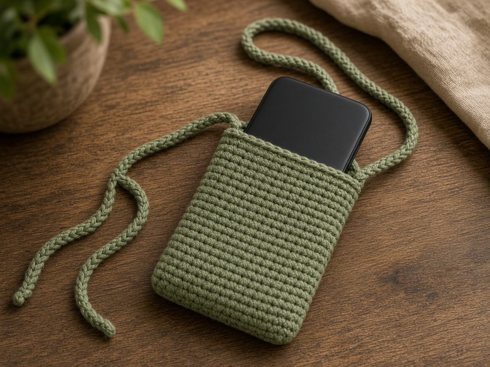
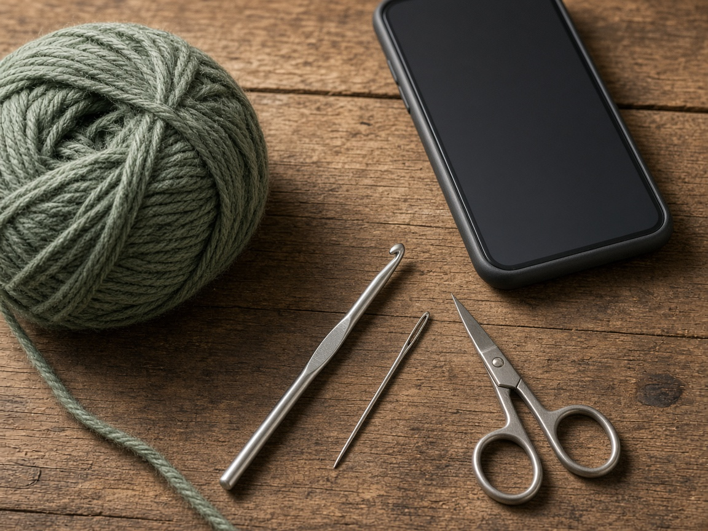
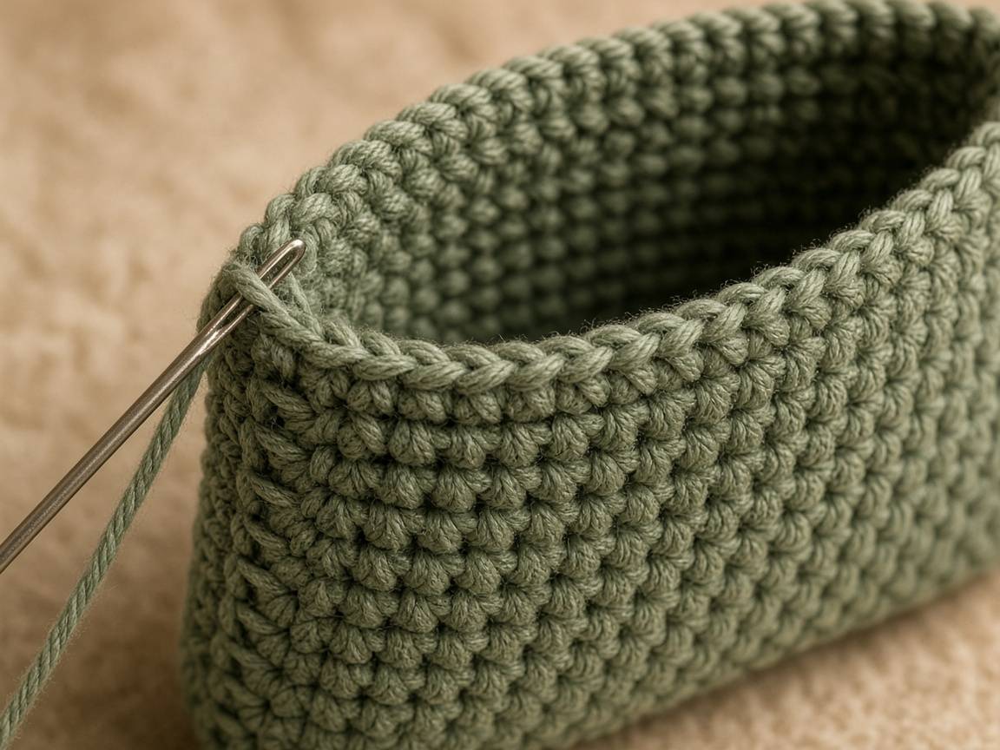

A phone in a coat pocket slides out when you sit down. A sleeve on a crossbody strap stays against your body, where you can feel it. The sleeve is a small folded rectangle. The strap runs from one side of the sleeve, across your chest, over the opposite shoulder, down your back, and to the other side of the sleeve.

Two measurements decide whether it works, and both are easy to get wrong. The sleeve has to fit around the phone, including its edges, not just across its face. And the strap is a loop around your body, so measuring from the shoulder to the hip on the front gives you about half the strap you need. This page works out both.

US terms. US single crochet is UK double crochet. [Abbreviations](/crochet-abbreviations-chart/). The pictures are illustrations. No crossbody for this page was crocheted, fitted, or worn. The phone and body measurements are invented examples.

## What is a technique, and what is only a plan

| Piece of this page | What it is |
| --- | --- |
| Folded rectangle sleeve, sides seamed | Standard construction. |
| Each face covers the phone's width plus its thickness | Geometry. |
| Strap = loop around the body minus the sleeve width | Geometry. |
| 3.0 × 6.0 × 0.35 in phone, 52 in loop | Invented examples. |
| 4 sc and 5 rows to the inch | An unverified example gauge. |
| 14 stitches wide; about 180 yards | Old lines. The width is corrected below, and the yardage was not weighed. |

## The sleeve: around the phone, not across it

Measure the phone's width, height, and thickness, including a case if it stays on.

The fabric wraps both edges of the phone. So each face of the sleeve must cover the width plus the thickness, and the side seams take up about a quarter inch more. The [phone case](/how-to-crochet-a-phone-case/) page draws this out.

The earlier version of this page made the example sleeve 14 stitches wide, 3.5 inches, for a 3 inch phone. Seamed, that leaves about 3.25 inches inside a sleeve that needs about 3.35. It is a little too tight, and a cotton sleeve stretched over a phone relaxes in the first wash and then drops the phone.

| Part | Arithmetic | Result |
| --- | --- | --- |
| Width | 3.0 + 0.35 + 0.25 seams + 0.15 ease | 3.75 in, 15 sc, chain 16 |
| Height per side | 6.0 + 0.17 at the fold + 0.5 | about 6.7 in |
| Rows | 6.7 × 2 × 5 | 67 rows |

## The strap: a loop around you

<figure class="diagram">

<figcaption>The sleeve's own top edge completes the loop, so subtract its width from the string.</figcaption>
</figure>

Put on the clothes you will usually wear it over. Hold one end of a string where you want the top of the sleeve to sit, at the hip. Run the string across your chest, over the opposite shoulder, down your back, and back to the start. Mark it and measure. That is the loop. In the example it is 52 inches.

The strap does not need to cover all of it. The sleeve's top edge, 3.75 inches, sits between the two strap ends. So the strap is 52 − 3.75, about **48 inches**: 240 rows at 5 rows per inch.

## Yarn and hook

- **Smooth worsted cotton.** Fuzzy yarn holds grit against the glass. [Yarn weights](/yarn-weight-chart/).
- **US G/6 (4.0 mm) hook**, or the size that gives dense fabric. A loose hook leaves holes. [Hook chart](/crochet-hook-size-conversion-chart/).
- Safety pins, yarn needle, scissors. A button if you add the flap.

Swatch first. [Gauge](/crochet-gauge/) matters most on the sleeve, which has almost no room for error.

## Stage 1: the sleeve

Chain 16. Keep the chain loose.

**Row 1:** Sc in the second chain from the hook and in each chain across. Ch 1, turn. (15)

**Rows 2–67:** Sc in each stitch. Ch 1, turn. (15)

The ch 1 does not count as a stitch. Count every 10 rows.

**Checkpoint at row 20:** fold the strip around the phone. The edges should meet beside it without strain.

Fold with right sides together so row 1 meets row 67. Single crochet both sides through both layers from the fold to the top, then turn right side out. Slide the phone in. It should go in without force and stay put when you tip the sleeve.

## Stage 2: the strap

A chain alone is not a strap. It stretches, and the phone ends up at your knee.

Chain 6.

**Row 1:** Sc in the second chain from the hook and across. Ch 1, turn. (5)

**Row 2:** Sc in each stitch. Ch 1, turn. (5)

Repeat row 2. Measure flat every 20 rows. Stop at the length you worked out, about 48 inches in the example.

## Stage 3: attach, then test

Sew one strap end inside the sleeve at the top of one side seam, overlapping about an inch, with a box and an X through the strap and the sleeve wall. Pin the other end to the opposite side with safety pins. Check the strap is not twisted.

Put the phone in and wear it for a day. Cotton straps lengthen under steady weight and do not spring back. If the sleeve now sits lower than you wanted, take out rows, then sew the second end the same way as the first. The [mini shoulder bag](/how-to-crochet-a-mini-shoulder-bag/) shows the box-and-X stitch.

## Optional flap

An open top lets you reach the phone quickly. A hard swing can also throw it. A flap stops that.

Join yarn in the fifth stitch of the back opening, counting from one side seam, so the flap covers stitches 5 to 11, the middle 7 of 15.

**Row 1:** Ch 1, sc in the same stitch and in the next 6. Ch 1, turn. (7)

**Rows 2–6:** Sc in each stitch. Ch 1, turn. (7)

**Row 7:** Sc 2, ch 4, skip 3, sc 2. (4 sc and a ch-4 loop)

Fasten off. Two, three skipped, and two is seven, so the loop is centered. Sew a button on the front where the loop reaches, with the phone inside.

This does not keep a phone dry. Rain and spilled drinks go through single crochet.

## Troubleshooting

**The phone will not go in.** The width did not include the thickness. Fifteen stitches for a 3 inch phone; more for a thicker case.

**The phone sits at your knee.** The strap was measured shoulder to hip on one side only, or it stretched. Remeasure the loop, and test before sewing the second end.

**The sleeve rides up under your arm.** The strap is too short. Add rows.

**The strap twists.** It was sewn with a twist. Unpick one end.

**The sleeve tilts.** The strap is sewn at different heights on the two sides.

## Care

Take the phone out. Hand wash cool. Dry flat with the strap straight. Put the phone back only when the sleeve is dry.

## Frequently asked

**Will it fit every phone?**

No. Measure yours, including any case, and redo the sleeve table.

**Can I sell them?**

Finished sleeves, yes. Do not republish the rows, and do not stitch a phone brand onto the sleeve as if the company made it.

**Is it safe in the rain?**

No. Water goes through.

## Next

The same sleeve without a strap is the [phone case](/how-to-crochet-a-phone-case/). A short strap that sits on one shoulder is the [mini shoulder bag](/how-to-crochet-a-mini-shoulder-bag/).
