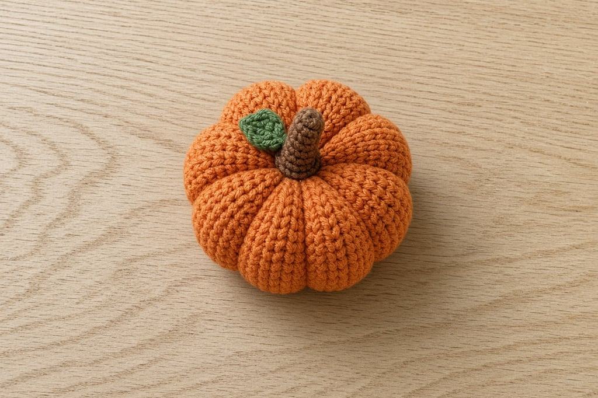
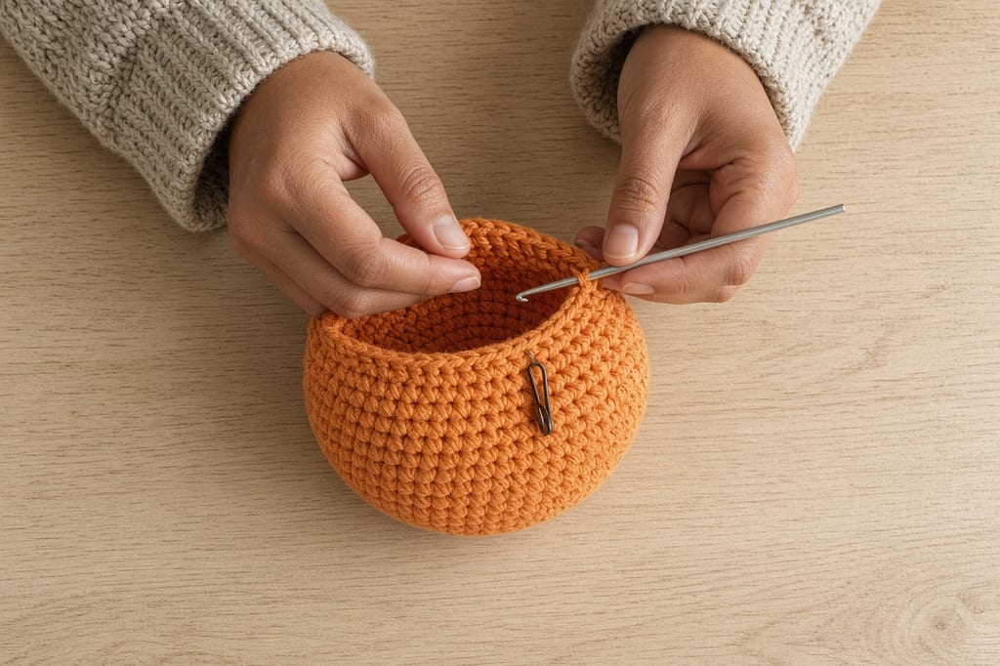
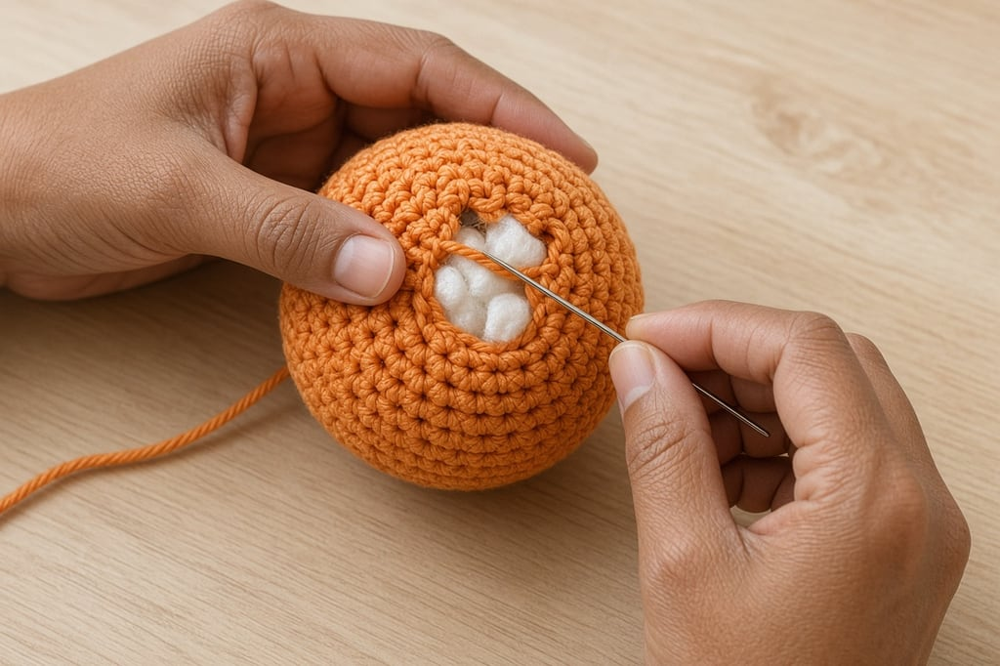
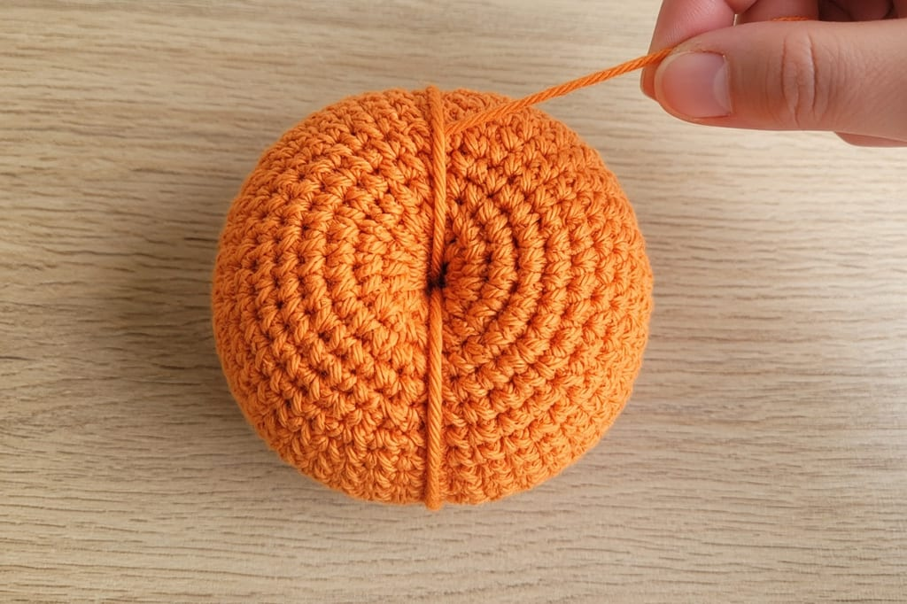
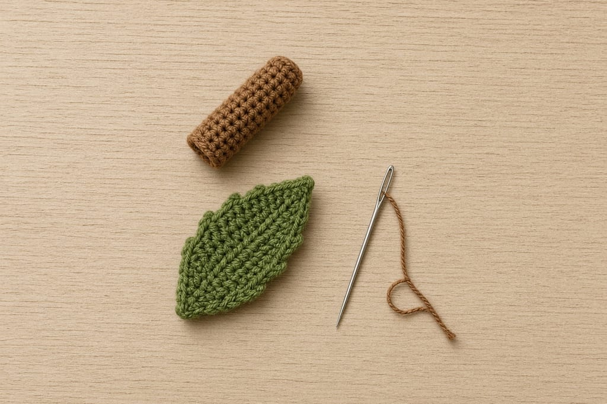

A crochet pumpkin is a stuffed ball, slightly squashed, with grooves pulled in from the outside and a short stem on top. The ball is the same basic shape behind most amigurumi, which is why this is a good first one. The grooves are a finishing trick, not a stitch.

The lesson here is the shape. Every amigurumi ball has three parts: rounds that increase, rounds that stay even, and rounds that decrease. The increases set how wide it gets. The even rounds set how tall. Change only the number of even rounds and the same ball becomes a pumpkin, an egg, or a cylinder. Once you see that, most stuffed toys stop looking mysterious.

If you can work [in the round](/crochet-in-the-round/) and make a [basic increase and decrease](/crochet-increase-decrease/), you can make this. US terms. [Abbreviations](/crochet-abbreviations-chart/). The pictures are illustrations of the finished pumpkin, which has not been made up in yarn here, so no finished size is given.

## How the shape works

<figure class="diagram">

<figcaption>Increase for width, work even for height, decrease to close. The grooves come later, from the outside.</figcaption>
</figure>

Six increases per round keeps a single crochet circle growing evenly. Six decreases per round closes it the same way. Between them, each even round adds one stitch height of wall. A ball of 36 stitches usually wants about six even rounds to look round. A pumpkin wants fewer, because it is wider than it is tall, and cinching the grooves will squash it further.

## What you need

- **Worsted-weight yarn** in orange, plus a scrap of brown or green for the stem. [Yarn weights](/yarn-weight-chart/).
- **A hook one or two sizes smaller than the yarn label suggests**, often US E/4 (3.5 mm) or F/5 (3.75 mm) for worsted. Amigurumi uses tighter fabric than a garment so the stuffing does not show through. [Hook chart](/crochet-hook-size-conversion-chart/).
- Polyester stuffing, a yarn needle, a stitch marker.

## Step 1: increase to 36

Work in a spiral. Mark the first stitch of every round and move the marker up.

**Round 1:** 6 sc in a magic ring. (6)

<figure class="diagram">

<figcaption>Round 1 starts in a magic ring, pulled tight so the top has no hole.</figcaption>
</figure>

**Round 2:** 2 sc in each stitch. (12)

**Round 3:** (Sc, 2 sc in next) 6 times. (18)

**Round 4:** (Sc 2, 2 sc in next) 6 times. (24)

**Round 5:** (Sc 3, 2 sc in next) 6 times. (30)

**Round 6:** (Sc 4, 2 sc in next) 6 times. (36)

Each repeat covers one more old stitch than the last round's repeat and makes one more new stitch. If your count is not on the list, find the error now. A miscount here shows as a lump later.

## Step 2: a short even section

**Rounds 7–10:** Sc in each stitch. (36)

Four even rounds is squat on purpose. For a rounder pumpkin, work five or six. For a flatter one, three.

## Step 3: decrease and stuff

**Round 11:** (Sc 4, sc2tog) 6 times. (30)

<figure class="diagram">

<figcaption>Through the front loops only, the decrease disappears into the fabric.</figcaption>
</figure>

**Round 12:** (Sc 3, sc2tog) 6 times. (24)

**Round 13:** (Sc 2, sc2tog) 6 times. (18)

Stuff firmly now, while you can still reach in. Push stuffing into the edges, not just the middle.

**Round 14:** (Sc, sc2tog) 6 times. (12)

Top up the stuffing.

**Round 15:** Sc2tog 6 times. (6)

Fasten off with a long tail. Thread it through the front loops of the last 6 stitches and pull the hole closed.

Stuff firmer than seems necessary. The grooves compress the body. A softly stuffed pumpkin turns into a dented blob when you pull them in.

## Step 4: cinch the grooves

Thread a long strand of the body color, or a slightly darker orange, onto a yarn needle.

1. Bring the needle up from the bottom center through the middle of the pumpkin and out at the top center.
2. Take the yarn down the outside to the bottom center, and pass the needle up through the middle again.
3. Pull until a groove forms. That is one wrap.
4. Turn the pumpkin and repeat. Six wraps, evenly spaced, make six sections. Eight look a little more detailed.

Pull each wrap enough to show a clear groove but not so tight that the top and bottom pucker into points. Pull every wrap to about the same tension. Tie off at the bottom and bury the ends inside.

## Step 5: the stem

With brown or green:

**Round 1:** 6 sc in a magic ring. (6)

**Rounds 2–4:** Sc in each stitch. (6)

Fasten off with a tail. Leave it hollow or stuff lightly. Sew it to the top center so it covers the point where the wraps meet.

## Troubleshooting

**A wavy disc instead of a cup.** The increases were uneven or skipped. Count each round.

**A tall tube with grooves.** Too many even rounds. Use four.

**Dents and soft spots.** Under-stuffed. Stuff before cinching, not after.

**A pointed top.** The last rounds were not stuffed, or the wraps were pulled too tight at the top.

**Stuffing shows through.** The fabric is too loose. Use a smaller hook.

**Visible lines of increases.** Six increases stacked in the same place every round make a hexagon. Shift the start of each repeat by a stitch or two from round to round.

## Frequently asked

### Why is no finished size given?

Hook, yarn, your tension, and how firmly you stuff all change the size, and no pumpkin was measured for this page. Make one, measure it, and write the number down.

### Can I make it bigger?

Keep increasing past 36 by adding a round: (sc 5, 2 sc in next) 6 times, 42. Add an even round or so, then decrease from 42 with (sc 5, sc2tog) first.

### Can I use blanket yarn?

With a larger hook, yes, but the fabric is soft and the grooves show less. Worsted or aran holds grooves better.

### Is it safe for a baby?

A stuffed toy for a baby needs securely closed seams and no small parts. This pumpkin has none, but it has not been safety tested. Treat it as decoration.

### What should I make next?

The same increase, even, decrease logic with an open hem is the [ghost amigurumi](/crochet-ghost-amigurumi-for-beginners/). A small oval body with flat wings is the [bat](/bat-amigurumi-wings-body-and-ears/).
