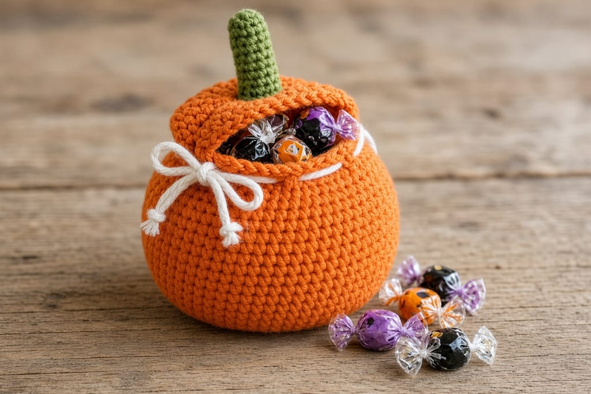
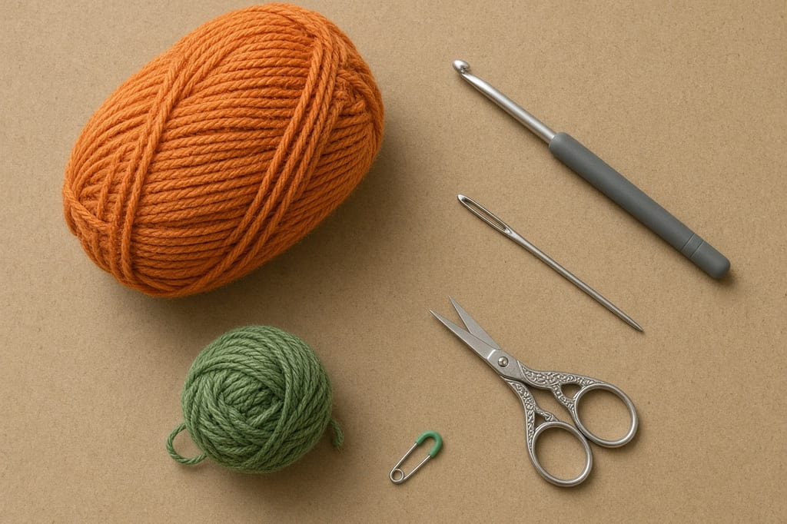
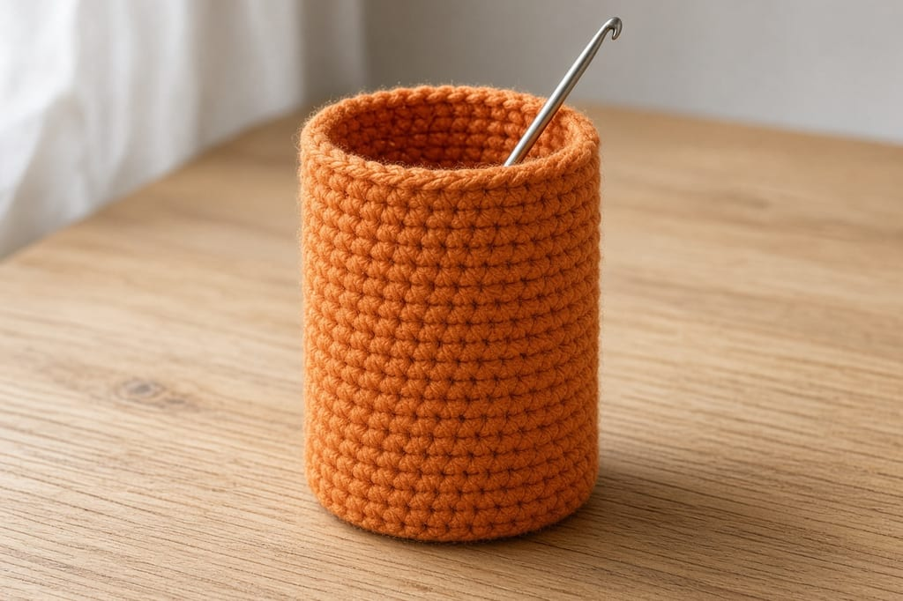
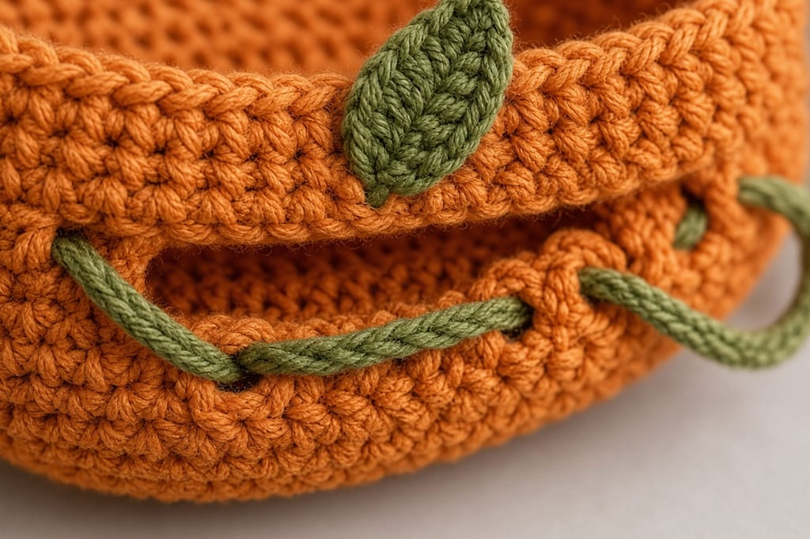

A straight orange tube with a stem is a cylinder that happens to be orange. A pumpkin is wider in the middle than at the top or bottom. This bag gets that shape from two rounds: one round of six increases partway up the wall, and one round of six decreases near the top. Between them the bag bulges slightly. Above them it narrows again to a neck that gathers neatly when you pull the cord.

That is the lesson here: you can shape a straight tube without starting over, by adding stitches evenly in one round and taking them out evenly in a later one. The same move shapes a vase, a bottle cozy, or the body of a toy.

It holds a handful of wrapped candy, not a night of trick-or-treating. US terms. US single crochet is UK double crochet. [Abbreviations](/crochet-abbreviations-chart/). The pictures are illustrations. No bag for this page was crocheted. Inches are estimates from the example gauge.

## What is a technique, and what is only a plan

| Piece of this page | What it is |
| --- | --- |
| Flat circle, then even rounds | Standard construction. |
| One round of 6 increases, later 6 decreases | Standard shaping. Spreads the change evenly. |
| (Sc, ch 1, skip 1) eyelet round on an even count | Standard. |
| 4 sc and 5 rounds to the inch | An unverified example gauge. |
| About 80 yards orange and 10 yards green | Old lines. Not measured. Withdrawn. |

## How the bag is built

<figure class="diagram">

<figcaption>Six stitches in, six stitches out. The bulge is gentle on purpose so the bag still stands.</figcaption>
</figure>

Six extra stitches at 4 per inch add 1.5 inches around. Divided by pi, that is about half an inch across, or about a quarter inch outward on each side. The bulge is gentle on purpose. Increase more and the belly sags under the weight of candy. Increase less and nobody sees it. If you want a rounder pumpkin, add a second increase round to 60 and a second decrease round back to 48. The worked example below uses one of each.

## Yarn and hook

- **Worsted cotton**, orange, plus a scrap of green. Cotton holds the bulge better than a soft acrylic, and candy wrappers do not stick to it. [Yarn weights](/yarn-weight-chart/).
- **US G/6 (4.0 mm) hook**, or the size that gives firm fabric. [Hook chart](/crochet-hook-size-conversion-chart/).
- Yarn needle, scissors, stitch marker.

A stuffed pumpkin with ribs is a different project: [how to crochet a pumpkin](/how-to-crochet-a-pumpkin-step-by-step/).

## The worked example

| Part | Arithmetic | Result |
| --- | --- | --- |
| Base | 6 × 8 rounds | 48 sts, 12 in around, about 3.8 in across |
| Belly | 48 + 6 | 54 sts, 13.5 in around, about 4.3 in across |
| Wall | Rounds 9 to 31 = 23 rounds ÷ 5 | about 4.6 in |
| Eyelets | 48 ÷ 2 | 24 holes |
| Cord | 12 in around + 2 tails of 6 in | about 24 in |

## Stage 1: the base

Work in a spiral. Do not join. Mark the first stitch of each round and move the marker up. [Working in the round](/crochet-in-the-round/).

**Round 1:** 6 sc in a magic ring. (6)

**Round 2:** 2 sc in each stitch. (12)

**Round 3:** (Sc, 2 sc in next) 6 times. (18)

**Round 4:** (Sc 2, 2 sc in next) 6 times. (24)

**Round 5:** (Sc 3, 2 sc in next) 6 times. (30)

**Round 6:** (Sc 4, 2 sc in next) 6 times. (36)

**Round 7:** (Sc 5, 2 sc in next) 6 times. (42)

**Round 8:** (Sc 6, 2 sc in next) 6 times. (48)

**Checkpoint:** a flat circle about 3.8 inches across.

## Stage 2: the shaped wall

**Rounds 9–12:** Sc in each stitch. (48)

**Round 13:** (Sc 7, 2 sc in next) 6 times. (54)

Each repeat covers 8 stitches of the 48 and makes 9. Six repeats make 54.

**Rounds 14–21:** Sc in each stitch. (54)

**Round 22:** (Sc 7, sc2tog) 6 times. (48)

Each repeat covers 9 stitches of the 54 and makes 8. Six repeats make 48.

**Rounds 23–28:** Sc in each stitch. (48)

**Checkpoint:** the wall is visibly wider through the middle and narrower at the neck. Count round 28. It must be 48, an even number, or the eyelet round will not finish.

The increases in round 13 sit directly over the base increases, which can make six faint corners. If you want a rounder look, start round 13 with sc 3 instead of sc 7 for the first repeat, then work (2 sc in next, sc 7) five times, 2 sc in next, sc 4. The stitch count is the same.

## Stage 3: eyelets and rim

**Round 29:** (Sc, ch 1, skip 1) 24 times. (24 sc, 24 ch-1 spaces)

**Rounds 30–31:** Sc in each sc and in each ch-1 space. (48) Fasten off.

## Stage 4: the cord

Chain until the cord measures about 24 inches, then slip stitch back along the chain. The slip-stitch pass makes it firmer and stops it stretching open. Thread it through the 24 eyelets with both ends at the front, then knot each end.

## Stage 5: the stem

With green:

**Round 1:** 5 sc in a magic ring. (5)

**Rounds 2–5:** Sc in each stitch. (5) Fasten off with a tail.

Sew the open end to the outside of the rim, between two eyelets, so the needle does not close a hole. The stem uses only a yard or two.

## Troubleshooting

**No visible bulge.** The yarn is too soft, or round 13 was missed. Count rounds 12 and 14.

**The belly sags when full.** Too much bulge for the yarn. Use one increase round, not two, or a firmer cotton.

**Six corners on the belly.** Increases stacked over the base increases. Offset round 13 as described.

**The eyelet round ends wrong.** Round 28 is not 48.

**The cord snags.** The stem was sewn through an eyelet.

## Care

Empty it first. Hand wash cool. Dry flat, pushing the belly back into shape.

## Frequently asked

**Can a toddler use it for trick-or-treating?**

For a few pieces at one house. The bag holds a handful. Knot and trim the cord ends, and never hang it around a neck.

**Is the stem structural?**

No. The cord closes the bag.

**Can I sell finished bags?**

Yes. Do not republish the pattern.

## Next

The same drawstring with large eyelets and a twisted cord is the [ghost candy bag](/how-to-crochet-a-ghost-candy-bag/). A zipped round pouch is the [pumpkin zipper pouch](/how-to-crochet-a-pumpkin-zipper-pouch/).
