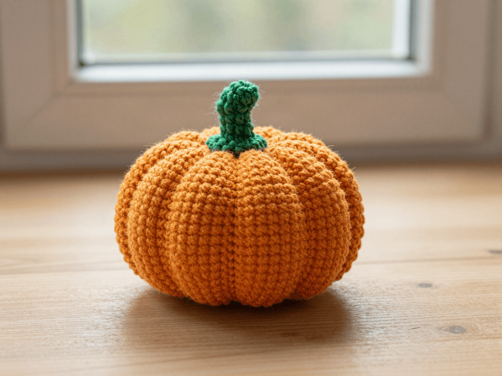
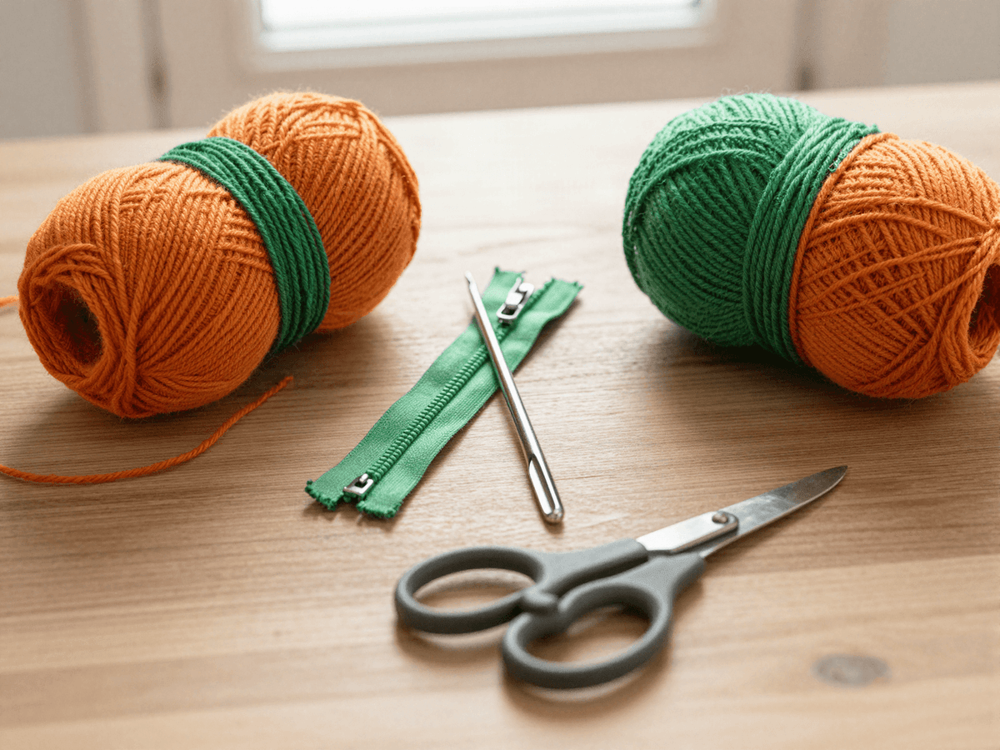
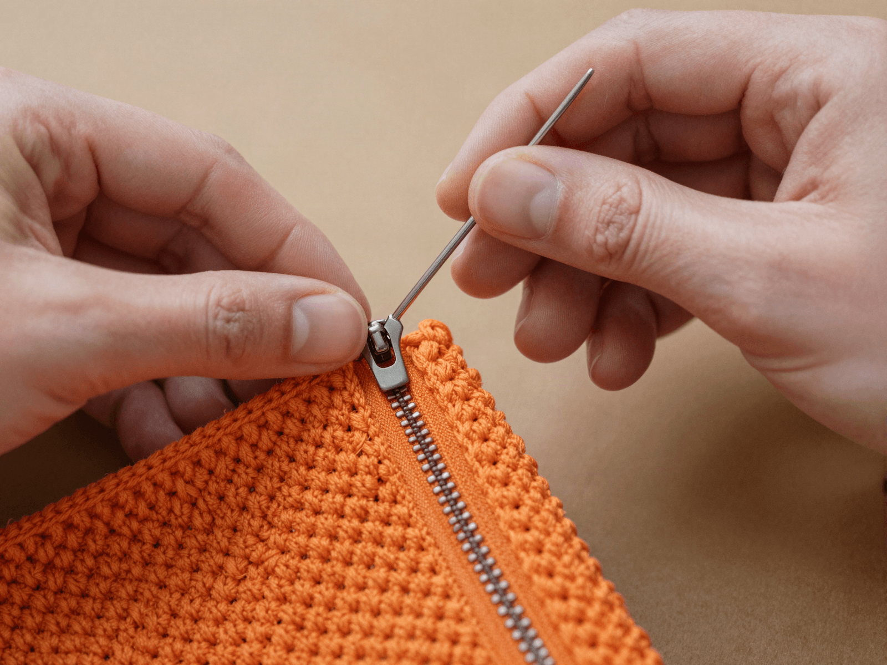

Wrapped candy and lip balm disappear in a tote. A small zipped pouch keeps them together and stops them walking out when the bag tips. This one is orange, with a green stem, so it reads as a pumpkin in October and as a small orange pouch the rest of the year.

The crochet is a flat circle with straight sides. The real lesson is the zipper. A zipper is straight, the top of the pouch is round, and crochet stretches where zipper tape does not. This page explains how long the zipper should be, where its ends go, and how to sew it by hand so it opens without catching.

US terms. US single crochet is UK double crochet. [Abbreviations](/crochet-abbreviations-chart/). The pictures are illustrations. No pouch for this page was crocheted or zipped. Sizes are estimates from the example gauge.

## What is a technique, and what is only a plan

| Piece of this page | What it is |
| --- | --- |
| Flat circle increasing by 6, then even rounds | Standard construction. |
| A round rim pinched flat is half its circumference long | Geometry. |
| Zipper sewn by hand behind the top edge | A standard way to set a zipper into knit or crochet fabric. |
| 4 sc and 5 rounds to the inch | An unverified example gauge. |
| About 70 yards | An old line. Not weighed. Withdrawn. |

## How the pouch is built

Rounds 1 to 8 make a flat circle of 48 stitches. Rounds 9 to 23 are even, so the edge turns up into a cup about 3 inches tall. That cup is the pouch. A zipper is sewn inside the top edge, and a short green chain on the outside is the stem.

It is not stuffed. For a solid round pumpkin, see the [pumpkin pattern](/how-to-crochet-a-pumpkin-step-by-step/). The drawstring version is the [pumpkin treat bag](/how-to-crochet-a-pumpkin-treat-bag/).

### How a straight zipper meets a round top

Pinch the rim so two opposite stitches meet, and it flattens into a straight opening. Its length is half the circumference. Forty-eight stitches at 4 per inch is 12 inches around, so the flattened opening is about **6 inches**.

The zipper's teeth should be a little shorter than that. A 5 inch zipper leaves about half an inch at each end. You close those ends with a few stitches joining front to back, which also keeps the zipper stops from sitting on the folds, where they would strain. A zipper longer than the opening will not lie flat. The extra has to fold somewhere, and it buckles the rim.

<figure class="diagram">

<figcaption>Half the circumference is the longest zipper that fits. A little shorter, with the ends closed, sits flatter.</figcaption>
</figure>

## Yarn, zipper, and tools

- **Worsted cotton**, orange, and a few yards of green for the stem. Cotton holds its edge against the zipper tape. Fuzzy yarn gets caught in the teeth. [Yarn weights](/yarn-weight-chart/).
- **US G/6 (4.0 mm) hook**, or the size that gives firm fabric. [Hook chart](/crochet-hook-size-conversion-chart/).
- **A closed-end zipper**, about 5 inches. Nylon coil is light and flexible. A metal zipper is heavier than the pouch.
- **Sewing needle and thread** that matches the zipper tape, pins or clips, a yarn needle, scissors.

## The worked example

| Part | Arithmetic | Result |
| --- | --- | --- |
| Around | 48 ÷ 4 | 12 in |
| Across the base | 12 ÷ 3.14 | about 3.8 in |
| Wall | 15 rounds ÷ 5 | 3 in |
| Flattened opening | 12 ÷ 2 | 6 in |
| Zipper | a little under 6 in | 5 in, about 0.5 in closed at each end |

If your circle has a different count, the opening is always half of it. At 4 stitches per inch, 42 stitches gives a 5.25 inch opening, which wants a zipper of about 4.5 inches.

## Stage 1: the base

These counts are for joined rounds: slip stitch to the first stitch, then ch 1, which does not count. To spiral instead, skip the join and the ch 1, and mark the first stitch.

**Round 1:** 6 sc in a [magic ring](/crochet-in-the-round/). (6)

**Round 2:** 2 sc in each stitch. (12)

**Round 3:** (Sc, 2 sc in next) 6 times. (18)

**Round 4:** (Sc 2, 2 sc in next) 6 times. (24)

**Round 5:** (Sc 3, 2 sc in next) 6 times. (30)

**Round 6:** (Sc 4, 2 sc in next) 6 times. (36)

**Round 7:** (Sc 5, 2 sc in next) 6 times. (42)

**Round 8:** (Sc 6, 2 sc in next) 6 times. (48)

<figure class="diagram">

<figcaption>Step 1. Round 8 ends on 48 stitches, 12 inches around at 4 sc per inch.</figcaption>
</figure>

**Checkpoint:** lay it flat. About 3.8 inches across at the example gauge. A cup means the tension is tight; a ruffle means extra increases. Fix it now. A wavy base rocks on the table.

## Stage 2: the sides

**Rounds 9–23:** Sc in each stitch. (48)

<figure class="diagram">

<figcaption>Step 2. Fifteen even rounds turn the flat base up into a 3 inch wall.</figcaption>
</figure>

Fifteen even rounds, about 3 inches. Count once in the middle. A gained stitch makes the rim longer than the zipper expects. Fasten off and weave the end down the inside.

Optional ribs: with a darker orange, work a line of surface slip stitch from the center of the base up the side to the rim, six times, starting above each increase line. It is decoration and does not change the size.

## Stage 3: the zipper

1. **Close the zipper.** A closed zipper lies straight and keeps the two sides level.
2. **Find the ends of the opening.** Pinch the rim flat. Mark the two folds with pins. The opening between them is about 6 inches.
3. **Close the ends.** Center the zipper. About half an inch of rim remains at each end. Whipstitch front edge to back edge across that half inch, with yarn.
4. **Pin the tape behind the crochet.** On each side, the tape goes on the inside, with the teeth just below the top edge of the crochet. The two crochet edges should almost meet over the teeth, with a little space so they do not get caught.
5. **Sew with thread.** Backstitch through the tape and the top round of crochet, about a quarter inch from the teeth. Catch the tape, never the teeth. Space the stitches evenly. The crochet edge may be slightly longer than the tape, so ease it on rather than stretching the tape.
6. **Tack the tape ends.** Fold each tape end down at an angle inside and stitch it so it does not scratch.
7. **Open and close it.** If the pull drags on a stitch, that section is too close to the teeth. Unpick and move it out.

Do not crochet into the zipper tape. Its weave is not made for a hook, and a crocheted join usually ripples.

## Stage 4: the stem

With green, join on the outside of the pouch, right next to one end of the zipper. Chain 8. Slip stitch in the second chain from the hook and in each chain back down. Slip stitch into the pouch to anchor it. Fasten off. If the stem flops into the zipper pull, it is too long. Remake it with ch 6.

## Troubleshooting

**The rim waves along the zipper.** The crochet was stretched onto the tape, or the zipper is too long for the opening.

**The zipper bulges at the ends.** The ends of the opening were not closed, so the stops sit on the folds.

**The pull catches.** Stitches went too close to the teeth.

**The zipper will not open.** You sewed both tapes together. Open it every few stitches as you sew.

**The pouch rocks.** The base ruffles. Rework it with fewer increases.

## Care

Empty it. Hand wash cool if the zipper is nylon. Dry flat with the zipper open so the tape does not dry curled. Do not iron a nylon coil.

## Frequently asked

**Can I skip the zipper?**

Yes. Work an eyelet round near the top on the even count of 48 and use a cord, as in the [ghost coin pouch](/how-to-crochet-a-ghost-coin-pouch/).

**Will it hold a phone?**

No. Twelve inches around and 3 inches tall is for candy and small things. A phone needs its own measurements: [phone case](/how-to-crochet-a-phone-case/).

**Can I use a sewing machine?**

Crochet stretches and shifts under a presser foot. Hand sewing is easier to control on fabric this thick.

## Next

A drawstring version, sized from what goes inside, is the [makeup pouch](/how-to-crochet-a-makeup-pouch/). A white bag for more candy is the [ghost candy bag](/how-to-crochet-a-ghost-candy-bag/).
